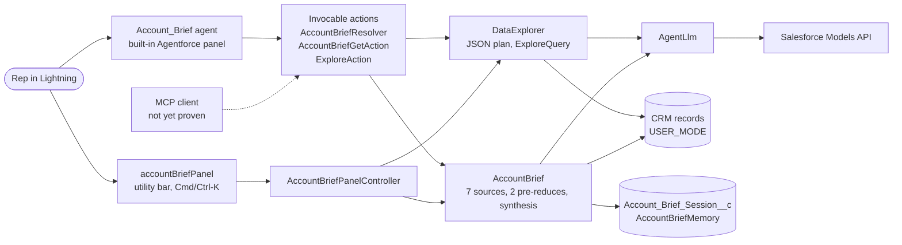

# Account Brief: a reusable Agentforce baseline

**One keystroke in Salesforce gives a rep a sourced account brief or an answer about their CRM
data, using only the records that rep is allowed to see.**


This repo is a working Salesforce DX project. It holds an Agentforce Employee agent, a Lightning
utility-bar panel, and the Apex behind both. Each part is written up as a pattern you can copy
into your own org. Everything under the agent is Apex. There are no Flows and no prompt template
metadata: prompts are plain-text static resources.

## What you get

| # | Pattern | Business outcome | Page |
|---|---|---|---|
| 1 | Route, gather, reduce | A full account brief in one ask. Every fact comes from the CRM, and the model only writes it up. | [01](docs/patterns/01-route-gather-reduce.md) |
| 2 | Ask-anything explorer | Org-wide questions answered with a table, and rows open to their related records. The model never writes SOQL. | [02](docs/patterns/02-ask-anything-explorer.md) |
| 3 | Hotkey panel | Cmd/Ctrl-K from any page in the app. No tab switching and no lost place. | [03](docs/patterns/03-hotkey-panel.md) |
| 4 | Model provider seam | One class decides which model runs. You can swap it without touching the features. | [04](docs/patterns/04-model-provider-seam.md) |
| 5 | Conversation memory | Follow-ups work, and earlier briefs of an account are listed when you come back. | [05](docs/patterns/05-conversation-memory.md) |
| 6 | Agent routing and verbatim relay | The built-in Agentforce panel sends each ask to the same Apex as the custom panel. Version 2 of the current script is active in `agent-probe`; the org it was first built in still runs the older version 1. | [06](docs/patterns/06-agent-routing-and-verbatim-relay.md) |
| 7 | Trust, access and failure | Users see only what they can already see. Failures read as one plain sentence, never a stack trace. | [07](docs/patterns/07-trust-access-and-failure.md) |
| 8 | Test and release lifecycle | Every change passes local, org and agent checks before anyone relies on it. | [08](docs/patterns/08-test-and-release-lifecycle.md) |
| 9 | Outside door (MCP) | AI clients outside Salesforce can ask for the same brief under the same rules. Designed, not yet proven. | [09](docs/patterns/09-outside-door-mcp.md) |

## System map



The panel calls Apex directly, so it answers in one request. The agent reaches the same Apex
through invocable actions. Both paths share one engine, one model door and one access rule.

## See it in 5 minutes

You need an org with Einstein generative AI and Agentforce turned on, the Salesforce CLI
signed in to it, and at least one Account with some contacts, deals and cases.

1. **Deploy the metadata, without the agent and without `Account_Brief_Agent_Access`.** That set
   names the `Account_Brief` agent, which does not exist until step 3, so it cannot deploy yet.

   ```sh
   sf project deploy start -o <org-alias> \
     --source-dir force-app/main/default/classes \
     --source-dir force-app/main/default/lwc \
     --source-dir force-app/main/default/staticresources \
     --source-dir force-app/main/default/objects \
     --source-dir force-app/main/default/messageChannels \
     --source-dir force-app/main/default/flexipages \
     --source-dir force-app/main/default/applications \
     --source-dir force-app/main/default/permissionsets/Account_Brief_Data_Access.permissionset-meta.xml
   sf org assign permset -o <org-alias> -n Account_Brief_Data_Access
   ```

   The panel works from here (step 5). If the CLI classifies your org as production, a plain
   deploy is refused: run the same `--source-dir` list with `sf project deploy validate
   --test-level RunLocalTests --wait 30`, then `sf project deploy quick --job-id <id> --wait 30`.
   Do the same for step 4. The recorded run did this ([org-migration.md](docs/research/org-migration.md)).

2. **Load the sample data** (optional, for an org with no accounts). The plan is
   `data/sample/sample-data-plan.json`; the script reads it and imports 107 records:

   ```sh
   SF_TARGET_ORG=<org-alias> bash scripts/seed-sample-data.sh
   ```

3. **Publish and activate the agent** (one step; the full lifecycle is in
   [08](docs/patterns/08-test-and-release-lifecycle.md)):

   ```sh
   bash scripts/agent-check.sh
   sf agent publish authoring-bundle --api-name Account_Brief -o <org-alias> --skip-retrieve --json
   sf agent activate --api-name Account_Brief --version <n> -o <org-alias> --json
   ```

   Publishing needs the Apex from step 1 in the org. `<n>` is the version number the publish
   reports (1 in a new org). Publishing rewrites files in the bundle folder: run
   `git checkout -- force-app/main/default/aiAuthoringBundles/Account_Brief` afterwards.

4. **Deploy `Account_Brief_Agent_Access` now that the agent exists, then the group.** Assign the
   group, not the sets one by one:

   ```sh
   sf project deploy start -o <org-alias> \
     --source-dir force-app/main/default/permissionsets/Account_Brief_Agent_Access.permissionset-meta.xml
   sf project deploy start -o <org-alias> \
     --source-dir force-app/main/default/permissionsetgroups
   sf org assign permset -o <org-alias> -n Account_Brief_User
   ```

   The group `Account_Brief_User` holds `Account_Brief_Data_Access` and `Account_Brief_Agent_Access`,
   so assign it only after both sets exist. Assigning only one of the two can make every agent
   turn fail. For the built-in Agentforce panel the user also needs Salesforce's standard
   `CopilotSalesforceUser` permission set. The [agent re-review](docs/reviews/agent-review-2.md)
   cites that name and the org-migration run did not confirm it, so check it exists in your org
   (Setup, Permission Sets) before assigning it. The run in `agent-probe` assigned the two sets
   directly; the group deploy and assignment are not part of that record. Not yet proven: use by
   a non-admin user.

5. Open the org with `sf org open -o <org-alias>` and pick **Account Brief** in the App Launcher.
   Press **Cmd-K** on a Mac or **Ctrl-K** elsewhere. Type `/brief <account name>` and press Enter.
   Any other text is a question for the explorer, such as "How many open opportunities are there?".

In `agent-probe`, a fresh Developer Edition org, main's bundle published on the first try as
version 1 ([org-migration.md](docs/research/org-migration.md)), and version 2, published over it,
is now the active version ([agent-iteration-1.md](docs/research/agent-iteration-1.md)). In the
org this was first built in, every CLI publish fails with a server `401`, and Studio's Commit
Version fails too with a "couldn't commit a version" message; its network response was not
captured, so whether it is the same `401` is not known
([agent-publish-spike.md](docs/research/agent-publish-spike.md)). The panel path does not depend
on publishing.

## How it is tested

| Layer | What it checks | Command |
|---|---|---|
| Python | Metadata shape: agent script rules, permission sets, the app, the gate scripts | `python3 -m unittest discover -s tests` |
| Apex | Engine, sections, resolver, memory, explorer, model door and controller. No test calls a model. | `bash scripts/validate-org.sh`: a check-only deploy that runs every `*Test` class and saves nothing |
| Jest | The panel: hotkey, latest request wins, focus, live region, drill, axe | `npm run test:unit` |
| Playwright | The panel in a real org, 8 specs | `npm run test:e2e` (see [e2e/README.md](e2e/README.md)) |
| Agent compile | The Agent Script compiles locally and validates in the org | `bash scripts/agent-check.sh` |
| Agent test spec | 12 utterances with expected routes and outcomes | [Account_Brief-testSpec.yaml](tests/agent/Account_Brief-testSpec.yaml): `sf agent test create --spec <file> --api-name <test-name> -o <org-alias>`, then `sf agent test run --api-name <test-name> --wait 5 --json -o <org-alias>` on an active version |
| Studio preview | Every spec case run live against the draft agent | Recorded in [studio-preview.md](docs/research/studio-preview.md) |

The method behind the layers is in [08: Test and release lifecycle](docs/patterns/08-test-and-release-lifecycle.md).

## Repo map

| Path | What is there |
|---|---|
| `force-app/main/default/aiAuthoringBundles/Account_Brief/` | The agent, in Agent Script |
| `force-app/main/default/classes/` | All Apex: the brief engine and its 7 sections, the explorer, the model door, memory, the panel controller, and a test class for each |
| `force-app/main/default/lwc/accountBriefPanel/` | The utility-bar panel and its Jest tests |
| `force-app/main/default/staticresources/` | The four prompts (`AgentPrompt_*`) |
| `force-app/main/default/objects/Account_Brief_Session__c/` | The memory object |
| `force-app/main/default/permissionsets/` | `Account_Brief_Data_Access` and `Account_Brief_Agent_Access` |
| `force-app/main/default/applications/`, `flexipages/`, `messageChannels/` | The app, its utility bar and the `AccountBriefOpen` channel |
| `tests/` | Python metadata tests and the agent test spec |
| `e2e/` | The Playwright suite |
| `scripts/` | The gates: `validate-org.sh`, `agent-check.sh`, `apex-scan.sh` |
| `docs/patterns/` | The nine pattern pages |
| `docs/ARCHITECTURE.md` | The engineer reference: class map, how to add a source or a provider, rules |
| `docs/reviews/`, `docs/research/` | The code reviews and recorded platform probes this README points to |

## Status

| Item | Status | Evidence |
|---|---|---|
| Brief engine, explorer, memory, controller | Proven by Apex tests | The `*Test.cls` classes in `force-app/main/default/classes/`, run by `scripts/validate-org.sh` |
| Panel behaviour | Proven by Jest | [accountBriefPanel.test.js](force-app/main/default/lwc/accountBriefPanel/__tests__/accountBriefPanel.test.js) |
| Agent routing, 12 cases | Proven in Studio preview against the draft, before the last explorer fixes, and by the agent test run in `agent-probe` (below) | [studio-preview.md](docs/research/studio-preview.md), [org-migration.md](docs/research/org-migration.md) |
| Calling the agent from Apex | Proven by a two-turn probe | [agent-api.md](docs/research/agent-api.md) |
| An MCP server lists and adds the actions as tools | Proven by a probe | [salesforce-mcp.md](docs/research/salesforce-mcp.md) |
| Real deploy of main to the org | Proven in the org this was first built in and in `agent-probe`: 60 components, 150 of 150 Apex tests in each | [deploy-verify.md](docs/research/deploy-verify.md), [org-migration.md](docs/research/org-migration.md) |
| Panel in a real org | Proven as an admin user: 8 of 8 Playwright specs, on the first run in the org this was built in, and in `agent-probe` (3.1 minutes, the run in the e2e report; the first run there passed 7 of 8, and spec 2 has failed now and then since, cause not found, see [e2e/README.md](e2e/README.md)) | [deploy-verify.md](docs/research/deploy-verify.md), [e2e report](docs/assets/e2e-report.png) |
| Code reviews of main | Apex: ready with fixes. Panel: ready with fixes. Agent: **not ready**, one blocker (no fixed version can be published in the org this was built in; it has since been published in `agent-probe`) | [apex-review-2.md](docs/reviews/apex-review-2.md), [lwc-review-2.md](docs/reviews/lwc-review-2.md), [agent-review-2.md](docs/reviews/agent-review-2.md) |
| A run as a non-admin user | **Not yet proven** | Only Apex `runAs` tests so far; see [07](docs/patterns/07-trust-access-and-failure.md) |
| A real MCP tool call | **Not yet proven** | See [09](docs/patterns/09-outside-door-mcp.md) |
| The panel calling the registered agent | **Not yet proven**, not built | See [06](docs/patterns/06-agent-routing-and-verbatim-relay.md) |
| The fixed script published and active | Proven in `agent-probe`: version 2, published from main, is active. In the org this was first built in, every CLI publish returns `401` and Studio's Commit Version also fails, and version 1 there is still the script before the fixes | [agent-iteration-1.md](docs/research/agent-iteration-1.md), [org-migration.md](docs/research/org-migration.md), [agent-publish-spike.md](docs/research/agent-publish-spike.md) |
| A version 2 published over an active version | Proven in `agent-probe`: version 2 was published while version 1 was active, then activated in its place | [agent-iteration-1.md](docs/research/agent-iteration-1.md) |
| Agent test spec run in the org | Proven in `agent-probe`: 16 of 16 cases against the active version 2. Explore history across turns was checked only in a preview of the local bundle. Version 1 passed the earlier 12 cases, 36 of 36 assertions | [agent-iteration-1.md](docs/research/agent-iteration-1.md), [org-migration.md](docs/research/org-migration.md) |
| A clean install from "See it in 5 minutes" | **Not fully proven.** Main was stood up in a fresh org (`agent-probe`) in the order recorded in org-migration.md, and needed two sample-data fixes on the way (PR #72 and PR #74). The steps above, as now written, have not been run end to end in a new org | [org-migration.md](docs/research/org-migration.md) |
