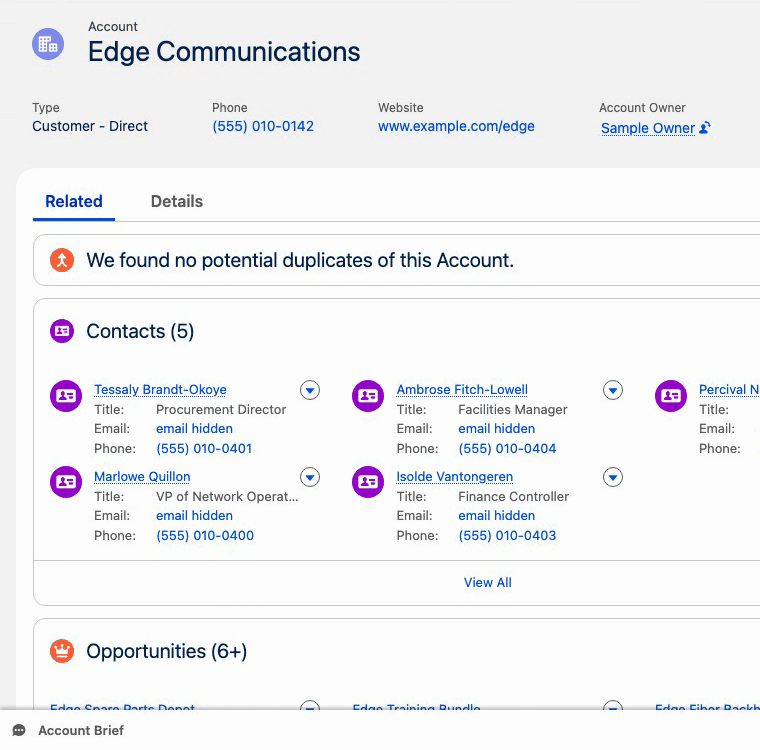

# Account Brief: a reusable Agentforce baseline

**One keystroke in Salesforce gives a rep a sourced account brief or an answer about their CRM
data, using only the records that rep is allowed to see.**



This repo is a working Salesforce DX project. It holds an Agentforce Employee agent, a Lightning
utility-bar panel, and the Apex behind both. Each part is written up as a pattern you can copy
into your own org. Everything under the agent is Apex. There are no Flows and no prompt template
metadata: prompts are plain-text static resources.

## What you get

| # | Pattern | Business outcome | Page |
|---|---|---|---|
| 1 | Route, gather, reduce | A full account brief in one ask. Every fact comes from the CRM, and the model only writes it up. | [01](docs/patterns/01-route-gather-reduce.md) |
| 2 | Ask-anything explorer | Org-wide questions answered with a table, and rows open to their related records. The model never writes SOQL. | [02](docs/patterns/02-ask-anything-explorer.md) |
| 3 | Hotkey panel | Cmd/Ctrl-K from any page in the app. No tab switching and no lost place. | [03](docs/patterns/03-hotkey-panel.md) |
| 4 | Model provider seam | One class decides which model runs. You can swap it without touching the features. | [04](docs/patterns/04-model-provider-seam.md) |
| 5 | Conversation memory | Follow-ups work, and earlier briefs of an account are listed when you come back. | [05](docs/patterns/05-conversation-memory.md) |
| 6 | Agent routing and verbatim relay | The built-in Agentforce panel sends each ask to the same Apex as the custom panel. Previewed, but the current script is not live yet. | [06](docs/patterns/06-agent-routing-and-verbatim-relay.md) |
| 7 | Trust, access and failure | Users see only what they can already see. Failures read as one plain sentence, never a stack trace. | [07](docs/patterns/07-trust-access-and-failure.md) |
| 8 | Test and release lifecycle | Every change passes local, org and agent checks before anyone relies on it. | [08](docs/patterns/08-test-and-release-lifecycle.md) |
| 9 | Outside door (MCP) | AI clients outside Salesforce can ask for the same brief under the same rules. Designed, not yet proven. | [09](docs/patterns/09-outside-door-mcp.md) |

## System map


The panel calls Apex directly, so it answers in one request. The agent reaches the same Apex
through invocable actions. Both paths share one engine, one model door and one access rule.

## See it in 5 minutes

You need an org with Einstein generative AI and Agentforce turned on, the Salesforce CLI
signed in to it, and at least one Account with some contacts, deals and cases.

1. Deploy the metadata. Leave the agent bundle out: it has its own lifecycle (see the note below).

   ```sh
   sf project deploy start -o <org-alias> \
     --source-dir force-app/main/default/classes \
     --source-dir force-app/main/default/lwc \
     --source-dir force-app/main/default/staticresources \
     --source-dir force-app/main/default/objects \
     --source-dir force-app/main/default/messageChannels \
     --source-dir force-app/main/default/flexipages \
     --source-dir force-app/main/default/applications \
     --source-dir force-app/main/default/permissionsets
   ```

2. Assign the two permission sets to yourself:

   ```sh
   sf org assign permset -o <org-alias> -n Account_Brief_Data_Access -n Account_Brief_Agent_Access
   ```

3. Open the org with `sf org open -o <org-alias>` and pick **Account Brief** in the App Launcher.
4. Press **Cmd-K** on a Mac or **Ctrl-K** elsewhere. Type `/brief <account name>` and press Enter.
   Any other text is a question for the explorer, such as "How many open opportunities are there?".

`Account_Brief_Agent_Access` names the agent. On an org where the `Account_Brief` agent does not
exist yet, that set may not deploy: leave it out of steps 1 and 2 and add it once the agent is
published. The panel needs only `Account_Brief_Data_Access`.

The agent in the built-in Agentforce panel needs one more step: publish and activate the
`Account_Brief` bundle. In the org this was built in, every CLI publish fails with a server
`401`, and Studio's Commit Version fails too with a "couldn't commit a version" message; its
network response was not captured, so whether it is the same `401` is not known
([agent-publish-spike.md](docs/research/agent-publish-spike.md)). The plan's morning notes report,
second-hand, that a minimal agent that failed there publishes in a fresh Developer Edition org, so
the fault looks specific to that org ([gtm-burn-plan.md](docs/plans/gtm-burn-plan.md)). The panel
path above does not depend on it.

## How it is tested

| Layer | What it checks | Command |
|---|---|---|
| Python | Metadata shape: agent script rules, permission sets, the app, the gate scripts | `python3 -m unittest discover -s tests` |
| Apex | Engine, sections, resolver, memory, explorer, model door and controller. No test calls a model. | `bash scripts/validate-org.sh`: a check-only deploy that runs every `*Test` class and saves nothing |
| Jest | The panel: hotkey, latest request wins, focus, live region, drill, axe | `npm run test:unit` |
| Playwright | The panel in a real org, 8 specs | `npm run test:e2e` (see [e2e/README.md](e2e/README.md)) |
| Agent compile | The Agent Script compiles locally and validates in the org | `bash scripts/agent-check.sh` |
| Agent test spec | 12 utterances with expected routes and outcomes | [Account_Brief-testSpec.yaml](tests/agent/Account_Brief-testSpec.yaml): `sf agent test create --spec <file> --api-name <test-name> -o <org-alias>`, then `sf agent test run --api-name <test-name> --wait 5 --json -o <org-alias>` on an active version |
| Studio preview | Every spec case run live against the draft agent | Recorded in [studio-preview.md](docs/research/studio-preview.md) |

The method behind the layers is in [08: Test and release lifecycle](docs/patterns/08-test-and-release-lifecycle.md).

## Repo map

| Path | What is there |
|---|---|
| `force-app/main/default/aiAuthoringBundles/Account_Brief/` | The agent, in Agent Script |
| `force-app/main/default/classes/` | All Apex: the brief engine and its 7 sections, the explorer, the model door, memory, the panel controller, and a test class for each |
| `force-app/main/default/lwc/accountBriefPanel/` | The utility-bar panel and its Jest tests |
| `force-app/main/default/staticresources/` | The four prompts (`AgentPrompt_*`) |
| `force-app/main/default/objects/Account_Brief_Session__c/` | The memory object |
| `force-app/main/default/permissionsets/` | `Account_Brief_Data_Access` and `Account_Brief_Agent_Access` |
| `force-app/main/default/applications/`, `flexipages/`, `messageChannels/` | The app, its utility bar and the `AccountBriefOpen` channel |
| `tests/` | Python metadata tests and the agent test spec |
| `e2e/` | The Playwright suite |
| `scripts/` | The gates: `validate-org.sh`, `agent-check.sh`, `apex-scan.sh` |
| `docs/patterns/` | The nine pattern pages |
| `docs/ARCHITECTURE.md` | The engineer reference: class map, how to add a source or a provider, rules |
| `docs/reviews/`, `docs/research/` | The code reviews and recorded platform probes this README points to |

## Status

| Item | Status | Evidence |
|---|---|---|
| Brief engine, explorer, memory, controller | Proven by Apex tests | The `*Test.cls` classes in `force-app/main/default/classes/`, run by `scripts/validate-org.sh` |
| Panel behaviour | Proven by Jest | [accountBriefPanel.test.js](force-app/main/default/lwc/accountBriefPanel/__tests__/accountBriefPanel.test.js) |
| Agent routing, 12 cases | Proven in Studio preview against the draft, before the last explorer fixes | [studio-preview.md](docs/research/studio-preview.md) |
| Calling the agent from Apex | Proven by a two-turn probe | [agent-api.md](docs/research/agent-api.md) |
| An MCP server lists and adds the actions as tools | Proven by a probe | [salesforce-mcp.md](docs/research/salesforce-mcp.md) |
| Real deploy of main to the org | Proven: 60 components, 150 of 150 Apex tests | [deploy-verify.md](docs/research/deploy-verify.md) |
| Panel in a real org | Proven as an admin user: 8 of 8 Playwright specs on the first run | [deploy-verify.md](docs/research/deploy-verify.md), [e2e report](docs/assets/e2e-report.png) |
| Code reviews of main | Apex: ready with fixes. Panel: ready with fixes. Agent: **not ready**, one blocker (no fixed version can be published) | [apex-review-2.md](docs/reviews/apex-review-2.md), [lwc-review-2.md](docs/reviews/lwc-review-2.md), [agent-review-2.md](docs/reviews/agent-review-2.md) |
| A run as a non-admin user | **Not yet proven** | Only Apex `runAs` tests so far; see [07](docs/patterns/07-trust-access-and-failure.md) |
| A real MCP tool call | **Not yet proven** | See [09](docs/patterns/09-outside-door-mcp.md) |
| The panel calling the registered agent | **Not yet proven**, not built | See [06](docs/patterns/06-agent-routing-and-verbatim-relay.md) |
| Agent version 2 published and active | **Not yet proven** | Every CLI publish returns `401` and Studio's Commit Version also fails; version 1, the script before the fixes, is still active. See [agent-publish-spike.md](docs/research/agent-publish-spike.md) |
| Agent test spec run in the org | **Not yet proven** | Written and shape-tested in Python; not run, because it needs the fixed version active |
| A clean install from "See it in 5 minutes" | **Not yet proven** | Main has been deployed to the org it was built in, not installed into a new org from these steps |
