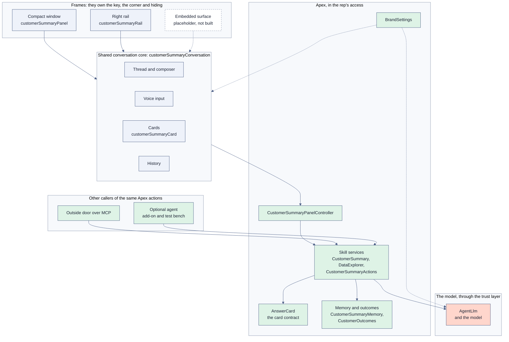
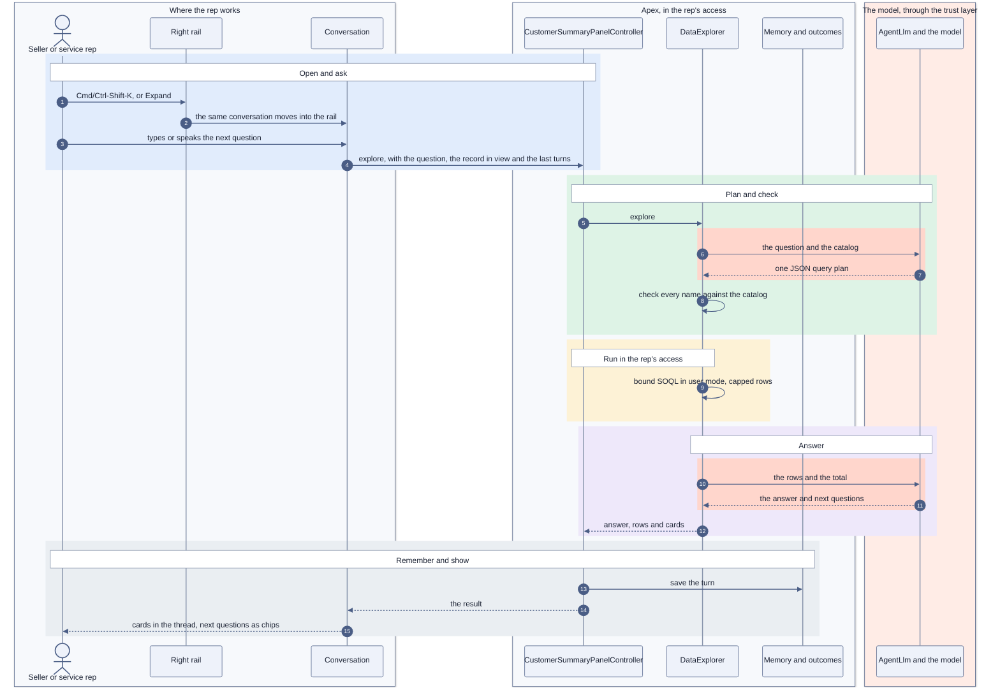
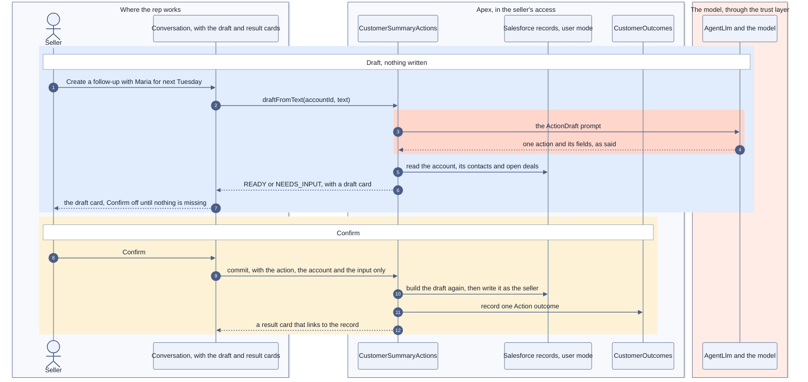
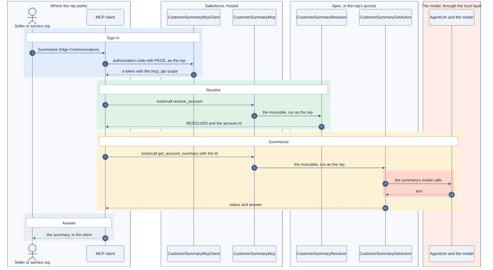

# Customer Summary

**A seller presses one key on any Salesforce page and gets a sourced summary of the account in front of them, then asks
the next question or has a follow-up written down, in their own words. A service rep gets the same picture of a
customer before they reply, built only from the records that rep is allowed to see.**


Customer Summary is one branded agent with three skills, in two surfaces of its own and over MCP. This is Agentforce,
with its own surfaces: the platform's models through its trust layer, behind a compact window and a right rail this
repo controls. It is a Salesforce DX project a team can take as an accelerator, rename for a prospect in one record,
and read as a workbook: one page per architecture pattern.

## Who it is for

- **A seller** mid-task, who wants an account's deals, service and people in one read, and the next question answered
  without leaving the record.
- **A service rep** who wants room to think: the conversation beside the account's deals, activity, cases and history.
- **A seller preparing a demo,** who swaps the agent's name, logo, colours and tone for a prospect's in one record.
- **A builder or an implementation team** who takes a pattern into their own org: each page says what it gives the
  business, how it works, why it is safe and how to adopt it.

## Why not just the standard chat?

In Agentforce's standard chat, every answer passes back through the agent's model, which can reword or shorten it, a
rich card shows only when the model picks it, and every new kind of follow-up is another action to build and publish.
Our surfaces call the same Apex directly, in the rep's own access, and draw every answer as cards. The full case, and
when the standard chat is the better choice, is chapter [Why custom](docs/patterns/00-why-custom.md).

## Three surfaces, one agent

The surfaces are not competing: they are levels of room around one conversation component. The thread, composer,
voice, quick actions, cards and history are the same in each; only the frame differs.

| Surface | Opens with | Use it when | Page |
|---|---|---|---|
| **Compact window** | Cmd-K on a Mac, Ctrl-K elsewhere, or the launcher at the bottom right | A quick answer mid-task, without leaving the record | [03](docs/patterns/03-hotkey-panel.md) |
| **Right rail** | Cmd-Shift-K or Ctrl-Shift-K, the launcher's expand, or Expand in the compact window | Room to think: the conversation beside the account's open deals, recent activity, cases, last summary, history and sentiment | [12](docs/patterns/12-right-rail.md) |
| **Embedded (placeholder, not built)** | On the page, when a call is accepted | A service rep briefed on the caller before they speak | [14](docs/patterns/14-embedded-surface.md), a labelled placeholder |


## The skills

One place to ask, and it picks the skill. One Apex service sits behind each skill, and every surface calls it.

- **Summary.** The one-ask account summary: code gathers each source in the rep's access, and focused prompts write it
  up from those parts only. Up to 4 model calls: engagement, deal history, the synthesis and the sentiment score.
  Pattern [01](docs/patterns/01-route-gather-reduce.md).
- **Ask anything.** The next question in the rep's own words, answered from the CRM data they can see, with rows to
  drill into. The model only plans; Apex checks every name against a catalog of eight objects and runs the query in
  user mode. Pattern [02](docs/patterns/02-ask-anything-explorer.md).
- **Act.** Create a task, create an event, log a call, update a contact, create a case or update an opportunity. Each
  comes back as a draft card that writes nothing; only Confirm writes it, as the rep. Pattern
  [13](docs/patterns/13-write-actions.md).

## Voice

The mic beside the composer turns speech into words in the composer, using the browser's own speech recognition. It
never sends on its own: the rep checks the words and presses Send. Chrome and Edge support it fully, Safari partly and
Firefox not at all; typing always works. Chrome sends the audio to Google's servers to transcribe it. Pattern
[11](docs/patterns/11-voice-input.md).

## Swap the brand in five steps

One record holds the agent name, company name, logo, colours, fonts and tone, and nothing in the components hard-codes
them. The full guide, with every field, is [Brand and theming](docs/patterns/10-brand-and-theming.md#swap-the-brand-step-by-step).

1. **Edit the `Default` record** in `force-app/main/default/customMetadata/Brand_Setting.Default.md-meta.xml`: the
   agent name, the company name, four colours, two fonts and one tone line.
2. **Swap the logo:** add the prospect's logo as a static resource and put its name in `Logo_Resource__c`.
3. **Change the utility item label** in `Customer_Summary_UtilityBar`, which Lightning reads before the panel loads.
4. **Place the history and sentiment components** on the Account record page, if the demo wants them there too.
5. **Redeploy** the custom metadata and static resources (and the flexipage, if step 3 changed it), then reload.

## The MCP door

An AI client outside Salesforce, such as Claude, signs in as the rep and calls the same Apex actions as tools: resolve
an account, get its summary, ask anything, and draft and commit two writes (a task, a logged call). In the test org the
door runs under the Customer Summary names. The first door, under the old product name, is still active beside it
until its removal is approved ([the runbook](docs/research/mcp-door-runbook.md#undo)). Whether a real tool call has run
is in the [Status table](#status). Pattern [09](docs/patterns/09-outside-door-mcp.md).

## Design principles

1. **A follow-up is never a new build:** the explorer answers the next question from the same context, in the rep's access ([02](docs/patterns/02-ask-anything-explorer.md)).
2. **Every answer is richly formatted and shown in cards,** from one typed card contract every surface reads ([03](docs/patterns/03-hotkey-panel.md)).
3. **API first for prompts:** every model call goes through the Models API from Apex, with prompts as files a team can change in minutes ([04](docs/patterns/04-model-provider-seam.md)).
4. **What the product does for a customer is kept against the customer,** as an outcome on the account ([05](docs/patterns/05-conversation-memory.md)).
5. **It sees what the rep sees:** every door runs as the signed-in user, with each system-context use named ([Trust by design](docs/patterns/07-trust-access-and-failure.md)).

## How it fits together

### The shared core and its three frames

The frames own the key, the corner and hiding; everything inside is one conversation component. The embedded frame is
dashed because it is not built. MCP and the optional agent call the same Apex actions.



### Ask from the rail

The numbers match the steps under the diagram. The coral blocks are the model calls; everything else is the browser
and deterministic Apex.



1. **Open and ask (steps 1 to 4).** The rail opens over the page and the one conversation moves into it, thread
   intact. The rep types or speaks; the conversation sends the question, the record in view and the last turns.
2. **Plan and check (steps 5 to 8).** The model answers with a small query plan, never SOQL. Apex checks every object
   and field in it against the catalog.
3. **Run (step 9).** Apex builds the query from catalog paths only, binds every value and runs it as the rep.
4. **Answer (steps 10 to 12).** The model answers from the rows it was shown, and Apex builds the cards.
5. **Remember and show (steps 13 to 15).** The turn is saved to the rep's own session, and the cards are drawn.

### A write action: draft, then Confirm



1. **Draft (steps 1 to 7).** One model call turns the sentence into one action and its fields. Apex checks every field
   against the account and the seller's access and returns a draft card. Nothing is written.
2. **Confirm (steps 8 to 12).** Apex builds the draft again from the same input, writes it in user mode, records the
   outcome and returns a result card. Cancel writes nothing. The full flow, with Fix and Undo, is in
   [13](docs/patterns/13-write-actions.md).

### The MCP door



1. **Sign in (steps 1 to 3).** The rep signs in through one External Client App, per user, with OAuth and PKCE. There
   is no integration user.
2. **Resolve (steps 4 to 6).** `resolve_account` turns the rep's words into one account, or the same fixed not-found
   or choice text the surfaces show.
3. **Summarize (steps 7 to 11).** `get_account_summary` runs the same engine as the surfaces, as the rep.
4. **Answer (step 12).** The client shows the status and the summary. `ask_anything`, `draft_action` and
   `commit_action` follow the same path ([09](docs/patterns/09-outside-door-mcp.md)).

## See it in 5 minutes

You need an org with Einstein generative AI and Agentforce turned on, the Salesforce CLI signed in to it, and at least
one Account with some contacts, deals and cases (or step 2's sample data).

1. **Deploy the metadata.** Every folder under `force-app/main/default` except the agent bundle. Of the permission
   sets, only the two the group holds: the agent and its permission set are optional; see the appendix.

   ```sh
   sf project deploy start -o <org-alias> \
     --source-dir force-app/main/default/applications \
     --source-dir force-app/main/default/classes \
     --source-dir force-app/main/default/customMetadata \
     --source-dir force-app/main/default/flexipages \
     --source-dir force-app/main/default/genAiPromptTemplates \
     --source-dir force-app/main/default/lwc \
     --source-dir force-app/main/default/messageChannels \
     --source-dir force-app/main/default/objects \
     --source-dir force-app/main/default/permissionsets/Customer_Summary_Data_Access.permissionset-meta.xml \
     --source-dir force-app/main/default/permissionsets/Customer_Summary_Outcome_Access.permissionset-meta.xml \
     --source-dir force-app/main/default/permissionsetgroups \
     --source-dir force-app/main/default/reportTypes \
     --source-dir force-app/main/default/staticresources
   ```

   On an org the CLI classifies as production (a Developer Edition org can be), deploy in two steps instead, as the
   recorded runs did: the same `--source-dir` list with `sf project deploy validate --test-level RunLocalTests --wait 30`,
   then `sf project deploy quick --job-id <id> --wait 30`
   ([org-migration.md](docs/research/org-migration.md)).

2. **Load the sample data** (optional, for an org with no accounts). The plan is `data/sample/sample-data-plan.json`;
   the script reads it and imports 107 records:

   ```sh
   SF_TARGET_ORG=<org-alias> bash scripts/seed-sample-data.sh
   ```

3. **Grant access:** assign the permission set group `Customer_Summary_User`.

   ```sh
   sf org assign permset -o <org-alias> -n Customer_Summary_User
   ```

   The group holds `Customer_Summary_Data_Access` and `Customer_Summary_Outcome_Access`, and no agent access: reps
   reach the product through its own surfaces. In the test org, OPS-30 deployed the group and assigned it to the admin
   ([fr2-rename-org.md](docs/research/fr2-rename-org.md)). A run as a user who is not an admin is in the
   [Status table](#status).

4. **Open it.** Run `sf org open -o <org-alias>` and pick **Customer Summary** in the App Launcher. Open an account,
   press **Cmd-K** on a Mac or **Ctrl-K** elsewhere, type `/brief <account name>` and press Enter. Any other text is
   a question, such as "Which of their open deals close this quarter?". Press **Cmd-Shift-K** or **Ctrl-Shift-K** for
   the rail.

The registered Agentforce agent is optional, and none of the steps above need it. To add it to an Agentforce channel, see the appendix, [06](docs/patterns/06-agent-routing-and-verbatim-relay.md#adopt-it).

Then run the checks: npm run ladder, typed as `SF_TARGET_ORG=<org-alias> npm run ladder`: without the variable its org rungs and e2e run against the test org.

## The pattern workbook

One page per pattern, in the order of the [pattern index](docs/patterns/README.md). Each page opens with the business
problem, then the architecture in a few steps, then the detail, and ends with how to adopt it and its open items.
Chapter 00 comes first; 06 is an optional appendix, 07 is the principles page and 14 is a placeholder.

| # | Page | Kind | Business outcome for a seller or a service rep | What it shows a builder |
|---|---|---|---|---|
| 00 | [Why custom](docs/patterns/00-why-custom.md) | chapter | Why the product is Agentforce with its own surfaces and cards, and when the standard chat is enough | Two paths to the same Apex, and what each costs a team |
| 01 | [Route, gather, reduce](docs/patterns/01-route-gather-reduce.md) | chapter | One summary of an account's deals, service and people, built only from records the rep can see | Code routes and gathers; one prompt writes the summary from what was gathered |
| 02 | [Ask anything](docs/patterns/02-ask-anything-explorer.md) | chapter | The next question in their own words, answered from the CRM data they can see, with rows to drill into | The model plans, Apex checks and runs the query; no SOQL from a model |
| 03 | [Hotkey panel](docs/patterns/03-hotkey-panel.md) | chapter | The compact window one key away on any page, so a question never means leaving the record | A utility-bar frame, the hotkeys and the shared card renderer |
| 04 | [Model provider seam](docs/patterns/04-model-provider-seam.md) | chapter | Answers from one model door and prompt files a team can tune in minutes, through the trust layer | One class names the provider; prompts are static resources |
| 05 | [Memory and customer history](docs/patterns/05-conversation-memory.md) | chapter | Follow-ups that know the last answer, and a customer history every new summary starts from | Sessions per rep and account, and outcomes kept against the account |
| 06 | [Appendix: the Agentforce agent (optional)](docs/patterns/06-agent-routing-and-verbatim-relay.md) | appendix | The same skills in the standard Agentforce chat, for a team that wants the registered agent too | An Agent Script that calls the same Apex actions; not a way in |
| 07 | [Trust by design](docs/patterns/07-trust-access-and-failure.md) | principles page | An assistant that sees only what the rep sees, and one plain sentence when something fails | User mode everywhere, each system-context use named and tested |
| 08 | [Testing an AI feature on Salesforce](docs/patterns/08-test-and-release-lifecycle.md) | chapter | Changes that reach them only after a ladder of tests, from Apex to a real browser and the agent | A first test to copy for each kind, and the ladder in one command |
| 09 | [Outside door (MCP)](docs/patterns/09-outside-door-mcp.md) | chapter | The same summary, questions and two writes from an AI client outside Salesforce, signed in as the rep | Apex actions as hosted MCP tools, signed in per user |
| 10 | [Brand and theming](docs/patterns/10-brand-and-theming.md) | chapter | An agent that carries the prospect's or customer's own name, logo, colours and tone | One brand record, CSS variables and the tone line in the prompts |
| 11 | [Voice input](docs/patterns/11-voice-input.md) | chapter | A question spoken instead of typed, landing in the composer to check before sending | The browser's speech API, with no auto-send |
| 12 | [Right rail](docs/patterns/12-right-rail.md) | chapter | A full-height side panel with the conversation, the account's facts, its history and its sentiment | One conversation moved between frames, and a prefetched context call |
| 13 | [Write actions](docs/patterns/13-write-actions.md) | chapter | A follow-up or an update said in their own words, shown as a draft, and written only on Confirm | A draft with no DML, and a commit in user mode |
| 14 | [Embedded surface (call centre)](docs/patterns/14-embedded-surface.md) | placeholder | Not built: the idea of a service rep briefed on the caller as soon as they accept a call | What a real build would have to fit; nothing to adopt yet |

The engineer's map of the whole, with the class list and how to extend it, is [ARCHITECTURE.md](docs/ARCHITECTURE.md).

## Proof

Every count here is copied from a tracked page, with its date. Nothing in this table was run for the README. Whether a
claim has run in a real org is in the [Status table](#status).

| What | Result | Date | Source |
|---|---|---|---|
| Full e2e suite, first run (42 tests, as an admin) | 38 passed, 3 failed, 1 skipped. The 3 failures (drill specs) passed when re-run on their own | 2026-11-14 | [fr2-build-review.md](docs/reviews/fr2-build-review.md) |
| Jest, with jest-axe and sa11y | 11 of 11 suites, 381 of 381 tests; 35 axe assertions in 10 test files | 2026-11-14 | [fr2-build-review.md](docs/reviews/fr2-build-review.md) |
| `bash scripts/agent-check.sh` (the optional agent) | pass: local compile with 0 warnings, and the org validate | 2026-11-14 | [fr2-build-review.md](docs/reviews/fr2-build-review.md) |
| axe on each open surface (WCAG 2.2 AA) | 0 violations at 1440x900; 1 at 1280x720 on the compact window (finding M5) | 2026-11-14 | [fr2-build-review.md](docs/reviews/fr2-build-review.md) |
| Speed: key to first frame, under 300 ms | compact window median 11 ms (`mac`) and 16 ms (`windows`); rail median 14 ms and 17 ms | 2026-11-14 | [fr2-build-review.md](docs/reviews/fr2-build-review.md#speed-budgets) |
| Rail context filled, under 1.5 s | median 304 ms (`mac`) and 323 ms (`windows`) | 2026-11-14 | [fr2-build-review.md](docs/reviews/fr2-build-review.md#speed-budgets) |
| The e2e run in the capture below | 30 passed, 12 not run: the run was cut by a 560 s limit | 2026-11-14 | [fr2-captures.md](docs/research/fr2-captures.md), page [08](docs/patterns/08-test-and-release-lifecycle.md#see-it) |
| The ladder, `npm run ladder -- --continue` | One line per rung, below | 2026-11-14 | [fr2-ladder.md](docs/research/fr2-ladder.md) |
| Testing Center suite for the optional agent | not run in this build: BE-38 waits on its own approval | | |

The ladder's run, as its page recorded it (the sub-lines under each failed rung are left out):

```
ladder: python         passed (1s): Ran 241 tests in 1.208s
ladder: jest           passed (4s): Tests: 265 passed, 265 total
ladder: scan           passed (4s): reported 254 violation(s); skipped the pmd, cpd and sfge engines (the Apex rules): they need Java. Installing Java 11 or later turns them on.
ladder: org-check      passed (242s): pass (147 components, 425 tests)
ladder: drift          failed (exit 2, 15s): differs
ladder: e2e-smoke      failed (exit 1, 70s): 2 failed 5 passed (1.2m)
ladder: FAILED
```

The ladder ran from an earlier commit than the review, so its Jest count is lower. Its page reads the drift and
smoke failures as one cause outside the ladder: the test org carried the rail work before main did.


The report above is the capture run: it was cut by its 560 s limit, so 12 of its 42 tests did not run and show as
skipped. How each layer is tested is chapter [08](docs/patterns/08-test-and-release-lifecycle.md).

## Status

The one place that says whether a run has passed. Pages link here; a row changes only when a tracked file records the
run. Every run below was as an admin user unless the row says otherwise.

| Item | Status | Evidence |
|---|---|---|
| The skill services in Apex: summary, ask anything, actions, memory, outcomes and the controller | Proven by Apex tests: the ladder's check-only org validate passed 425 tests over 147 components (2026-11-14) | [fr2-ladder.md](docs/research/fr2-ladder.md), the `*Test.cls` classes in `force-app/main/default/classes/` |
| The conversation, the compact window, the rail and the cards | Proven by Jest: 381 of 381 tests (2026-11-14) | [fr2-build-review.md](docs/reviews/fr2-build-review.md) |
| Both surfaces in a real org | Proven as an admin user by Playwright: 38 of 42 on the first full run, and the 3 failed drill specs passed on their own; the drill specs fail now and then (M4) | [fr2-build-review.md](docs/reviews/fr2-build-review.md) |
| Deploy of the renamed product to the test org | Proven: validated, then quick-deployed, 62 of 62 components and 251 of 251 Apex tests; the group `Customer_Summary_User` assigned to the admin (2026-11-13) | [fr2-rename-org.md](docs/research/fr2-rename-org.md) |
| Code review of the FR2 build | Ready with fixes: five medium findings (see [Limits](#limits-and-open-items)) | [fr2-build-review.md](docs/reviews/fr2-build-review.md) |
| The optional agent published and active | Proven in the test org: `Customer_Summary` version 2 published and activated, and one turn from Apex answered with a full summary (2026-11-13) | [fr2-agent-publish.md](docs/research/fr2-agent-publish.md) |
| The optional agent's test spec and Testing Center suite | Not run in this build: BE-38 waits on its own approval. The earlier spec runs were on the agent before the rename | [agent-iteration-1.md](docs/research/agent-iteration-1.md), [org-migration.md](docs/research/org-migration.md) |
| A version 2 published over an active version | Proven in the test org, before the rename: version 2 was published while version 1 was active, then activated in its place | [agent-iteration-1.md](docs/research/agent-iteration-1.md) |
| An MCP server lists the actions as tools | Proven by a probe, on the first door | [salesforce-mcp.md](docs/research/salesforce-mcp.md) |
| The panel's button that called the registered agent | Retired (FR2): the button, its Apex client and its spec are removed | [fr2-retire-ask-agent.md](docs/research/fr2-retire-ask-agent.md) |
| A run as a non-admin user | **Not yet proven** | Only Apex `runAs` tests so far; FE-5 is parked. See [07](docs/patterns/07-trust-access-and-failure.md) |
| A real MCP tool call | **Not yet proven** | It waits on an admin's OAuth sign-in; OPS-53 is parked. See [09](docs/patterns/09-outside-door-mcp.md) |
| A clean install from "See it in 5 minutes" | **Not yet proven** | The product was stood up in the test org in the order in [org-migration.md](docs/research/org-migration.md), with fixes on the way; the steps as written here have not been run end to end in a new org (OPS-28). OPS-62 (2026-11-15) ran them in connect-24h, which was not empty (200 Accounts, five other agents, about 70 org Apex classes from the orgfarm template), so this is a new org with no prior Customer Summary build, not an empty org. The README steps as written passed there: the deploy start with the 13 directories (149 of 149 components, no tests, as a Developer Edition deploy), the group assignment, the agent publish and activation, and the agent access set. The ladder passed its python, jest, scan, org-check and drift rungs. Its e2e smoke rung then failed (1 failed, 10 passed) in `e2e/panel.spec.js:98`, the Cmd/Ctrl-K hotkey spec, which timed out waiting for the account's Summarize button in the panel; the sign-in passed, since the global setup now accepts the org's /lightning landing (FE-29). A direct smoke run had passed 11 of 11, so the spec is intermittent here. Not proven until the ladder passes every rung. Earlier attempts on the production validate path failed: 12 tests need the group, which the README gives after the deploy. See [fresh-org-run.md](docs/research/fresh-org-run.md) |
| Runs without the agent | **Not yet proven** | OPS-28's run in a new org, with no agent published, has not passed |
| The microphone in Chrome | **Not yet proven** | Jest uses a mocked recognizer; the by-hand check in [11](docs/patterns/11-voice-input.md) is not recorded (OPS-53, parked) |
| VoiceOver | **Not yet proven** | The five-minute script in [fr2-panel-proof.md](docs/research/fr2-panel-proof.md) has not been run and recorded |

## Limits and open items

The open findings of the [FR2 build review](docs/reviews/fr2-build-review.md#findings), ranked as it ranks them:

- **M1. A rep's conversation text can be read outside our surfaces.** Reps hold read access to the session's turn
  text, so a manager above them, or anyone a row is shared with, can read it through a report or the API.
- **M2. With no speech recognition in the browser, the voice note crushes the composer** to a sliver.
- **M3. The undo token is not signed,** so a client that builds its own token can run an allow-listed update with no
  draft and no Confirm.
- **M4. The drill specs fail now and then** (panel 7, View record 1 and 2), and pass when re-run alone.
- **M5. The compact window's Minimize button fails axe `target-size` at 1280x720,** and the suite scans only at
  1440x900.
- **Low findings L1 to L12:** stale lines in docs and in the code's reasons, the chip row scrolling sideways in the
  compact window, a crowded sentiment chart, two fallback blues, and test rows left on the sample account.

Other open items:

- **The diagrams on this page were not render-checked.** The Mermaid render check in
  [_diagram-theme.md](docs/patterns/_diagram-theme.md#render-check) was not run for this README; OPS-61 has it, and it
  is parked. How they draw on GitHub is unchecked.
- **Confirm has not run in an org.** The approval for tests that create a record is pending, so every draft in the
  e2e runs and the captures stopped at Cancel.
- **The explorer reaches eight curated objects.** Reaching more is BE-31's discovery; its build cards are parked
  ([02](docs/patterns/02-ask-anything-explorer.md#the-scale-out-path)).
- **The first MCP door, under the old product name, is still active** in the test org, and the old Apex classes are
  still there; removing them needs an approved destructive deploy (OPS-54, parked;
  [fr2-rename-org.md](docs/research/fr2-rename-org.md)).
- **The embedded surface is not built;** page 14 records the idea only.
- **The optional agent gets no tone, write actions or cards in FR2** (BE-28, parked).
- **Voice depends on the browser:** none in Firefox, patchy in Safari, and the audio goes to the browser vendor.

## Repo map

| Path | What is there |
|---|---|
| `force-app/main/default/classes/` | All Apex: the three skill services, the resolver, the model door, memory, outcomes, the card contract, brand settings, the controller, and a test class for each |
| `force-app/main/default/lwc/` | `customerSummaryConversation` (the shared core), `customerSummaryPanel` (the compact window), `customerSummaryRail`, `customerSummaryCard`, `customerSummaryVoiceInput`, the history timeline and the sentiment chart, with Jest tests |
| `force-app/main/default/staticresources/` | The prompts (`AgentPrompt_*`) and the brand logos |
| `force-app/main/default/customMetadata/` | The brand record, the prompt settings and the outcome types |
| `force-app/main/default/objects/` | The session object, the outcome object and the three custom metadata types |
| `force-app/main/default/permissionsets/`, `permissionsetgroups/` | The group `Customer_Summary_User` and its two sets; the agent's own set sits outside the group |
| `force-app/main/default/aiAuthoringBundles/Customer_Summary/` | The optional agent, in Agent Script |
| `mcp-door/` | The MCP server definition and its External Client App, kept apart from the normal install |
| `tests/`, `e2e/` | Python metadata tests and the agent test spec; the Playwright suite and the capture kit |
| `scripts/` | The gates and the ladder: `ladder.sh`, `validate-org.sh`, `agent-check.sh`, `apex-scan.sh`, `org-drift.sh`, `check-docs.sh` |
| `docs/patterns/` | The workbook: pages 00 to 14 and their index |
| `docs/ARCHITECTURE.md` | The engineer's map: class list, how to add a source, a provider, an object, an action or a card |
| `docs/reviews/`, `docs/research/`, `docs/plans/` | The reviews, recorded platform runs and plans this README points to |
