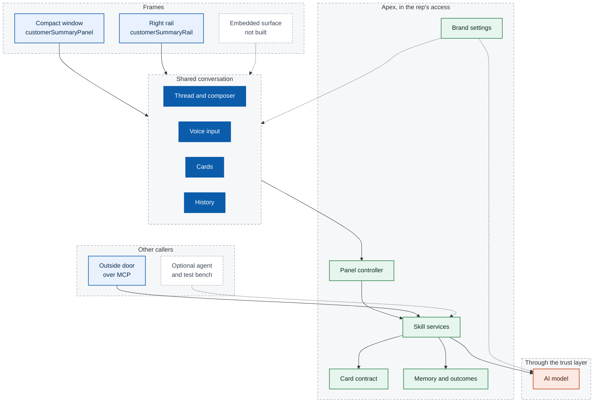
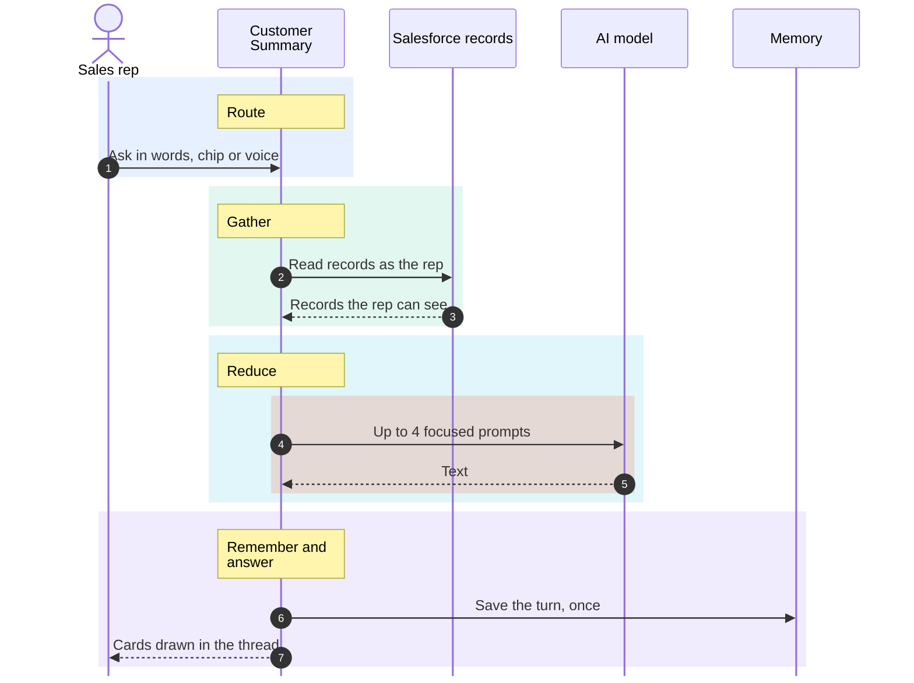

# Architecture

How Customer Summary fits together: three ways in, one service behind each skill, one card contract, and the rules
that keep it inside the rep's own access. This is the map. Each part below is a few lines and a pattern number that
points into [the pattern pages](#the-pattern-pages), which explain it for sellers, service reps and builders. Why the
product has surfaces and cards of its own, and not only the standard chat, is chapter
[Why custom](patterns/00-why-custom.md).

## What the product is

Customer Summary is one branded agent that works like Claude: one place to ask, and it picks the skill. A seller or a
service rep gets a summary of an account, asks the next question in their own words, or asks for a follow-up to be
written down, and every answer comes back as readable cards. It is Agentforce with its own skin: the platform's models
through its trust layer, behind surfaces this repo controls, and every call runs as the signed-in user.

## Three ways in

All three call the same services, and each one reaches only what the rep can see.

- **The compact window.** A small window one key away on any page (Cmd-K or Ctrl-K), with a minimize and an expand.
  Pattern 03.
- **The right rail.** A full-height side panel with the same conversation, plus the account's deals, activity, cases,
  last summary, history and sentiment. It opens with Cmd-Shift-K or Ctrl-Shift-K, or from the compact window's expand.
  Pattern 12.
- **The outside door over MCP.** An AI client outside Salesforce, such as Claude, signs in as the rep and calls tools.
  Every tool is an Apex action, so there is no second set of rules. Pattern 09.

The two surfaces are frames around one conversation component. The frame owns the key, the corner and hiding; the
thread, composer, voice input, quick actions, cards and history are the same in both. A third frame, the embedded surface for a service rep taking a call, is not built: [its placeholder page](patterns/14-embedded-surface.md) records the idea.

**The optional agent is an add-on and a test bench, never a way in.** The registered Agentforce agent calls the same
Apex actions, for a team that also wants the standard chat or wants to test the skills in Agentforce's tooling.
Agentforce's own panel and the agent are not a way in to this product, and the agent is not an MCP tool. Appendix 06.

## One service behind each skill

Each skill is one Apex service. The compact window and the rail call it through one controller
(`CustomerSummaryPanelController`), MCP calls it through the Apex actions, and a team's own agent can call the same
actions.

| Skill | Service | What it does | Pattern |
|---|---|---|---|
| Summary | `CustomerSummary` | Resolves the account, gathers each source in user mode, condenses the noisy parts, then writes the summary from those parts only. Up to 4 model calls: engagement, deal history, the synthesis and the sentiment score | 01 |
| Ask anything | `DataExplorer` | The model fills a JSON query plan; Apex checks it, builds bound SOQL and runs it in user mode. No DML | 02 |
| Act | `CustomerSummaryActions` | Builds a draft that writes nothing, and commits it only on the rep's Confirm. Over MCP the pair is Draft Action and Commit Action | 13 |

Behind them: `CustomerSummaryResolver` turns words into one account, `AgentLlm` is the only door to a model,
`CustomerSummaryMemory` and `CustomerOutcomes` keep what was done, `AnswerCard` builds the cards and `BrandSettings`
holds the brand.

**How a skill is built.** The pattern is route, gather, reduce: code routes the request and gathers records in the
rep's access, then one prompt writes the answer from what was gathered. Apex emits facts and fixed one-line statuses;
prompts write the prose, and a prompt never queries data.

## The card contract

Every answer is a set of typed cards plus its own plain text, built once in Apex (`AnswerCard`) and read by every
surface. A card holds data, never markup: rich text is runs of bold, italic and code, and a record link is a key that
the surface turns into a button. The same cards go out over MCP as JSON next to the text, so an answer reads correctly
even where a card cannot be drawn. One shared component, `customerSummaryCard`, draws them at both widths. Patterns 03
and 12 show them on each surface; the contract itself is in
[the card architecture page](research/fr2-card-architecture.md) and
[its Apex build](research/fr2-card-contract-apex.md).

## The two diagrams

The component diagram shows the shared conversation core (`customerSummaryConversation`) and the frames around it. The theme is the shared one in
[_diagram-theme.md](patterns/_diagram-theme.md).

The sequence diagram follows one question from a surface to an answer with cards. The numbers match the steps under it.
The coral block is the model calls; everything else is the browser and deterministic Apex.

1. **Ask and route (step 1).** The rep types, speaks or taps a chip. The conversation sends the question and the open
   record to the controller (`CustomerSummaryPanelController`), which hands the request to the one service for the
   skill it asks for: a summary, a question or an action. No message of its own is drawn for the hand-off.
2. **Gather (steps 2 and 3).** The service reads records in user mode and builds its context. No model is involved.
3. **Reduce (steps 4 and 5).** Focused prompts condense the noisy parts and write the answer from what was gathered.
   For a summary that is up to 4 model calls; its synthesis prompt is `AgentPrompt_SummarySynthesis`, and `AgentLlm`
   is the door to the model.
4. **Cards.** The service builds the cards and their plain text from data it already holds. This step sends no
   message, so it has no number.
5. **Remember (step 6).** The turn and the outcome are saved once, after every model call, by the memory and outcomes
   classes (`CustomerSummaryMemory`, `CustomerOutcomes`). A failed save is logged and the answer still returns.
6. **Answer (step 7).** The controller returns the cards and the surface draws them in the thread.

## The two memories

- **Conversation history.** One row per rep, account and session: the title, the times and the newest 10 turns. A
  session ends after 30 idle minutes. A rep sees only their own sessions, and only while they can read the account.
  Pattern 05.
- **Customer outcomes.** What the product did for a customer (a summary, an action, a saved answer) is kept against the
  account, with a retention by type. Anyone who can see the account sees an outcome's type, date and sentiment label;
  only its author sees its text, unless its type is marked to share. The next summary and the next question start from
  the rep's own last outcomes. Pattern 05.

## The model door

`AgentLlm` is the only door to a model. It loads a prompt file (`AgentPrompt_<Name>`, plain text with a system part and
a user part), fills its placeholders and calls the provider, by default the platform's Models API. A prompt template is
an opt-in per prompt; swapping a provider changes one class. Prompts are files a team can edit and redeploy in
minutes. Pattern 04.

## Brand settings

One custom metadata record holds the agent name, company name, logo, colours and tone. Each surface sets them as CSS
variables, and the tone is added to the summary and explorer prompts. Nothing hard-codes a name, a colour or a font, so a
seller can rename the agent for a prospect by changing the record. Pattern 10.

## Add a source

To add a source to the summary: write one class that implements `CustomerSummarySource`, add one line to the registry
in `CustomerSummary`, and reference its key in `AgentPrompt_SummarySynthesis` or a pre-reduce. Pattern 01.

## Where else to change things

- **Add a provider:** one class that implements `AgentLlm.Provider`. Pattern 04.
- **Add an object** to what Ask anything can reach: one entry in `ExploreCatalog`. Pattern 02.
- **Add an action** the rep can confirm: one `Spec` in `CustomerSummaryActionCatalog`. Pattern 13.
- **Add a card type:** one Apex builder, one view and one plain-text rule; no surface changes. Pattern 03.

## Why you can trust it

Runs as the signed-in user: every class is `with sharing`, and every read or write of CRM data names user mode
(`WITH USER_MODE` or `AccessLevel.USER_MODE`), so the rep's object, field and record access all apply, in the compact
window, the rail, MCP and the optional agent alike. A failure shows the rep one fixed sentence, never raw error text.

System context: only where the product keeps its own records, each named in the code with a `// system-context:`
marker and its reason. [test_trust_rule.py](../tests/test_trust_rule.py) fails a build that adds a system-context use
with no marker, or a marker with no system-context use. The uses, from the trust-rule page
([fr2-trust-rule.md](research/fr2-trust-rule.md)):

| Class | Where | Why the user's own access is not enough |
|---|---|---|
| `AgentLlm` | `querySettings`, the prompt settings query | The product's own prompt configuration, the same for every user; reps hold no read access to the type |
| `CustomerSummaryMemory` | `write` | The product's own session rows, written for the running user; reps have no write access to the object |
| `CustomerSummaryMemory` | `purgeOverflow` | Deletes the running user's own old session rows; reps have no delete access to the object |
| `CustomerSummaryMemory` | `recentRows` | Reads the running user's own session rows; history() re-checks the account in user mode first |
| `CustomerSummaryMemory` | `findRows` | Reads the running user's own session rows, filtered to their session keys; reps hold read on the object (Customer_Summary_Data_Access), so the read shows them nothing they could not already see |
| `CustomerSummaryMemory` | `findRowsForUpdate` | Locks the running user's own session rows for a write; reps have no write access to the object, so the lock runs in system context |
| `CustomerOutcomes` | `writeText`, `readText` | Reps hold no field access to outcome text (F79); set only on rows just inserted as this user, read only for rows view() shows in full |
| `CustomerOutcomes` | `deleteOwn` | Reps hold no delete on outcomes; the caller has already checked the user is the author |
| `CustomerOutcomeRetentionBatch` | the whole class | The purge deletes every expired outcome, whoever wrote it, and no rep can see them all |

Each use has its guard and its test on the principles page, pattern 07.

Access is granted in one step: assign the permission set group `Customer_Summary_User`. It holds the data-access set
and the outcome-access set and no agent access, because reps reach the product through the surfaces. The agent-access
set sits outside the group, for the optional agent only. What has run in a real org is kept in one place, the README's
[Status table](../README.md#status).

## Tests and release

Local: `python3 -m unittest discover -s tests` and `npm run test:unit`. Org, check-only: `bash scripts/validate-org.sh`.
Docs: `bash scripts/check-docs.sh`. Browser: `npm run test:e2e`. Tests set `AgentLlm.stub`, so no test calls a model.
Pattern 08.

## The pattern pages

The same pages, titles and order as the [pattern index](patterns/README.md). The pattern numbers above refer to this
list.

| # | Page | Kind |
| --- | --- | --- |
| 00 | [Why custom](patterns/00-why-custom.md) | chapter |
| 01 | [Route, gather, reduce](patterns/01-route-gather-reduce.md) | chapter |
| 02 | [Ask anything](patterns/02-ask-anything-explorer.md) | chapter |
| 03 | [Hotkey panel](patterns/03-hotkey-panel.md) | chapter |
| 04 | [Model provider seam](patterns/04-model-provider-seam.md) | chapter |
| 05 | [Memory and customer history](patterns/05-conversation-memory.md) | chapter |
| 06 | [Appendix: the Agentforce agent (optional)](patterns/06-agent-routing-and-verbatim-relay.md) | appendix |
| 07 | [Trust by design](patterns/07-trust-access-and-failure.md) | principles page |
| 08 | [Testing an AI feature on Salesforce](patterns/08-test-and-release-lifecycle.md) | chapter |
| 09 | [Outside door (MCP)](patterns/09-outside-door-mcp.md) | chapter |
| 10 | [Brand and theming](patterns/10-brand-and-theming.md) | chapter |
| 11 | [Voice input](patterns/11-voice-input.md) | chapter |
| 12 | [Right rail](patterns/12-right-rail.md) | chapter |
| 13 | [Write actions](patterns/13-write-actions.md) | chapter |
| 14 | [Embedded surface (call centre)](patterns/14-embedded-surface.md) | placeholder |

## Limits and open items

- The two diagrams were not run through the Mermaid render check written up in
  [_diagram-theme.md](patterns/_diagram-theme.md), and how they draw on GitHub is unchecked. OPS-61 (parked) has the
  check.
- The embedded surface is not built; the placeholder page records the idea only.
- Run status for every part is in the README's [Status table](../README.md#status), and only there.

[Back to the pattern index](patterns/README.md) | [Back to the README](../README.md)
