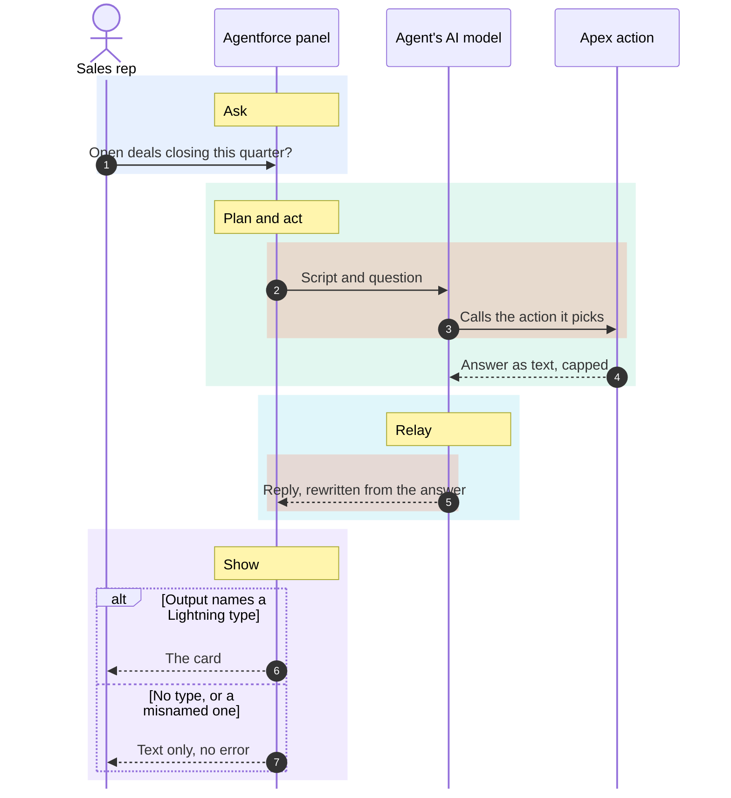
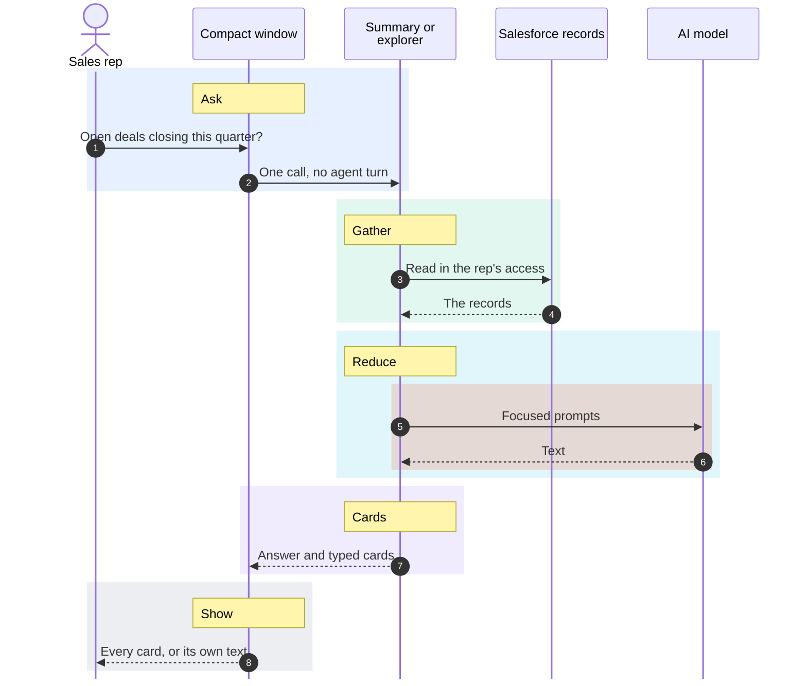

# Why custom

This is Agentforce: the same platform, models and trust layer, with surfaces and cards we control. It is a different
skin, not a rival.

## The business problem

*For the teams who sell it and build it: why we bring our own surfaces and cards instead of only Agentforce's standard
chat.*

In the standard chat a rep asks in Agentforce's own panel, the agent's model picks an action, and the action's answer
goes back through that model before the rep sees it. A team that builds on it meets five costs. Each figure below
was measured in our own org ([BE-32](../research/fr2-standard-limits.md)) or comes from a public Salesforce doc.

- **The agent rewrites a formatted answer's layout, even when told to keep it.** The agent's instructions say to keep
  every line break and label line, and 6 of 6 account summaries still came back with their section labels pulled into the body text ([measured](../research/fr2-standard-limits.md#brief-one-account-summary-through-the-agent)).
- **Teams cap their own answers to stay under a limit nobody has measured.** Our own agent action stops at 5,900 characters, so on one question the agent showed 36 of 47 rows where our panel showed all 47 ([measured](../research/fr2-standard-limits.md#result)).
  Lists are capped the same way in a production Agentforce build we reviewed, and its users get no sign that rows
  were left out. Where the platform's own limit sits is not measured: no existing action returns more than 5,811 characters ([why](../research/fr2-standard-limits.md#what-a-changed-agent-would-add)).
- **Each agent turn takes longer.** The same data questions took 13 to 33 s through the agent and 5 to 9 s on the direct path ([measured](../research/fr2-standard-limits.md#measurements)).
- **Cards cost build cycles.** A card in the standard chat needs a custom
  [Lightning type](https://developer.salesforce.com/docs/platform/lightning-types/guide/lightning-types-core.html), an
  Apex action, and an output setting that names the type and marks it for display
  ([Agent Script actions](https://developer.salesforce.com/docs/ai/agentforce/guide/ascript-ref-actions.html)). A
  misnamed type falls back to plain text with no error message
  ([Salesforce Developers blog](https://developer.salesforce.com/blogs/2026/05/use-custom-lightning-types-in-agent-script-for-rich-agent-ui)),
  so a team finds the mistake only by looking.
- **Every follow-up becomes a new build.** The agent reads CRM data only through actions someone built and published,
  so a new kind of follow-up ("which of those close this quarter?") means another action and another publish. Our
  surfaces answer it with the explorer, from the same context and in the rep's own access, over the objects [pattern 02](02-ask-anything-explorer.md) lists.

What a team gets instead is in [What changes for a team](#what-changes-for-a-team), and when the standard chat is the
better choice is in [When the standard chat fits](#when-the-standard-chat-fits).

## The architecture in a few steps

1. **The rep asks where they work:** the compact window (Cmd-K or Ctrl-K), the right rail
   ([12](12-right-rail.md)), or an MCP client signed in as the rep. The rail is a full-height sheet that slides over the
   page, opened with Cmd-Shift-K or Ctrl-Shift-K, with Expand in the compact window, or with the expand button beside the
   launcher.
2. **The surface calls the Apex services directly,** in the rep's own access. No agent turn sits between the rep and
   the answer.
3. **The services call the platform's models** through the Models API and the trust layer, with prompts the team keeps
   as files ([04](04-model-provider-seam.md)).
4. **The answer and its cards come back in one typed contract,** and the surface draws every card. A card it cannot
   draw shows its own plain text.
5. **The agent stays optional.** A team that also wants the standard chat adds the registered agent, which calls the
   same services ([06](06-agent-routing-and-verbatim-relay.md)).

## How it works

The architecture of the why: two paths to the same Apex. The numbers in each diagram match the steps under it. The
coral blocks are the model calls; everything else is deterministic. The theme is the shared one in
[_diagram-theme.md](_diagram-theme.md).

### The standard chat

1. **Ask (step 1).** The rep types in Agentforce's own panel. Where its launcher sits, its size, a hotkey, history and
   branding are unproven (see [What was measured](#what-was-measured-and-how-to-say-it)).
2. **Plan and act (steps 2 to 4).** The agent's model reads its script and the question and calls an action. The
   action returns its answer as text, under whatever cap its author set.
3. **Relay (step 5).** The answer passes back through the agent's model, which writes the reply from it, before the
   rep sees it. This is where
   a formatted answer's layout is rewritten and where the turn spends its extra time
   ([BE-32](../research/fr2-standard-limits.md#findings)).
4. **Show (steps 6 and 7).** The rep gets one of the two. A card shows only when the action's output setting names a custom Lightning type and marks
   the output for display; otherwise the rep gets text. The output setting decides, not the model, and a misnamed type
   gives text with no error ([BE-32's sources](../research/fr2-standard-limits.md#rich-cards-in-the-standard-chat-public-docs)).

### Our surfaces

1. **Ask (steps 1 and 2).** The rep's question goes to the compact window. It holds the conversation component, and the right rail
   ([12](12-right-rail.md)) moves that same conversation out of the window, so the thread is kept. Either one calls
   `CustomerSummaryPanelController`, which passes each service's result through as the service built it. No agent turn
   and no relay.
2. **Gather (steps 3 and 4).** `CustomerSummary` or `DataExplorer` reads the records in the rep's own access
   (`WITH USER_MODE`): the summary's fixed sections
   ([01](01-route-gather-reduce.md)) or the explorer's checked query plan ([02](02-ask-anything-explorer.md)).
3. **Reduce (steps 5 and 6).** Focused prompts from the team's prompt files are the only model calls on the path,
   through the Models API and the trust layer.
4. **Cards (step 7).** `AnswerCard` builds the cards from data the service already holds, with no new model call
   or query. A summary gives a `summary` card and one `section` card per section. An explorer answer gives a `text`
   card, then a `table`, `metric` or `recordList` card for its result, a `notice` when rows are left out, the `trail`
   of its queries and its `followups`. Every card carries its own plain text, and the panel's table card holds every
   row the explorer read ([BE-39](../research/fr2-card-contract-apex.md#what-the-services-return)).
5. **Show (step 8).** The conversation component draws each card with `customerSummaryCard`, in six layouts.
   A card it cannot draw (an unknown type, a newer version, the action cards it does not draw yet) shows the card's
   own text, and unreadable cards leave the reply's text. Nothing rewrites the answer between the service and the rep.

**What an MCP client gets.** The same services, through the door's three read tools ([09](09-outside-door-mcp.md)
also lists its two write tools). Each tool returns its Apex action's outputs
([BE-39](../research/fr2-card-contract-apex.md#what-an-mcp-client-gets)):

| Tool | Outputs |
| --- | --- |
| `get_account_summary` | `status`, `answer`, and `cards`: the `summary` card and one `section` card per section, as JSON text |
| `ask_anything` | `status`, `answer`, `history`, and `cards`: the explorer's cards as JSON text, the table cut to the rows the `answer` shows, with a `notice` when that is fewer than matched |
| `resolve_account` | `status`, `accountId`, `accountName`, `message`, and `cards`: a `choice` card for a choice of accounts, a `notice` for not found, `[]` otherwise |

Over 60,000 characters the `cards` output is `''`, never cut JSON, and the `answer` is unchanged. A client gets no
card for an earlier turn, no drill, no action cards and no `structuredContent`. How a hosted MCP server lays these
outputs out in a tool result has not been observed, and `cards` has not been read through a signed-in client. A client
that ignores `cards` loses nothing: the `answer` says the same. The registered agent's actions do not declare `cards`,
so the standard chat gets the text alone.

## What was measured, and how to say it

`BE-32` (merged 2026-11-13) ran 24 agent turns against the active agent in our org, as an admin, and the same
questions on the direct path. Every figure here is from [its write-up](../research/fr2-standard-limits.md).

- **Tables were relayed whole.** Up to 5,811 characters, the most any existing action returns, the agent kept every
  row, column and row-count footer in 18 of 18 runs ([measured](../research/fr2-standard-limits.md#explore-an-actions-table-through-the-agent)).
- **Above 5.9k characters: not measured.** No existing action returns more, and a larger one needs a changed agent
  action and a publish ([why](../research/fr2-standard-limits.md#what-a-changed-agent-would-add)).
- **The only cut seen was our own.** Our agent action clips its answer at 5,900 characters; that is where 36 of 47 rows
  came from ([measured](../research/fr2-standard-limits.md#result)).
- **Formatted prose was re-laid out.** In 6 of 6 summaries, the six section labels on their own line became 1. In the
  3 runs that also counted where the labels went, no section went missing, and the lines starting "- " went from 4 to
  0 ([measured](../research/fr2-standard-limits.md#brief-one-account-summary-through-the-agent)).
- **Turns took longer.** An explore turn took 13 to 33 s through the agent against 5 to 9 s direct; a summary 31 to
  36 s against 22 to 25 s ([measured](../research/fr2-standard-limits.md#measurements)).
- **The launcher is unproven.** Where it lives, its size, a hotkey, the rep's own history and branding beyond the
  agent's name have no public doc, and the panel was not opened in a browser in this run
  ([BE-32](../research/fr2-standard-limits.md#the-launcher-and-panel)). So say only what our surfaces add: the compact
  window on Cmd-K or Ctrl-K ([03](03-hotkey-panel.md)), the rep's past conversations behind its History button
  ([05](05-conversation-memory.md)), and one place to brand ([10](10-brand-and-theming.md)). The right rail ([12](12-right-rail.md)) is built: say
  what it shows and how it opens, and nothing about how it pushes the page, a sticky header or a screen reader.

| Say | Do not say |
| --- | --- |
| "In our runs the agent kept every table whole up to 5,811 characters." | "Agentforce cuts long answers," or any character ceiling. |
| "The only cut we saw was our own 5,900-character cap." | "The platform dropped rows." |
| "The agent re-laid out a formatted summary in 6 of 6 runs." | "The agent loses sections." No section went missing. |
| "A turn took 13 to 33 s through the agent, against 5 to 9 s direct." | Any adjective about the platform. |
| "Our compact window opens on a hotkey, keeps your past conversations under History, and is branded in one place." | "The standard panel has no hotkey or history," which is unproven. |
| "A rep can expand the same conversation into a larger rail that slides over the page, with the account's open deals, recent activity, open cases and last summary beside it." | "The rail pushes the page aside," "the rail has a sticky header," or "the rail has been tested with a screen reader." |

## What changes for a team

- **No caps tuned to an unmeasured limit.** The surface shows every row the explorer read: 47 of 47 where the agent
  showed 36 ([BE-32](../research/fr2-standard-limits.md#findings)).
- **Cards that always render.** One typed contract, built in Apex and drawn by one component, with the card's own text
  when a card cannot be drawn. No Lightning type, output setting or publish per card.
- **Follow-ups without new builds.** The explorer answers the next question from the same context, over the objects
  [pattern 02](02-ask-anything-explorer.md) lists.
- **One place to brand.** Brand settings hold the agent's name, the company name, the logo, the colours and the tone,
  and every surface reads them ([10](10-brand-and-theming.md)).

## When the standard chat fits

It is the right choice when ([BE-32's list](../research/fr2-standard-limits.md#fair-to-the-platform)):

- **No code is the point.** Deploying an employee agent is activating it; there is no component, controller or test to
  maintain for the chat itself.
- **One agent should reach several channels.** The same employee agent runs in the Lightning Experience panel, Slack
  and the mobile app, with extra set-up steps for Slack and mobile.
- **The platform's own updates are wanted.** Streaming, progress status and card rendering come with the client, and
  each release adds to them with no work in the org.
- **There is no developer.** Admins build in Agentforce Builder and can create custom Lightning types in Setup.
- **Trust layer features should apply with no wiring:** toxicity detection, prompt defense and audit logging.
- **Answers are short tables.** Every table measured up to 5.8k characters was relayed whole.

The two can live side by side: the registered agent calls the same Apex services as our surfaces
([06](06-agent-routing-and-verbatim-relay.md)).

**Why not Coworker.** Salesforce documents no in-org call to Agentforce Coworker and no way to place its UI in our
page. The extension model it documents is the other way round: our agent, and its Lightning type cards, can show
inside Coworker's UI through delegation, not Coworker's UI inside ours. Whether an agent may be a way in when the door
is Coworker is the product owner's decision under ledger row F83, which stands
([the Coworker spike](../research/fr2-coworker-spike.md)).

## Limits and open items

- **The answer-length ceiling above 5.9k characters is not measured.** Finding it needs a changed agent action and an
  agent publish, and none is planned. No card yet.
- **Why the summary is re-laid out** (the reasoning model or the platform), and whether any word changed: the runs
  counted labels and lines, not words. No card yet.
- **Every relay was run as an admin.** Whether a non-admin rep sees the same relay is not measured. No card yet. The
  non-admin run of our own surfaces is FE-5's.
- **The standard launcher's place, size, hotkey, history and branding are unproven.** No card yet.
- **The rail's own limits are on its page.** See [Limits and open items](12-right-rail.md#limits-and-open-items) on
  page 12.
- **The custom code a customer now maintains.** The surfaces, their controller, the card component and their tests
  are the team's to keep current with each release, where the standard chat gets its updates with no work. No card
  yet.
- **The registered agent gets no cards.** Its actions return text only; adding `cards` is an agent change, and that
  work is parked under BE-28.
- **Follow-ups reach only the explorer's catalog,** the objects pattern 02 lists. Whether it can reach more is
  BE-31's question.
- **A reopened turn shows as text.** The conversation history stores each answer's text, not its cards. No card
  yet.
- **Over MCP,** how a hosted server lays out the outputs is not observed. A real MCP tool call is tracked in the
  README's [Status table](../../README.md#status).
- **The diagrams on this page have not been render-checked.** The check in
  [_diagram-theme.md](_diagram-theme.md#render-check) was not run for this page; only their structure is tested. No
  card yet.

[Back to the pattern index](README.md) | [Back to the architecture page](../ARCHITECTURE.md) | [Back to the README](../../README.md)
