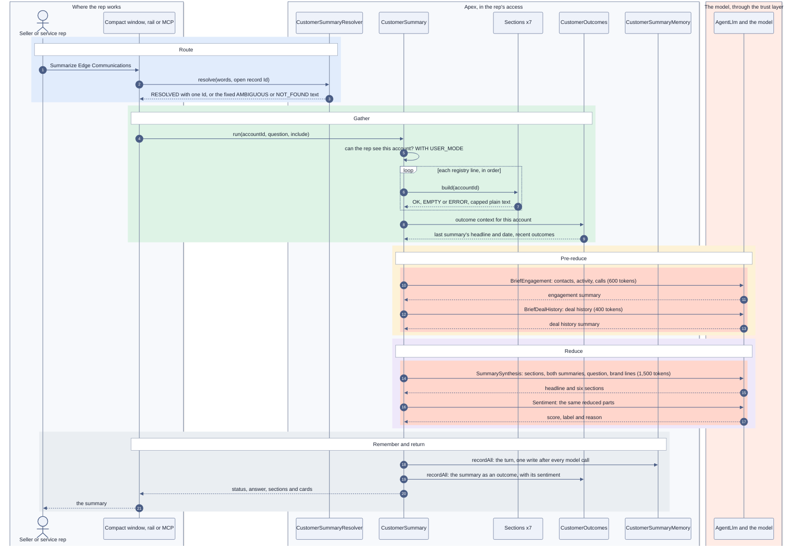
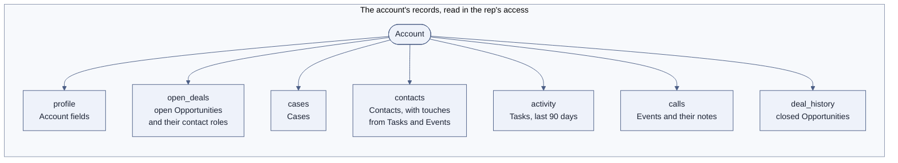
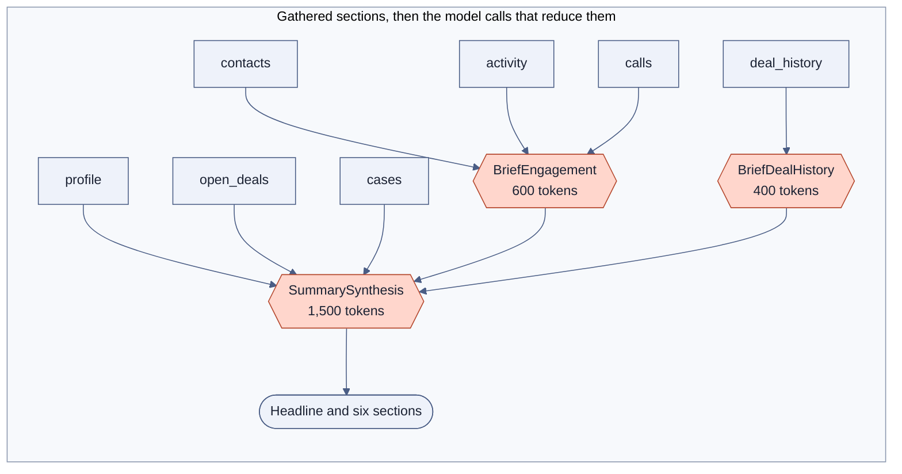
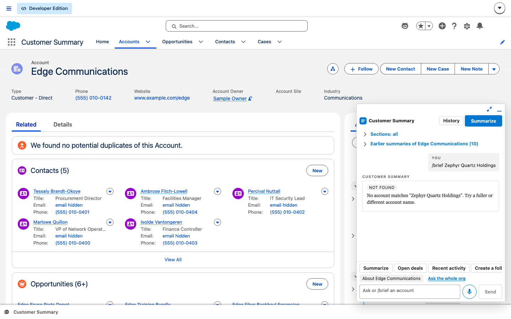
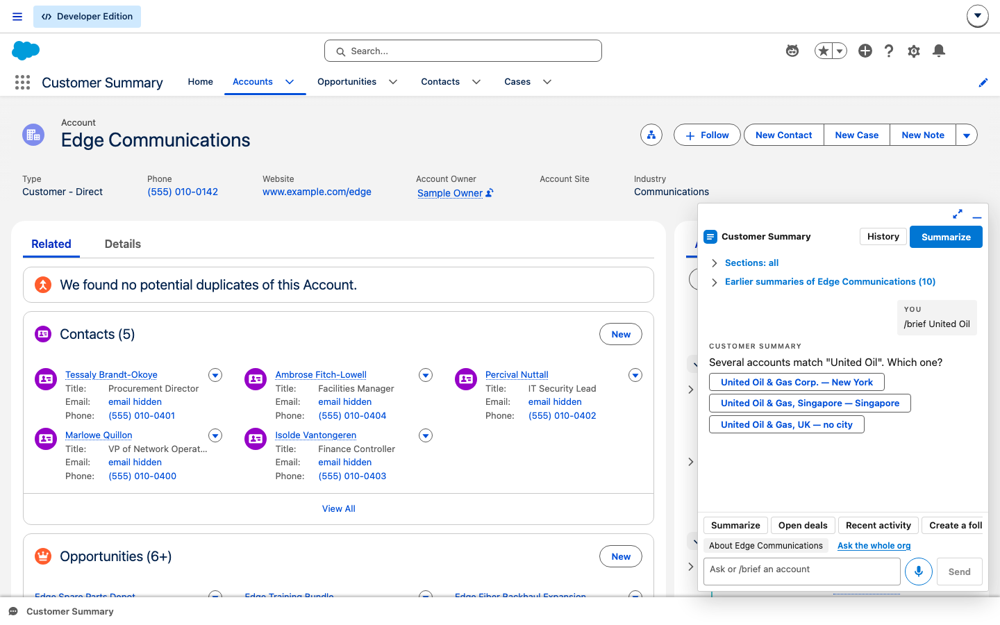
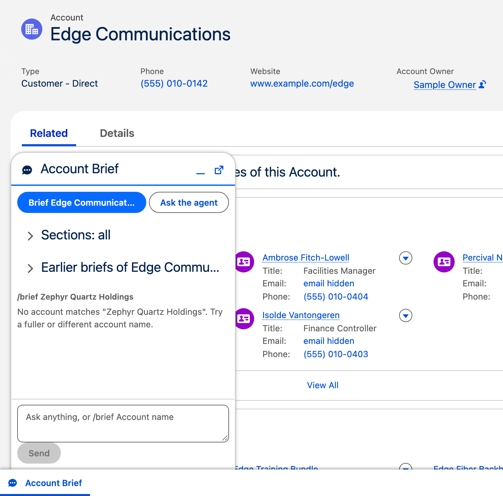
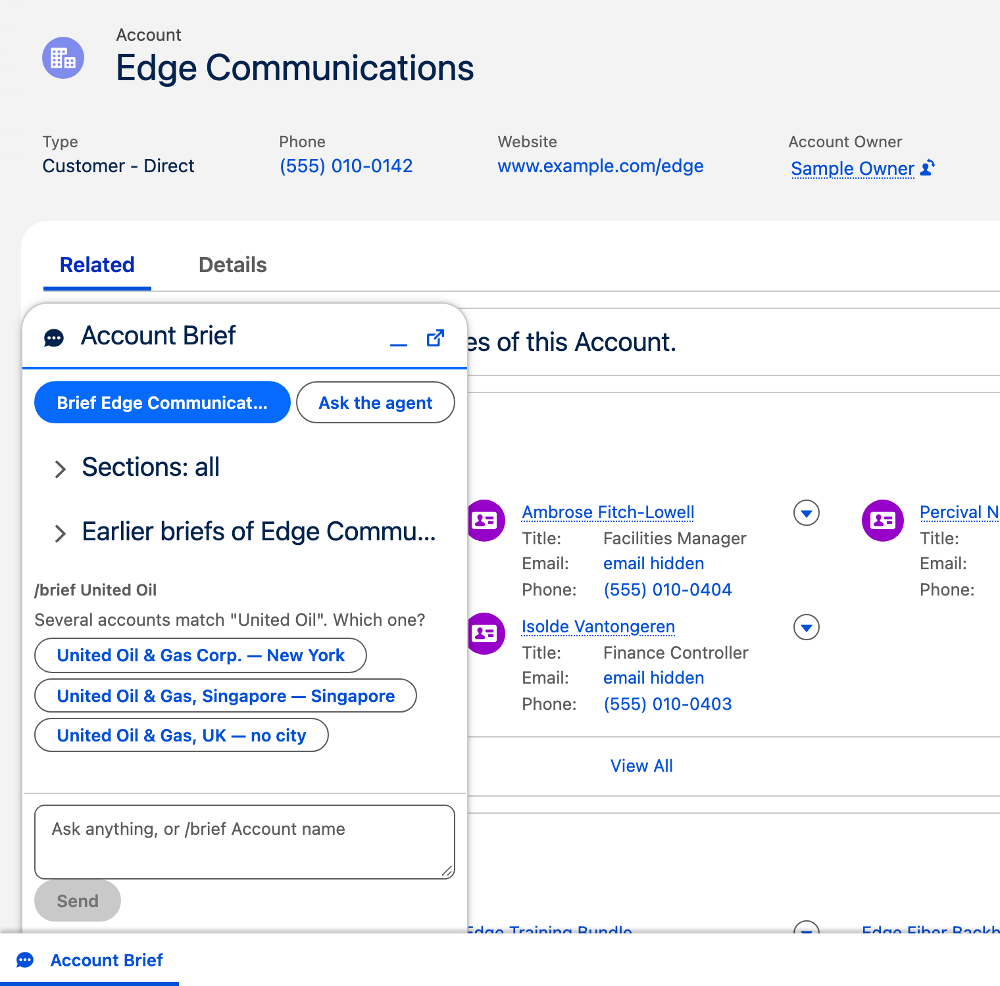

# Route, gather, reduce

A seller or service rep names an account and gets one summary of its deals, service and people, built only from the
CRM records that rep can already see.

## The business problem

*Part 1 of 2: the business impact.*

- **The problem.** Before a call, a rep pieces the customer together from many tabs: the account, the open deals,
  the cases, the contacts and the activity timeline. Then they try to remember what matters. It is slow, and the
  thing that matters (an escalated case, a deal past its close date, a contact who went quiet) is easy to miss.
- **What everyone wants.** Deal history, service history and a read on the customer, before or during a
  conversation, in one place and in plain words.
- **What changes for a seller.** One ask gives the open deals with who is involved, what was won and lost, who on
  the customer's side is engaged and who has gone quiet, and two to four things to follow up on.
- **What changes for a service rep.** The same summary shows service health: open and high-priority cases, what
  closed recently, and the deals a support problem puts at risk.
- **What changes for their manager.** Every rep starts a conversation from the same facts, in the same shape, and
  each summary is kept against the account with a sentiment label, so a manager sees how an account is trending
  without reading every record.
- **The philosophy.** This is Customer 360-style context from the CRM records already in the org, through
  Agentforce and Apex, with no Data Cloud. Code finds the account and reads its records in the rep's own access.
  Small, focused model calls condense the noisy parts. One last call writes the summary from those parts only, so
  every fact in it was read by code, and the model only puts it into words.
- **What Data Cloud would add.** This is a fair comparison, not a claim of parity. Data Cloud brings in data from
  outside the CRM (web, commerce, marketing, a data warehouse), matches the same customer across those systems into
  one profile, computes insights and segments over large volumes, reacts to streaming events, and retrieves over
  unstructured content. This pattern reads only what is in the org, for one account, when the rep asks. For many
  teams that is the context they need before a call; a team that needs the rest needs Data Cloud.

## The architecture in a few steps

1. **Route.** Code turns the rep's words, a pasted Id or the open record into exactly one account, or says plainly
   why it could not.
2. **Gather.** Code reads a fixed list of sections (account, open deals, cases, contacts, activity, calls, deal
   history), each capped, each in the rep's own access. No model is involved.
3. **Pre-reduce.** Two small model calls each condense one noisy part: engagement, and deal history.
4. **Reduce.** One final model call writes the headline and six sections from the gathered parts only. One more
   short call scores the customer's sentiment from the same parts.
5. **Remember.** The turn and the summary are saved once, after every model call, against the account.

**How easy it is to take.** To point it at your own objects, a team writes one small Apex class per section, adds one
line to the registry, and names the section in the synthesis prompt. The route, the gating, the caps, the failure
handling and the memory stay as they are. See [Adopt it](#adopt-it) and
[The reduction structure](#the-reduction-structure).

## How it works

*Part 2 of 2: the architecture.* The numbers in the diagram match the steps under it. The coral blocks are the model
calls; everything else is deterministic Apex. The theme is the shared one in [_diagram-theme.md](_diagram-theme.md).



1. **Route (steps 1 to 3).** `CustomerSummaryResolver` turns the rep's words, a pasted Account Id or the open record
   into one Account. It answers RESOLVED, AMBIGUOUS (up to 8 candidates, one line each) or NOT_FOUND, each with fixed
   text that the surface relays as it is. Only a RESOLVED Id goes on.
2. **Gate (steps 4 and 5).** `CustomerSummary.run` reads the Account `WITH USER_MODE`. If the rep cannot see it, the
   answer is the fixed text "I can't see that account. Check the name or your access." and no model is called.
3. **Gather (steps 6 and 7).** The registry in `CustomerSummary` lists seven sources in summary order. Each
   implements `CustomerSummarySource` and returns one `CustomerSummarySection`: OK, EMPTY or ERROR, plain text, with
   row and length caps. `include` can narrow the list, for example to `open_deals` only; a section that was not asked
   for reaches the model as `EMPTY: not requested`. If no section is OK and one failed, the summary is ERROR, not
   EMPTY, and no model is called.
4. **Outcome context (steps 8 and 9).** `CustomerOutcomes` gives the synthesis the last summary's headline and date
   and the account's last few outcomes, by type and date only for anyone but their author.
5. **Pre-reduce (steps 10 to 13).** `AgentPrompt_BriefEngagement` condenses contacts, activity and calls;
   `AgentPrompt_BriefDealHistory` condenses deal history. A pre-reduce with no data is skipped. A section that failed
   inside one stays visible to the synthesis as its own `ERROR:` line.
6. **Reduce (steps 14 to 17).** `AgentPrompt_SummarySynthesis` gets the other sections, both summaries, the question
   and the brand's company and tone lines, and writes the headline and the six sections. Then `AgentPrompt_Sentiment`
   scores the account from the same reduced parts (no new query). A sentiment that fails, or that would not fit the
   model-time budget, is stored as no score, and the summary still returns. A failed synthesis gives ERROR with fixed
   text and keeps the gathered sections.
7. **Remember and return (steps 18 to 21).** `CustomerSummaryMemory.recordAll` writes the turn once, after every model
   call, because a write before a model call in the same transaction would fail it. The summary is then saved as a
   customer outcome with its sentiment. A failed outcome write is logged and the summary still returns. The answer is
   capped at 5,900 characters and ends on a clear marker if it is cut.

### The design principle

Deterministic Apex reads the records. Small, focused model calls each condense one noisy part (engagement, deal
history). One final call writes the summary from those parts only. A production Agentforce build we reviewed works the
same way: code routes the request and gathers the records in the user's own access, one prompt reduces what was
gathered, prose comes only from the prompt and data comes only from code, and a status a step returns (not found, a
choice of records, a failed section) is passed on unchanged.

Why focused calls: a long, noisy section (months of tasks, every call note) crowds out the facts that matter when it
goes straight into one big prompt. Condensing it first, in a prompt that does one job, keeps the final prompt short
and every part of it about the same size. All prose lives in the prompt files, so a team can read and change it
without touching Apex.

### The account's data graph

Everything the summary knows hangs off one Account. Each branch is one section, read by its own class.



### The reduction structure

Which sections the model sees as they are, and which it sees condensed first. The coral nodes are model calls.



| Key | Section | What it reads | Caps | Pre-reduced | Prompt and token budget |
| --- | --- | --- | --- | --- | --- |
| `profile` | Account | The Account's own fields, one labelled line each | 1,200 characters | No | `AgentPrompt_SummarySynthesis`, 1,500 |
| `open_deals` | Open deals | Open Opportunities, soonest close first, with who is involved on each | 5 deals, 3 contact roles each, 1,200 characters | No | `AgentPrompt_SummarySynthesis`, 1,500 |
| `cases` | Service health | A tally of open, high-priority and recently closed Cases, then the most urgent open ones | 5 cases, 1,200 characters | No | `AgentPrompt_SummarySynthesis`, 1,500 |
| `contacts` | Contacts | Contacts, busiest first by touches (Tasks and Events) in the last 90 days | 6 contacts | Yes | `AgentPrompt_BriefEngagement`, 600 |
| `activity` | Recent activity | Tasks in the last 90 days: counts by type and past due, then the latest | 5 tasks | Yes | `AgentPrompt_BriefEngagement`, 600 |
| `calls` | Calls & meetings | Past Events with their notes, newest first, then the next one | 5 events, 1,200 characters | Yes | `AgentPrompt_BriefEngagement`, 600 |
| `deal_history` | Deal history | Closed Opportunities, latest first, with won and lost totals | 5 deals, 1,200 characters | Yes | `AgentPrompt_BriefDealHistory`, 400 |

The registry (key and class) is `CustomerSummary.registry`, and which keys each pre-reduce condenses is
`CustomerSummary.PRE_REDUCES`. `AgentPrompt_Sentiment` reads open deals, cases and both summaries; it adds no section.

#### Swap a section for your industry

These are examples, not shipped code. Each shows the registry line, a short outline of the source class and the prompt
heading to change. The synthesis prompt fills its placeholders in one pass, and a placeholder with no value is an
error, so a section that is removed comes out of the prompt in the same change.

**Case history, for a service-led business.** Swap closed deals for closed cases, condensed first like deal history.

```apex
// Example, not shipped code. In CustomerSummary.registry, in place of deal_history:
new Source('case_history', 'CustomerSummaryCaseHistorySection'),
// In CustomerSummary.PRE_REDUCES, in place of BriefDealHistory:
new PreReduce('BriefCaseHistory', 'case_history_summary', 400, new List<String>{ 'case_history' }),

// Example, not shipped code: the source class.
public with sharing class CustomerSummaryCaseHistorySection implements CustomerSummarySource {
    public String key() { return 'case_history'; }
    public String title() { return 'Case history'; }
    public CustomerSummarySection build(Id accountId) {
        try {
            // One aggregate query WITH USER_MODE: Cases closed in the last 12 months, reopened, average days to close.
            // One query WITH USER_MODE, LIMIT 5: the latest closed Cases, one line each (subject, priority, days open).
            // Cap the body at 1,200 characters; no Cases gives EMPTY with one plain sentence.
            return null; // the OK or EMPTY section built from the lines above
        } catch (Exception e) {
            return CustomerSummarySection.failed('case_history', 'Case history', e);
        }
    }
}
```

In `AgentPrompt_SummarySynthesis`, rename the heading `Deal history` to `Case history`, change its source line to
"Case history: from Case history summary.", and change the user block's `Deal history summary:` and
`{{deal_history_summary}}` to `Case history summary:` and `{{case_history_summary}}`. Add a prompt file
`AgentPrompt_BriefCaseHistory` modelled on `AgentPrompt_BriefDealHistory`: the reopen pattern, the time to close and
how recent the cases are.

**Order history, for a retailer.** Add orders beside the deals, sent straight to the synthesis with no pre-reduce.

```apex
// Example, not shipped code. In CustomerSummary.registry, after open_deals:
new Source('orders', 'CustomerSummaryOrderHistorySection'),

// Example, not shipped code: the source class.
public with sharing class CustomerSummaryOrderHistorySection implements CustomerSummarySource {
    public String key() { return 'orders'; }
    public String title() { return 'Order history'; }
    public CustomerSummarySection build(Id accountId) {
        try {
            // One aggregate query WITH USER_MODE on Order: count and total amount in the last 12 months.
            // One query WITH USER_MODE, LIMIT 5: the latest Orders, one line each (number, status, date, amount).
            // Cap the body at 1,200 characters; no Orders gives EMPTY with one plain sentence.
            return null; // the OK or EMPTY section built from the lines above
        } catch (Exception e) {
            return CustomerSummarySection.failed('orders', 'Order history', e);
        }
    }
}
```

In `AgentPrompt_SummarySynthesis`, add the heading `Order history` after `Open deals` in the structure, add the
source line "Order history: from Orders.", and add `Orders:` and `{{orders}}` to the user block. If order lines grow
long, move the key into a pre-reduce instead, as case history does above.

### How to change the narrative per industry

The sections decide what the summary knows; the synthesis prompt decides how it tells it.

- **The headings.** The six headings in `AgentPrompt_SummarySynthesis` (Account, Open deals, People & engagement,
  Service health, Deal history, Watch next) are the summary's shape. A service-led team can put Service health first;
  a retailer can add Order history. The headline rule (the single most important real finding) stays.
- **The tone.** The brand settings record holds a tone line (`Tone__c`) and a company name, which are added after the
  synthesis prompt's own text on every summary. Changing the tone changes the voice, not the facts. See
  [Brand and theming](10-brand-and-theming.md).
- **A built industry switch** (one setting that picks the sections and the narrative together) does not exist; see
  [Limits and open items](#limits-and-open-items).

## See it

Captured by OPS-52 on 2026-11-14 on the sample account Edge Communications, each still the whole 1440 by 900 window
([capture record](../research/fr2-captures.md)).


When the name does not resolve, the resolver answers without a model call:





## Why you can trust it

Runs as the signed-in user: every class on this path is `with sharing`, and the resolver, the visibility check, all
seven sections and the prompt files are read in user mode, so the rep's object, field and record access all apply.

System context: three uses on this path, each named in the code with its reason and checked by
[test_trust_rule.py](../../tests/test_trust_rule.py): the prompt settings (`Agent_Prompt_Setting__mdt`, the product's
own configuration, the same for every user, which reps cannot read); the conversation memory rows (the running user's
own rows, which reps cannot write); and the text of customer outcomes (reps hold no field access to it; it is set only
on rows just written by this user, and read into a prompt only for its author or a type marked to share).

Whether a run in a real org has passed is kept in one place, the README's [Status table](../../README.md#status).

- **Registry order, gating and include filtering are tested.**
  [CustomerSummaryTest](../../force-app/main/default/classes/CustomerSummaryTest.cls) covers registry order
  (`allSourcesByDefaultInRegistryOrder`, `everyRegistryKeyMatchesItsSource`), `include` filtering
  (`includeFiltersAndSkipsEngagement`, `emptyIncludeMeansAll`, `onlyUnknownKeysBuildsNothing`) and no model call on
  NOT_FOUND (`notFoundMakesNoModelCall`).
- **ERROR is never shown as EMPTY.** `everySectionErrorGivesErrorNotEmpty` and `errorAndEmptySectionsGiveError`; a
  failed section inside a pre-reduce still reaches the synthesis as ERROR
  (`aFailedSectionInsideAPreReduceStillReachesTheSynthesisAsError`), and the prompt has a rule for it
  (`synthesisPromptHasARuleForAFailedSection`).
- **No record Id reaches a model.** `recordIdsReachThePanelInSectionLinesButNeverAPrompt`.
- **A model failure writes nothing.** `modelExceptionGivesErrorAndNoMemory` and `aFailedSummaryMakesNoSentimentCall`.
- **Bulk limits are tested.** `bulkBriefOverThreeHundredTasksStaysWithinLimits`,
  `threeFullRequestsAtTheCapStayWellInsideTheQueryLimit` and `requestsPastTheCapGetAFixedLineAndNoModelCall`.
- **Each section is tested,** one test class per section, for example
  [CustomerSummaryOpenDealsSectionTest](../../force-app/main/default/classes/CustomerSummaryOpenDealsSectionTest.cls),
  and every section fails closed for a user without access
  ([CustomerSummarySectionErrorTest](../../force-app/main/default/classes/CustomerSummarySectionErrorTest.cls)).
- **The numbers come from the sections.** The accuracy check (BE-29) ran on five sample accounts in a test org: of 84
  dates, amounts, percents and counts in the summaries, 83 were found in a gathered section. The one other was a
  correct sum of two amounts in one section, not an invented figure
  ([fr2-summary-accuracy.md](../research/fr2-summary-accuracy.md)).
- **The code is reviewed.** The Apex re-review ([apex-review-2.md](../reviews/apex-review-2.md)) rates the Apex
  "Ready with fixes" with no blockers; BE-29 then fixed its findings N1, N2, N3, N7 and N8 on this path.

## How it scales

- **More sections.** A section is one class and one registry line; the test that every registry key matches its
  source (`everyRegistryKeyMatchesItsSource`) catches a line that points at the wrong class.
- **Caps keep every prompt bounded.** Each section has a row cap, and most a 1,200-character body cap (see
  [the table](#the-reduction-structure)), so the synthesis prompt has a known largest size however much data an
  account holds. The pre-reduce prompts ask for at most 1,200 and 800 characters.
- **Pre-reduce when a section grows.** A section that gets long or noisy moves into a pre-reduce by adding its key to
  `PRE_REDUCES`; the synthesis then sees a short summary of it.
- **A fixed few queries per section, never one per record.** Contacts counts touches with two aggregate queries grouped
  by contact; the resolver looks up many pasted Ids in one query (`manyPastedIdsUseOneQuery` in
  [CustomerSummaryResolverTest](../../force-app/main/default/classes/CustomerSummaryResolverTest.cls)). One summary
  runs about 25 queries; a caller may ask for up to three summaries in one request, and each one past that gets a
  fixed line and no model call.
- **User-mode reads.** The summary reads the CRM as it is, in the rep's access: no copy of the data to keep in step
  and no second set of sharing rules.
- **The reply fits what the agent can relay.** The prompt asks for under 4,000 characters; the answer is capped at
  5,900, under the chat relay's limit of about 6,000, and a cut answer ends on a clear marker
  (`anAnswerPastTheLengthCapEndsOnAClearMarker`).
- **Model time is budgeted.** Model calls share one transaction's callout allowance. The sentiment call, the one a
  summary can do without, is skipped as no score once 90 seconds have gone to model calls
  (`pastTheModelTimeBudgetTheSentimentIsSkippedAndTheSummaryStands`).

## When something fails

Each failure reads as one fixed sentence that says what to do next. No raw error text reaches the rep.

- **No account matches.** The resolver answers 'No account matches "…". Try a fuller or different account name.'
  (`unknownNameIsNotFound`, `blankInputIsNotFound` and `notFoundGivesOneNoticeCard` in
  [CustomerSummaryResolverTest](../../force-app/main/default/classes/CustomerSummaryResolverTest.cls)). A query error
  in the resolver, such as no access to accounts, is its own fixed ERROR text, not "no account matches"
  (`aQueryErrorIsAnErrorWithFixedTextNotNotFound`).

  

- **Several accounts match.** The resolver answers 'Several accounts match "…". Which one?' with up to eight
  candidates, which the surface shows as a choice of accounts (`tenMatchesAreAmbiguousWithEightLinesAndMore` and
  `ambiguousGivesOneChoiceCardInTheMessagesOrderWithIdsOnlyInRefs`). The choice goes back by Id, not by name.

  

- **A failed section stays a section.** A section that cannot load becomes ERROR with "Couldn't load <title> right
  now.", and the rest of the summary still returns (`brokenSourceBecomesErrorSection`,
  `someErrorSectionsStillGiveAnOkBrief` and `aFailedSectionStillGivesACardAndKeepsTheRest` in
  [CustomerSummaryTest](../../force-app/main/default/classes/CustomerSummaryTest.cls)).
- **No raw errors.** The panel's controller turns any unexpected exception into "I couldn't finish that right now.
  Try again in a minute." (`unexpectedExceptionsBecomeFixedText` in
  [CustomerSummaryPanelControllerTest](../../force-app/main/default/classes/CustomerSummaryPanelControllerTest.cls)).

## Adopt it

1. Grant access: assign the permission set group `Customer_Summary_User`.
2. Copy `CustomerSummary.cls`, `CustomerSummarySource.cls`, `CustomerSummarySection.cls`,
   `CustomerSummaryResolver.cls`, `CustomerSummaryGetAction.cls`, the seven `CustomerSummary*Section.cls` classes and
   their tests from `force-app/main/default/classes/`.
3. Copy the model door from [04](04-model-provider-seam.md) and the four prompts `AgentPrompt_SummarySynthesis`,
   `AgentPrompt_BriefEngagement`, `AgentPrompt_BriefDealHistory` and `AgentPrompt_Sentiment` from
   `force-app/main/default/staticresources/`.
4. Copy `CustomerSummaryMemory.cls` and `Customer_Summary_Session__c` ([05](05-conversation-memory.md)), and
   `CustomerOutcomes.cls`, `CustomerSentiment.cls` and `Customer_Outcome__c`, or remove their calls from
   `CustomerSummary` if you do not want memory or outcomes.
5. Copy `BrandSettings.cls` and `Brand_Setting__mdt` ([10](10-brand-and-theming.md)) for the company and tone lines.
6. **Point it at your objects.** Add, remove or swap lines in `CustomerSummary.registry` (registry order is summary
   order), choose which keys a pre-reduce condenses in `PRE_REDUCES`, and change the headings in
   `AgentPrompt_SummarySynthesis` to match. See [The reduction structure](#the-reduction-structure) and "Add a source"
   in [ARCHITECTURE.md](../ARCHITECTURE.md#add-a-source).

## Limits and open items

- **One account per summary.** Other objects (a household, a site, a parent company with its children) need their
  own resolver and registry. No card yet.
- **The accuracy check finds made-up numbers, not misplaced ones.** It finds a number that no section holds; it does
  not find a real number given to the wrong deal. It also found one correct total the model computed itself, which a
  reader cannot trace to a section; having the Open deals section state that total is proposed in BE-29's research.
  No card yet.
- **Wording changes from run to run,** so a clean accuracy run does not promise the next one is clean. No card yet.
- **What BE-29 fixed** from the Apex re-review: many summaries in one call are capped (N1); in the account, open deals
  and calls sections a field the rep cannot read is left out and named instead of failing the section (N2); the
  synthesis prompt has a rule for a failed section (N3); a resolver query error is its own ERROR, not NOT_FOUND (N7);
  and a cut answer ends on a marker (N8).
- **A summary run by a non-admin user in a live org** has not been recorded; the Apex tests use `runAs` for
  restricted users. FE-5 has it.
- **An industry switch,** one setting that picks the sections and the narrative together, is not built; today a team
  changes the registry and the prompt by hand, as above. OPS-34 has industry scenarios, and it is tabled.
- **The diagrams on this page have not been render-checked:** no check could be made to fail in this card (see
  [Render check](_diagram-theme.md#render-check)). No card yet.

[Back to the pattern index](README.md) | [Back to the architecture page](../ARCHITECTURE.md) | [Back to the README](../../README.md)
