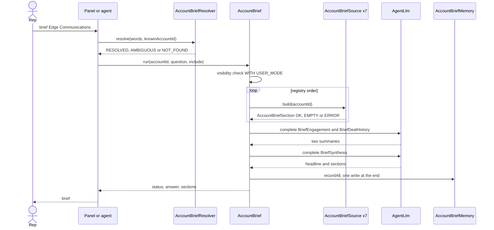
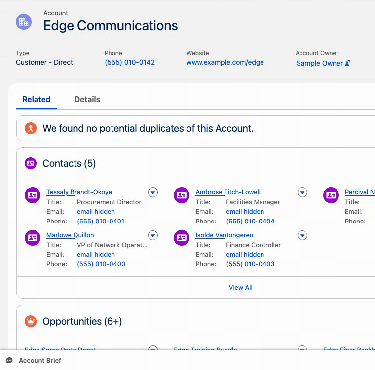
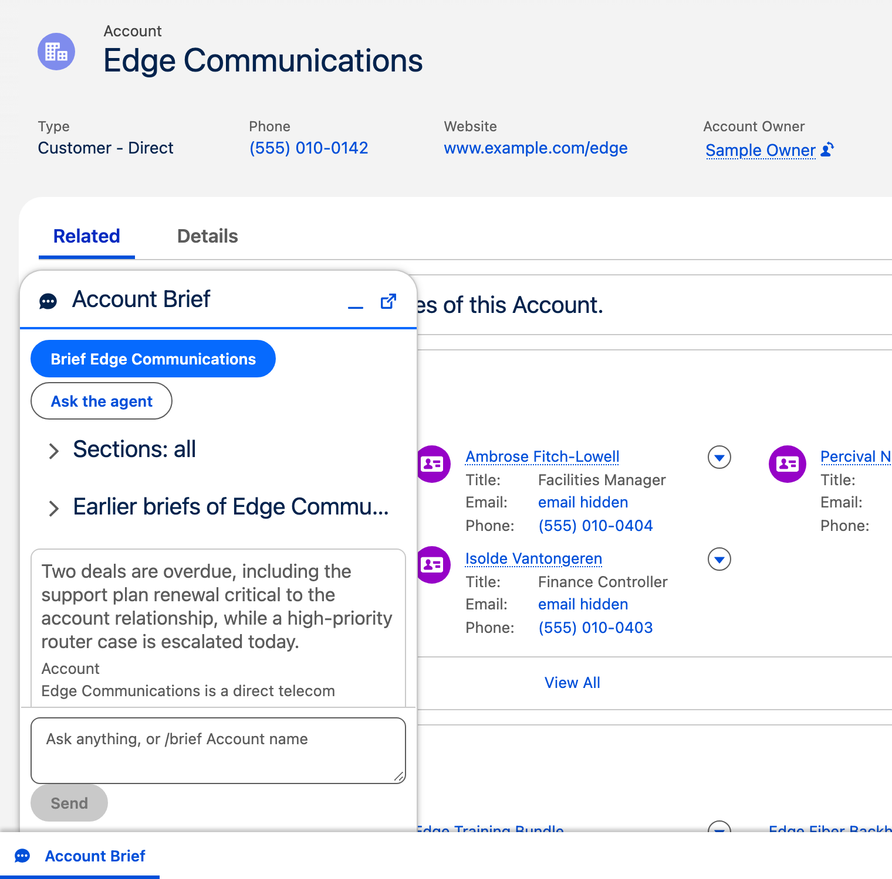

# 01. Route, gather, reduce

## The outcome

A rep names an account and gets a brief in one step: a headline, then Account, Open deals,
People & engagement, Service health, Deal history and Watch next. Every fact in it was read
from the CRM by Apex. The model only turns those facts into prose.

## The problem it removes

Before a call, a rep opens the account, the deals, the cases, the contacts and the activity
timeline, then tries to remember what matters. An agent that queries freely can be just as slow,
and it can state facts it never read. This pattern fixes the order of work. It finds the one
right account, gathers a fixed set of sections, and lets the model write only from them.

## How it works

1. **Route.** `AccountBriefResolver` turns the rep's words, a pasted Account Id or the open
   record into one Account. It answers RESOLVED, AMBIGUOUS (up to 8 candidates, one line each) or
   NOT_FOUND. Only a RESOLVED Id goes on.
2. **Gate.** `AccountBrief.run` reads the Account `WITH USER_MODE`. If the rep cannot see it, the
   answer is the fixed NOT_FOUND text and no model is called.
3. **Gather.** The registry in `AccountBrief` lists 7 sources in brief order: profile,
   open_deals, cases, contacts, activity, calls and deal_history. Each implements
   `AccountBriefSource` and returns one `AccountBriefSection`: OK, EMPTY or ERROR, plain text,
   with row and length caps. No model is involved.
4. **Narrow.** `include` limits the sources, for example `open_deals` only. A section that was
   not asked for reaches the model as `EMPTY: not requested`.
5. **Pre-reduce.** Two small prompts condense the noisy sections first. `BriefEngagement` takes
   contacts, activity and calls (600 tokens). `BriefDealHistory` takes deal history (400 tokens).
   A pre-reduce with no data is skipped.
6. **Reduce.** `BriefSynthesis` gets the other sections, both summaries and the question, and
   writes the headline and the six sections (1,500 tokens).
7. **Status.** If no section is OK and one failed, the brief is ERROR, not EMPTY. A model failure
   gives ERROR with fixed text and keeps the gathered sections.
8. **Remember.** `AccountBriefMemory.recordAll` writes once, after every model call, and only on
   OK or EMPTY.

## See it

## Why you can trust it

- **Order and gating are tested.** [AccountBriefTest](../../force-app/main/default/classes/AccountBriefTest.cls)
  covers registry order (`allSourcesByDefaultInRegistryOrder`), `include` filtering
  (`includeFiltersAndSkipsEngagement`), no model call on NOT_FOUND (`notFoundMakesNoModelCall`),
  ERROR when every section fails (`everySectionErrorGivesErrorNotEmpty`), and no memory write on a
  model failure (`modelExceptionGivesErrorAndNoMemory`). It also runs a brief over 300 tasks
  inside governor limits (`bulkBriefOverThreeHundredTasksStaysWithinLimits`).
- **Resolution is tested.** [AccountBriefResolverTest](../../force-app/main/default/classes/AccountBriefResolverTest.cls)
  covers exact name over partial match, many pasted Ids in one query, ten matches giving eight
  lines, and LIKE wildcards in the term read as plain text.
- **Each section is tested.** There is one test class per section, for example
  [AccountBriefOpenDealsSectionTest](../../force-app/main/default/classes/AccountBriefOpenDealsSectionTest.cls).
- **Review findings are fixed in code.** The Apex review ([apex-review.md](../reviews/apex-review.md))
  found that an all-failed brief read as EMPTY (finding 1), that bulk calls hit callout-after-DML
  (finding 3), and that the resolver ran one query per pasted Id (finding 5). Each is fixed and
  covered by the tests named above. The re-review ([apex-review-2.md](../reviews/apex-review-2.md))
  confirms findings 1 and 5 fixed and finding 3 fixed for ordering, and rates the Apex
  "Ready with fixes" with no blockers.
- **It runs live.** Main was deployed to a real org with 150 of 150 Apex tests passing, and the
  Playwright run briefed an account in the panel as an admin user, 8 of 8 specs
  ([deploy-verify.md](../research/deploy-verify.md)). Studio preview cases 1, 2, 6 and 7 brief the
  right account through the draft agent ([studio-preview.md](../research/studio-preview.md)).

## Adopt it

1. Copy `AccountBrief.cls`, `AccountBriefSource.cls`, `AccountBriefSection.cls`,
   `AccountBriefResolver.cls`, `AccountBriefGetAction.cls`, the seven `AccountBrief*Section.cls`
   classes and their tests from `force-app/main/default/classes/`.
2. Copy the model door from [04](04-model-provider-seam.md) and the three prompts
   `AgentPrompt_BriefSynthesis`, `AgentPrompt_BriefEngagement` and `AgentPrompt_BriefDealHistory`
   from `force-app/main/default/staticresources/`.
3. Copy `AccountBriefMemory.cls` and `Account_Brief_Session__c`, or remove the `recordAll` call
   in `AccountBrief` if you do not want memory.
4. **Change the sections.** Add or remove lines in `AccountBrief.registry`. Each line is a key and
   a class name, and registry order is brief order. See "Add a source" in
   [ARCHITECTURE.md](../ARCHITECTURE.md#add-a-source).
5. **Change the voice.** Edit `AgentPrompt_BriefSynthesis`. Its section headings and length rule
   are the brief's shape.

## Limits and open items

- The brief is for one Account. Other objects need their own resolver and registry.
- Should-fix from the Apex re-review ([apex-review-2.md](../reviews/apex-review-2.md)):
  - N1: a caller that sends many briefs in one call can hit a platform limit that cannot be
    caught, and then gets no answer at all. The agent normally sends one request.
  - N2: one field the rep cannot read fails the whole section, and the message reads like a
    passing fault.
  - N3: the synthesis prompt has no rule for a failed section, so the model can write "no open
    cases" when the Cases section failed to load.
- Notes from the same review: every query error in the resolver reads as NOT_FOUND (N7), and a
  brief that runs past the output cap ends mid-sentence with no marker (N8).

> [!WARNING]
> **Not yet proven:** a brief run by a non-admin user in a live org. The Apex tests use `runAs`
> for restricted users, but no live run has been recorded. See [07](07-trust-access-and-failure.md).
