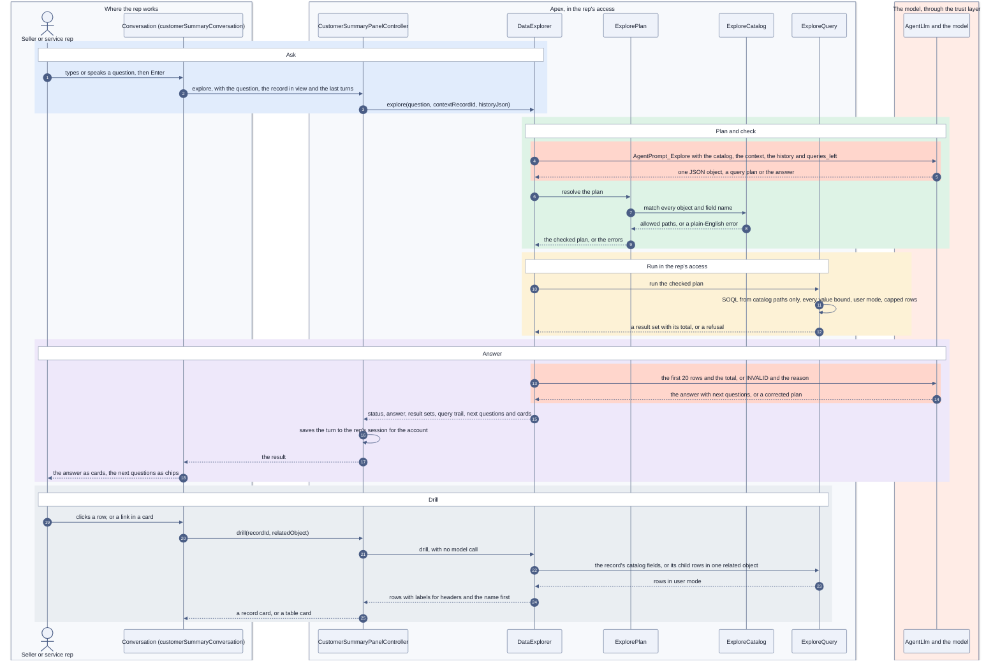
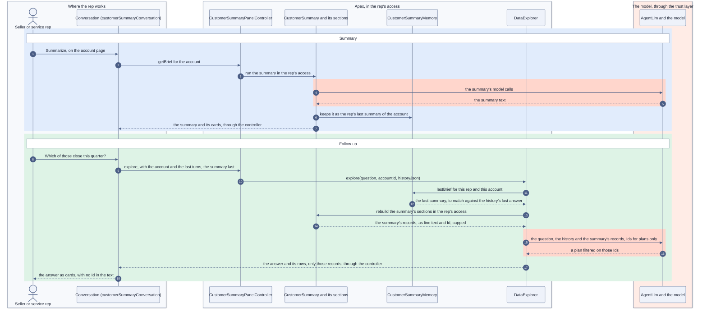

# Ask anything

With Customer Summary, a seller or service rep asks the next question in their own words, about the summary they just
read or about anything in the org they can see, and gets a short answer with the rows behind it, with no new flow built
for that question.

## The business problem

*Part 1 of 2: the business impact.*

- **The problem.** In a typical Agentforce build, the summary is one action, and every question after it is another.
  "Which of those close this quarter?" needs a flow, repurposed or rebuilt, with the summary's context passed back to
  it by hand. The next kind of question needs another. The build cycles never end, and the hours go on questions a
  model could already answer, hours the customer had not planned for. That is the shape of
  a production Agentforce build we reviewed.
- **The operating principle. A follow-up is never a new build.** After a summary, the next question is answered by
  the explorer from the same context, in the rep's own access. Nobody builds a flow or an action to answer a
  follow-up, and nobody passes context back by hand
  ([fr2-design.md](../plans/fr2-design.md#operating-principles), principle 1).
- **What changes for a seller or a service rep.** After the summary, the rep types or speaks the next question in
  their own words: "which of those close this quarter?", "any open cases on the biggest deal?". The answer comes from
  the records the summary was built from, with no new build. A question about the whole org works the same way, and a
  row in the answer opens that record and its related records.
- **What changes for the team that builds it.** One explorer and one prompt file answer every follow-up. A new kind
  of question is a sentence the rep types, not a flow a builder writes, tests and deploys.
- **The philosophy.** The model only plans; it never writes SOQL. Apex checks every name in the plan against a fixed
  catalog and runs it with bound values, in the rep's own access, so a free question never becomes a free query. Why
  the product brings its own explorer instead of a flow per question is in [Why custom](00-why-custom.md).

## The architecture in a few steps

1. **Plan.** The rep's question, the record in view and the last turns go to the model, which answers with one small
   plan: an object, fields, filters, an order and a limit.
2. **Check.** Apex matches every name in the plan to a fixed catalog of objects and fields the rep can read.
3. **Run in the rep's access.** Apex builds the query from the catalog only, binds every value and runs it as the
   rep, with capped rows.
4. **Correct.** A plan that fails a check, or a query that fails, goes back to the model as one plain line, and it
   tries again inside the same caps.
5. **Answer.** The model answers from the rows it was shown, and the rep sees the answer as cards with the rows under
   it and a few next questions as chips.
6. **Drill.** A row opens that record, or its related records, with no model call.

**How easy it is to take.** A team copies the explorer's classes and its prompt file and assigns one permission set
group. Adding an object to the catalog is one line. See [Adopt it](#adopt-it).

## How it works

*Part 2 of 2: the architecture.* The numbers in each diagram match the steps under it. The coral blocks are the model
calls; everything else is the browser and deterministic Apex. The theme is the shared one in
[_diagram-theme.md](_diagram-theme.md).

1. **Ask (steps 1 to 3).** The rep types or speaks into the composer ([11](11-voice-input.md)). The conversation sends
   the question, the record in view and its last turns as history to `CustomerSummaryPanelController.explore`, which
   hands them to `DataExplorer.explore`. The scope chip above the composer says what the question is about: "About"
   and the account's name on an account page, "About this record" on another record, or "Whole org", which sends no
   record. After a summary on a page with no record, the question goes with the summarized account. Text whose first
   real word is an action verb goes to a draft instead ([13](13-write-actions.md)).
2. **Plan (steps 4 and 5).** Each turn, the model gets the prompt file `AgentPrompt_Explore` with the catalog, the
   record in view (with the account's earlier outcomes, [05](05-conversation-memory.md)), the history, the turns so far
   and `queries_left`, through the model door `AgentLlm` ([04](04-model-provider-seam.md)). It replies with one JSON
   object: a query plan (object, fields, filters, order, limit, group by, aggregates) or an answer.
3. **Check (steps 6 to 9).** `ExplorePlan.resolve` matches every name to `ExploreCatalog`. The catalog is a curated
   list of eight objects (Account, Contact, Opportunity, OpportunityContactRole, Case, Task, Event and User), each with
   its fields, describe-checked for the running user: anything the rep cannot read is dropped before the model sees
   the catalog, and a name outside it is an error in plain English.
4. **Run in the rep's access (steps 10 to 12).** `ExploreQuery` builds SOQL only from catalog paths, fixed operators
   and its own aliases. Every value is a bind variable, and the query runs in `AccessLevel.USER_MODE`. The limit
   defaults to 50 rows and is capped at 200. An aggregate first runs a capped `COUNT()`: past 10,000 matching records
   it is refused with "Add filters to narrow it", instead of hitting a platform limit that cannot be caught.
5. **Correct (steps 13 and 14).** The model sees the first 20 rows of each result and its total. A reply that is not
   one JSON object, a plan error, a query error or a row-cap refusal goes back as `INVALID: <reason>`, and the model
   tries again. A question gets at most 5 model turns and 4 queries. When the turns run out with rows in hand, the
   status stays OK and the last result is shown with a fixed note.
6. **Answer (steps 15 to 18).** The explorer returns its status, the answer, the result sets, the query trail, up to
   four next questions and the same answer as cards, built from those members with no new query or model call. The
   controller saves an answered turn about an account to the rep's session ([05](05-conversation-memory.md)), last,
   after every model call; a failed save is logged and the answer still returns. The conversation draws the cards: the
   answer as text runs, the last result as a table, a record list or a metric, a notice when rows were cut, the query
   trail closed to start, and the next questions as chips that ask them. No record Id is in the answer text or a
   column: rows keep their Id only to open the record.
7. **Drill (steps 19 to 25).** A row, or a link in a card, calls `drill`. `DataExplorer.drill` reads that record's
   catalog fields, or its child rows in one related catalog object found by describe, in user mode and with no model
   call. Child rows lead with the record's name and carry field labels as headers. A single record comes back as a
   record card with its related objects as chips; related rows come back as the explorer's own table card.

### A follow-up after a summary

The summary comes first ([01](01-route-gather-reduce.md)). The next question goes through the same explorer as any
other: no new action, no new input. What changes is what the model sees.

1. **The summary (steps 1 to 7).** The rep asks for the summary. `CustomerSummary` gathers the account's sections in
   the rep's access, makes its model calls, and keeps the summary as the rep's last one for that account in the
   session store ([05](05-conversation-memory.md)). Each section line that names a record ends with that record's Id,
   which stays out of the text the rep reads.
2. **The follow-up goes out as an ordinary question (steps 8 to 10).** The rep asks the next question in their own
   words. The conversation sends it to `explore` like any other, with the account as the record and the summary as the
   last turn of the history.
3. **Is the last turn the summary? (steps 11 and 12).** The explorer adds the summary's records only when the record
   is an account and the history's last answer matches the summary this rep last got for it
   (`CustomerSummaryMemory.lastBrief`; spaces are collapsed and a clipped tail is allowed, and an answer under 20
   characters never matches). Otherwise nothing is added and the explorer works as in the diagram above.
4. **The summary's records (steps 13 and 14).** The explorer rebuilds the summary's sections (open deals, cases,
   contacts, activity, calls and deal history) for that account, in the rep's access, and reads each record's line
   and Id from them. It is the same set of records the summary was built from, not a new search. They go only into
   the prompt, under "Earlier in this conversation": at most 10 records per section, each line clipped to 120
   characters, and 3,000 characters in all, with "(N more not listed)" where a section was cut.
5. **The plan (steps 15 and 16).** Prompt rule 12 tells the model that "those", "them", "there" or "that deal" mean the
   records of the last turn: after a summary, it filters on their Ids, and on the account's Id for "there". The listed
   lines only say which records; they are never the source of a value, a count or a ranking, so the answer comes from
   a query. When it is unclear which records the question means, the model asks back, runs no query and offers the
   likely choices as next questions. The plan is then checked and run exactly as in the diagram above.
6. **The answer (steps 17 and 18).** The rep sees the answer and its rows, which are the summary's own records, as
   cards. Prompt rule 5 keeps Ids out of the answer.

## See it

These captures are from before the compact window and the cards. OPS-52 recaptures them on each surface.

## Why you can trust it

Runs as the signed-in user: the conversation reaches the explorer only through `CustomerSummaryPanelController`, and
the controller, `DataExplorer`, `ExplorePlan`, `ExploreCatalog` and `ExploreQuery` are all `with sharing`. Every CRM
read on this path (the catalog's describe for the running user, each plan's query, count and pre-count, the drill,
and the summary's sections rebuilt for a follow-up) is in user mode, so the rep's object, field and record access all
apply.

System context: three uses on this path, each named in the code with its reason and checked by
[test_trust_rule.py](../../tests/test_trust_rule.py): the prompt settings (`Agent_Prompt_Setting__mdt`, read for every
model call, the product's own configuration, which reps cannot read); the conversation's session rows
(`Customer_Summary_Session__c`: `lastBrief` reads the running user's own last summary to match a follow-up, and the
controller saves an answered turn as the running user's own row, which reps cannot write); and the text of customer
outcomes (the account's earlier outcomes in the prompt carry their text only for the rep who wrote them, or a type
marked to share, because reps hold no field access to it).

Whether a run in a real org has passed is kept in one place, the README's [Status table](../../README.md#status).

- **Injection is closed.** `quoteAndKeywordsAreBoundNotInjected` in
  [ExploreQueryTest](../../force-app/main/default/classes/ExploreQueryTest.cls) shows quotes and SOQL keywords in a
  value stay bound. The Apex review calls the injection defence strong
  ([apex-review.md](../reviews/apex-review.md), summary).
- **Reads are capped.** `aggregateOverTheRowCapIsRefusedAfterACappedCount`, `groupedAggregateOverTheRowCapIsRefused`
  and `countOnlyAggregatesSkipTheRowCap` in ExploreQueryTest, and `aggregateOverTheRowCapIsFedBackAndCountsAsAQuery`
  in [DataExplorerTest](../../force-app/main/default/classes/DataExplorerTest.cls). This fixed review finding 4
  ([apex-review-2.md](../reviews/apex-review-2.md)).
- **The loop is bounded and keeps what it read.** `queryCapForcesAnswer`,
  `queryPastCapIsRefusedAndRunningOutOfTurnsKeepsTheResults`, `invalidRepliesAreFedBackAndCorrected` and
  `modelFailureKeepsResultSets` in [DataExplorerTest](../../force-app/main/default/classes/DataExplorerTest.cls). This
  fixed review finding 6. A model failure partway through still shows the tables already read, with the error card
  first (`aModelFailureIsAnErrorCardThenTheTableAlreadyRead`), and the optional agent's action relays them too
  (`agentPathKeepsTheTablesReadBeforeAModelFailure`, Apex N4 of the re-review, fixed by BE-30,
  [fr2-follow-ups.md](../research/fr2-follow-ups.md#the-two-review-fixes)).
- **Dates mean the rep's day.** `aDateOnlyValueOnADatetimeFieldIsReadInTheUsersTimeZone` and
  `rangeOperatorsAndInCoverTheWholeLocalDayForADateOnlyValue` in
  [ExploreQueryTest](../../force-app/main/default/classes/ExploreQueryTest.cls). This fixed review finding 8, which
  compared against midnight GMT.
- **The catalog follows access.** `userWithoutAccessHasObjectsDropped` in
  [ExploreCatalogTest](../../force-app/main/default/classes/ExploreCatalogTest.cls), and `objectOutsideCatalogIsRejected`
  and `drillRefusesWhatTheCatalogDoesNotJoin` in DataExplorerTest.
- **A follow-up uses the summary's records, and only those.** `whichOfThoseCloseThisQuarterUsesTheSummarysDeals`,
  `whoThereHaveWeNotCalledUsesTheSummarysContacts` and `anyOpenCasesOnTheBiggestDealUsesTheSummarysDealAndAccount` in
  [DataExplorerTest](../../force-app/main/default/classes/DataExplorerTest.cls) each check that the prompt carries the
  summary's records and that every row returned is one of them, with a matching record on a second account left out.
  `anUnclearPronounAfterASummaryIsAskedBackWithNoQuery`, `noSummaryContextWhenTheLastTurnIsNotTheSummary` and
  `theSummaryContextIsCappedPerSectionAndInAll` cover the ask-back, the cases with no context and the caps
  ([fr2-follow-ups.md](../research/fr2-follow-ups.md#tests)).
- **No record Id reaches the text.** `exploreNeverShowsAnIdColumnAndItsRowsStillDrill` and
  `theTrailHidesRecordIdsOnly` in [DataExplorerTest](../../force-app/main/default/classes/DataExplorerTest.cls); in
  the live follow-up set no answer held a record Id
  ([fr2-follow-ups.md](../research/fr2-follow-ups.md#live-follow-up-set)).
- **Headers read as words.** `labelsAreDotFreeAndUniqueWhilePathsStayTheKeys` in ExploreQueryTest,
  `parentFieldsGetPlainLabelsInTheAnswerAndTheModelPreview` in
  [ExploreActionTest](../../force-app/main/default/classes/ExploreActionTest.cls), and, for the drill,
  `drillChildRowsCarryLabelsAndNamesAndKeepTheirIds` and `drillChildRowsWithoutANameFieldLeadWithTheOtherSidesName` in
  DataExplorerTest (the Apex half of panel N1, fixed by BE-30,
  [fr2-follow-ups.md](../research/fr2-follow-ups.md#the-two-review-fixes)).
- **The rep sees what a question is about.** The scope chip reads "About" and the account's name, "About this record"
  or "Whole org", and a whole-org question goes with no record (the "scope chip" cases in
  [customerSummaryConversationFr2.test.js](../../force-app/main/default/lwc/customerSummaryConversation/__tests__/customerSummaryConversationFr2.test.js),
  and specs 2 and 3 in [conversation-fr2.spec.js](../../e2e/conversation-fr2.spec.js)). That closes panel N3 of the
  re-review ([lwc-review-2.md](../reviews/lwc-review-2.md)), a question quietly tied to the summarized account.
- **The cards say what the text says.** `cardsAgreeWithTheAnswerTheTableTheTrailAndTheFollowups` and
  `aCutTableSaysSoAndANoticeSaysHowToNarrowIt` in
  [DataExplorerTest](../../force-app/main/default/classes/DataExplorerTest.cls), and the drill's cards in
  `aRecordDrillGivesOneRecordCardWithLookupsAsRefsAndRelatedObjects` in
  [CustomerSummaryPanelControllerTest](../../force-app/main/default/classes/CustomerSummaryPanelControllerTest.cls).
- **It is checked in a test org.** The Playwright suite ([e2e/README.md](../../e2e/README.md)) runs as an admin user:
  spec 7 in [panel.spec.js](../../e2e/panel.spec.js) drills to the record view and back, and spec 3 in
  [conversation-fr2.spec.js](../../e2e/conversation-fr2.spec.js) asks a whole-org question and checks its card.

## How it scales

- **Every question is bounded.** At most 5 model turns and 4 queries, a limit of 50 rows by default and 200 at most,
  and 20 rows shown to the model per result (`queryCapForcesAnswer` and
  `queryPastCapIsRefusedAndRunningOutOfTurnsKeepsTheResults` in
  [DataExplorerTest](../../force-app/main/default/classes/DataExplorerTest.cls)).
- **A big org cannot end the request.** An aggregate over more than 10,000 records is refused after a capped count,
  so a question never meets a limit Apex cannot catch (`aggregateOverTheRowCapIsRefusedAfterACappedCount` in
  [ExploreQueryTest](../../force-app/main/default/classes/ExploreQueryTest.cls)).
- **The catalog grows by one line, and follows access.** It is eight curated objects today, describe-checked for the
  running user, so a rep who cannot read an object never sees it in the catalog (`userWithoutAccessHasObjectsDropped`
  in [ExploreCatalogTest](../../force-app/main/default/classes/ExploreCatalogTest.cls)). Adding an object is one entry,
  and lookups and one-level parent paths then work in plans and in the drill.
- **Follow-ups work today, with no build per question.** In the live follow-up set, each of two sample accounts was
  summarized and then asked ten follow-ups straight after the summary, the way the conversation sends them. The second
  run passed 18 of 20 (the first, before prompt rule 12 was tightened, 14 of 20), at 1 to 4 model calls each
  ([fr2-follow-ups.md](../research/fr2-follow-ups.md#live-follow-up-set)). "Which of those close this quarter?" and
  "any open cases on the biggest deal?" passed on both accounts in both runs; the misses are in
  [Limits and open items](#limits-and-open-items).
- **The summary's records cost queries, not model calls.** Rebuilding the sections costs about what the summary's own
  gather costs, which stays under the 100-query limit of one request, and adds no model call. The context is capped at
  10 records per section and 3,000 characters (`theSummaryContextIsCappedPerSectionAndInAll` in
  [DataExplorerTest](../../force-app/main/default/classes/DataExplorerTest.cls),
  [fr2-follow-ups.md](../research/fr2-follow-ups.md#limits)).

### The scale-out path

Not yet built. BE-31's discovery ([fr2-explorer-scale.md](../research/fr2-explorer-scale.md)) asked whether the
explorer can reach any object the rep can read, in any combination, with the same checks: every name checked against
describe, every value bound, every query in user mode. A prototype in a spike, one run, answered 27 of 30 questions;
the explorer as built answered 23 of 30 in a replay and 20 of 30 through the deployed call. The two runs of the same
code disagreed on 5 questions, so only two gains are structural: search in long text, and an object outside the
curated eight. The cost is prompt size: the median input per question doubled, which is why pruning the catalog's
fields comes first. CPU and heap stayed under a tenth of the limits.

What it recommends, each a proposed card, all parked:

1. **BE-41, a baseline.** The 30 questions run three times on the deployed explorer, before any build.
2. **BE-42, a catalog from describe with an admin deny list,** kept in custom metadata, with field pruning and an
   on-demand describe, so the per-call catalog stays near today's size. The product's own records, setup and audit
   objects, and history, share, feed and change-event objects stay out.
3. **BE-43, a wider plan grammar:** OR and grouped filters, two-level parent paths, child rows, semi- and anti-joins,
   and chained steps, with every platform rule refused by the planner in a plain line.
4. **BE-44, long-text search,** with a SOSL proof first.
5. **BE-45, the same 30 questions after the build,** three runs, against the baseline.

Until those land, the explorer answers what the catalog and the plan above can express
([Proposed build cards](../research/fr2-explorer-scale.md#proposed-build-cards)).

## Adopt it

1. Grant access: assign the permission set group `Customer_Summary_User`.
2. Copy `DataExplorer.cls`, `ExplorePlan.cls`, `ExploreCatalog.cls`, `ExploreQuery.cls` and `AnswerCard.cls`, with
   their tests, from `force-app/main/default/classes/`, and `ExploreAction.cls` if you add the optional agent
   ([06](06-agent-routing-and-verbatim-relay.md)) or the MCP door ([09](09-outside-door-mcp.md)).
3. Copy the prompt file `AgentPrompt_Explore` from `force-app/main/default/staticresources/` and the model door from
   [04](04-model-provider-seam.md). The conversation and its controller are [03](03-hotkey-panel.md)'s.
4. **Follow-ups to a summary** need the summary ([01](01-route-gather-reduce.md)) and its session store
   ([05](05-conversation-memory.md)): the explorer reads `CustomerSummaryMemory.lastBrief` and rebuilds the sections
   listed in `DataExplorer.SUMMARY_SOURCES`. Keep that list in step with the summary's registry when a section that
   lists records is added.
5. **Change the catalog.** Add one entry to `ExploreCatalog.CURATED`:
   `'Object' => new List<String>{ 'Id', 'Name', ... }`. Nothing else changes.
6. **Change the caps** only if you must: `MAX_TURNS` and `MAX_QUERIES` in `DataExplorer`, `DEFAULT_LIMIT`,
   `MAX_LIMIT` and `ROW_CAP` in `ExploreQuery`, and `SUMMARY_ITEMS_PER_SECTION` and the 3,000-character
   `SUMMARY_CONTEXT_CHARS` in `DataExplorer`.

## Limits and open items

- **OR between filters, deeper parent paths, filters on long text and objects outside the eight.** The plan joins
  filters with AND only, parent paths go one level up (such as `Account.Name`), and long text is shown but cannot be
  filtered. BE-42, BE-43 and BE-44 propose them; all three are parked.
- **"Who there have we not called?" can end on the wrong table.** The plan has no NOT IN, so "contacts with no call"
  takes two queries, and on the larger sample account the model stopped on the activities in both runs. BE-43's
  anti-join would make it one query; it is parked.
- **An unclear follow-up can be answered instead of asked back.** "Which of those matter most?" was answered on the
  smaller sample account. A check in code would also block a fair answer, so BE-30 left it open. No card yet.
- **Only the turn right after the summary gets its records.** After one explorer answer, "those" means that answer's
  records. On a record page that is not the account, the question goes with that record, so the summary's records are
  not added. No card yet.
- **One question can take up to 5 model calls,** and the live follow-ups took 1 to 4. BE-41 and BE-45 would measure
  calls and tokens per question before and after the scale-out; both are parked.
- **Table cards are titled with the object's API name,** such as `OpportunityContactRole`, in an answer and in a
  drill, because the card takes the result's object name as its title. No card yet.
- **No recorded run types a follow-up into the window.** The live follow-up set ran in Apex with the history the
  conversation sends, and the Jest cases check what the conversation sends. No card yet.
- **A run as a non-admin user** with only the permission set group has not been recorded; the Apex tests use `runAs`.
  FE-5 has it, and it is parked.
- **Follow-ups in the optional agent.** What is open there (the agent's history carrying the summary turn, and a
  word-for-word relay of explorer tables) moved to the optional appendix with OPS-44
  ([06](06-agent-routing-and-verbatim-relay.md)).
- **The diagrams on this page have not been render-checked:** the render check in
  [_diagram-theme.md](_diagram-theme.md#render-check) was not run for this page. No card yet.

[Back to the architecture page](../ARCHITECTURE.md) | [Back to the README](../../README.md)
