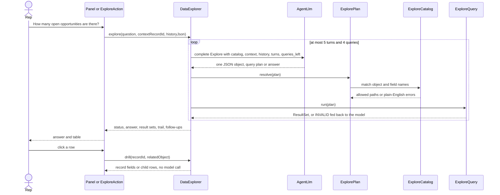
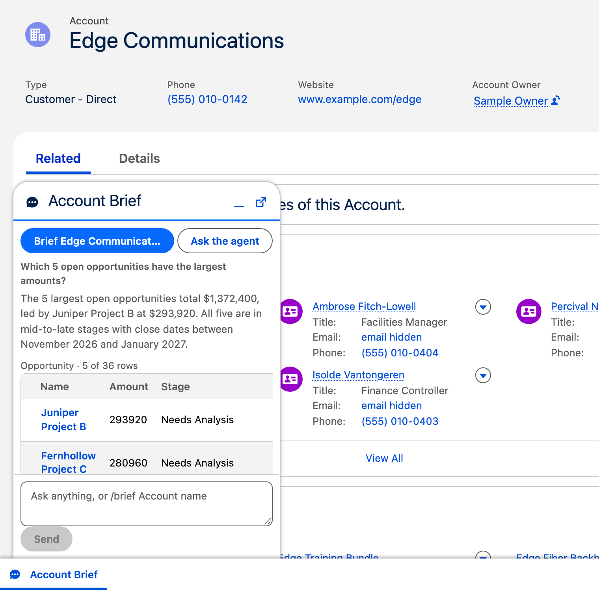
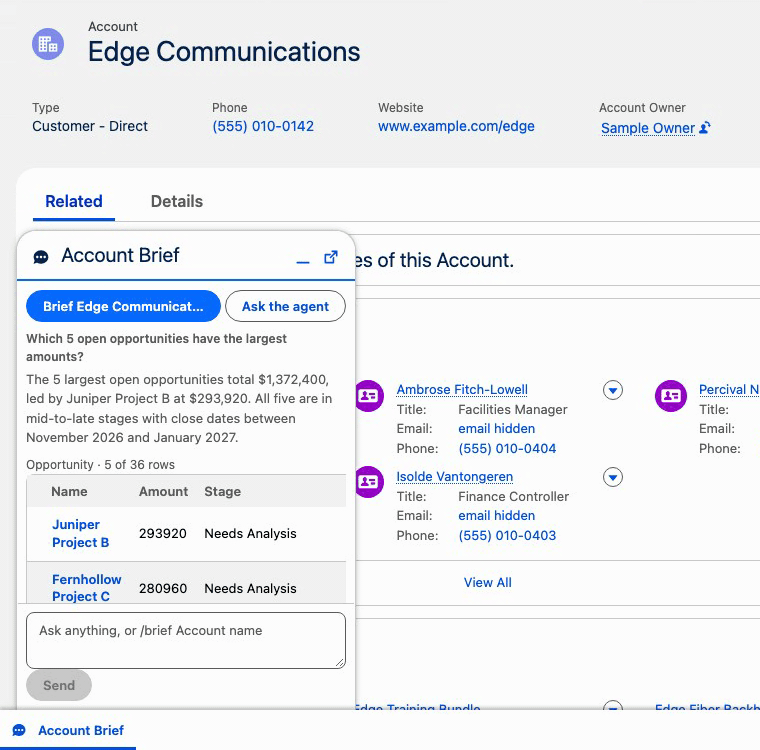
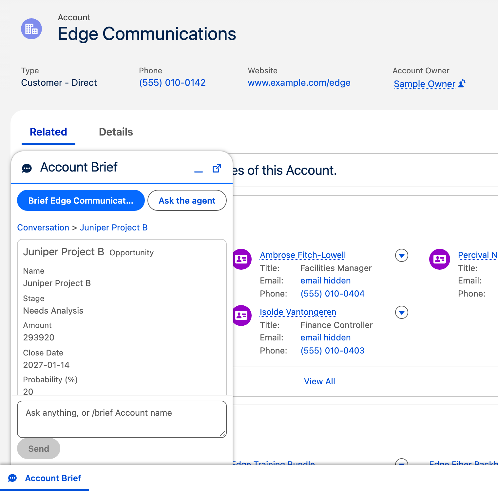

# 02. Ask-anything explorer

## The outcome

A rep asks a question about their CRM data in plain words, such as "How many open opportunities
are there?", and gets a short answer with the result table under it. Clicking a row opens that
record and its related records without another model call.

## The problem it removes

Answering a one-off data question usually means building a report or asking an admin. Letting a
model write SOQL instead is risky: it can query objects it should not, read too many rows, or be
talked into an injected filter. Here the model only fills in a small JSON plan. Apex checks every
name in it against a fixed catalog and runs it with bound values, in the rep's own access.

## How it works

1. **Ask.** `DataExplorer.explore` takes the question, an optional open record, and up to 5
   earlier turns as history.
2. **Plan, not SOQL.** Each turn the model gets `AgentPrompt_Explore` with the catalog, the open
   record, the history, the turns so far and `queries_left`. It replies with one JSON object:
   a query plan (object, fields, filters, order, limit, group by, aggregates) or an answer.
3. **Check.** `ExplorePlan.resolve` matches every name to `ExploreCatalog`. The catalog is a
   curated list (Account, Contact, Opportunity, OpportunityContactRole, Case, Task, Event, User),
   describe-checked for the running user. Anything the user cannot read is dropped.
4. **Build and run.** `ExploreQuery` builds SOQL only from catalog paths, fixed operators and its
   own aliases. Every value is a bind variable. It runs in `AccessLevel.USER_MODE`. The limit
   defaults to 50 and is capped at 200.
5. **Cap the reads.** An aggregate first runs a capped `COUNT()`. If more than 10,000 records
   match, it is refused with "Add filters to narrow it" instead of hitting a limit that cannot be
   caught.
6. **Correct.** A bad reply, a plan error, a query error or a row-cap refusal goes back to the
   model as `INVALID: <reason>`, and it tries again inside the same caps.
7. **Answer.** The model sees 20 rows plus the total per query. When turns run out with results in
   hand, the status stays OK and the last result is shown with a fixed note.
8. **Drill.** `DataExplorer.drill` opens one record's catalog fields or its child rows in one
   related catalog object, found by describe. No model is called.

## See it

## Why you can trust it

- **Injection is closed.** [ExploreQueryTest](../../force-app/main/default/classes/ExploreQueryTest.cls)
  `quoteAndKeywordsAreBoundNotInjected` shows quotes and SOQL keywords in a value stay bound.
  The Apex review calls the injection defence strong ([apex-review.md](../reviews/apex-review.md), summary).
- **Reads are capped.** `aggregateOverTheRowCapIsRefusedAfterACappedCount`,
  `groupedAggregateOverTheRowCapIsRefused` and `countOnlyAggregatesSkipTheRowCap` in
  ExploreQueryTest, and `aggregateOverTheRowCapIsFedBackAndCountsAsAQuery` in
  [DataExplorerTest](../../force-app/main/default/classes/DataExplorerTest.cls). This fixes review
  finding 4.
- **The loop is bounded and keeps results.** DataExplorerTest `queryCapForcesAnswer`,
  `queryPastCapIsRefusedAndRunningOutOfTurnsKeepsTheResults` and
  `invalidRepliesAreFedBackAndCorrected`. This fixes review finding 6.
- **Dates mean the rep's day.** `aDateOnlyValueOnADatetimeFieldIsReadInTheUsersTimeZone` and
  `rangeOperatorsAndInCoverTheWholeLocalDayForADateOnlyValue` in ExploreQueryTest. This fixes
  review finding 8, which compared against midnight GMT.
- **The catalog follows access.** [ExploreCatalogTest](../../force-app/main/default/classes/ExploreCatalogTest.cls)
  `userWithoutAccessHasObjectsDropped`, and DataExplorerTest `objectOutsideCatalogIsRejected` and
  `drillRefusesWhatTheCatalogDoesNotJoin`.
- **Headers read as words.** `labelsAreDotFreeAndUniqueWhilePathsStayTheKeys` (ExploreQueryTest)
  and `parentFieldsGetPlainLabelsInTheAnswerAndTheModelPreview`
  ([ExploreActionTest](../../force-app/main/default/classes/ExploreActionTest.cls)). This followed
  Studio preview case 11, where headers showed raw field paths
  ([studio-preview.md](../research/studio-preview.md)).
- **It runs live.** Studio preview cases 9, 10 and 11 answer org-wide questions through the agent.

## Adopt it

1. Copy `DataExplorer.cls`, `ExplorePlan.cls`, `ExploreCatalog.cls`, `ExploreQuery.cls`,
   `ExploreAction.cls` and their tests from `force-app/main/default/classes/`.
2. Copy `AgentPrompt_Explore` from `force-app/main/default/staticresources/` and the model door
   from [04](04-model-provider-seam.md).
3. **Change the catalog.** Add one entry to `ExploreCatalog.CURATED`:
   `'Object' => new List<String>{ 'Id', 'Name', ... }`. Lookups and one-level parent paths then
   work in plans and in drill. Nothing else changes.
4. **Change the caps** only if you must: `MAX_TURNS` and `MAX_QUERIES` in `DataExplorer`,
   `DEFAULT_LIMIT`, `MAX_LIMIT` and `ROW_CAP` in `ExploreQuery`.

## Limits and open items

- Filters are joined by AND only. There is no OR between filters.
- Parent paths go one level up, such as `Account.Name`. Long text fields are shown but cannot be
  filtered.
- Drill-down from a brief's section lines is not possible yet: section lines carry no record Id.
  The fix is queued ([FE-4 card](../../agents/tasks/FE-4-playwright-end-to-end-suite-for.md), [gtm-burn-plan.md](../../docs/plans/gtm-burn-plan.md)).
- One question can take up to 5 model calls.

> [!WARNING]
> **Not yet proven:** the explorer run as a non-admin user in a live org. The catalog and query
> tests use `runAs` for a user without access, but no live run is recorded. See
> [07](07-trust-access-and-failure.md).
