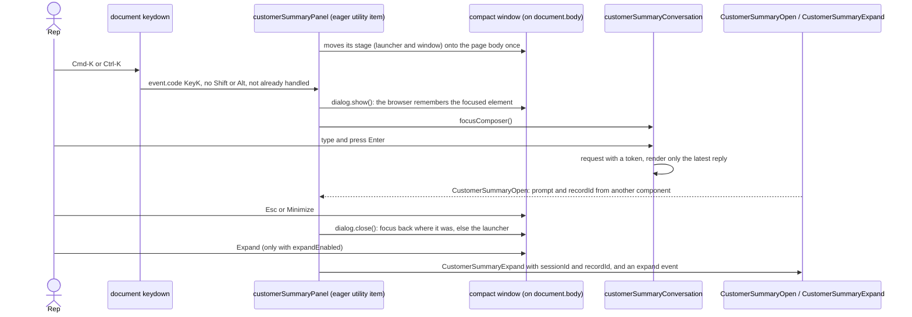
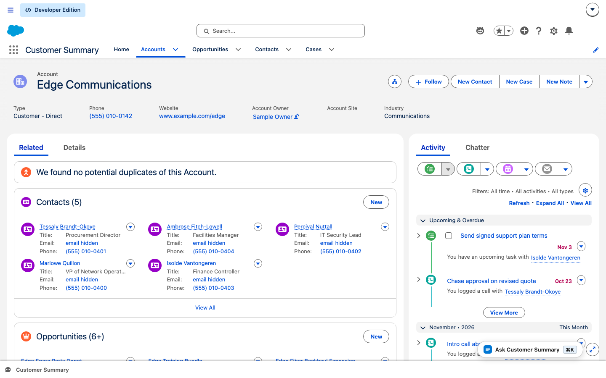
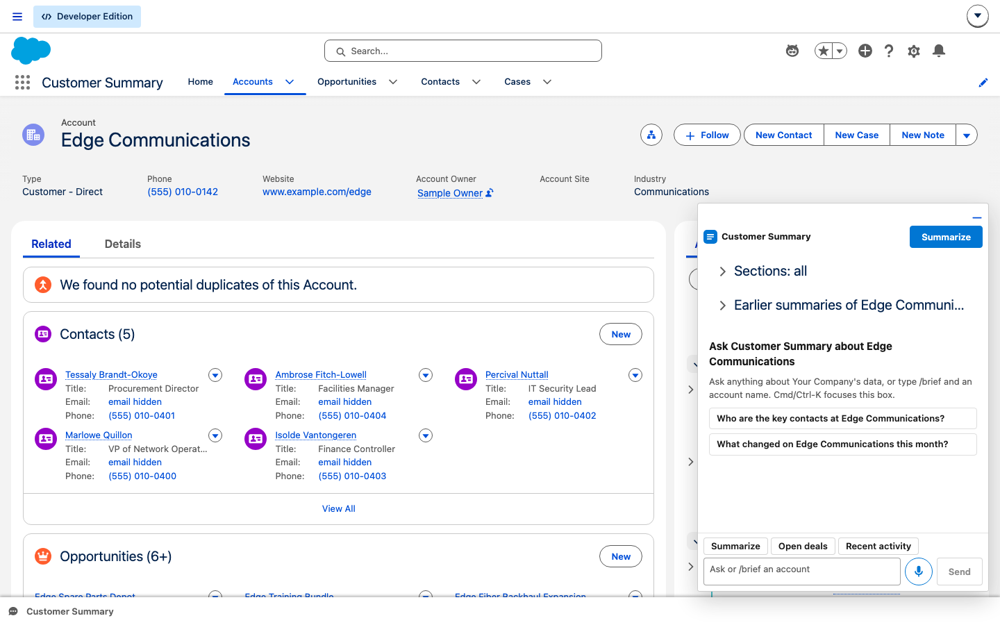

# 03. Hotkey panel

## The outcome

From any page in the Customer Summary app, Cmd-K on a Mac or Ctrl-K elsewhere opens a compact
window at the bottom right of the page with the cursor already in the text box. A launcher in
the same corner, "Ask <agent name>" with the key, opens it too. Esc or Minimize puts it away,
focus goes back where it was, and the conversation is still there next time. The rep never leaves
the record they were on.

## The problem it removes

Assistants that live on their own tab or behind a menu cost the rep their place, so they get used
less. A panel that grabs the keyboard can also break the page: it can trap Tab, steal Lightning
shortcuts, lose the rep's place in a form, or show a stale answer when two requests race. This
window is one keystroke away, and it behaves like a good neighbour on the page.

## How it works

1. **The corner, and why.** The window and the launcher sit at the bottom right, 16 px from the
   right edge and 48 px above the bottom, clear of the utility bar, which stays at its default
   left alignment where a softphone lives ([fr2-surfaces-spike.md](../research/fr2-surfaces-spike.md#corner)).
   A closed utility panel is `display: none` and an open one is a transformed box, so nothing
   fixed inside it can reach the page's corner. The panel stays an `eager` item of the
   `Customer_Summary_UtilityBar` utility bar (so the hotkey works before anything was opened) and
   moves its stage, the launcher and the window, onto `document.body` once. Lightning Web Security
   allows that, but it is not a documented pattern, so it lives in one function (`moveToBody`).
   For an org that mirrors its bar to the right, the item's `corner` property flips both to the
   bottom left (not tried in an org).
2. **The window.** 420 by 560 px (at most the window height less 96 px), a non-modal `<dialog>`
   named after the agent. It slides up with `cubic-bezier(0.32, 0.72, 0, 1)` over 280 ms;
   `prefers-reduced-motion` turns the motion off. Opening took 4 to 14 ms from the key to the
   first frame painted with the window open (5 opens with a warm cache, median 9 ms, in the full
   e2e run of 2026-11-13; e2e spec 10, budget 300 ms).
3. **Hotkeys, and why they are free.** A document `keydown` listener takes Cmd-K on a Mac and
   Ctrl-K elsewhere (`event.code === 'KeyK'`, no Shift or Alt), and yields when another component
   already handled the event (`defaultPrevented`). Lightning's own shortcut list has no K
   shortcut, and Chrome on a Mac lists no Cmd-K. On Windows and Linux, Ctrl-K is Chrome's "search
   from anywhere", an ordinary accelerator a page may take ([fr2-surfaces-spike.md](../research/fr2-surfaces-spike.md#hotkeys)).
   Keys pressed inside the moved stage are handled by the stage itself, because a document
   listener does not hear them there under Lightning's synthetic shadow.
4. **The launcher.** A pill with the agent name from the brand settings ("Ask Customer Summary";
   "Ask the assistant" until they arrive) and the key hint, ⌘K on a Mac and Ctrl K elsewhere, with
   `aria-keyshortcuts`. It scales away as the window opens and comes back when it closes. The agent
   name shows once in the frame, on the launcher; the window's own brand row belongs to the
   conversation.
5. **Esc and focus.** Esc anywhere in the window closes it, except during an IME composition, where
   it only ends the composition. The window is a `<dialog>` opened with `show()`, never
   `showModal()`, so Tab is never trapped, and its `close()` gives focus back to the element that
   had it when the window opened. That browser record is what reaches a field inside another
   component on the record page: Lightning Web Security hides that field from the panel (the
   event path and the active element both stop at the record page's outer host). When that
   element is gone, focus goes to the launcher, never the page body. For a short while after a
   close, focus is kept on the restored element against late moves of the page, until the rep
   presses a key or a pointer.
6. **Minimize and expand.** Minimize closes the window to the launcher; the conversation stays
   mounted, so the thread is there when it opens again. Expand hands the conversation to the right
   rail (FE-15): it fires an `expand` event and publishes on the `CustomerSummaryExpand` channel,
   both with `{ sessionId, recordId }`, then closes the window. It is behind the item's
   `expandEnabled` property. FE-15 turns it on in the `Customer_Summary_UtilityBar` utility bar, and
   Expand opens the [right rail](12-right-rail.md).
7. **The utility bar item.** Its own panel (340 by 200) holds only a note and an Open button, for
   a rep who clicks "Customer Summary" in the bar: the button puts the utility panel away and opens
   the window.
8. **The conversation is its own component.** `c-customer-summary-conversation` (FE-12) owns the
   thread, the composer, latest-wins requests, the live region and the drill view; the window
   passes it the page's record, the brand and the session.
9. **Other components can drive it.** A message on the `CustomerSummaryOpen` channel opens the
   window and runs a prompt with that message's record as context, or briefs an Account Id sent
   alone.
10. **Brand in the app (14f): launcher only.** A Lightning app's brand block is static metadata,
    a header colour and a logo that must be a ContentAsset, set at deploy. It cannot follow the
    runtime brand settings the panel reads, so a brand swap would leave it stale. The app keeps no
    brand block; the brand shows on the launcher and in the window.

## See it

The GIF and the sections still are from before FE-13, when the panel opened in the utility panel
at the bottom left.

## Why you can trust it

- **Jest covers the behaviour.** [customerSummaryPanel.test.js](../../force-app/main/default/lwc/customerSummaryPanel/__tests__/customerSummaryPanel.test.js)
  has tests for the hotkey by key code on and off Mac, Shift, Alt and Cmd being ignored off Mac,
  yielding to an earlier handler, the key hint and `aria-keyshortcuts` per platform, the stage on
  the page body with the theme on it, the launcher scaling away, minimize keeping the thread, the
  expand event and message with their payload (and no Expand button by default), Esc returning
  focus to a field inside another component and falling back to the launcher, `show()` and
  `close()` of the dialog, Tab never trapped, Esc during IME, and axe on the window closed and open.
- **The metadata shape is tested.** [test_app.py](../../tests/test_app.py) checks the utility bar
  has exactly one item, the panel, eager, with `corner` right and `expandEnabled` on (FE-15, for the rail), that the
  `CustomerSummaryExpand` channel carries `sessionId` and `recordId`, and that the app has no brand
  block.
- **It runs in a real org.** The Playwright suite ([e2e/README.md](../../e2e/README.md)) passed
  in `agent-probe` as an admin user (`10 passed (3.3m)`, 2026-11-13). It checks the window's corner and size, the
  launcher and its key hint, Esc returning focus from the global Search button, from the Phone
  field of the record's inline edit (inside another component) and from the launcher, the
  fall back to the launcher when the element is gone, Tab leaving, minimize keeping the thread,
  the open time, and the conversation journeys and axe inside the window.
- **Review findings.** N4 of the panel re-review ([lwc-review-2.md](../reviews/lwc-review-2.md)),
  focus landing on the page body after Esc from a field inside another component, is fixed by the
  dialog's own focus return and proven by e2e spec 2 from the three starting points.

## Adopt it

1. Copy `force-app/main/default/lwc/customerSummaryPanel/` with its `__tests__/` folder, and the
   Jest mocks it maps in `jest.config.js`, and `customerSummaryConversation/` (FE-12) with its tests.
2. Copy `CustomerSummaryPanelController.cls` and its test, the `CustomerSummaryOpen` and
   `CustomerSummaryExpand` message channels, the `Customer_Summary_UtilityBar` flexipage and the
   `Customer_Summary` app.
3. **Change the back end.** The conversation only calls `CustomerSummaryPanelController`. Point its
   methods at your own engine and keep the reply shapes.
4. **Change the hotkey** in `isHotkey` near the top of `customerSummaryPanel.js` if K clashes with
   something in your org, and the key hint next to it.
5. **Pick the corner** with the utility item's `corner` property (right, or left for a mirrored
   bar). `expandEnabled` is on in the shipped utility bar (FE-15) and Expand opens the right rail;
   turn it off if you do not deploy `customerSummaryRail`.

## Limits and open items

- The page-body mount is allowed by Lightning Web Security but not documented; a platform change
  could stop it. It is kept in one function so it is easy to replace.
- The left corner (`corner` left, for a mirrored bar) has not been tried in an org.
- Should-fix from the panel re-review ([lwc-review-2.md](../reviews/lwc-review-2.md)): N5, stacked
  drill-line buttons are about 18 px tall with no gap, which may miss the WCAG 2.2 target size.
- Still open from the first review: every result row is a separate Tab stop (row 6).
- The hotkey and the window work only inside an app whose utility bar holds the panel.
- The window needs a desktop browser. It is not built for the Salesforce mobile app.

> [!WARNING]
> **Not yet proven:** a run as a non-admin user, the second hotkey branch (one run exercises only
> Cmd-K or only Ctrl-K), a manual press of the hotkey in real Chrome on Windows (Playwright sends
> keys past Chrome's own accelerators), the dark theme and its contrast, and real screen-reader
> output.
