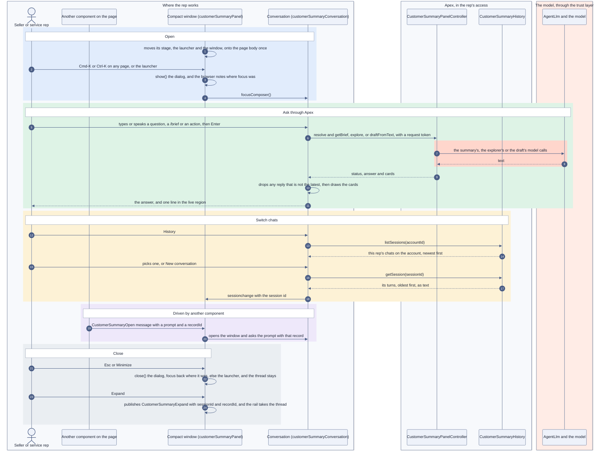

# Hotkey panel

The compact window puts Customer Summary one key away on any page of the app, so a seller or service rep can ask,
hide it, come back to the same thread and switch to an earlier chat without leaving the record they are on.

## The business problem

*Part 1 of 2: the business impact.*

- **The problem.** An assistant that sits behind a button reps do not reach for goes unused. A rep in the middle of a
  call or a form will not stop, look for an icon, open a side panel and lose their place to ask one question. So the
  questions go unasked and the rep pieces the answer together from tabs, as before.
- **What changes for a seller or a service rep.** Customer Summary is one key away on any page in the app: Cmd-K on a
  Mac, Ctrl-K elsewhere, or the launcher in the corner. The window snaps in at the bottom right with the cursor already
  in the text box, over the record the rep was on. It hides with Esc or Minimize without losing the thread, and the
  cursor goes back where it was. Its History lists the rep's past chats on the account, so they can switch back to
  yesterday's conversation or start a new one.
- **What changes for their manager.** Every rep reaches the same summaries, answers and actions the same way, from the
  page they already work on, and every answer arrives as the same readable cards. What a rep asked stays with the rep
  and the account, not in a tab they closed.
- **The standard option, and why this is our own.** Agentforce's own panel is the standard way to chat with an agent
  in Salesforce. This product brings its own surface instead, for the reasons in [Why custom](00-why-custom.md): the
  answers it can show, the cards and how far they scale.
- **The philosophy.** The window is a frame. It owns the key, the corner, hiding and focus; the conversation inside it
  is one shared component that the right rail uses too, and every answer comes from Apex in the rep's own access.

## The architecture in a few steps

1. **Open.** The rep presses Cmd-K or Ctrl-K, or the launcher, on any page in the app. The window opens in the corner
   with the cursor in the text box.
2. **Ask.** The rep types or speaks a question, a summary request or an action. The conversation sends it to Apex.
3. **Answer.** Apex answers in the rep's access, with a model call where one is needed, and the answer is drawn as
   cards. Only the newest answer is shown.
4. **Switch or hide.** History reopens an earlier chat on the account, or starts a new one. Esc or Minimize hides the
   window and keeps the thread.
5. **Close.** Focus goes back where the rep was. Expand moves the same thread into the right rail instead.

**How easy it is to take.** A team copies the window and the conversation, assigns one permission set group and adds
the window to its app's utility bar. The back end is one controller; pointing it at another engine leaves the frame as
it is. See [Adopt it](#adopt-it).

## How it works

*Part 2 of 2: the architecture.* The numbers in the diagram match the steps under it. The coral block is the model
call; everything else is the browser and deterministic Apex. The theme is the shared one in
[_diagram-theme.md](_diagram-theme.md).

1. **The corner, and why (step 1).** The window and the launcher sit at the bottom right, 16 px from the right edge
   and 48 px above the bottom, clear of the utility bar, which stays at its default left alignment where a softphone
   lives ([fr2-surfaces-spike.md](../research/fr2-surfaces-spike.md#corner)). A closed utility panel is
   `display: none` and an open one is a transformed box, so nothing fixed inside it can reach the page's corner. The
   panel stays an `eager` item of the `Customer_Summary_UtilityBar` utility bar, so the key works before anything was
   opened, and moves its stage, the launcher and the window, onto `document.body` once. Lightning Web Security allows
   that, but it is not a documented pattern, so it lives in one function (`moveToBody`). For an org that mirrors its
   bar to the right, the item's `corner` property flips both to the bottom left.
2. **The key and the window (steps 2 to 4).** A document `keydown` listener takes Cmd-K on a Mac and Ctrl-K elsewhere
   (`event.code === 'KeyK'`, no Shift or Alt), and yields when another component already handled the event
   (`defaultPrevented`). Lightning's own shortcut list has no K shortcut, and Chrome on a Mac lists no Cmd-K. On
   Windows and Linux, Ctrl-K is Chrome's "search from anywhere", an ordinary accelerator a page may take
   ([fr2-surfaces-spike.md](../research/fr2-surfaces-spike.md#hotkeys)). Keys pressed inside the moved stage are
   handled by the stage itself, because a document listener does not hear them there under Lightning's synthetic
   shadow. The launcher is a pill with the agent name from the brand settings ("Ask Customer Summary") and the key
   hint, ⌘K on a Mac and Ctrl K elsewhere, with `aria-keyshortcuts`; it scales away as the window opens. The window is
   420 by 560 px (at most the window height less 96 px), a non-modal `<dialog>` named after the agent, opened with
   `show()`, never `showModal()`, so Tab is never trapped. It slides up over 280 ms, and `prefers-reduced-motion` turns
   the motion off. Then the conversation's `focusComposer()` puts the cursor in the text box.
3. **Ask (steps 5 and 6).** The rep types, or speaks into the composer with the mic ([11](11-voice-input.md)). A
   `/brief <name>` goes to `resolve` and then `getBrief` ([01](01-route-gather-reduce.md)); a question goes to
   `explore` ([02](02-ask-anything-explorer.md)); text whose first real word is an action verb, with an account in
   view, goes to `draftFromText` ([13](13-write-actions.md)). The scope chip above the composer reads "About <account>"
   on an account page, and one press asks the whole org instead. Every call carries a token, and a repeat of the
   request already on its way is ignored.
4. **The model call (steps 7 and 8).** The window never calls a model. The summary, the explorer and a typed draft
   each make their own model calls in Apex, through the model door `AgentLlm` and the platform's trust layer
   ([04](04-model-provider-seam.md)). A quick action such as "Log a call" drafts with no model call.
5. **Answer (steps 9 to 11).** The controller passes back the service's status, its text and its cards. The latest
   request wins: a reply whose token is no longer the newest is dropped, so a slow first answer never replaces a
   second. The answer is drawn as cards (see [The cards](#the-cards)), model text is drawn as text runs and never as
   markup, and the live region says one line so a screen reader hears that the answer is in. A failed call gives one
   fixed sentence, never the platform's text.
6. **Switch chats (steps 12 to 18).** History lists this rep's own chats on the account, newest first, ten by default
   (`CustomerSummaryHistory.listSessions`, from the session store of [05](05-conversation-memory.md)). Picking one
   reopens its turns in order (`getSession`), as text, because memory keeps no cards. "New conversation" starts a
   clean thread with a new id. Either way the conversation fires `sessionchange`, so the frame and the rail follow the
   same session. A chat whose account the rep can no longer see is hidden, and an empty list or a failed load says so
   in one sentence.
7. **Driven by another component (steps 19 and 20).** A message on the `CustomerSummaryOpen` channel opens the window
   and runs its prompt with that message's record as context, or summarizes an Account Id sent alone. That is how a
   button elsewhere on the page can start a question in the window.
8. **Hide and close (steps 21 and 22).** Esc anywhere in the window closes it, except during an IME composition, where
   it only ends the composition. `close()` gives focus back to the element that had it when the window opened. That
   browser record is what reaches a field inside another component on the record page: Lightning Web Security hides
   that field from the panel. When that element is gone, focus goes to the launcher, never the page body, and for a
   short while after a close focus is kept on the restored element against late moves of the page, until the rep
   presses a key or a pointer. Minimize does the same from a button. The conversation stays mounted, so the thread and
   any answer still on its way are there when the window opens again.
9. **Expand (steps 23 and 24).** Expand fires an `expand` event and publishes on the `CustomerSummaryExpand` channel,
   both with `{ sessionId, recordId }`, and the same conversation moves into the [right rail](12-right-rail.md): one
   thread, one session, on both surfaces. It is behind the item's `expandEnabled` property, which is on in the
   `Customer_Summary_UtilityBar` utility bar.

### Around the window

- **The utility bar item.** Its own panel (340 by 200) holds only a note and an Open button, for a rep who clicks
  "Customer Summary" in the bar: the button puts the utility panel away and opens the window.
- **The brand shows on the launcher and in the window.** A Lightning app's brand block is static metadata set at
  deploy, so it cannot follow the runtime brand settings the window reads, and the app keeps none
  ([10](10-brand-and-theming.md)).
- **One conversation component.** `c-customer-summary-conversation` owns the thread, the composer, the latest-wins
  requests, the live region, the sessions, the scope chip and the drill; the window passes it the page's record, the
  brand and the session.

### The cards

Every answer in the window is drawn as cards from one typed card contract
([fr2-card-architecture.md](../research/fr2-card-architecture.md)), which the Apex services build
([fr2-card-contract-apex.md](../research/fr2-card-contract-apex.md)) and `c-customer-summary-card` draws. The window
draws them compact: about 340 px of content, lists folded at 5 with the count line always shown, and a table of more
than three columns stacked row by row. Each card also carries its own text, built by one rule per type, which is what
shows when the card cannot be drawn.

| Card | When it shows | Text fallback |
| --- | --- | --- |
| `summary` | First card of a summary: its headline, then the body | The title, then the body lines |
| `section` | One per summary section, closed to start; a failed section shows its fixed line with an Error badge | `Title (shown of total)`, then `- label — detail` per record |
| `text` | The explorer's answer in prose | The text, links as their label |
| `table` | An explorer result with more than two columns | The title, a header line, one line per row, then `(shown of total rows)` |
| `recordList` | An explorer result of a name and one detail | The title, `- label — detail` lines, `(shown of total)` |
| `metric` | An explorer count or sum with no groups | The title, `Label: value — detail` lines |
| `notice` | "Showing N of M rows", an account that matches nothing, or an empty summary | The sentence |
| `trail` | The queries the explorer ran, closed to start | The title, then `N. query — rows` lines |
| `followups` | Suggested next questions as chips; a chip asks it | `Ask next`, then a `- ` line each |
| `error` | A summary or an answer that failed: its fixed sentence | The sentence |
| `record` | A record drilled from a link in any card, with its related objects as chips | `Title · Object`, then `Label: value` lines |
| `actionDraft` | A drafted task or call: its fields, what is still needed, Confirm, Edit and Cancel | `Title · meta`, `Label: value` lines, `Note:` lines, `Options:` |
| `actionResult` | After Confirm: what was written, the record as a link and Open; Undo for 15 s after an update | `Title · meta`, `Label: value` lines, then its line |

Three types in the contract are not drawn in the window. An account name that matches several accounts keeps its
candidate buttons, so its `choice` card is not drawn; `timeline` and `comparison` have builders in Apex but no service
makes them yet. A card of a type or version the window does not know, or one that fails to draw, shows its own text. A
reopened chat shows as text, because memory keeps no cards.

## See it

The GIF and the sections still are from before FE-13, when the panel opened in the utility panel
at the bottom left.

## Why you can trust it

Runs as the signed-in user: the window and the conversation hold no data of their own and reach Apex only through
`CustomerSummaryPanelController` and `CustomerSummaryHistory`, both `with sharing`. Every CRM read behind them (the
resolver, the summary's sections, the explorer's queries, the drill, the drafts and the history's account check) is in
user mode, so the rep's object, field and record access all apply.

System context: three uses on this path, each named in the code with its reason and checked by
[test_trust_rule.py](../../tests/test_trust_rule.py): the prompt settings (`Agent_Prompt_Setting__mdt`, read for every
model call, the product's own configuration, which reps cannot read); the conversation's session rows
(`Customer_Summary_Session__c`, written and read only as the running user's own rows, which reps cannot write; History
re-checks the account in user mode before it shows a chat); and the text of customer outcomes (a summary and a
confirmed action each save one; reps hold no field access to the text, which is set only on rows just written by this
user, and an Undo removes the row only after its author is checked).

Whether a run in a real org has passed is kept in one place, the README's [Status table](../../README.md#status).

- **Jest covers the frame.** [customerSummaryPanel.test.js](../../force-app/main/default/lwc/customerSummaryPanel/__tests__/customerSummaryPanel.test.js)
  has tests for the key by key code on and off Mac, Shift, Alt and Cmd being ignored off Mac, yielding to an earlier
  handler, the key hint and `aria-keyshortcuts` per platform, the stage on the page body with the theme on it, the
  launcher scaling away, minimize keeping the thread, the expand event and message with their payload, Esc returning
  focus to a field inside another component and falling back to the launcher, `show()` and `close()` of the dialog,
  Tab never trapped, Esc during IME, the latest request winning, and axe on the window closed and open.
- **Jest covers the conversation.** [customerSummaryConversationFr2.test.js](../../force-app/main/default/lwc/customerSummaryConversation/__tests__/customerSummaryConversationFr2.test.js)
  checks History (newest first, one Tab stop, reopening in order and dropping a reply still on its way for the old
  thread, a new conversation, and each failure in one sentence), the scope chip, each card drawn at the window's
  density, and that no record Id is in the markup.
- **No raw errors.** Any failed call shows one fixed sentence,
  "I couldn't finish that right now. Try again in a minute.", in the thread and in the live region, even when the
  platform rejects with its own text
  ([customerSummaryConversation.test.js](../../force-app/main/default/lwc/customerSummaryConversation/__tests__/customerSummaryConversation.test.js),
  "speaks the fixed sentence in the live region and the error turn when the platform rejects with its own text"). The
  proof pass found the live region speaking the platform's text, and that is now fixed
  ([fr2-panel-proof.md](../research/fr2-panel-proof.md#finding-for-the-panels-owner)).
- **Model text is text, never markup.** Answers render as runs bound as text ("renders rich text by runs: strong, em
  and plain spans, never as HTML" in
  [customerSummaryConversation.test.js](../../force-app/main/default/lwc/customerSummaryConversation/__tests__/customerSummaryConversation.test.js)),
  and a card binds every value as text and builds no link from card data ("markup in a value stays text" in
  [customerSummaryCard.test.js](../../force-app/main/default/lwc/customerSummaryCard/__tests__/customerSummaryCard.test.js)).
- **Nothing is written before Confirm.** A draft makes no write and Confirm is the only commit
  ([customerSummaryConversationActions.test.js](../../force-app/main/default/lwc/customerSummaryConversation/__tests__/customerSummaryConversationActions.test.js),
  and `aTaskDraftMakesNoDmlAndConfirmWritesIt` in
  [CustomerSummaryActionsTest](../../force-app/main/default/classes/CustomerSummaryActionsTest.cls)). The confirm path
  is covered by Jest and Apex tests only; no end-to-end run has created a record
  ([fr2-action-cards.md](../research/fr2-action-cards.md)).
- **The metadata shape is tested.** [test_app.py](../../tests/test_app.py) checks the utility bar has exactly one
  item, the panel, eager, with `corner` right and `expandEnabled` on, that the `CustomerSummaryExpand` channel carries
  `sessionId` and `recordId`, and that the app has no brand block.
- **It is checked in a test org.** The Playwright suite ([e2e/README.md](../../e2e/README.md)) runs as an admin user:
  [panel.spec.js](../../e2e/panel.spec.js) checks the window's corner and size, the launcher and its key hint, Esc
  returning focus from the global Search button, from a field of the record's inline edit (inside another component)
  and from the launcher, Tab leaving, minimize keeping the thread and the open time;
  [hotkey-platforms.spec.js](../../e2e/hotkey-platforms.spec.js) runs the key on the Mac and the Windows branch
  ([fr2-front-end-tests.md](../research/fr2-front-end-tests.md#both-hotkey-branches)); and
  [conversation-fr2.spec.js](../../e2e/conversation-fr2.spec.js) checks History, the scope chip and a card answer.
- **What a screen reader is given.** The proof pass took accessibility snapshots of the window closed, open, pending,
  answered and in error, checked focus after Esc in each state, and ran axe's colour-contrast rule on the open window
  with an answer showing, with no violations on the light theme ([fr2-panel-proof.md](../research/fr2-panel-proof.md),
  [a11y-snapshot.spec.js](../../e2e/a11y-snapshot.spec.js)).
- **Review findings are fixed.** N4 of the panel re-review ([lwc-review-2.md](../reviews/lwc-review-2.md)), focus
  landing on the page body after Esc from a field inside another component, is fixed by the dialog's own focus return
  and checked by e2e spec 2 from three starting points. N5 (small drill lines) and row 6 of the first review (every
  result row a Tab stop) are fixed in the conversation: every small button has a 24 by 24 px minimum and a result list
  is one Tab stop ("gives every small button the 24 by 24 px target size" and "a brief section's drill lines are one
  Tab stop" in
  [customerSummaryConversation.test.js](../../force-app/main/default/lwc/customerSummaryConversation/__tests__/customerSummaryConversation.test.js)).

## How it scales

- **Opening stays instant on any page.** The window is mounted once at page load by an eager utility item, so the key
  does not wait for a component to load. Opening took 4 to 14 ms from the key to the first frame painted with the
  window open (5 opens with a warm cache, median 9 ms), against a budget of 300 ms (spec 10 in
  [panel.spec.js](../../e2e/panel.spec.js)).
- **Only the newest answer is drawn.** Each request carries a token and a stale reply is dropped, so a rep who asks
  twice, or moves to another account while a summary runs, never sees the wrong answer (the concurrency tests in
  [customerSummaryPanel.test.js](../../force-app/main/default/lwc/customerSummaryPanel/__tests__/customerSummaryPanel.test.js)
  and spec 5 in [panel.spec.js](../../e2e/panel.spec.js)).
- **One conversation for every surface.** The window and the rail share one mounted conversation, so Expand moves the
  thread rather than copying it, and a new surface is a new frame around the same component (spec 2 in
  [rail.spec.js](../../e2e/rail.spec.js)).
- **History stays short.** History lists ten chats by default and never more than fifty, the rep's own only
  (`sessionsAreListedNewestFirstWithTheDefaultLimit`, `theLimitIsHonouredAndCappedAtFifty` and
  `aRepSeesNoneOfAnotherRepsSessionsEvenWhenShared` in
  [CustomerSummaryHistoryTest](../../force-app/main/default/classes/CustomerSummaryHistoryTest.cls)).
- **Cards stay readable at 340 px.** A long list folds at 5 rows in the window and 10 in the rail, the count line is
  never folded, and a wide table stacks ("folding: 5 rows at compact, 10 at comfortable; the count line is not folded"
  in [cardContract.test.js](../../force-app/main/default/lwc/customerSummaryCard/__tests__/cardContract.test.js)).
- **A failure stays one sentence.** However a call fails, the rep reads
  "I couldn't finish that right now. Try again in a minute." and the thread stays as it was; a failed History load or reopen says so in one sentence and keeps the
  thread ("a failed load says so in one sentence" and "a reopen that fails says so in one sentence" in
  [customerSummaryConversationFr2.test.js](../../force-app/main/default/lwc/customerSummaryConversation/__tests__/customerSummaryConversationFr2.test.js)).

## Adopt it

1. Grant access: assign the permission set group `Customer_Summary_User`.
2. Copy `force-app/main/default/lwc/customerSummaryPanel/`, `customerSummaryConversation/` and `customerSummaryCard/`,
   each with its `__tests__/` folder, and the Jest mocks they map in `jest.config.js`.
3. Copy `CustomerSummaryPanelController.cls`, `CustomerSummaryHistory.cls` and their tests, the `CustomerSummaryOpen`
   and `CustomerSummaryExpand` message channels, the `Customer_Summary_UtilityBar` flexipage and the
   `Customer_Summary` app.
4. **Change the back end.** The conversation only calls `CustomerSummaryPanelController` and `CustomerSummaryHistory`.
   Point the controller's methods at your own engine and keep the reply shapes, cards included.
5. **Change the key** in `isHotkey` near the top of `customerSummaryPanel.js` if K clashes with something in your
   org, and the key hint next to it.
6. **Pick the corner** with the utility item's `corner` property (right, or left for a mirrored bar). `expandEnabled`
   is on in the shipped utility bar and Expand opens the right rail; turn it off if you do not deploy
   `customerSummaryRail`.

## Limits and open items

- **The page-body mount is allowed but not documented.** Lightning Web Security allows moving the stage onto the page
  body, but no Salesforce page describes it, so a platform change could stop it. It is kept in one function so it is
  easy to replace. No card yet.
- **The left corner has not been tried in an org.** No card yet.
- **Only in apps whose utility bar holds the panel.** The key and the window work only there. FE-17 proposes the
  panel in every app as P2.
- **Desktop only.** The window needs a desktop browser and is not built for the Salesforce mobile app. FE-17 proposes
  the mobile app as P10.
- **Account pages only.** On an opportunity, contact or case page the window has no account in view: no Summarize, no
  History and no account chip. FE-17 proposes following the record to its account as P1.
- **History is per account.** A rep switches between chats on one account, not across accounts. FE-17 proposes a
  switcher across accounts as P3.
- **A reopened chat shows as text, not cards,** because memory keeps no cards. No card yet.
- **A run as a non-admin user** with only the permission set group has not been recorded; the Apex tests use `runAs`.
  FE-5 has it, and it is parked.
- **A real screen reader's output.** FE-16 recorded what the browser exposes and wrote a five-minute VoiceOver script
  ([fr2-panel-proof.md](../research/fr2-panel-proof.md#voiceover-script-about-five-minutes-macos-safari-or-chrome)),
  which has to be run by hand. No card yet.
- **The dark theme and its contrast.** The test org offers no dark theme, so FE-16 checked the brand colours on the
  light theme only, and axe left 2 elements undecided. No card yet.
- **A lighter brand colour can fail contrast.** The default primary colour is just above 4.5:1 against white, so a
  seller who sets a lighter one would fail it as text and as a button. FE-16 found it. No card yet.
- **The fallback names on a slow connection.** Before the brand settings load, the launcher reads "Ask the assistant"
  for about 220 ms on a warm run; how long on a slow connection was not measured. FE-16 found it. No card yet.
- **The key pressed by hand in Chrome on Windows.** The Windows branch runs with the platform set in a Mac browser,
  and Playwright sends keys past Chrome's own accelerators. No card yet.
- **A record written from the window end to end.** Confirm is covered by Jest and Apex tests; no end-to-end run has
  created a record. No card yet.
- **The diagram on this page has not been render-checked:** the render check in
  [_diagram-theme.md](_diagram-theme.md#render-check) was not run for this page. No card yet.

### What comes later

Not built. The top of FE-17's ranked list ([fr2-panel-later.md](../research/fr2-panel-later.md#ranked-top-five-and-why)),
each a proposed card a reader can pick by its id:

1. **P1, the panel follows the record to its account.** On an opportunity, contact or case page the window would know
   the account, so Summarize, History and the chip work there too.
2. **P2, the panel in every app.** One step adds it to the standard Sales and Service apps, where reps already work.
3. **P3, switch chats across accounts.** Recent and pinned chats, one key away.
4. **P4, a signal when a slow answer is ready while the window is hidden,** so hiding it costs nothing.
5. **P5, keep an answer on the account.** FE-23 has it, and it is parked.

[Back to the pattern index](README.md) | [Back to the architecture page](../ARCHITECTURE.md) | [Back to the README](../../README.md)
