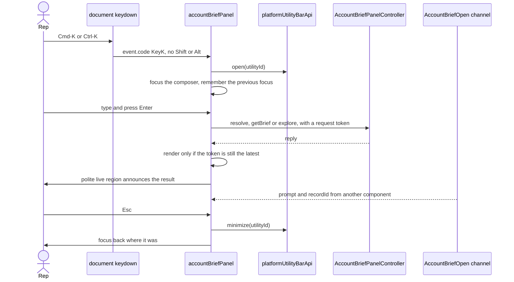
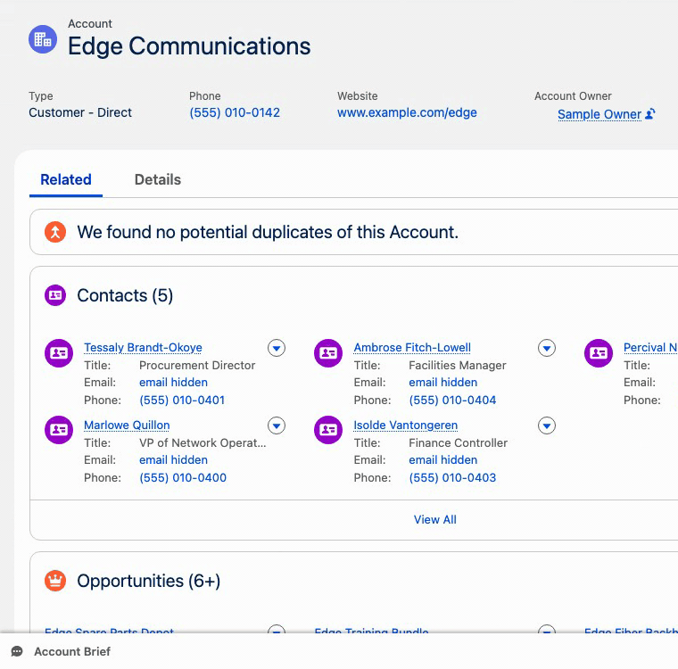
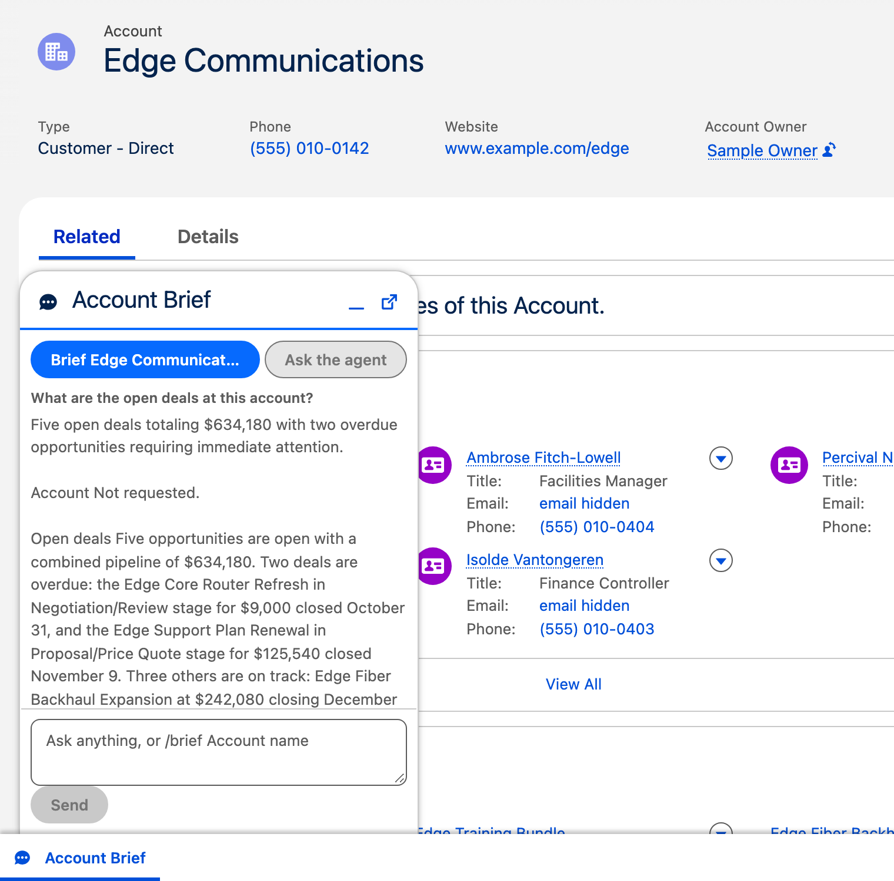

# 03. Hotkey panel

## The outcome

From any page in the Account Brief app, Cmd-K on a Mac or Ctrl-K elsewhere opens a small panel
with the cursor already in the text box. Esc puts it away. The rep never leaves the record they
were on.

## The problem it removes

Assistants that live on their own tab or behind a menu cost the rep their place, so they get used
less. A panel that grabs the keyboard can also break the page: it can trap Tab, steal Lightning
shortcuts, or show a stale answer when two requests race. This panel is one keystroke away, and
it behaves like a good neighbour on the page.

## How it works

1. **Always listening.** The panel sits in the `Account_Brief_UtilityBar` utility bar with
   `eager` set, so the hotkey works before the utility was ever opened. It is 340 by 480 pixels.
2. **One hotkey, narrowly matched.** A document `keydown` listener checks `event.code === 'KeyK'`
   with no Shift or Alt. On a Mac it takes Cmd-K only and leaves Ctrl-K to text fields. It yields
   if another component already handled the event.
3. **Open and focus.** It records where focus was, opens the utility through
   `lightning/platformUtilityBarApi` and focuses the composer.
4. **Typing is safe.** The composer stops key events from reaching Lightning's single-key
   shortcuts. Enter sends, Shift-Enter does not, and Enter during IME composition does not.
5. **Latest request wins.** Every request carries a token. A reply whose token is no longer the
   latest is dropped. A repeat click on the request already in flight is ignored.
6. **Plain text only.** Answers render as text in pre-line blocks, never as HTML.
7. **Accessible.** A polite live region announces loading and results. Tab is never trapped,
   because the panel is not a modal. Esc from any control minimizes and returns focus.
8. **Other components can drive it.** A message on the `AccountBriefOpen` channel opens the panel
   and runs a prompt with that message's record as context, or briefs an Account Id sent alone.
9. **The answer gets the room.** Only one row is pinned above the conversation: the Brief button,
   whose label truncates when it is long but keeps "Brief <Account name>" as its accessible name.
   "Sections" and "Earlier briefs" sit at the top of the scroll box and
   scroll away. A brief's summary shows its headline, with the rest behind a "Full summary"
   toggle, so the section headers are in view under it.

## See it

## Why you can trust it

- **Jest covers the behaviour.** [accountBriefPanel.test.js](../../force-app/main/default/lwc/accountBriefPanel/__tests__/accountBriefPanel.test.js)
  has tests for the hotkey by key code on and off Mac, Shift, Alt and Cmd being ignored off Mac,
  yielding to an earlier handler, six latest-wins cases, Esc returning focus, Tab never trapped,
  Enter and IME, the live region, markup rendered as text, the one-row bar, the "Full summary"
  toggle, three axe checks, and a case that no "Ask the agent" button renders.
- **The metadata shape is tested.** [test_app.py](../../tests/test_app.py) checks the utility bar
  has exactly one item, the panel, with its properties, and that the app references it.
- **Review findings are fixed in code.** The LWC review ([lwc-review.md](../reviews/lwc-review.md))
  found an inert hotkey until first open (finding 1), a bypassed one-request guard (2), no screen
  reader output (4), lost focus (5), a Tab trap (6), a composer that scrolled away at 340 by 480
  (8) and a hotkey that matched too broadly (11). Each is fixed and covered by the Jest tests
  above. The re-review ([lwc-review-2.md](../reviews/lwc-review-2.md)) confirms 1, 2, 4, 8 and 11
  fixed, 5 fixed for the one starting point tested, and 6 changed: the trap is gone. It rates the
  panel "Ready with fixes" with no blockers, and its own Jest run passed 36 of 36 with 89.5% line
  coverage of the panel's JavaScript.
- **It runs in a real org.** The Playwright suite ([e2e/README.md](../../e2e/README.md)) passed
  8 of 8 as an admin user: the hotkey before first open, Esc returning focus, the live region, a
  pinned bar of at most 80 px over a scroll box of at least 240 px, the pinned composer, latest wins, Enter to send, a drill and back, and axe. It passed on its first
  run in the org this was built in ([deploy-verify.md](../research/deploy-verify.md)) and in
  `agent-probe`, where the [e2e report](../assets/e2e-report.png) was taken (3.1 minutes). The first
  run in `agent-probe` passed 7 of 8, and spec 2 (Esc returning focus) has failed now and then since,
  cause not found ([e2e/README.md](../../e2e/README.md)). The earlier spec 9, "Ask the
  agent", was removed with the button (FR2). The e2e report image is the earlier 8 of 8 run.

## Adopt it

1. Copy `force-app/main/default/lwc/accountBriefPanel/` with its `__tests__/` folder, and the
   Jest mocks it maps in `jest.config.js`.
2. Copy `AccountBriefPanelController.cls` and its test, the `AccountBriefOpen` message channel,
   the `Account_Brief_UtilityBar` flexipage and the `Account_Brief` app.
3. **Change the back end.** The panel only calls `AccountBriefPanelController`. Point its methods
   at your own engine and keep the reply shapes.
4. **Change the hotkey** in `isHotkey` near the top of `accountBriefPanel.js` if K clashes with
   something in your org.

## Limits and open items

- Should-fix from the panel re-review ([lwc-review-2.md](../reviews/lwc-review-2.md)):
  - N4: Esc returning focus is proven from one starting point only, the global search button.
    From a field inside another component, focus can land on the page body.
  - N5: stacked drill-line buttons are about 18 px tall with no gap, which may miss the WCAG 2.2
    target size.
- Still open from the first review: every result row is a separate Tab stop (row 6), and the app
  has no brand block (14f). Esc during IME composition also minimizes the panel (note N9).
- The hotkey works only inside an app whose utility bar holds the panel.
- The panel needs a desktop browser. It is not built for the Salesforce mobile app.

> [!WARNING]
> **Not yet proven:** a run as a non-admin user, the second hotkey branch (one run exercises only
> Cmd-K or only Ctrl-K), the dark theme and its contrast, and real screen-reader output. The live
> region has been checked in the page markup only.
