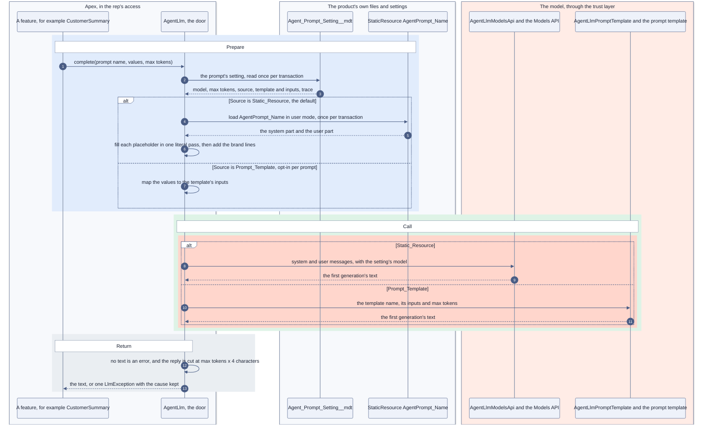

# Model provider seam

Every model call goes through one door, and prompts are files a team can change in minutes.

## The business problem

- **Who has it.** The builder who owns a prompt: the summary's wording, the explorer's rules, the sentiment rubric.
  Each prompt is changed many times, because the first version is rarely the right one.
- **What it costs with prompt templates.** A prompt template adds a build layer between the team and the model. The
  prompt is written in Prompt Builder, its inputs are merge fields or data providers, each change is a new version,
  and a version has to be activated before it runs. Every wording change goes through that UI, so a team slows down
  on template details instead of on what the prompt should say.
- **What the builder sees is not the whole request.** The template text in the builder is not all that reaches the
  model. Merge fields and data providers resolve at run time, as the running user, and the call carries settings of
  its own beside the template (here the application name and the maximum length). When masking is on in Setup, the
  Einstein Trust Layer masks personal and payment data and unmasks the reply, and it scores toxicity; it does this on
  the Models API path too. The difference is where the rest lives: here the whole request that Apex sends is one
  prompt file plus the values code fills into it, and a trace prints it filled
  ([fr2-model-door.md](../research/fr2-model-door.md#what-the-trust-layer-does-on-each-path)).
- **What changes.** A prompt is a plain text file in the repo. A team reads it, changes it, deploys it and tries it
  on a real account in about a minute, alone or with an AI coding assistant. The features never build a prompt
  string; they name a prompt and pass values. A team that still needs a template can switch one prompt to one.

## The decision

**API first for prompts.** This is principle 3 of the design
([fr2-design.md](../plans/fr2-design.md#operating-principles)): every model call goes through the Models API from
Apex, with prompts kept as files a team can read, change, deploy and try in minutes. A prompt template is an opt-in
per prompt for teams that need one, never a required layer.

- **Why.** The Models API is the direct call to the model provider through Salesforce, under the same Trust Layer.
  A file is the fastest thing to change and the easiest to work on with an AI assistant: paste it with a failing
  answer, get a new version, try it. A template adds a layer that most prompts here do not need.
- **The trade-off, said plainly.** The Models API has no point-and-click UI. Prompts live in files and the values
  they get are built in Apex, so changing a prompt means editing a file and deploying it, and changing what a prompt
  is given means changing code. An admin who works only in Setup cannot edit a prompt this way. The
  [builder's guide](../guides/models-api-prompts.md) is how a team works with that.
- **What the Models API request does not take.** It has no maximum-token or temperature setting, so the length is
  held by a character cap in the door, not by the model
  ([fr2-model-door.md](../research/fr2-model-door.md#generation-settings)).

### When a template still fits

- **An admin team edits prompts without deploys.** They want Prompt Builder's editor, versions and activation, not a
  file and a pull request.
- **A governance rule asks for it.** For example, every production prompt must be a versioned, activated template.
- **An existing template library.** A team already has tested templates and wants to reuse them as they are.

**How to use one: a switch per prompt, not commented-out code.** Each prompt has a setting record in
`Agent_Prompt_Setting__mdt`, named after it. Its `Source__c` is `Static_Resource` (the prompt file, the default) or
`Prompt_Template`. With `Prompt_Template`, `Template_Name__c` names the template and `Template_Inputs__c` maps the
prompt's variables to the template's inputs. The feature code does not change, and both sides of the switch are
tested. The repo ships one sample template, `Customer_Summary_Deal_History`, a copy of the deal history prompt, and
that prompt's setting already names it, so switching it over is one field. The switch was run once in a real org, as
an admin, on that prompt, and set back to the file afterwards
([fr2-model-door.md](../research/fr2-model-door.md#the-live-run-2026-11-13-agent-probe)). A rep cannot run a
template until the user group grants Execute Prompt Templates; see [Limits and open items](#limits-and-open-items).
The guide has the steps:
[switch one prompt to a template and back](../guides/models-api-prompts.md#switch-one-prompt-to-a-template-and-back).

## The architecture in a few steps

1. **Name a prompt.** A feature asks for a prompt by name, for example `SummarySynthesis`, and passes the values it
   gathered. It never builds a prompt string.
2. **Load its settings.** The door reads the prompt's setting record: the model, the maximum length, the source and
   whether to trace.
3. **Fill it.** From the prompt file, each `{{name}}` is filled with its value. For a template, the values go to the
   template's inputs.
4. **Send it.** The filled prompt goes to the model through the Models API, or the template runs.
5. **Cap and check.** An empty reply is an error. A reply longer than the maximum length is cut.
6. **Return.** The feature gets the text, or one kind of error that it turns into a plain sentence.

## How it works

The numbers in the diagram match the steps under it. The coral block is the model call; everything else is
deterministic Apex. The two branches are the two sources a prompt's setting can name. The theme is the shared one in
[_diagram-theme.md](_diagram-theme.md).



1. **Name a prompt (step 1).** A feature calls `AgentLlm.complete('SummarySynthesis', values, 1500)`, optionally with
   extra system lines such as the brand's company and tone. Four features call the door, with six prompts:
   `CustomerSummary` (`BriefEngagement`, `BriefDealHistory`, `SummarySynthesis`), `CustomerSentiment` (`Sentiment`),
   `DataExplorer` (`Explore`) and `CustomerSummaryActions` (`ActionDraft`).
2. **Load its settings (steps 2 and 3).** `AgentLlm` reads `Agent_Prompt_Setting__mdt` once per transaction. The
   record named after the prompt gives the model (`Model__c`), the maximum length (`Max_Tokens__c`, which wins over
   the caller's value), the source (`Source__c`), the template and its inputs, and the trace switch (`Trace__c`). A
   prompt with no record runs on every default: the prompt file, the caller's length and the fallback model
   `AgentLlmModelsApi.MODEL`.
3. **Fill it (steps 4 to 7).** On the default path, `AgentLlm` loads the static resource `AgentPrompt_<Name>` in user
   mode, once per transaction. The file has a `---system---` part and a `---user---` part. Each `{{name}}` is filled in
   one literal pass, so a value is never expanded again, and a placeholder with no value is an error, so a renamed
   variable fails loudly. Extra system lines go after the file's system text. On the template path (step 7) the values
   go to the template's inputs as `Template_Inputs__c` maps them; a variable it names with no value is an error. With
   the trace on, the filled text (or the template and its inputs) goes to the debug log with record Ids replaced.
4. **Send it (steps 8 to 11).** `AgentLlmModelsApi` sends a system message and a user message to the Models API's
   chat generations, with the setting's model (steps 8 and 9). `AgentLlmPromptTemplate` runs the named template with
   its inputs and sends the maximum length as the request's own setting, which the Models API request does not take
   (steps 10 and 11). `AgentLlm` reaches both classes by name, so the door holds no compile-time reference to a
   platform AI API.
5. **Cap and check (step 12).** No text is an error. A reply longer than about 4 characters per token of the maximum
   length is cut, on both paths: on the Models API path it is the only length control, on the template path a
   backstop. This cut adds no marker. Some features cap their own answer after it (see
   [Limits and open items](#limits-and-open-items)).
6. **Return (step 13).** The feature gets the text. Any failure, from a missing prompt to a provider exception, is
   one `AgentLlm.LlmException` with the cause kept, which each feature turns into its fixed plain sentence. In tests,
   `AgentLlm.stub` (and `templateStub`) replace the model, so no test calls one.

## See it

This pattern has no screen, so this is the output of [`scripts/prompt-try.apex`](../../scripts/prompt-try.apex) for
one prompt, `BriefDealHistory`, on sample 1 of the seed data, run once in a real org on 2026-11-14. The script prints
only `TRY|` lines and replaces the account's name with `[account]`; no Id or name is in it. It made one model call and
wrote no record (the summary session count is the same before and after).

```text
TRY|prompt=BriefDealHistory sample=1 setting=true source=Static_Resource model_calls=1
TRY|reply_chars=462 gather_ms=74 model_ms=4644
TRY|sessions_before=12 sessions_after=12
TRY|reply=This account shows a 60% win rate with three deals won and two lost. The average won deal is $113,677, though individual wins range from about $15,000 to nearly $194,000. All five deals closed within the past year, with activity spanning from January through October 2026. The two losses were mid-sized opportunities totaling over $325,000 combined, while the wins include one large field tools order, one sizable wireless survey, and one smaller switch rollout.
```

Change the prompt file, deploy it and run the script again to see the new reply. The
[builder's guide](../guides/models-api-prompts.md#try-it-in-a-minute) has the steps.

## Why you can trust it

Runs as the signed-in user: `AgentLlm`, `AgentLlmModelsApi` and `AgentLlmPromptTemplate` are `with sharing`, and the
prompt files are read `WITH USER_MODE`, so a rep holding only the user group reads them in their own access
(`aRepWithTheUserGroupsDataSetReadsPromptFilesAndSettings` in
[AgentLlmTest](../../force-app/main/default/classes/AgentLlmTest.cls)). The values a prompt is given were read by
each feature in the rep's own access.

System context: one use on this path, named in the code with its reason and checked by
[test_trust_rule.py](../../tests/test_trust_rule.py): the prompt settings (`Agent_Prompt_Setting__mdt`), the
product's own configuration, the same for every user, which reps hold no read access to
([fr2-model-door.md](../research/fr2-model-door.md#prompt-files-for-reps-n11)).

Whether a run in a real org has passed is kept in one place, the README's [Status table](../../README.md#status).

- **The door is tested.** [AgentLlmTest](../../force-app/main/default/classes/AgentLlmTest.cls) covers loading and
  filling (`loadsPromptAndFillsPlaceholders`), the three summary prompts having both parts
  (`everyBriefPromptHasBothParts`), clear failures for a missing prompt, a missing variable and a malformed file, the
  default provider (`providerDefaultsToModelsApi`), wrapping (`anyProviderExceptionBecomesAnLlmException`), the
  length cap (`replyLengthIsCappedFromMaxTokens`) and the cache (`aPromptIsLoadedOncePerTransaction`).
- **The settings are tested.** In [AgentLlmTest](../../force-app/main/default/classes/AgentLlmTest.cls): a prompt with
  no record keeps today's behaviour (`aPromptWithNoSettingKeepsTodaysBehaviour`), the setting's model reaches the
  provider (`theSettingsModelReachesTheProvider`), a setting applies only to its own prompt
  (`aSettingOnlyAppliesToItsOwnPrompt`), its length wins and the cap stays a backstop
  (`theSettingsMaximumLengthWinsAndTheCapStaysABackstop`), and four shipped records keep their callers' lengths
  (`theShippedSettingsKeepTodaysValues`). A test never reads the org's records unless it asks, so a changed record
  cannot break another class's test.
- **Both sides of the switch are tested.** The template path with a stub in
  [AgentLlmTest](../../force-app/main/default/classes/AgentLlmTest.cls)
  (`aTemplateSourceCallsTheTemplateWithMappedInputs`, `aTemplateWithAnUnknownVariableFailsClearly`,
  `aTemplateSettingWithNoNameOrABadMapFailsClearly`, `aTemplateFailureBecomesAnLlmException`), and the template
  request in [AgentLlmPromptTemplateTest](../../force-app/main/default/classes/AgentLlmPromptTemplateTest.cls)
  (`buildsTheTemplateRequestFromTheMappedInputs`, `sendsTheMaximumLengthAsTheRequestsOwnSetting`,
  `anyTemplateFailureIsWrappedWithItsCause`). The switch was also run once in a real org, as an admin
  ([fr2-model-door.md](../research/fr2-model-door.md#the-live-run-2026-11-13-agent-probe)).
- **The provider is tested.** [AgentLlmModelsApiTest](../../force-app/main/default/classes/AgentLlmModelsApiTest.cls)
  covers the message shape, the setting's model and the fallback (`thePromptsModelIsSentAndABlankOneFallsBack`), a
  blank system prompt, reading the first generation and wrapping with the cause
  (`anyProviderFailureIsWrappedWithItsCause`). `theRequestCarriesNoGenerationSettings` fails if the request gains a
  field, which pins this page's claim that the Models API request takes no length setting.
- **The trace never leaks.** It is off by default, never writes in a test's output, and replaces record Ids
  (`theTraceIsOffByDefault`, `theTraceNeverWritesRecordIds` and `theTraceCoversTheTemplatePath` in
  [AgentLlmTest](../../force-app/main/default/classes/AgentLlmTest.cls)).
- **The numbers come from the inputs.** The accuracy check (BE-29) found 83 of 84 numbers in five live summaries in a
  gathered section; the other was a correct sum of two of them
  ([fr2-summary-accuracy.md](../research/fr2-summary-accuracy.md)).
- **The code is reviewed.** The Apex re-review ([apex-review-2.md](../reviews/apex-review-2.md)) marks finding 13
  changed (every provider error wrapped, the output capped) and raised N12 (the model as a constant in code), which
  the per-prompt setting now answers.

## How it scales

- **A new prompt is a file and, if it needs one, a record.** Add `AgentPrompt_<Name>` and call it by name; give it a
  setting record only for its own model or length. No door code changes (`aPromptWithNoSettingKeepsTodaysBehaviour`
  in [AgentLlmTest](../../force-app/main/default/classes/AgentLlmTest.cls)).
- **One read per transaction.** Each prompt file and the settings are read once per transaction and cached, however
  many calls a request makes (`aPromptIsLoadedOncePerTransaction` in
  [AgentLlmTest](../../force-app/main/default/classes/AgentLlmTest.cls)).
- **A model change is a record change.** A prompt's model is `Model__c` on its record, so one prompt can move to
  another model with no code change and no effect on the others (`aSettingOnlyAppliesToItsOwnPrompt` in
  [AgentLlmTest](../../force-app/main/default/classes/AgentLlmTest.cls)).
- **Calls fit the transaction.** A summary makes up to four model calls (two condensing calls, the synthesis and the
  sentiment), and the sentiment is skipped once 90 seconds have gone to model calls, inside the 120-second callout
  total per transaction ([fr2-sentiment.md](../research/fr2-sentiment.md#design),
  [fr2-model-door.md](../research/fr2-model-door.md#time-and-rate-limits)). The one try above took under five
  seconds for its call.
- **Rate limits are the platform's.** In production the Models API allows 10,000 requests a minute per org per
  endpoint; trial and sandbox orgs allow far fewer
  ([fr2-model-door.md](../research/fr2-model-door.md#time-and-rate-limits)).

## Adopt it

1. Grant access: assign the permission set group `Customer_Summary_User`.
2. Copy `AgentLlm.cls`, `AgentLlmModelsApi.cls`, `AgentLlmPromptTemplate.cls` and their tests from
   `force-app/main/default/classes/`, the `Agent_Prompt_Setting__mdt` type from `force-app/main/default/objects/`, and
   its records from `force-app/main/default/customMetadata/`.
3. Put each prompt in `force-app/main/default/staticresources/AgentPrompt_<Name>.resource`, plain text, with
   `---system---` then `---user---`, and call it with `AgentLlm.complete('<Name>', values, maxTokens)`. The summary's
   synthesis prompt is `AgentPrompt_SummarySynthesis`.
4. **Change the model or the length** for one prompt on its setting record (`Model__c`, `Max_Tokens__c`), in Setup
   under Custom Metadata Types, or in the repo with a validate and a quick deploy.
5. **Change a prompt** by editing its file and trying it with `scripts/prompt-try.apex`. The builder's guide,
   [Models API prompts](../guides/models-api-prompts.md), covers where a prompt's context comes from, how to tune
   it, how to check it, what it costs, how to switch it to a template and back, and how to work on it with an AI
   assistant.
6. **Change the provider** by writing one class that implements `AgentLlm.ModelProvider` (or `AgentLlm.Provider`,
   which keeps its own model) and naming it in the `PROVIDER_CLASS` constant in `AgentLlm`. Only that class may
   reference a vendor or platform API.

## Limits and open items

- **Reps cannot run a prompt template yet.** Running one needs the Execute Prompt Templates permission, and the user
  group does not grant it, so every shipped setting stays on the prompt file. A template run as a rep can only be
  shown live, because Apex tests cannot run the template call as another user. BE-33 leaves this open; the run as a
  rep is FE-5's.
- **The settings are read in system context** because the data-access permission set does not grant
  `Agent_Prompt_Setting__mdt`. Granting it would let the read move to user mode. BE-33 leaves this open; no card yet.
- **The door's cut adds no marker.** The character cap in `AgentLlm` cuts a long reply with no notice. Two features
  cap their own answer after it: the summary cuts an answer over 5,900 characters at a sentence or line end and adds
  a clear marker, "[Cut short: this summary reached its length limit.]" (`CustomerSummary`, BE-29, N8); the
  explorer's action cuts an answer over 5,900 characters and ends it on "..." (`ExploreAction`), a weaker sign. The
  cap is by characters, not tokens, so on the Models API path the model can still spend tokens it was not asked for.
  No card yet.
- **No time limit of the door's own.** A call runs under the platform's callout limits (120 seconds per
  transaction); only the summary budgets model time, by skipping the sentiment. BE-33 recorded the limits; no card
  yet.
- **What a call costs is partly unconfirmed.** Every Models API request counts against the org's generative AI
  usage; how prompts are metered, and whether a template call counts the same, come from a help article BE-33 could
  not confirm. See the guide's [what each call costs](../guides/models-api-prompts.md#what-each-call-costs). No card
  yet.
- **A provider outside Salesforce is researched, not built.** A model registered in Einstein Studio would need only
  its name in `Model__c` and keep the Trust Layer; a direct call to a vendor needs a new provider class and loses it
  (BE-33, research only, unconfirmed). No card yet.
- **The accuracy check finds made-up numbers, not misplaced ones,** and wording changes from run to run (BE-29). No
  card yet.

[Back to the pattern index](README.md) | [Back to the architecture page](../ARCHITECTURE.md) | [Back to the README](../../README.md)
