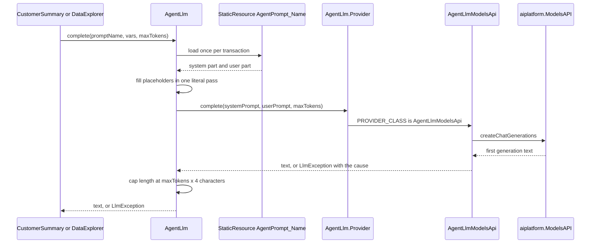

# 04. Model provider seam

## The outcome

Every model call in the repo goes through one Apex class, and one constant names the provider
behind it. A team can change the model, or the way it is reached, by writing one class. No
feature code changes.

## The problem it removes

When each feature calls a model its own way, a model change touches every feature. Prompts get
buried in code, so tests end up calling a real model, and errors leak out in many shapes. Here
features name a prompt and pass values. One door does the rest, and tests replace the door with
a stub.

## How it works

1. **Name a prompt.** A caller asks `AgentLlm.complete('BriefSynthesis', vars, 1500)`. It never
   builds a prompt string itself.
2. **Prompts are files.** `AgentLlm` loads the static resource `AgentPrompt_<Name>`. The file has
   a `---system---` part and a `---user---` part. It is read once per transaction and cached.
3. **Fill strictly.** Each `{{name}}` is filled in one literal pass, so a value is never expanded
   again. A placeholder with no value is an error, so a renamed variable fails loudly.
4. **One provider.** The `AgentLlm.Provider` interface has one method. `PROVIDER_CLASS` names the
   class that implements it, here `AgentLlmModelsApi`.
5. **Default provider.** `AgentLlmModelsApi` calls the Salesforce Models API chat generations
   endpoint. The model is held in one constant, `AgentLlmModelsApi.MODEL`, and is a Claude model
   served through the Models API.
6. **Cap at the door.** The Models API request carries no max-token setting, so `AgentLlm` cuts
   the reply at about 4 characters per requested token, for every provider.
7. **One error type.** Any failure, from a missing prompt to a provider exception, becomes
   `AgentLlm.LlmException` with the cause kept. Callers turn it into their fixed ERROR text.
8. **Tests never call a model.** Tests set `AgentLlm.stub`, which replaces the provider.

## See it

This pattern has no screen. The diagram above is the picture.

## Why you can trust it

- **The door is tested.** [AgentLlmTest](../../force-app/main/default/classes/AgentLlmTest.cls)
  covers loading and filling (`loadsPromptAndFillsPlaceholders`), every brief prompt having both
  parts (`everyBriefPromptHasBothParts`), clear failures for a missing prompt, a missing variable
  and a malformed file, the default provider (`providerDefaultsToModelsApi`), wrapping
  (`anyProviderExceptionBecomesAnLlmException`), the length cap (`replyLengthIsCappedFromMaxTokens`)
  and the cache (`aPromptIsLoadedOncePerTransaction`).
- **The provider is tested.** [AgentLlmModelsApiTest](../../force-app/main/default/classes/AgentLlmModelsApiTest.cls)
  covers the message shape, a blank system prompt, reading the first generation, and wrapping
  with the cause.
- **Review findings are fixed in code.** Apex review finding 13 (uncontrolled output length and
  some unwrapped errors) and finding 14 (one SOQL per model call to load a prompt) are fixed and
  covered by the tests above ([apex-review.md](../reviews/apex-review.md)). The re-review
  ([apex-review-2.md](../reviews/apex-review-2.md)) confirms finding 14 fixed. It marks finding 13
  changed: every provider error is now wrapped and the output is capped, but there is still no
  timeout control and the cap cuts silently (N8).
- **It runs live.** Every brief and explorer answer in the Playwright run on a real org went
  through this door ([deploy-verify.md](../research/deploy-verify.md)), and so did every brief and
  explorer answer in the Studio preview of the draft agent
  ([studio-preview.md](../research/studio-preview.md)). Replies made of fixed text, such as the
  resolver's not-found and candidate lists, make no model call.

## Adopt it

1. Copy `AgentLlm.cls`, `AgentLlmModelsApi.cls` and both tests from
   `force-app/main/default/classes/`.
2. Put each prompt in `force-app/main/default/staticresources/AgentPrompt_<Name>.resource`, plain
   text, with `---system---` then `---user---`.
3. **Change the model.** Edit the `MODEL` constant in `AgentLlmModelsApi` to another model your
   org can reach through the Models API.
4. **Change the provider.** Write one class that implements `AgentLlm.Provider`, and set
   `AgentLlm.PROVIDER_CLASS` to its name. Only that class may reference a vendor or platform API.

## Limits and open items

- The cap is by characters, not tokens. The model can still spend tokens it was not asked for;
  only the text that comes back is cut. A brief that hits the cap ends mid-sentence with no marker
  (Apex re-review N8, [apex-review-2.md](../reviews/apex-review-2.md)).
- The model name is a constant in code, so an org without that model must change code (N12).
- One provider is active for the whole org. Choosing a model per prompt needs a small change to
  `AgentLlm`.
- A second provider has been designed for, not written. Only `AgentLlmModelsApi` exists.
- The Models API needs Einstein generative AI turned on in the org, and each call counts against
  the org's generative AI usage.
