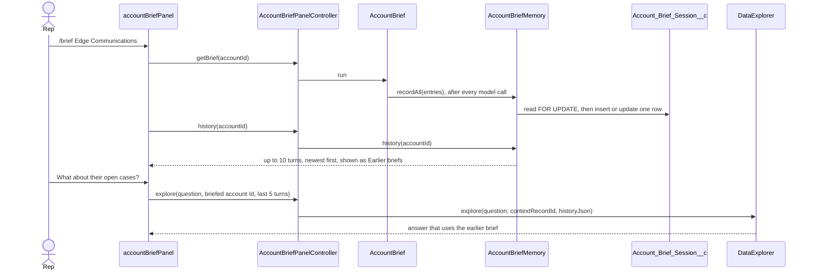
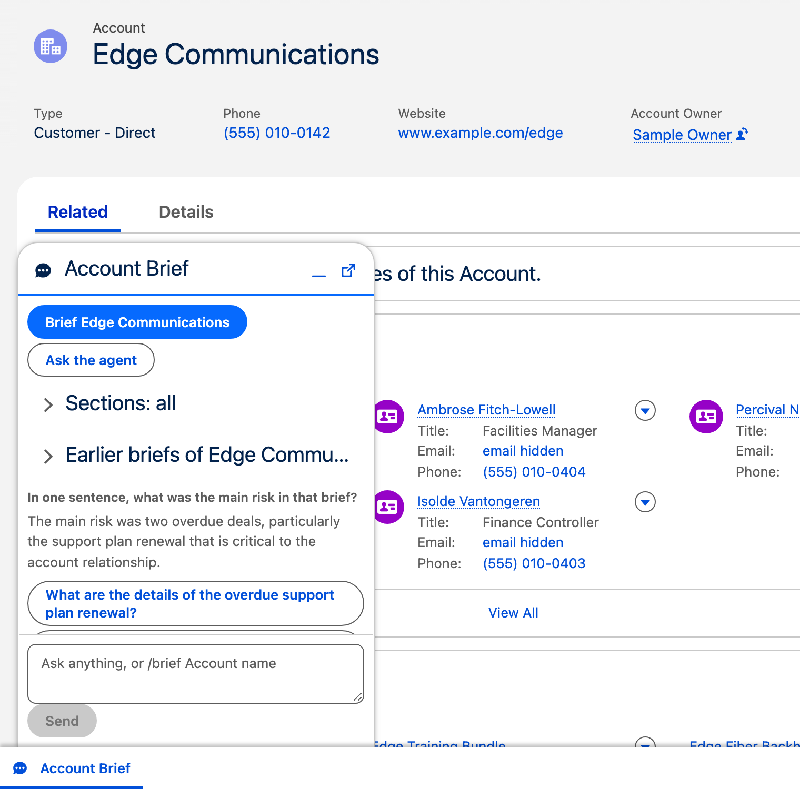

# 05. Conversation memory

## The outcome

A rep can ask a follow-up such as "What about their open cases?" right after a brief, and the
answer knows which account and which brief they mean. When the rep comes back to an account
later, the panel lists their earlier briefs of it. Each rep sees only their own.

## The problem it removes

Without memory, every message starts from nothing. The rep has to repeat the account name, and
the agent can guess the wrong one. Memory kept in a shared place can also leak one rep's
questions to another, or grow without limit. This pattern keeps two small memories: the current
conversation, and a short per-rep history of each account.

## How it works

1. **One row per rep and account.** `Account_Brief_Session__c` is keyed by `Session_Key__c`,
   which is the user's Id and the Account Id joined by an underscore.
2. **A short ring.** `Turns_JSON__c` holds the newest 10 turns. Each turn keeps the time, the
   status, the question and a headline of up to 200 characters.
3. **Written once, last.** `AccountBrief` calls `AccountBriefMemory.recordAll` once, after every
   model call, and only on OK or EMPTY. A failed memory write is logged and the brief still
   returns.
4. **No lost turns.** The rows to change are read `FOR UPDATE`. A row that did not exist is
   inserted. If another transaction created it first, the insert fails with DUPLICATE_VALUE and
   the write is redone once from a fresh locked read.
5. **Bounded growth.** Each rep keeps at most 200 rows. After a write that created rows, their
   least recently active rows beyond the cap are deleted. Another rep's rows are never touched.
6. **Earlier briefs.** When an account is briefed or open, the panel calls `history(accountId)`
   and shows the turns in an "Earlier briefs" accordion.
7. **In-conversation follow-ups.** The panel sends its last 5 turns, including the brief text, to
   the explorer as `historyJson`, with the briefed account as the context record.
8. **In the agent.** The agent keeps `briefed_account_id` and `briefed_account_name` as
   conversation variables, so "their open cases" briefs the same account (see
   [06](06-agent-routing-and-verbatim-relay.md)).

## See it

## Why you can trust it

- **The store is tested.** [AccountBriefMemoryTest](../../force-app/main/default/classes/AccountBriefMemoryTest.cls)
  covers one row on the first write, twelve writes keeping the ten newest, clipped headlines,
  separate rows for two users, one write for several turns, a row saved by another transaction
  kept and not overwritten (`aRowSavedByAnotherTransactionIsKeptNotOverwritten`), the per-user cap
  (`rowsPerUserAreCappedAndTheOldestGoFirst`) and the cap never purging another user's rows.
- **Write order is tested.** [AccountBriefTest](../../force-app/main/default/classes/AccountBriefTest.cls)
  `modelExceptionGivesErrorAndNoMemory` and `threeRequestsMakeNoModelCallAfterDml`.
- **Follow-up context is tested.** [DataExplorerTest](../../force-app/main/default/classes/DataExplorerTest.cls)
  `contextAndHistoryReachThePrompt` and `unreadableHistoryAndNoContextAreNone`. The panel's
  history accordion is covered in
  [AccountBriefPanelControllerTest](../../force-app/main/default/classes/AccountBriefPanelControllerTest.cls)
  `getBriefWithNullIncludeBriefsEverySourceAndHistoryRemembersIt`.
- **Review findings are fixed in code.** Apex review finding 10 (a dead invocable write action,
  `recordFromFlow`, exposed to builders) and finding 11 (racing writes and unbounded rows) are
  fixed and covered above ([apex-review.md](../reviews/apex-review.md)). LWC review finding 9
  (earlier briefs of another account) is fixed ([lwc-review.md](../reviews/lwc-review.md)). The
  re-reviews confirm all three fixed ([apex-review-2.md](../reviews/apex-review-2.md),
  [lwc-review-2.md](../reviews/lwc-review-2.md)).
- **It runs live.** In the Studio preview of the draft agent, case 7 answers "What about their open cases?" from the stored
  account, with no new resolve ([studio-preview.md](../research/studio-preview.md)).

## Adopt it

1. Copy `AccountBriefMemory.cls`, its test, and `force-app/main/default/objects/Account_Brief_Session__c/`.
2. Give users read access to the object and its fields. `Account_Brief_Data_Access` does this,
   read-only.
3. Call `AccountBriefMemory.recordAll` once at the end of your own engine, after every callout.
4. **Change the size.** `MAX_TURNS` and `HEADLINE_MAX` are constants. `maxRowsPerUser` is 200.
5. **Change what a follow-up sees.** `HISTORY_TURNS` in the panel and `HISTORY_ITEMS` in
   `DataExplorer` are both 5.

## Limits and open items

- Memory reads and writes run in system mode. This is deliberate: the row key holds the running
  user's Id, the object is private, and the user never picks the row. The Apex review accepted it
  ([apex-review.md](../reviews/apex-review.md), access-mode inventory).
- Only the brief is stored. Explorer questions are not remembered across sessions.
- Earlier briefs are listed, not fed to the model. A new brief starts fresh. `lastBrief()` exists
  but nothing calls it yet.
- A lock timeout on the memory write drops that one turn. The brief itself still returns.
- How long an agent conversation keeps its variables has not been measured.
- Memory outlives access. A rep who loses access to an account can still see its last brief
  text, because past briefs are returned without checking access again (Apex re-review N6,
  [apex-review-2.md](../reviews/apex-review-2.md)).
- A brief overtaken by a newer request is never shown, but the server still finishes it and
  stores it, so "Earlier briefs" can list a brief the rep never saw (panel re-review N6,
  [lwc-review-2.md](../reviews/lwc-review-2.md)).
