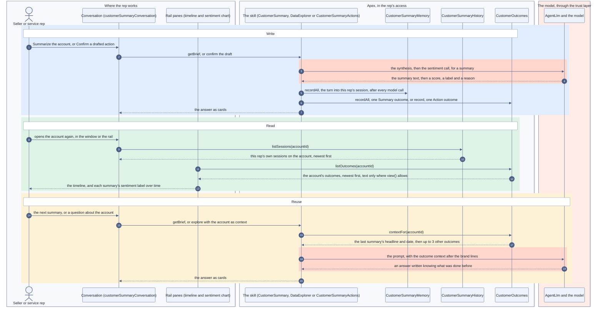

# Memory and customer history

The product remembers what it did for each customer, and every seller or service rep starts from that: the
conversation they were in, and the summaries, actions and saved answers kept against the account.

## The business problem

*Part 1 of 2: the business impact.*

- **The problem.** A summary is paid for in model calls and in the rep's time, then it is forgotten: it lives in a
  closed tab or in one agent conversation, and the next rep, or the same rep next week, asks for it again. Reps repeat
  themselves, re-typing the account name and the question they asked yesterday. Nobody sees how a customer is
  trending, because each summary stands alone and nothing joins one to the next.
- **The operating principle. What the product does for a customer is kept against the customer.** A summary, an
  action taken or an answer a rep saves is a customer outcome: stored against the account, not inside one agent or one
  conversation, and kept for as long as its type says
  ([fr2-design.md](../plans/fr2-design.md#operating-principles), principle 4).
- **What changes for a seller or a service rep.** A follow-up such as "what about their open cases?" knows which
  account and which summary it means. When the rep comes back to the account, History lists their own past chats on
  it, and the rail shows what has been done for the customer, newest first, with the sentiment label of each summary.
  The next summary is given the last one, so it can say what changed since.
- **What changes for their manager.** The work done for an account stays with the account. Anyone who can see the
  account sees that a summary was made or a task was created, when, and how the customer read at the time, without
  seeing text that was built from someone else's access.
- **The philosophy.** Two small memories, each with one job, both in the org, both in the rep's own access. The
  platform's own Agent Memory has a different job, and this page says plainly where it fits.

## Two memories

| | The conversation | Customer outcomes |
| --- | --- | --- |
| What it holds | One session: one rep, one account, a title, a start, a last activity, a turn count and the newest 10 turns, from the summary and the explorer alike | One outcome: a summary, an action taken or a saved answer, with its title, headline, body, record link, sentiment and expiry |
| Where | `Customer_Summary_Session__c`, written by `CustomerSummaryMemory`, read by `CustomerSummaryHistory` | `Customer_Outcome__c`, in a master-detail to the account, written and read by `CustomerOutcomes` |
| How long | A session ends after 30 idle minutes; each rep keeps at most 200 sessions, oldest first out | By type: summaries forever, actions and saved answers for two years; a purge job deletes what has expired |
| Who sees it | Only the rep who owns it, and only while they can still read the account | Anyone who can see the account sees each outcome's type, date and sentiment label; only its author sees its text, unless its type is marked to share |
| What it is for | Follow-ups inside the conversation, and History to reopen a past chat | The outcome context every new conversation starts from, the timeline and the sentiment chart |

- **The conversation is short and the rep's own.** It is per session, so a rep who comes back after a meeting starts
  a new one, and the old one stays in History. Who else may see a rep's history is an open question for the product
  owner; until it is answered, each rep sees only their own
  ([fr2-conversation-history.md](../research/fr2-conversation-history.md)).
- **Customer outcomes are durable and belong to the account.** Nothing on an outcome is specific to one agent or one
  session, so a summary made in the compact window, a task confirmed in the rail and a summary asked for through MCP
  all land in the same place. A rep who loses the account loses its outcomes, because the account is their master
  ([fr2-customer-outcomes.md](../research/fr2-customer-outcomes.md)).
- **Shown to others without what only the author could read.** A summary is built from what its author could read,
  so another rep sees its type, its date and its sentiment label, and for an action a fixed phrase for its kind
  ("Task created", never the task's subject). The title, headline, body, record link and sentiment reason stay with
  the author. A type can be marked to share its text; none is, as shipped.

## Agentforce's Agent Memory

Agentforce's Agent Memory is per user and per agent, not keyed to an account, and never reaches the panel, the rail or
MCP. That last point is reasoned from the design, not tested: Agent Memory lives inside a registered agent's runtime,
and the panel, the rail and MCP call Apex services, not the agent. The measurements and sources are in
[fr2-agent-memory.md](../research/fr2-agent-memory.md).

**What it is.** A feature of Agent Script agents, which Salesforce lists as generally available. A model writes short
memories about the user from their conversations with one agent (a preference, their name), up to 50 per user per
agent plus a smaller pool that a user's agents share, and replaces the oldest when full. Each user can view, delete
and export their memories and turn memory off per agent, and one org-wide setting turns it off for everyone. An agent
turns it on with one `context:` block in its script. Data 360's agentic memory is a different product: it keys memory
to an individual's profile in Data 360 and is read through an API.

**How it fits.** It does well what our design does not try to do: remember a rep's own preferences inside an
Agentforce agent, curated by a model and managed by the rep. Our surfaces and the MCP door call Apex services, not
the agent, so by design nothing it keeps reaches them. It covers neither of our two memories, so both stay as designed.

| Need | Agent Memory | Data 360 agentic memory | Our design |
| --- | --- | --- | --- |
| Outcomes that persist against the account, kept by type | Not covered: per user and per agent, oldest replaced, no account key, no retention per type | Not covered: keyed to a person's profile, not an account, and needs Data 360 | Customer outcomes (`BE-35`) |
| Earlier summaries fed to the next one | Not covered: it keeps short facts about the user, not the summaries, and no object exposes them to Apex | Partial: session summaries through an API, per profile, for agents registered in Data 360 | The outcome context (`BE-35`) |
| Sentiment over time | Not covered | Not covered | A label on each summary (`BE-36`), drawn in the rail (`FE-19`) |
| Context when the rep opens a conversation, on every surface | Partial: only inside the registered agent, only that rep's facts, never on our surfaces or MCP | Partial: profile context through an API, behind Data 360 | The outcome context (`BE-35`) and the conversation history (`BE-26`) |

**What our outcomes keep that it does not:** the record of what was done for the account, who did it, when, how the
customer read, and how long to keep it, readable by anyone who can see the account. Turning Agent Memory on in the
optional agent, for a rep's preferences there, is a later opt-in and is not built.

## The architecture in a few steps

1. **A skill finishes.** A summary is answered, an explorer question is answered, or a drafted action is confirmed.
2. **It records an outcome.** After its last model call, the skill saves the turn in the rep's session and, for a
   summary or a confirmed action, one customer outcome on the account.
3. **The next conversation starts from it.** When the rep opens the account again, History lists their sessions, and
   every new summary or question about the account carries a short outcome context: the last summary and the last
   few outcomes.
4. **The next summary says what changed.** The outcome context goes into the summary's prompt, so the new summary is
   written knowing what the last one said.
5. **The rail shows the timeline and the trend.** The account's outcomes, newest first, and each summary's sentiment
   label over time.

**How easy it is to take.** A team copies two classes and an object per memory, assigns one permission set group, and
calls one method at the end of its own skill. A new outcome type is one custom metadata record. See
[Adopt it](#adopt-it).

## How it works

*Part 2 of 2: the architecture.* The numbers in the diagram match the steps under it. The coral blocks are the model
calls; everything else is the browser and deterministic Apex. The theme is the shared one in
[_diagram-theme.md](_diagram-theme.md).

1. **A skill finishes (steps 1 and 2).** The rep asks for a summary in the compact window or the rail, or confirms a
   drafted action ([13](13-write-actions.md)). An explorer question ([02](02-ask-anything-explorer.md)) takes the same
   path through `CustomerSummaryPanelController.explore`, and records only its turn.
2. **The model calls (steps 3 and 4).** The summary's model calls run first, all of them, before anything is written
   ([01](01-route-gather-reduce.md)). After the synthesis, one focused call reads the already-reduced sections and
   returns strict JSON: a score from -2 to +2, one of five labels (At risk, Concerned, Neutral, Positive, Very
   positive) and a one-line reason. A partial summary, a failed call or a malformed reply stores no sentiment, and the
   summary still returns ([fr2-sentiment.md](../research/fr2-sentiment.md)). A confirmed action makes no model call.
3. **The turn is saved (step 5).** `CustomerSummaryMemory.recordAll` writes once, last, and only on an OK or EMPTY
   answer. The rep's rows are read `FOR UPDATE`; a row another transaction created first is caught by its
   `DUPLICATE_VALUE` and the write is redone once from a fresh locked read. A turn more than 30 minutes after the
   session's last activity ends that session: its row keeps its title, start and turns, and a new row starts. The ring
   keeps the newest 10 turns, each with its time, status, question, a 200-character headline and its kind, `summary`
   or `explorer`. After a write that created rows, the rep's least recently active rows beyond 200 are deleted, and
   another rep's rows are never touched. A failed write is logged and the answer still returns.
4. **The outcome is saved (step 6).** A summary writes one `Summary` outcome with the question as its title, the
   answer as its body, its first line as its headline, and the sentiment; an EMPTY summary is recorded too, because
   the rep did ask. A confirmed action writes one `Action` outcome titled with what was done and linked to the record
   it wrote; a failed outcome write never undoes the action. `CustomerOutcomes` stamps each with its type's expiry and
   fills the surface from where the request came from (`panel`, `action` for MCP and the agent, `api`, `script`). The
   write is in its own try and catch, so a failure is logged and the answer still returns.
5. **The answer (step 7).** The conversation draws the answer as cards ([03](03-hotkey-panel.md#the-cards)).
6. **History (steps 8 to 10).** When the rep opens the account again, History lists this rep's own sessions on it,
   newest first, ten by default and never more than fifty, and `getSession` reopens one with its turns in order, as
   text. Both read in user mode, and both first check that the rep can still read the account: a session for an
   account the rep has lost is hidden, never deleted. Inside one conversation, the last 5 turns go with each question
   as `historyJson`, so "their open cases" means the account just summarized.
7. **The timeline and the trend (steps 11 to 13).** In the rail's context column, `customerSummaryHistoryTimeline`
   lists the account's outcomes, newest first, as one `timeline` card drawn by the shared card renderer, with a filter
   by type and a detail under the card for each entry. `customerSummarySentimentChart` draws each summary as a point on
   the band of its label, oldest on the left, with a text table for screen readers. It draws labels only: no line and
   no numeric axis, because the score is not yet steady enough to chart (BE-36). Both draw only what
   `CustomerOutcomes.view()` returns: another rep's entry shows its type, date and label, and says its text stays with
   its author.
8. **The outcome context (steps 14 to 17).** Every new summary, and every explorer question with an account open,
   asks `CustomerOutcomes` for a short context: the last summary's headline and date, then up to 3 other outcomes,
   one line each, at most 160 characters a line and 900 in all. A line carries a headline only when the rep may see
   its text, so one rep's headline never reaches another rep's prompt; the body is never in it. The context is built
   inside the shared services, so the compact window, the rail and both MCP tools get it with no change to a door.
9. **The answer knows what came before (steps 18 to 20).** The summary adds the context to its synthesis prompt's
   system text, after the brand lines, so the new summary is written knowing the last one's headline and can say what
   changed since; the explorer adds it to its prompt's context value. The prompt files themselves are unchanged.

## See it

The follow-up still predates the FR2 compact window and rail. FE-19 took two stills of the rail on an account record
page at 1440 by 900, which OPS-52 links here with the rest of this page's captures:

- `fr2-history-timeline.png`: the rail with the history timeline in its context column.
- `fr2-history-sentiment.png`: the rail with the sentiment chart in its context column, a point focused.

## Why you can trust it

Runs as the signed-in user: the conversation, History, the timeline and the chart hold no data of their own and reach
Apex only through `CustomerSummaryPanelController`, `CustomerSummaryHistory` and `CustomerOutcomes`, all
`with sharing`. History's reads and its account check are in user mode, and every outcome row, and every field on it
except the four text fields, is read and written in user mode, so the platform checks the account each time.

System context: four uses on this path, each named in the code with its reason and checked by
[test_trust_rule.py](../../tests/test_trust_rule.py): the conversation's session rows (`CustomerSummaryMemory` writes,
locks, caps and reads only the running user's own rows, the product's own records, which reps cannot write); the text
of customer outcomes (reps hold no field access to the title, headline, body or sentiment reason, so the rule on who
sees them cannot be bypassed in a list view or a report; `CustomerOutcomes` sets them only on rows this user has just
inserted, reads them only for rows `view()` shows in full, and removes an outcome only after checking its author); the
outcome purge job (`CustomerOutcomeRetentionBatch` deletes every expired outcome, whoever wrote it, and no rep can see
them all); and the prompt settings (`Agent_Prompt_Setting__mdt`, read for every model call, the product's own
configuration, which reps cannot read).

Whether a run in a real org has passed is kept in one place, the README's [Status table](../../README.md#status).

- **The session store is tested.** [CustomerSummaryMemoryTest](../../force-app/main/default/classes/CustomerSummaryMemoryTest.cls)
  covers one row on the first write, twelve writes keeping the ten newest, clipped headlines, separate rows for two
  users, a row saved by another transaction kept and not overwritten
  (`aRowSavedByAnotherTransactionIsKeptNotOverwritten`), the per-user cap
  (`rowsPerUserAreCappedAndTheOldestGoFirst`) and the cap never purging another user's rows
  (`theCapNeverPurgesAnotherUsersRows`).
- **History is own-only and re-checks the account.** [CustomerSummaryHistoryTest](../../force-app/main/default/classes/CustomerSummaryHistoryTest.cls)
  shares one rep's row with a second rep, shows the second rep can read it in user mode, and shows neither method
  returns it (`aRepSeesNoneOfAnotherRepsSessionsEvenWhenShared`); a session is hidden, not deleted, once its account
  is unreadable (`aSessionIsHiddenOnceItsAccountIsNoLongerReadable`); and the timeout starts a new session
  (`aQuestionAfterTheTimeoutStartsANewSession`).
- **Who sees an outcome is tested.** [CustomerOutcomesTest](../../force-app/main/default/classes/CustomerOutcomesTest.cls)
  covers `theAuthorSeesEverything`, `anotherRepSeesTypeDatePhraseAndLabelButNoText`,
  `aTypeMarkedToShareShowsItsTextToOthers`, `noRepGetsTheTextFromAUserModeQuery`,
  `anAuthorWhoLosesTheAccountLosesItsOutcomes`, `aRepWhoCannotSeeTheAccountSeesNoOutcomes`,
  `oneRepsHeadlineNeverReachesAnotherRepsContext` and `aRepCannotRemoveAnotherRepsOutcome`.
- **Nothing is written before the last model call, and a failed write costs nothing.**
  [CustomerSummaryTest](../../force-app/main/default/classes/CustomerSummaryTest.cls) has
  `modelExceptionGivesErrorAndNoMemory`, `threeRequestsMakeNoModelCallAfterDml`,
  `aSummaryIsRecordedAsAnOutcomeAfterEveryModelCall`, `aFailedOutcomeWriteIsLoggedAndTheSummaryStillReturns` and
  `aFailedSentimentCallStillGivesTheSummaryAndItsOutcome`;
  [CustomerSummaryActionsTest](../../force-app/main/default/classes/CustomerSummaryActionsTest.cls) has
  `aFailedOutcomeNeverUndoesTheAction`.
- **The MCP path gets the outcome context.** Two tests go through the actions the MCP tools call:
  `aNewSummaryThroughTheActionSeesTheLastSummarysHeadlineAndDate` in
  [CustomerSummaryTest](../../force-app/main/default/classes/CustomerSummaryTest.cls) and
  `theActionSeesTheOpenAccountsOutcomeContext` in
  [DataExplorerTest](../../force-app/main/default/classes/DataExplorerTest.cls), each with the headline in the prompt
  and not the body ([fr2-customer-outcomes.md](../research/fr2-customer-outcomes.md#proof-that-the-mcp-path-receives-the-context)).
- **A sentiment reply is parsed strictly.** [CustomerSentimentTest](../../force-app/main/default/classes/CustomerSentimentTest.cls)
  maps each score to its one label and refuses prose, extra keys, a label that disagrees with the score and a
  fractional or out-of-range score; `noEvidenceOnRecordIsNotEnoughActivityWithNoModelCall` and
  `aPartialSummaryIsNotScored` cover the sparse and partial cases.
- **The timeline and the chart draw only what they are given.**
  [customerSummaryHistoryTimeline.test.js](../../force-app/main/default/lwc/customerSummaryHistoryTimeline/__tests__/customerSummaryHistoryTimeline.test.js)
  has "opening someone else's entry shows type, date and label and a note that the text stays with its author" and
  "no record Id reaches the markup, and no href is built";
  [customerSummarySentimentChart.test.js](../../force-app/main/default/lwc/customerSummarySentimentChart/__tests__/customerSummarySentimentChart.test.js)
  has "many points: one per summary, oldest on the left, labelled with date and label, no line" and "someone else's
  summary: the label alone, never a reason, in the chart or the table".
- **They are checked in a test org.** [history.spec.js](../../e2e/history.spec.js) opens both in the rail of a record
  page: the timeline newest first with an entry's detail, and the chart's points with no line and its text table
  ([e2e/README.md](../../e2e/README.md)).
- **Review findings are fixed.** Memory outliving access (N6 in [apex-review-2.md](../reviews/apex-review-2.md)) is
  closed by the access re-check on every session read
  ([fr2-conversation-history.md](../research/fr2-conversation-history.md#the-access-re-check-n6)) and by outcomes
  that follow the account ([fr2-customer-outcomes.md](../research/fr2-customer-outcomes.md)). The rail's last-summary
  date no longer moves with an explorer turn (`aLaterExplorerTurnDoesNotMoveTheSummaryDate` in
  [CustomerSummaryContextTest](../../force-app/main/default/classes/CustomerSummaryContextTest.cls)).

## How it scales

- **Retention by type.** Summaries are kept forever and actions and saved answers for two years (730 days), set per
  type in `Customer_Outcome_Type__mdt`; a type of a team's own needs only a new record
  (`anActionAndASavedAnswerExpireAfterTheirTypesRetention` and `aTypeWithItsOwnRetentionIsHonoured` in
  [CustomerOutcomesTest](../../force-app/main/default/classes/CustomerOutcomesTest.cls),
  [fr2-customer-outcomes.md](../research/fr2-customer-outcomes.md#design)).
- **The purge job.** `CustomerOutcomeRetentionBatch` deletes only rows whose expiry has passed, across every rep, and
  a script schedules it daily at 02:30 if it is not already scheduled (`theBatchDeletesOnlyExpiredOutcomes`,
  `theBatchSeesEveryRepsOutcomes` and `theScheduleStartsTheBatch` in
  [CustomerOutcomesTest](../../force-app/main/default/classes/CustomerOutcomesTest.cls)).
- **What the rows cost to keep.** Salesforce counts about 2 KB of data storage for most custom object rows, whatever
  their content, so an outcome costs about 2 KB: 1,000 summaries a month is about 2 MB a month, kept forever, and the
  32,768-character body does not change the count
  ([fr2-customer-outcomes.md](../research/fr2-customer-outcomes.md#storage-per-outcome)).
- **The session store stays bounded.** At most 10 turns a session and 200 sessions a rep, and a listing reads at most
  50 sessions and never their turns (`theLimitIsHonouredAndCappedAtFifty` in
  [CustomerSummaryHistoryTest](../../force-app/main/default/classes/CustomerSummaryHistoryTest.cls),
  [fr2-conversation-history.md](../research/fr2-conversation-history.md#governor-cost)).
- **The writes stay cheap.** However many summaries one call makes, the outcome write is one insert and one text
  update, and three summaries in one invocation make 4 DML statements, all after every model call
  (`threeRequestsMakeNoModelCallAfterDml` in [CustomerSummaryTest](../../force-app/main/default/classes/CustomerSummaryTest.cls),
  [fr2-customer-outcomes.md](../research/fr2-customer-outcomes.md#governor-cost)).
- **The context stays small.** At most 4 lines and 900 characters, whatever the account holds (`theContextIsCapped`
  in [CustomerOutcomesTest](../../force-app/main/default/classes/CustomerOutcomesTest.cls)).
- **Sentiment costs one call per summary, inside a budget.** One extra model call after the synthesis, skipped once
  the transaction's model time reaches 90 seconds (`pastTheModelTimeBudgetTheSentimentIsSkippedAndTheSummaryStands`
  in [CustomerSummaryTest](../../force-app/main/default/classes/CustomerSummaryTest.cls),
  [fr2-sentiment.md](../research/fr2-sentiment.md#design)).

## Adopt it

1. Grant access: assign the permission set group `Customer_Summary_User`.
2. **The conversation.** Copy `CustomerSummaryMemory.cls`, `CustomerSummaryHistory.cls`, their tests and
   `force-app/main/default/objects/Customer_Summary_Session__c/`.
3. **Customer outcomes.** Copy `CustomerOutcomes.cls`, `CustomerOutcomeSaveAnswer.cls`,
   `CustomerOutcomeRetentionBatch.cls` and their tests, `objects/Customer_Outcome__c/` and
   `objects/Customer_Outcome_Type__mdt/`, the three `Customer_Outcome_Type` records, the
   `Customer_Outcomes_with_Account` report type and `scripts/schedule-outcome-retention.apex`.
4. **Record from your own skill.** At the end of it, after every callout, call `CustomerSummaryMemory.recordAll` for
   the turn and `CustomerOutcomes.record` or `recordAll` for the outcome, each in its own try and catch so a failed
   write never fails the answer. Add `CustomerOutcomes.contextFor(accountId)` to your prompt to reuse what came
   before.
5. **Add or change a type.** A new `Customer_Outcome_Type__mdt` record, with `Retention_Days__c` (blank is forever)
   and `Share_Text__c` (off unless that type's text may be shown to anyone who can see the account).
6. **Schedule the purge** by running `scripts/schedule-outcome-retention.apex` once in the org.
7. **Change the sizes.** `MAX_TURNS` (10), `HEADLINE_MAX` (200), `sessionTimeoutMinutes` (30) and `maxRowsPerUser`
   (200) in `CustomerSummaryMemory`; `CONTEXT_ITEMS` (3) and `CONTEXT_CHARS` (900) in `CustomerOutcomes`;
   `HISTORY_TURNS` in the conversation and `HISTORY_ITEMS` in `DataExplorer` (both 5).
8. **On a record page.** The timeline and the sentiment chart (FE-19) can be placed on an Account record page, as
   "Customer Summary History" and "Customer Summary Sentiment" in the Lightning App Builder. Placing them is a step
   for the swap guide ([10](10-brand-and-theming.md#swap-the-brand-step-by-step)), not something the quick start
   does; the swap guide does not list it yet (see [Limits and open items](#limits-and-open-items)).

## Limits and open items

Every item on the earlier version of this page, and every limit BE-26, BE-34, BE-35 and BE-36 recorded, rechecked.

- **The session rows are written and read in system context.** Accepted: the row key holds the running user's Id,
  the object is private, the user never picks the row, and each use is named in the code (BE-37).
- **A lock timeout on the session write drops that one turn.** Accepted: the answer itself still returns, and the
  outcome is a separate write.
- **A summary overtaken by a newer request is still stored.** Accepted: it is a real outcome, made and paid for, and
  it now shows in the timeline.
- **How long an agent conversation keeps its context.** Measured by BE-34 in the optional agent: kept after
  1, 5 and 15 idle minutes, lost at 30, on one sample per gap. The cause of the loss at 30 is not known: idle time is not
  separated from the session's age or the number of sessions open at once, and a routing slip is not ruled out. "Kept"
  does not show that the stored account variable itself was read, because a session trace would be needed and traces
  need Data 360, and the reply at 30 minutes was not kept. Salesforce states no idle timeout for an agent session
  through the Agent API or the invocable action. A team using the optional agent should
  not count on a follow-up after 30 idle minutes keeping its context; the panel, the rail and MCP never lean on the
  agent's session ([fr2-agent-memory.md](../research/fr2-agent-memory.md#how-long-an-agent-conversation-keeps-its-context)).
  No card yet.
- **Who may see another rep's history.** Open as question Q7: until the product owner answers, each rep sees only
  their own sessions, and the filter sits in one place so it can be widened there.
- **A rep can still report on their own session rows, and an admin with View All Data can read anyone's.** Open,
  the part of N6 that BE-26 left as it was: the Read grant and the object's reports allow it. No card yet.
- **Agent Memory is not turned on in the optional agent.** Parked with BE-28: it is one `context:` line and a
  publish, for a rep's preferences inside that agent only. Whether the org-wide memory setting is on could not be
  read from the settings BE-34 retrieved.
- **The platform's memory actions have not been called from Apex,** and no queryable object or report type for Agent
  Memory was found. Accepted: outcomes do not depend on them (BE-34).
- **Agent Memory has no time-based expiry** that Salesforce's docs state: only the rule that the oldest memory is
  replaced when the 50 are full. Accepted: our outcomes keep their own retention by type and do not depend on it
  (BE-34).
- **Agent Memory's licence and cost are not stated** in any Salesforce text BE-34 could read, nor whether it needs
  Data 360. Open until the optional agent turns it on; Parked with BE-28.
- **Whether Agent Memory applies through the REST Agent API, or the invocable action the optional agent's tests use,
  is not known:** nothing Salesforce publishes says either way. Parked with BE-28, whose opt-in test would show it.
- **"Never reaches the panel, the rail or MCP" is reasoned from the design, not tested.** Agent Memory is per user and
  per agent, inside the agent's runtime, and those surfaces call Apex, not the agent. BE-34's proposed opt-in test
  checks it (the panel and MCP should not follow a remembered preference). Parked with BE-28.
- **Data 360's agentic memory is not used.** Accepted: it needs Data 360, and it keys memory to a person, not an
  account (BE-34).
- **The purge job is not scheduled in the test org,** and it has not run there; it is covered by Apex tests only.
  Open: the script is ready, and running it waits for its approval. No card yet.
- **No type shares its text.** Open: whether a summary, an action or a saved answer is shown in full to others is a
  per-type choice for the product owner (BE-35). No card yet.
- **Eight outcome fields are readable outside our surfaces.** Open: any holder of the outcome permission set can read
  the record link, skill, surface, model, sentiment score and label, type and expiry through the API and a list view;
  the report type leaves out the record link. Only the four text fields are closed (BE-35, documented by BE-50). No
  card yet.
- **A user without the outcome permission set records no outcome,** and gets no outcome context; the summary still
  returns and the failed write is logged. An admin who does not hold the group is in the same position, because new
  fields come with no field access for any profile. Accepted: the `Customer_Summary_User` group grants the set
  (BE-50).
- **The text shows only in our surfaces, even to its author.** Accepted: a record page or a report shows no title,
  headline, body or reason, which is what keeps the rule on who sees them from being bypassed (BE-35).
- **No MCP tool lists an account's outcomes,** and the MCP path's context is shown by Apex tests through the actions,
  not a live MCP call (BE-35). No card yet.
- **No control saves an answer.** The Saved answer type and its invocable exist, but no surface has a control to keep
  an answer. Parked with FE-23.
- **Sentiment is labels only.** BE-36 found repeated runs agree, but an edit to one prompt rule moved one sample
  account's label two steps, and the model mis-added the rubric; so the chart shows labels only, with no line
  ([fr2-sentiment.md](../research/fr2-sentiment.md#result)). The check used three sample accounts, three runs each,
  and after the prompt fix one account still did not match the label its records give under the rubric; the fix was
  written after seeing the first results. Open: moving the arithmetic to Apex and repeating the check with more
  accounts. No card yet.
- **The e2e README's model-call counts predate the sentiment call.** A summary now makes 4 model calls, not 3, and
  the e2e README's model-call counts, per spec and per run, were written before that (BE-36). No card yet.
- **Whether a new summary says what changed has not been checked on a live run.** The outcome context reaching the
  prompt is tested and was seen in BE-35's live check; the prompt file has no rule of its own that asks for a
  comparison. No card yet.
- **A sharing rule that hides an account has not been tried.** The test org's account sharing is Public Read/Write,
  so the tests hide an account by taking away Account Read, and the setting that lets a rep with read-only access to
  an account still record a summary on it matters only in an org with tighter sharing (BE-35). No card yet.
- **The swap guide does not list the record-page step yet.** Placing the timeline and the chart on a record page is a
  step for the swap guide, and page 10 does not have it. No card yet.
- **A reopened chat shows as text, not cards,** because the session keeps no cards: each turn keeps its question and
  a 200-character headline, not the full answer; only the last summary is kept whole (BE-26). No card yet.
- **Sessions have no time-based expiry.** Accepted: a rep's oldest sessions go once they pass the cap of 200, and a rep
  who opens many short sessions reaches it sooner. A session whose account is deleted loses its account, is hidden,
  and goes with the cap in time (BE-26).
- **A run as a non-admin user** with only the permission set group has not been recorded; the Apex tests use `runAs`.
  Parked: FE-5 has it.
- **The diagram on this page has not been render-checked:** the render check in
  [_diagram-theme.md](_diagram-theme.md#render-check) was not run for this page. No card yet.

### Closed since the earlier version of this page

- **Only the summary was stored; explorer questions were not remembered.** Closed by BE-26: every turn, from the
  summary and the explorer, is kept in the session, and History reopens it.
- **Earlier summaries were listed, not fed to the model.** Closed by BE-35: the outcome context gives every new
  summary the last one's headline and date. `lastBrief()` is now read by the explorer, to match a follow-up to the
  summary it follows ([02](02-ask-anything-explorer.md)).
- **Memory outlived access (N6).** Closed by BE-26, which re-checks the account on every session read, and BE-35,
  whose outcomes follow the account; the report access that remains is listed above.
- **The rail's last-summary date moved with an explorer turn or a new session.** Closed by BE-49: it is the time of
  the rep's last summary.
- **A rep with the group recorded no outcomes.** Closed by BE-50: the group grants the outcome permission set.

[Back to the architecture page](../ARCHITECTURE.md) | [Back to the README](../../README.md)
