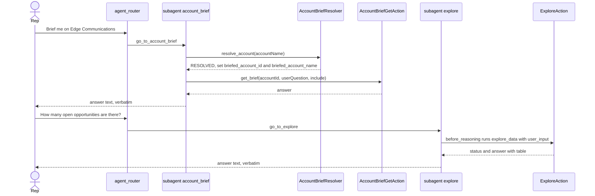

# 06. Agent routing and verbatim relay

## The outcome

Reps who use the built-in Agentforce panel get the same brief and the same data answers as the
custom panel. The agent decides which of two jobs a message is, then passes the Apex answer
through without rewording it.

The current script runs live in `agent-probe`, a fresh Developer Edition org. There, version 1
of `Account_Brief`, published from main with this script, is the active version. The
screenshots below come from it, and the 12-case agent test passed against it
([org-migration.md](../research/org-migration.md)). In the org it was first built in, version 1
is still the script from before the review fixes, and every publish there fails. See "Limits and
open items".

## The problem it removes

An agent that answers in its own words can soften a warning, drop a number, or add an offer it
cannot keep. An agent that guesses the account can brief the wrong one. Here the agent only
routes. The facts and the wording come from the same Apex the panel uses, and the agent relays
that text as it is.

## How it works

1. **Every turn starts at the router.** `agent_router` applies six rules in order, and the first
   match wins. An org-wide count, list or total that names no account goes to explore, even
   after a brief. A named account, a pick from a candidate list, or "their" after a brief goes to
   account_brief. Anything else gets one fixed line.
2. **Resolve first.** In `account_brief`, `resolve_account` (`AccountBriefResolver`) always sets
   `briefed_account_id` and `briefed_account_name`, so a failed resolve clears the earlier
   account instead of leaving it in place.
3. **Brief only a resolved Id.** `get_brief` (`AccountBriefGetAction`) is available only when
   `briefed_account_id` is not None and not empty.
4. **AMBIGUOUS and NOT_FOUND** are relayed as the resolver's message, and nothing else is called.
5. **Explore runs without the model choosing.** The `explore` subagent's `before_reasoning` block
   runs `explore_data` (`ExploreAction`) with `@system_variables.user_input` as the question. It
   passes no open record and no history.
6. **Verbatim relay.** The system instruction and each subagent say the reply is the action's
   answer text only, with line breaks kept and no closing question.
7. **Way back out.** Each subagent has a `reclassify` transition to the router, so a change of
   subject is routed again.
8. **Off topic.** The router replies "I can brief you on an account or answer questions about
   your CRM data." and calls nothing.

## See it

## Why you can trust it

- **The script's rules are tested.** [test_agent_bundle.py](../../tests/test_agent_bundle.py)
  checks that the router only transitions, that each subagent has a reclassify route, the
  unconditional set on resolve, the null-safe gate on `get_brief`
  (`test_get_brief_is_gated_on_a_non_null_non_empty_id`), the deterministic explore run
  (`test_explore_runs_explore_data_deterministically`), rule 1 coming before the follow-up rule,
  and the off-topic line.
- **The spec is checked for shape.** The same file checks that
  [Account_Brief-testSpec.yaml](../../tests/agent/Account_Brief-testSpec.yaml) has 12 utterances,
  including AMBIGUOUS, a two-turn follow-up, an org-wide count after a brief, and NOT_FOUND then
  a follow-up.
- **It ran live.** All 12 cases routed correctly in Studio preview against the draft version
  ([studio-preview.md](../research/studio-preview.md)). Every turn entered the router first. The
  replies equalled the action's text, with one exception: in case 11 two table headers that were
  dotted field paths came back as `URL_Redacted`. The explorer now writes plain column labels
  instead (see [02](02-ask-anything-explorer.md)), and that change has not been previewed yet.
- **It runs as the active version.** In `agent-probe`, `sf agent test run` of the 12-case spec
  passed 12 of 12 cases and 36 of 36 assertions against the active version 1, and a two-turn
  check passed both turns ([org-migration.md](../research/org-migration.md)). In case 7 the agent
  called `resolve_account` before `get_brief`, where the spec expects `get_brief` alone, and the
  runner still scored it a pass.
- **Review findings are fixed in script.** The agent review ([agent-review.md](../reviews/agent-review.md))
  found org-wide questions scoped to the briefed account (finding 1), the resolve message relayed
  on RESOLVED (2), no route out of a subagent (3), a null Id passing the gate (4), and a system
  rule that contradicted the off-topic reply (5). Each is fixed and covered by
  test_agent_bundle.py. The re-review ([agent-review-2.md](../reviews/agent-review-2.md)) confirms
  1 to 5 fixed in the script on main. It was a review of the org this was first built in, where
  none of it was live, and it rated the agent **"Not ready"**: reps there still ran version 1
  and no version could be published. The fixed script has since been published and activated
  in `agent-probe`.
- **The agent can be called from Apex.** A probe called it twice through `generateAiAgentResponse`
  in one session. The second turn found the right account without naming it. Each turn took 14 to
  18 seconds ([agent-api.md](../research/agent-api.md)).

## Adopt it

1. Copy `force-app/main/default/aiAuthoringBundles/Account_Brief/` and the three action classes:
   `AccountBriefResolver`, `AccountBriefGetAction` and `ExploreAction`.
2. Copy `Account_Brief_Agent_Access`. It grants the agent and nothing else.
3. **Change the routes.** Edit the six rules in `agent_router`, and keep the org-wide rule first.
4. **Change the jobs.** Point each subagent's actions at your own `apex://` classes. Keep each
   action's answer ready to relay, under about 6,000 characters.
5. Run `bash scripts/agent-check.sh`, then preview, publish and activate the bundle (see
   [08](08-test-and-release-lifecycle.md)). In the org this was first built in, publishing
   fails; in `agent-probe` it worked. See below.

## Limits and open items

- **Publishing fails in the org this was first built in.** There, version 1 is the script from
  before the review fixes and is still the active version; the fixed script sits in an open
  draft, and no version 2 exists. Every publish in that org returned `401` "Error saving or
  updating agent graph": the CLI publish, the first publish of a new throwaway agent, and a
  comment-only version 3. Studio's Commit Version also failed; whether with the same error was
  not captured ([agent-publish-spike.md](../research/agent-publish-spike.md)). In `agent-probe`,
  a fresh Developer Edition org, the same bundle from main published on its first try and its
  version 1 is active ([org-migration.md](../research/org-migration.md)), so the fault is
  specific to that one org.
- Only version 1 exists in `agent-probe`. Publishing and activating a second version over an
  active one has not been done in either org.
- Should-fix from the agent re-review ([agent-review-2.md](../reviews/agent-review-2.md)):
  - N3: an explorer follow-up through the agent gets no history, so "Which close this quarter?"
    loses the question before it. A pronoun can also send the follow-up to the briefed account.
  - N4: the explorer runs before the explore step can hand a misrouted message back, so that
    work can be wasted or relayed for the wrong question (suspected).
  - N5: access needs two permission sets plus a standard one, with no group and no setup doc.
    See [07](07-trust-access-and-failure.md).
  - N6: word-for-word relay of explorer tables is unproven on the current Apex.
- Still open from the first review: a brief on the wrong account is stopped only by instruction
  text (finding 6), and the NOT_FOUND reply says "open the account and ask again" although the
  open record is not passed in (finding 12, Studio's one warning).
- Agent turns are slow. The Apex probe recorded 14 to 18 seconds per turn
  ([agent-api.md](../research/agent-api.md)). The custom panel calls the same Apex directly.
- The custom panel's "Ask the agent" button only opens the built-in panel and sends the question.
  The answer appears there, not in the custom panel.

> [!WARNING]
> **Not yet proven:** the custom panel calling the registered agent and showing its reply. The
> Apex call is proven, but the `@AuraEnabled` wrapper and the panel view are not built.
