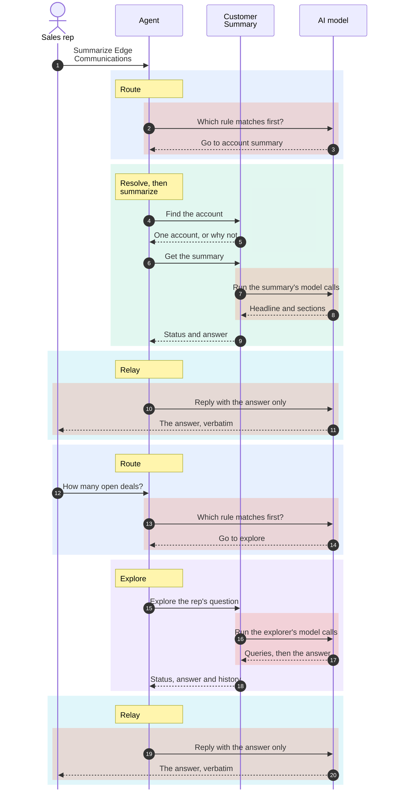

# Appendix: the Agentforce agent (optional)

The product is Agentforce with its own surfaces; the registered `Customer_Summary` agent is there for a team that
wants the same skills in an Agentforce channel.

## How it works

The agent only routes and relays. The facts and the wording come from the same Apex services the compact window,
the rail and the MCP door call, and the agent passes that text on as it is. The numbers in the diagram match the
steps under it. The coral blocks are the model's turns; everything else is deterministic. The theme is the shared
one in [_diagram-theme.md](_diagram-theme.md).



1. **Route (steps 1 to 3).** Every turn starts at `agent_router`, which applies six rules in order; the first match
   wins, and the model's reply names the transition (`go_to_account_summary` or `go_to_explore`) that moves the turn to
   that subagent. An org-wide count, list or total that names no account goes to `explore`, even after a summary. A
   named account, a pick from a candidate list, or "their" right after a summary goes to `account_summary`. A
   follow-up about the records of an explore answer stays with `explore`. Anything that is not about CRM data gets one
   fixed line, "I can brief you on an account or answer questions about your CRM data.", and nothing is called. The
   router never answers a data question itself.
2. **Resolve, then summarize (steps 4 to 9).** In `account_summary`, `resolve_account` (`CustomerSummaryResolver`)
   always sets `briefed_account_id` and `briefed_account_name`, and the resolver returns them blank unless RESOLVED,
   so a failed resolve clears the earlier account. `get_brief` (`CustomerSummaryGetAction`) is available only when
   `briefed_account_id` is not None and not empty. On AMBIGUOUS, NOT_FOUND or ERROR the reply is the resolver's
   message, and nothing else is called. `get_brief` runs the summary engine of
   [pattern 01](01-route-gather-reduce.md), whose model calls produce the headline and the sections.
3. **Verbatim relay (steps 10 and 11).** The system instruction and each subagent say the reply is the action's answer
   text only, with its line breaks kept, and no closing question or offer. The model's turn carries that text to the
   rep as it is.
4. **Route again (steps 12 to 14).** The next message starts at `agent_router` again and the same six rules apply.
   "How many open deals?" names no account, so the model picks `go_to_explore`, even right after a summary.
5. **Explore (steps 15 to 18).** The `explore` subagent's `before_reasoning` block runs `explore_data`
   (`ExploreAction`) without the model choosing it, with the rep's message (`@system_variables.user_input`) as the
   question and the previous explore question and answer (`explore_history`) as history. It passes no open record, so
   an org-wide question is never scoped to the summarized account. A resolve or a summary clears the history. The
   explorer is [pattern 02](02-ask-anything-explorer.md), and its model calls write the queries and then the answer.
6. **Relay again (steps 19 and 20).** The explore answer is relayed the same way as the summary: the answer text only,
   verbatim.
7. **The way back out.** Each subagent has a `reclassify` transition to the router, so a change of subject is
   routed again.

The script is `force-app/main/default/aiAuthoringBundles/Customer_Summary/Customer_Summary.agent`.
[test_agent_bundle.py](../../tests/test_agent_bundle.py) checks these rules, and the shape of the 16-case spec in
[Customer_Summary-testSpec.yaml](../../tests/agent/Customer_Summary-testSpec.yaml).

## When you would add it

None of our surfaces or the MCP door use it: the compact window and the rail call the Apex services directly, and
over MCP the tools are those Apex actions, never the agent ([fr2-design.md](../plans/fr2-design.md#the-product)).
Whether a run of the product, or of the agent, has passed is kept in one place, the README's
[Status table](../../README.md#status).

Add the agent only for one of these:

- **A channel that only a registered agent can reach.** An Agentforce channel the team already runs, where the
  same summary and explorer should answer.
- **Agent Memory.** The platform remembers things about one user for one agent: up to 50 items a model curates,
  the oldest replaced when full, not keyed to an account. It works only inside a registered Agent Script agent and
  is turned on with one `context:` block and a publish; `Customer_Summary` does not turn it on today. It does not
  replace the product's own memory ([05](05-conversation-memory.md)), and none of it reaches our surfaces or MCP
  ([fr2-agent-memory.md](../research/fr2-agent-memory.md)).
- **The platform's agent testing and session traces.** Testing Center and `sf agent test` test a registered agent,
  and its actions call the same Apex as our surfaces, so the agent can serve as a test bench for routing, the
  summary and the explorer ([08](08-test-and-release-lifecycle.md)). A capped Testing Center suite for it (BE-38)
  waits on its own approval and is not part of this build. Session traces need Data 360, which is off in the test
  org ([fr2-agent-memory.md](../research/fr2-agent-memory.md)).

## Adopt it

All optional. Do them after the README's quick start, which deploys the Apex the agent's actions call.

1. Grant access: assign the permission set group `Customer_Summary_User`.
2. **Check the script.** `bash scripts/agent-check.sh` compiles the `.agent` file locally and validates it in the
   org without saving.
3. **Publish and activate** (the full lifecycle is in [08](08-test-and-release-lifecycle.md)):

   ```sh
   sf agent publish authoring-bundle --api-name Customer_Summary -o <org-alias> --skip-retrieve --json
   sf agent activate --api-name Customer_Summary --version <n> -o <org-alias> --json
   git checkout -- force-app/main/default/aiAuthoringBundles/Customer_Summary
   ```

   `<n>` is the version number the publish reports (1 in a new org). Publishing rewrites the bundle's files, so the
   last line puts them back. The renamed agent's publish and activation are recorded in
   [fr2-agent-publish.md](../research/fr2-agent-publish.md).
4. **Assign the agent's own permission set.** `Customer_Summary_Agent_Access` grants the agent and nothing else, and
   it stays outside the group. It names the agent, so it deploys only after step 3:

   ```sh
   sf project deploy start -o <org-alias> \
     --source-dir force-app/main/default/permissionsets/Customer_Summary_Agent_Access.permissionset-meta.xml
   sf org assign permset -o <org-alias> -n Customer_Summary_Agent_Access
   ```

   The agent review says the panel also needs the standard Agentforce user permission set
   `CopilotSalesforceUser` ([agent-review-2.md](../reviews/agent-review-2.md), N5). That name has not been
   confirmed in an org, so check it in yours ([07](07-trust-access-and-failure.md)).
5. **Run the checks.** One turn from Apex through `generateAiAgentResponse`, as in
   [agent-api.md](../research/agent-api.md), then the 16-case spec with `sf agent test create` and
   `sf agent test run` ([08](08-test-and-release-lifecycle.md), step 17). The spec runs only on an active version,
   and both spend model calls.
6. **To change it,** edit the six rules in `agent_router` and keep the org-wide rule first; point each subagent's
   actions at your own `apex://` classes, and keep each answer ready to relay, under about 6,000 characters. Every
   variable description stays within 255 characters, or the publish is rejected.

## Limits and open items

- **Publishing fails in the org this was first built in.** Every publish there returned `401` "Error saving or
  updating agent graph", and its active version is still the script from before the review fixes
  ([agent-publish-spike.md](../research/agent-publish-spike.md)). Accepted: the fault is that one org's, the
  renamed agent was published in another org with the same CLI steps
  ([fr2-agent-publish.md](../research/fr2-agent-publish.md)), and nothing in the product needs a publish.
- **A publish rejected for a variable description over 255 characters.** Closed: the description was shortened
  before version 2, and a test keeps every description within 255 characters
  ([agent-iteration-1.md](../research/agent-iteration-1.md)).
- **Agent re-review N3, explore follow-ups.** Closed in the script: the explore step passes the previous question
  and answer as history. The test runner does not set history across turns, so that part was checked only in a
  preview of the local bundle ([agent-iteration-1.md](../research/agent-iteration-1.md)).
- **Agent re-review N4.** The explorer runs before the explore step can hand a misrouted message back, so that work
  can be wasted, or relayed for the wrong question (suspected). Accepted: the agent gets no script fixes in FR2
  (BE-28 is parked).
- **Agent re-review N5, access.** Closed by FE-20 and step 4 above: the group grants the product without the agent,
  and the agent's own set is one added step.
- **Agent re-review N6.** A word-for-word relay of explorer tables has not been recorded on the current Apex, and
  the plain column labels that replaced two redacted table headers have not been previewed. Accepted: BE-28 is
  parked.
- **A summary of the wrong account** is stopped only by instruction text and the gate on a resolved Id (first agent
  review, finding 6). Accepted: BE-28 is parked. Finding 12 is closed: the NOT_FOUND reply says "Try a fuller or
  different account name."
- **Agent turns are slow:** 10 to 18 seconds a turn in the Apex probes ([agent-api.md](../research/agent-api.md)),
  and about 30 seconds for a first turn in the later runs ([fr2-agent-memory.md](../research/fr2-agent-memory.md)).
  Accepted: it is the agent runtime's cost, and our surfaces call the Apex directly.
- **Spec case 14,** "Which of them close this quarter?", got the same answer as before and was graded 2 in the
  last spec run. Accepted: BE-28 is parked; the Testing Center suite (BE-38) waits on its approval.
- **A follow-up after 30 idle minutes lost the conversation's context** in one sample; after 1, 5 and 15 minutes it
  kept it. The cause was not found ([fr2-agent-memory.md](../research/fr2-agent-memory.md)). Our surfaces keep
  their own history. No card yet.
- **The built-in Agentforce panel and the custom panel's agent button** are no longer ways in: the button, its Apex
  client and its specs were dropped with it (FE-20), and the built-in panel's screenshots were dropped from this page
  with the panel. Hiding the Agentforce icon for reps is a Setup choice left to the admin; FE-20 records the step
  ([fr2-retire-ask-agent.md](../research/fr2-retire-ask-agent.md)).
- **The diagram is checked locally, not yet on the pushed page.** The script in
  [Render check](_diagram-theme.md#render-check) parsed and drew it with Mermaid 11.4.1 in headless Chromium, after
  it printed `FAIL` for the broken sample. GitHub draws with its own Mermaid build, so a look at the pushed page is
  still open. No card yet.

[Back to the pattern index](README.md) | [Back to the architecture page](../ARCHITECTURE.md) | [Back to the README](../../README.md)
