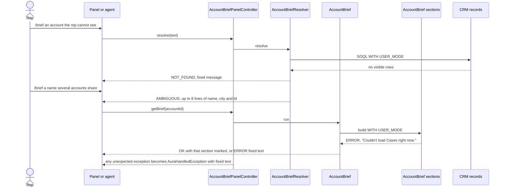
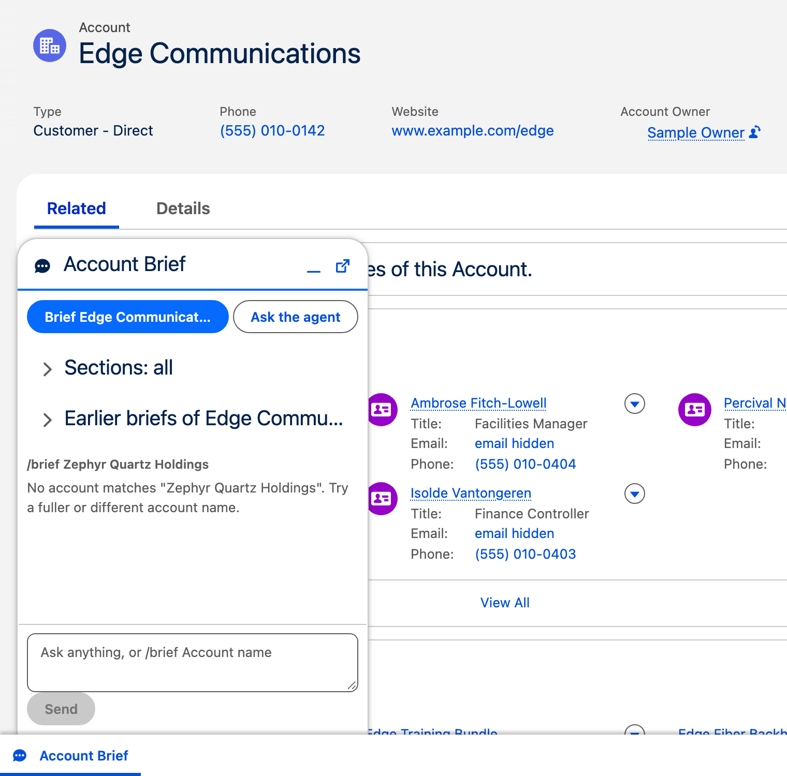
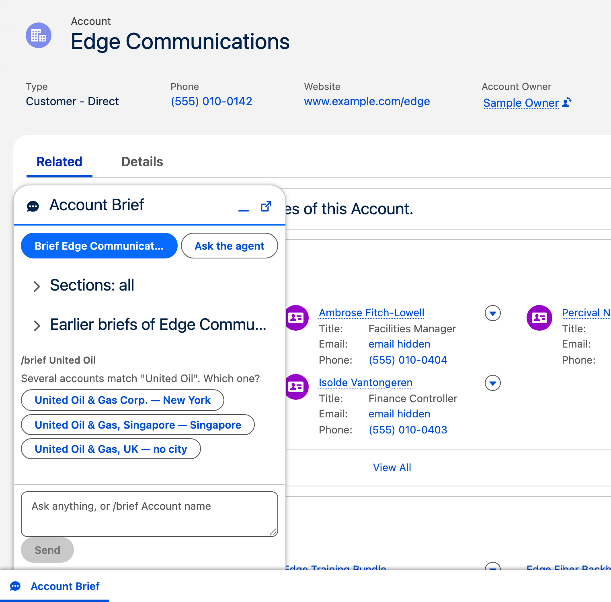

# 07. Trust, access and failure

## The outcome

The assistant shows a rep only records that rep can already open in Salesforce. When something
goes wrong, the rep reads one plain sentence that says what to do next, never a stack trace or a
half-written answer. Granting access takes two permission sets that grant nothing extra.

## The problem it removes

An assistant that runs with broad access can show a rep a deal they are not allowed to see. One
that passes raw errors through confuses people and can expose internals. A permission set copied
from a template often grants far more than the feature needs. Here every read runs in the rep's
own access. Failures become fixed text, and the permission sets are cut to what the entry points
use.

## How it works

1. **Sharing everywhere.** Every Apex class is `with sharing`.
2. **User mode for every read of CRM data.** The resolver, the brief's visibility check, all
   seven sections and the explorer query `WITH USER_MODE` or `AccessLevel.USER_MODE`. Object
   access, field access and sharing all apply. A rep who cannot see a field gets that section as
   ERROR, not a quiet gap.
3. **Fixed status texts.** NOT_FOUND from the resolver reads 'No account matches "…". Try the
   full name or open the account and ask again.' A brief that cannot be finished reads "I couldn't
   finish the brief right now. Try again in a minute." These come from Apex constants, and the
   agent relays them as they are.
4. **AMBIGUOUS is a choice.** Up to 8 candidates, one line each with name, city and Id. The panel
   shows them as buttons without the raw Id.
5. **A failed part stays a part.** A section that throws becomes ERROR with "Couldn't load
   <title> right now." The brief still returns the other sections.
6. **No raw errors.** `AccountBriefPanelController` catches every exception. Expected ones carry
   their own user text. Anything else is logged and becomes an `AuraHandledException` with
   "I couldn't finish that right now. Try again in a minute."
7. **No markup.** The panel renders model text as plain text, never as HTML.
8. **Two narrow permission sets.** `Account_Brief_Data_Access` shows the app, grants the five
   entry-point classes, and gives read-only access to the memory object. `Account_Brief_Agent_Access`
   grants the agent and nothing else.

## See it

## Why you can trust it

- **Fail-closed sections are tested.** [AccountBriefSectionErrorTest](../../force-app/main/default/classes/AccountBriefSectionErrorTest.cls)
  `everySectionFailsClosedAndKeepsTheCauseForAUserWithoutAccess` runs every section as a user
  without access. [AccountBriefTest](../../force-app/main/default/classes/AccountBriefTest.cls)
  `brokenSourceBecomesErrorSection` and `someErrorSectionsStillGiveAnOkBrief`.
- **Resolver texts are tested.** [AccountBriefResolverTest](../../force-app/main/default/classes/AccountBriefResolverTest.cls)
  `unknownNameIsNotFound`, `tenMatchesAreAmbiguousWithEightLinesAndMore` and `blankInputIsNotFound`.
- **No raw errors reach the panel.** [AccountBriefPanelControllerTest](../../force-app/main/default/classes/AccountBriefPanelControllerTest.cls)
  `unexpectedExceptionsBecomeFixedText` and `drillTurnsEveryExceptionIntoTheFixedText`, and the
  Jest tests "shows the fixed fallback, never raw script text" and "renders markup in answers,
  cells, section lines and follow-ups as text" in
  [accountBriefPanel.test.js](../../force-app/main/default/lwc/accountBriefPanel/__tests__/accountBriefPanel.test.js).
- **The permission sets are tested.** [test_permission_sets.py](../../tests/test_permission_sets.py)
  checks that only the entry-point classes are granted, that the session object is never given
  delete, view all or modify all, and that the agent set has no class or object access.
- **Review findings are fixed in code.** From the Apex review
  ([apex-review.md](../reviews/apex-review.md)): finding 2 (Activity read Tasks in system mode),
  finding 7 (implicit access modes and discarded causes), finding 9 (the data permission set
  granted more than the engine uses), and finding 15 (drill passed raw messages to the UI). From
  the LWC review ([lwc-review.md](../reviews/lwc-review.md)): finding 10 (raw Apex errors). Each is
  fixed and covered by the tests above. The re-reviews are pending.
- **It runs live.** Studio preview cases 3, 4, 5 and 8 show NOT_FOUND and AMBIGUOUS relayed as the
  resolver wrote them ([studio-preview.md](../research/studio-preview.md)).

## Adopt it

1. Copy both permission sets from `force-app/main/default/permissionsets/` and
   `tests/test_permission_sets.py`.
2. Keep `with sharing` and `WITH USER_MODE` on every new query. Make every new source return
   `AccountBriefSection.failed(...)` from its catch block.
3. Keep every user-facing failure as a constant in Apex, and wrap every new `@AuraEnabled` method
   in the controller's catch-all.
4. **Change the grants.** Add a class to `Account_Brief_Data_Access` only when it becomes an entry
   point called from the panel or the agent. Update the Python test in the same change.

## Limits and open items

- Memory runs in system mode on purpose. The row key holds the running user's Id and the object is
  private. See [05](05-conversation-memory.md).
- A query timeout in the resolver reads as NOT_FOUND, not ERROR.
- A user without access to one field in a section, such as contact roles or event names, loses
  the whole section rather than that field.
- Apex at API 68.0 is assumed to run plain static SOQL in user mode. The sections now state
  `WITH USER_MODE` explicitly, so they do not depend on that.

> [!WARNING]
> **Not yet proven:** a live run as a non-admin user with only the two permission sets. The Apex
> tests use `runAs` for users without access, which checks the code paths, not the real profile,
> the app and the agent together.
