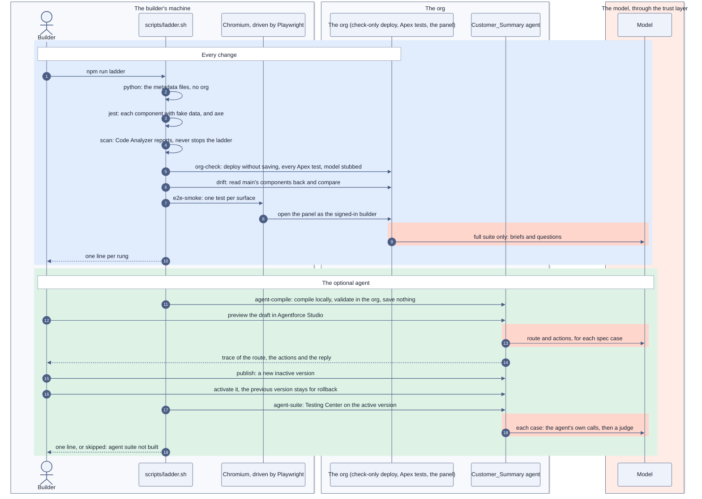

# Testing an AI feature on Salesforce

A change to the summary, the explorer or the panel reaches a seller or a service rep only after a ladder of checks has
run, so a broken change is caught by a test before a rep ever sees it.

## The business problem

- **The problem.** An AI feature is often shipped on a demo that worked once. Then a prompt is edited, a field is
  renamed or a new agent version goes live, and the feature breaks quietly. Nobody notices until a rep gets a wrong
  answer in front of a customer, or stops trusting the tool.
- **Why it is new for many Salesforce teams.** Admins and developers know Apex tests, because a deploy to production
  needs them. Fewer have tested a screen in a real browser, a component on its own, or an agent's answers. An AI
  feature needs all of them, because each one catches a kind of mistake the others cannot see.
- **What a test is, in plain words.** A test is a small, saved check that runs the feature the way a user or another
  piece of code would, and says "passed" or "failed". Once written, it runs again on every change in seconds or
  minutes, so nobody has to click through the feature by hand to know it still works.
- **What changes.** Every check is a named command, and one command runs them all in order, one plain line each.
  A builder sees in minutes whether a change broke the summary, the explorer or the panel. A new agent version stays a
  draft until it has been previewed, so a mistake does not reach every user at once.

## The architecture in a few steps

The ladder runs from the cheapest check to the dearest. Each rung catches something the one before cannot see.

1. **python** checks the metadata files: the agent's rules, the permission sets, the app, the scripts. Seconds, no
   org, no model calls.
2. **jest** runs each screen component on its own, with fake data, and checks it for accessibility problems. Seconds,
   no org, no model calls.
3. **scan** runs Salesforce Code Analyzer over the code and reports likely bugs and security smells. Seconds, no org,
   no model calls. It reports and never stops the ladder.
4. **org-check** asks the org to try a deploy without saving it, and runs every Apex test there. About four minutes,
   no model calls: every Apex test uses a stand-in for the model.
5. **drift** reads the org back and says whether it still matches the code on `main`. Seconds, read-only, no model
   calls.
6. **e2e-smoke** opens the panel in a real browser, signed in as the builder, and runs one test per surface. About a
   minute, no model calls. The full suite takes about seven minutes and makes about ten.

The agent rungs are an optional track, for a team that uses the registered agent
([06](06-agent-routing-and-verbatim-relay.md)): **compile** the agent's script (seconds, no model calls), **preview**
the draft in Agentforce Studio (model calls on every case), **publish** a new inactive version, **activate** it, and
run **Testing Center** against the active version (model calls on every case, plus a judge). Testing Center is not run
in this build.

## How it works

The numbers in the diagram match the steps under it. The blue block is the track every change runs; the green block is
the optional agent track. The coral blocks are the model calls; everything else spends none. The theme is the shared
one in [_diagram-theme.md](_diagram-theme.md).



1. **Start (step 1).** `npm run ladder` runs `scripts/ladder.sh`. It stops at the first rung that fails, unless it is
   given `--continue`. `--full` runs the full browser suite in place of the smoke subset, and `--agent` adds the agent
   track. The org is `agent-probe` unless `SF_TARGET_ORG` names another. Nothing on the ladder deploys for real,
   publishes or activates.
2. **The local rungs (steps 2 to 4).** `python3 -m unittest discover -s tests` reads the metadata and needs no org.
   `npm run test:unit` runs the components with `sfdx-lwc-jest`, including the accessibility checks from
   `@sa11y/jest`. `scripts/apex-scan.sh` runs Code Analyzer; without Java it runs the engines that need none and says
   which it skipped.
3. **The org rungs (steps 5 and 6).** `scripts/validate-org.sh` runs a check-only deploy of everything except the
   agent bundle, with every `*Test` class, and saves nothing. No Apex test calls a model: each one sets `AgentLlm.stub`.
   `scripts/org-drift.sh` retrieves main's components into a temporary folder and compares them file by file; it never
   asks for a type that can carry a secret.
4. **The browser (steps 7 to 9).** `npm run test:e2e:smoke` signs in through the builder's own sf CLI session and runs
   one test per surface in Chromium, with no model call. `npm run test:e2e` is the full suite, the release check; its
   briefs and questions reach the model (step 9).
5. **The result (step 10).** One line per rung: passed, failed or skipped, and why. A failed rung also prints its last
   lines. The exit status is 1 when a rung failed.
6. **Compile the agent (step 11).** `bash scripts/agent-check.sh` compiles the `.agent` file with the Agentforce
   skill's local compiler, then runs `sf agent validate authoring-bundle`, which compiles it in the org and saves
   nothing.
7. **Preview the draft (steps 12 to 14).** Save the script as a new draft version in Agentforce Studio and run each
   spec case in the live preview. The trace shows the route, each action's inputs and outputs, and the reply, as in
   [studio-preview.md](../research/studio-preview.md). This step is by hand.
8. **Publish, then activate (steps 15 and 16).** Publish creates an inactive version; activate makes it the live one.
   The previous version stays for rollback.

   ```sh
   sf agent publish authoring-bundle --json --api-name Customer_Summary -o <org-alias>
   sf agent activate --json --api-name Customer_Summary --version <n> -o <org-alias>
   ```

9. **Testing Center (steps 17 to 19).** The ladder's `agent-suite` rung runs `scripts/agent-test.sh` when that script
   exists and its approval is recorded. Neither is true in this build, so the rung prints
   `skipped: agent suite not built`. What the suite would check is under
   [Testing Center for the agent](#testing-center-for-the-agent).

## Each kind of test, with a first test to copy

Four kinds of test, each with what it proves, the command, and a short example from this repo. A first test is best
copied from one next to it: keep its shape, change the record and the expected result.

### Apex tests

**What it proves.** The server code does the right thing with real records: the right account is found, the sections
hold the right rows, a rep without access gets a fixed sentence, and nothing is written when the model fails. Apex
tests run in the org, on test records that are thrown away afterwards, so they never touch real data.

**The command.** `bash scripts/validate-org.sh` (every test, check-only), or one class:
`sf apex run test --class-names CustomerSummaryTest --wait 10 -o <org-alias>`.

**A first test to copy.** The model is the one thing a test must not call: it costs money, and it answers differently
each time. So each test class puts in a stand-in, called a stub, that records each call and returns fixed text.
Simplified from the test class
[CustomerSummaryTest](../../force-app/main/default/classes/CustomerSummaryTest.cls) (its stub and its
`notFoundMakesNoModelCall` test):

```apex
@IsTest
private class CustomerSummaryTest {
    // The stand-in for the model: it records every call and never reaches a model.
    private class Stub implements AgentLlm.Provider {
        List<String> systems = new List<String>();
        public String complete(String systemPrompt, String userPrompt, Integer maxTokens) {
            systems.add(systemPrompt);
            return 'Headline finding.\nAccount\nBody.';
        }
    }

    @IsTest
    static void notFoundMakesNoModelCall() {
        Account a = new Account(Name = 'Brief Engine Test');
        insert a;
        Id goneId = a.Id;
        delete a;                       // 1. a record the rep cannot see any more
        Stub stub = new Stub();
        AgentLlm.stub = stub;           // 2. every model call now goes to the stub

        CustomerSummary.Result r = CustomerSummary.run(goneId, 'Hi', null);

        // 3. the fixed sentence, word for word, and no model call at all
        Assert.areEqual(CustomerSummary.NOT_FOUND, r.status);
        Assert.areEqual('I can\'t see that account. Check the name or your access.', r.message);
        Assert.areEqual(0, stub.systems.size());
    }
}
```

### Jest for components

**What it proves.** Each screen component, on its own, shows what it should for a given answer: the headline, the
table, the fixed sentence on an error, the disabled Send button. It also checks each state for accessibility problems
a screen reader would hit, with axe through `@sa11y/jest`. It runs on the builder's machine in seconds, with the Apex
calls replaced by fakes, so it needs no org.

**The command.** `npm run test:unit`, or one file: `npx sfdx-lwc-jest -- customerSummaryConversation`.

**A first test to copy.** From
[customerSummaryConversation.test.js](../../force-app/main/default/lwc/customerSummaryConversation/__tests__/customerSummaryConversation.test.js),
trimmed (`mount`, `ask`, `flush` and `$` are helpers at the top of that file; `threeRows` is defined further down,
inside its own `describe` block):

```js
// The Apex method is replaced by a fake that the test controls.
jest.mock('@salesforce/apex/CustomerSummaryPanelController.explore', () => ({ default: jest.fn() }), { virtual: true });

it('a drill that fails shows the fixed sentence, never platform text', async () => {
    explore.mockResolvedValue(threeRows());                  // 1. the fake answer
    drill.mockRejectedValueOnce({ body: { message: 'Invalid id: 123456789012345678' } });
    const el = await mount();                                // 2. put the component on a blank page
    await ask(el, 'deals?');
    $(el, '.abp-row-button').click();
    await flush();
    expect($(el, '[role="alert"]').textContent).toBe(FIXED_ERROR);   // 3. what the rep reads
    expect(el.shadowRoot.textContent).not.toContain('Invalid id');
});

it('is accessible with an error turn', async () => {
    explore.mockRejectedValueOnce({});
    const el = await mount({ brand: BRAND });
    await ask(el, 'q');
    await expect(el).toBeAccessible();                       // axe finds no violations in this state
});
```

### Playwright in a real browser

**What it proves.** What a rep sees and does on a real Lightning page in a real org: the hotkey opens the window, focus
lands in the right place, Esc gives it back, the layout fits, the drill opens the record. Jest cannot see any of this,
because it never loads Lightning. Playwright drives Chromium; Chromium is the open-source browser behind Chrome, which
Playwright drives like a person would, pressing keys and clicking. The suite signs in through the builder's own sf CLI
session, so it sees what that user's access allows.

**The command.** `npm run test:e2e:smoke` for a front-end change (about a minute, no model call), or
`npm run test:e2e` for the release check. `npx playwright show-report` opens the report of the last run. The details
are in [e2e/README.md](../../e2e/README.md).

**A first test to copy.** From [panel.spec.js](../../e2e/panel.spec.js), spec 6, a smoke test:

```js
test('6. @smoke typing enables Send without blur, and Enter sends', async ({ page, panel }) => {
    await panel.open();                                       // 1. open the window, as a rep would
    await expect(panel.send).toBeDisabled();                  // 2. nothing typed, nothing to send
    await page.keyboard.type(NO_SUCH_ACCOUNT);                //    a name that matches no account: no model call
    await panel.expectFocused(panel.composer, 'the composer kept focus');
    await expect(panel.send).toBeEnabled();

    await page.keyboard.press('Enter');                       // 3. Enter sends
    await expect(panel.turns).toHaveCount(1, { timeout: 60_000 });
    await expect(panel.composer).toHaveValue('');             // 4. the box is cleared for the next question
});
```

The `@smoke` tag puts a test in the smoke subset. A test that would spend a model call stays out of it.

### Testing Center for the agent

**What it proves.** That the registered agent sends each kind of question down the right path and calls the right
actions, and that its reply says what it should. The agent's actions call the same Apex as the panel, so it is a test
bench for routing and for the summary and explorer behind it. It does not test the panel, the rail or the cards
(Playwright does), and the agent has no write actions to test.

**What a case asserts.** Three things, from the spec file in [tests/agent](../../tests/agent/Customer_Summary-testSpec.yaml):
`expectedTopic` (the route the agent took), `expectedActions` (the actions it called; an extra action does not fail
it) and `expectedOutcome` (a sentence a model judge compares the reply with). From that file:

```yaml
  - utterance: "Brief me on Zzqxv Nonexistent Holdings"   # what the user types
    expectedTopic: account_summary                       # the route
    expectedActions:                                     # the actions it must call
      - resolve_account
    expectedOutcome: "The agent says no account matches the name and does not produce a brief. It calls no action other than resolve_account."
```

**The command.** `sf agent test create --spec tests/agent/Customer_Summary-testSpec.yaml --api-name <test-name>
-o <org-alias>`, then `sf agent test run --api-name <test-name> --wait 5 --json -o <org-alias>`. It runs only on an
active version, and a test definition is tied to the version it was created for, so create it again after each
activation.

**What a run costs.** Every case is a real conversation: the agent's own model call to pick a route, the model calls
inside the actions (a summary makes up to four), and one more for the judge. So it is a named rung, not part of every
change's check, and the planned suite is capped at 20 cases with no write actions.

**Where to run it.** Salesforce advises running Testing Center in a sandbox. `agent-probe` has none.

**In this build.** The suite and its script (`scripts/agent-test.sh`) wait on their own approval, so Testing Center is
not run in this build, and the ladder's `agent-suite` rung prints `skipped: agent suite not built`. Whether an agent
test run has passed in an org is recorded only in the README's [Status table](../../README.md#status).

## Turn a bad answer into a test

When a rep reports a wrong answer, write down the question, the account and what was wrong, then add a test at the
lowest layer that can see the mistake. Run it first and watch it fail; then fix the code until it passes. From then
on, that mistake cannot come back unnoticed.

| What was wrong | Where the test goes | What it asserts |
| --- | --- | --- |
| A wrong number, a missing deal, the wrong account, or a section a rep should not see | Apex, with the model stubbed | The section's rows, or the fixed sentence, for a test record shaped like the rep's |
| A right answer shown wrongly: a cut table, a missing button, an error in platform words | Jest | What the component renders for that answer |
| Something only the real page shows: focus, the hotkey, the layout, a drill that goes nowhere | Playwright | What the rep sees after the same keys and clicks |
| The agent took the wrong route or called the wrong action | Testing Center | A new case with the rep's words as the `utterance` |
| The model worded or invented something the sections do not hold | The prompt, then Apex and Testing Center | Apex checks the prompt holds the rule; a Testing Center `expectedOutcome` checks the reply |

Keep the rep's own words, but never a real customer's name or a record Id: use a sample account from `data/sample/`.

## See it

The ladder's output, from its first recorded run
([fr2-ladder.md](../research/fr2-ladder.md), `npm run ladder -- --continue`):

```text
ladder: python         passed (1s): Ran 241 tests in 1.208s
ladder: jest           passed (4s): Tests: 265 passed, 265 total
ladder: scan           passed (4s): reported 254 violation(s); skipped the pmd, cpd and sfge engines (the Apex rules): they need Java. Installing Java 11 or later turns them on.
ladder: org-check      passed (242s): pass (147 components, 425 tests)
ladder: drift          failed (exit 2, 15s): differs
ladder:                  | org-drift: differs
ladder:                  | changed in the org: 2
ladder:                  |   FlexiPage: 1
ladder:                  |     Customer_Summary_UtilityBar
ladder:                  |   LightningComponentBundle: 1
ladder:                  |     customerSummaryPanel
ladder: e2e-smoke      failed (exit 1, 70s): 2 failed 5 passed (1.2m)
ladder:                  |   2 failed
ladder:                  |     [mac] › e2e/panel.spec.js:98:1 › 1. @smoke @hotkey Cmd/Ctrl-K before the window was ever opened opens it in the bottom right corner and focuses the composer
ladder:                  |     [windows] › e2e/panel.spec.js:98:1 › 1. @smoke @hotkey Cmd/Ctrl-K before the window was ever opened opens it in the bottom right corner and focuses the composer
ladder:                  |   5 passed (1.2m)
ladder: FAILED
```

Both runs it records were taken while the org carried the right rail's panel work, deployed but not yet merged to
`main`. So the drift line and the failure of smoke spec 1 were expected: the org and `main` differed in exactly those
two components. No run has been recorded since that work merged. The second run added `--agent`: `agent-compile`
passed and `agent-suite` printed `skipped: agent suite not built`.

The e2e rung's own report, from a full `npx playwright test` against the test org, captured by OPS-52 on 2026-11-14
([capture record](../research/fr2-captures.md)). The run had a 560 s limit to keep the capture's wait short, so it
stopped after 30 of its 42 tests: the 30 passed, and the other 12 show as skipped, with the two timeout lines at the
top.


## Why you can trust it

Runs as the signed-in user: the browser suite signs in through the builder's own sf CLI session and acts as that
user, so it sees only what that user's access allows; the org rungs run as the same CLI user and save nothing.

System context: one use on this path, from the platform: Apex test methods run in system context by default. So every
test that checks access runs the code under `System.runAs` with a user who lacks that access, for example
[CustomerSummarySectionErrorTest](../../force-app/main/default/classes/CustomerSummarySectionErrorTest.cls). The
product code under test keeps its own rule, checked by [test_trust_rule.py](../../tests/test_trust_rule.py).

Whether a run in a real org has passed is kept in one place, the README's [Status table](../../README.md#status).

- **The ladder tests itself.** [test_ladder.py](../../tests/test_ladder.py) checks that the ladder, the scan and the
  drift check hold no real deploy, publish or activation. [test_agent_bundle.py](../../tests/test_agent_bundle.py)
  and [test_validate_org.py](../../tests/test_validate_org.py) check the agent compile and the org check.
- **No Apex test calls a model.** Every class that reaches the model sets `AgentLlm.stub`
  ([AgentLlmTest.cls](../../force-app/main/default/classes/AgentLlmTest.cls) covers the door itself).
- **The browser suite's flaky spec was looked into.** Something on the record page drops focus about three seconds
  after load; the suite now waits until the page is six seconds old. The smoke subset and both hotkey branches were
  added in the same card ([fr2-front-end-tests.md](../research/fr2-front-end-tests.md)).
- **The order follows Salesforce's own lifecycle.** Draft, preview, publish, then activate, as in the lifecycle table
  in [salesforce-skills.md](../research/salesforce-skills.md); the agent review found the earlier workflow skipped it
  (finding 8 in [agent-review.md](../reviews/agent-review.md)).

### What the tests prove

Written from the test files as they are today. Each row names where to look; the files say what each test checks.

| Area | What is checked | Test files |
| --- | --- | --- |
| Summary | One account is found or a fixed sentence says why; the seven sections, their caps and their failures; the prompts the summary sends; the sentiment score; the card built from the answer | [CustomerSummaryTest](../../force-app/main/default/classes/CustomerSummaryTest.cls), [CustomerSummaryResolverTest](../../force-app/main/default/classes/CustomerSummaryResolverTest.cls), one class per section such as [CustomerSummaryOpenDealsSectionTest](../../force-app/main/default/classes/CustomerSummaryOpenDealsSectionTest.cls), [CustomerSentimentTest](../../force-app/main/default/classes/CustomerSentimentTest.cls), [AnswerCardTest](../../force-app/main/default/classes/AnswerCardTest.cls), [customerSummaryCard.test.js](../../force-app/main/default/lwc/customerSummaryCard/__tests__/customerSummaryCard.test.js) |
| Explorer | The plan the model writes is checked before it runs; queries run in the rep's access, within limits; the catalog of objects; the drill into a record | [DataExplorerTest](../../force-app/main/default/classes/DataExplorerTest.cls), [ExplorePlanTest](../../force-app/main/default/classes/ExplorePlanTest.cls), [ExploreQueryTest](../../force-app/main/default/classes/ExploreQueryTest.cls), [ExploreCatalogTest](../../force-app/main/default/classes/ExploreCatalogTest.cls), [test_explore_prompt.py](../../tests/test_explore_prompt.py) |
| Panel | The compact window, the rail, the conversation, voice input and their accessibility in Jest; the hotkey, focus, layout and drill on a real page in Playwright; the controller behind them | [customerSummaryPanel.test.js](../../force-app/main/default/lwc/customerSummaryPanel/__tests__/customerSummaryPanel.test.js), [customerSummaryConversation.test.js](../../force-app/main/default/lwc/customerSummaryConversation/__tests__/customerSummaryConversation.test.js), [customerSummaryRail.test.js](../../force-app/main/default/lwc/customerSummaryRail/__tests__/customerSummaryRail.test.js), [panel.spec.js](../../e2e/panel.spec.js), [rail.spec.js](../../e2e/rail.spec.js), [hotkey-platforms.spec.js](../../e2e/hotkey-platforms.spec.js), [CustomerSummaryPanelControllerTest](../../force-app/main/default/classes/CustomerSummaryPanelControllerTest.cls) |
| Memory | Each turn is written once, after every model call; a rep sees only their own conversations; customer outcomes, their retention and who may read their text | [CustomerSummaryMemoryTest](../../force-app/main/default/classes/CustomerSummaryMemoryTest.cls), [CustomerSummaryHistoryTest](../../force-app/main/default/classes/CustomerSummaryHistoryTest.cls), [CustomerOutcomesTest](../../force-app/main/default/classes/CustomerOutcomesTest.cls), [conversation-fr2.spec.js](../../e2e/conversation-fr2.spec.js) |
| Access | What each permission set and the group grant; every class with sharing and every read in user mode; a section fails closed for a user without access | [test_permission_sets.py](../../tests/test_permission_sets.py), [test_access_group.py](../../tests/test_access_group.py), [test_trust_rule.py](../../tests/test_trust_rule.py), [CustomerSummarySectionErrorTest](../../force-app/main/default/classes/CustomerSummarySectionErrorTest.cls) |

## How it scales

What each rung costs as the suite grows, from the recorded runs.

| Rung | Time today | Model calls | As the suite grows |
| --- | --- | --- | --- |
| python, jest, scan | Seconds each | None | Stays in seconds; they run on the builder's machine |
| org-check | About 4 minutes; about 11 when another deploy was queued in the org | None: the model is stubbed | Grows with the Apex tests, and waits behind any other deploy in the org |
| drift | Seconds | None | Grows with the number of components on `main` |
| e2e-smoke | About a minute | None | One test per surface, so it grows only when a surface is added |
| e2e full | About 7 minutes | About ten | Grows with each spec; specs that spend a model call stay out of the smoke subset |
| Agent compile | Seconds | None | Stays in seconds |
| Preview, Testing Center | Minutes, per case | Several per case, plus a judge | Grows with every case, so the planned suite is capped at 20 and is a named rung, not part of every change |

Times are from [fr2-ladder.md](../research/fr2-ladder.md) and [e2e/README.md](../../e2e/README.md); the model
calls per spec are listed in [e2e/README.md](../../e2e/README.md#model-calls).

## Adopt it

1. Grant access: assign the permission set group `Customer_Summary_User`.
2. Copy `scripts/ladder.sh`, `scripts/validate-org.sh`, `scripts/org-drift.sh`, `scripts/apex-scan.sh` and
   `scripts/agent-check.sh`, and add `"ladder": "bash scripts/ladder.sh"` to the scripts in `package.json`.
3. Copy `tests/` and adapt `test_agent_bundle.py` and `test_permission_sets.py` to your agent and your permission
   sets.
4. Copy `package.json`, `jest.config.js`, `playwright.config.js` and `e2e/`, then run `npm ci` and
   `npx playwright install chromium`.
5. **Change the org.** The ladder and its org scripts read `SF_TARGET_ORG`, and the browser suite reads `SF_E2E_ORG`
   first. Set them to your alias.
6. **Change the agent name** in `agent-check.sh` (`BUNDLE_NAME`) and in the test spec.
7. `agent-check.sh` needs the Salesforce agentforce-generate skill installed locally (its local compiler), and it and
   `org-drift.sh` call the `sf` CLI by a pinned path. Adjust both to your machine.
8. **Read the platform's own docs** for each tool:
   - Testing Center and the Agentforce Testing API:
     [Get started](https://developer.salesforce.com/docs/ai/agentforce/guide/testing-api-get-started.html).
   - The Agentforce DX commands for agents:
     [Test an agent](https://developer.salesforce.com/docs/ai/agentforce/guide/agent-dx-test.html) and
     [Run agent tests](https://developer.salesforce.com/docs/ai/agentforce/guide/agent-dx-test-run.html).
   - Code Analyzer:
     [Overview](https://developer.salesforce.com/docs/platform/salesforce-code-analyzer/guide/code-analyzer.html).
   - The Apex test runner:
     [`sf apex run test`](https://developer.salesforce.com/docs/platform/salesforce-cli-reference/guide/cli_reference_apex_run_test.html)
     and [Testing Apex](https://developer.salesforce.com/docs/platform/apex-dev/references/apex-dev/apex-testing.html).

## Limits and open items

Each open item from the last version of this page, rechecked.

- **Testing Center is not run in this build.** The capped suite and its script wait on their own approval (BE-38).
  Until then the ladder skips the rung and says so.
- **A test definition is tied to the agent version it was created for.** BE-38's script is to create it again for the
  active version on every run and print the version. Until it is built, create the definition again by hand after
  each activation, as in [Testing Center for the agent](#testing-center-for-the-agent).
- **The local checks cannot see a defect that shows only at run time,** such as a model rewording a reply. Accepted:
  that is what the Testing Center rung (BE-38) and the browser suite are for.
- **The code scan runs without its Apex rules.** The machine it runs on has no Java, so the scan runs the engines that
  need none and names the ones it skipped (OPS-46). Installing Java 11 or later turns the Apex rules on; it is an
  optional step. It stays report-only.
- **Drift is checked, but no clean run is recorded.** OPS-46 added the read-only drift check. Both of its recorded runs
  differed in the two components that held the rail work deployed before it merged; no run has been recorded since.
- **The browser suite has run as an admin user only, and on one machine.** A run as a non-admin user is FE-5. Both
  hotkey branches now run in every run (FE-21). Nothing runs the checks automatically: there is no CI, and running them
  in GitHub Actions would mean storing an org login in GitHub, which is the repo owner's call. No card yet.
- **Spec 2 failed now and then.** FE-21 found the likely cause, a page that drops focus about three seconds after load,
  and made the suite wait. Spec 2 did not fail in the runs before that fix either, so the fix is shown on the new
  focus test, not on spec 2. Spec 7 failed once and was not reproduced.
- **Publishing over an active version through Studio is unchecked.** Accepted: the CLI is the documented path and is
  the one used to publish in `agent-probe`, and FR2's other publishes use it too.
- **The CLI publish failed in the org this was first built in** with a `401` on every call. Accepted as history: that
  org is no longer used, and `agent-probe` publishes.
- **The "Ask the agent" spec** is gone with its button (FE-20).
- **The diagram on this page has not been render-checked** on GitHub or locally (see
  [Render check](_diagram-theme.md#render-check)). No card yet.
- **The public doc links under [Adopt it](#adopt-it) were taken from search results and not opened:** the
  documentation site refused automated fetches. No card yet.

[Back to the pattern index](README.md) | [Back to the architecture page](../ARCHITECTURE.md) | [Back to the README](../../README.md)
