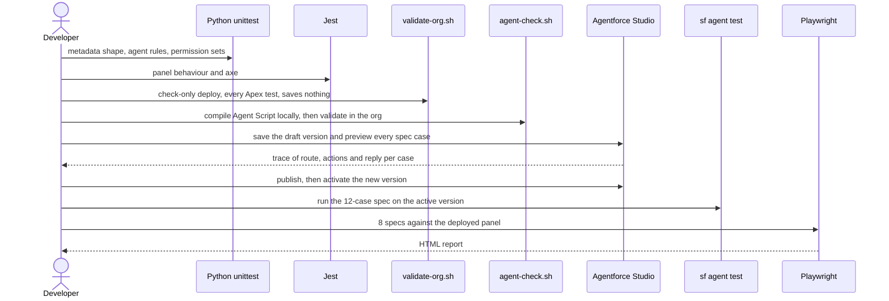
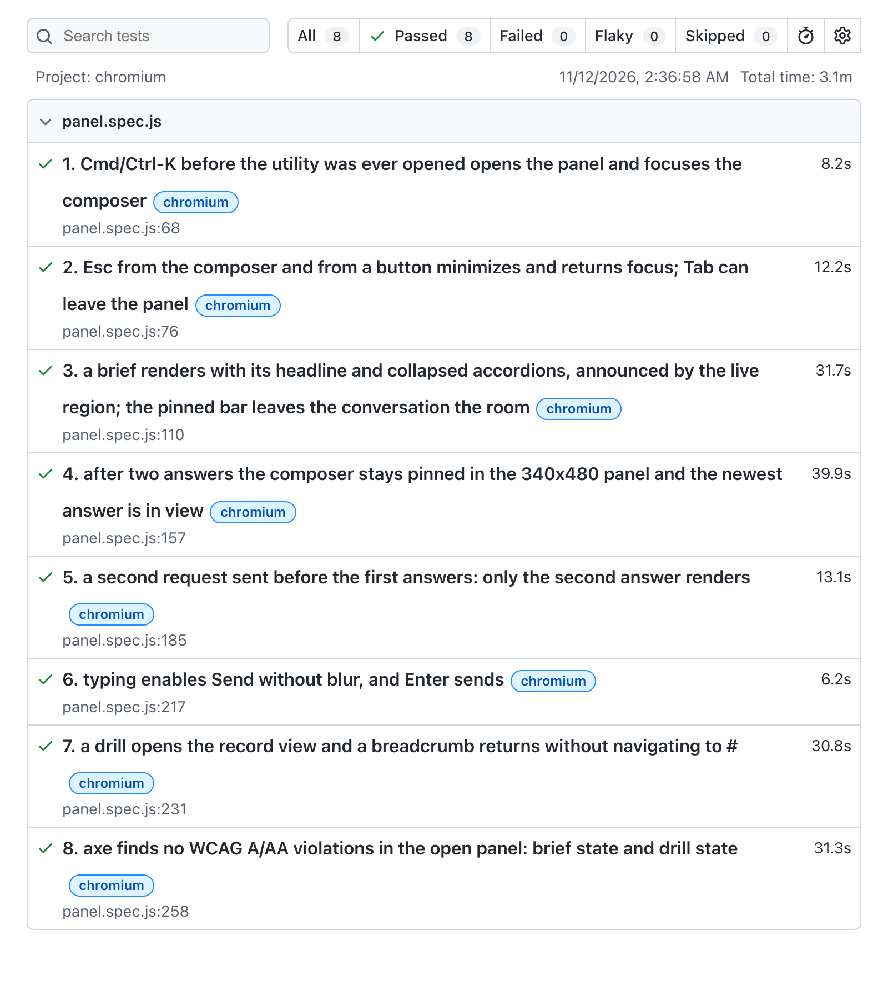

# 08. Test and release lifecycle

## The outcome

A change reaches reps only after it passes the same ladder of checks: fast local tests, a
check-only deploy that runs the Apex tests in the org, an agent compile, a live preview, and a
browser run of the panel. Each rung catches a kind of defect the one before cannot see.

## The problem it removes

AI features are often shipped on a demo that worked once. Then a prompt edit, a renamed field or a
new agent version breaks them quietly. Agent changes are also easy to push straight to the active
version, so a mistake reaches every user at once. This ladder makes each kind of check a
named command, and it keeps a new agent version a draft until it has been previewed.

## How it works

1. **Python, seconds.** `python3 -m unittest discover -s tests` reads the metadata. It checks
   the Agent Script rules, the 12-case spec, both permission sets, the app and utility bar, the
   project file and the gate scripts. It needs no org.
2. **Jest, seconds.** `npm run test:unit` runs the panel tests with `sfdx-lwc-jest`, including
   axe checks through `@sa11y/jest`.
3. **Apex in the org, check-only.** `bash scripts/validate-org.sh` runs a validate deploy of
   everything except the agent bundle, with every `*Test` class. It never saves. No Apex test
   calls a model: tests set `AgentLlm.stub`.
4. **Agent compile.** `bash scripts/agent-check.sh` compiles the `.agent` file with the
   Agentforce skill's local compiler, then runs `sf agent validate authoring-bundle`, which
   compiles in the org and saves nothing.
5. **Preview the draft.** Save the script as a new draft version in Agentforce Studio and run
   every spec case in the live preview. The trace shows the route, each action's inputs and
   outputs, and the reply. Results are recorded, as in [studio-preview.md](../research/studio-preview.md).
6. **Publish, then activate.** Publish creates an inactive version, from Studio or with
   `sf agent publish authoring-bundle --json --api-name Account_Brief -o <org-alias>`. Activate it
   in Studio or with `sf agent activate --json --api-name Account_Brief --version <n> -o <org-alias>`.
   The previous version stays for rollback.
7. **Agent test.** `sf agent test create --spec tests/agent/Account_Brief-testSpec.yaml
   --api-name <test-name> -o <org-alias>`, then `sf agent test run --api-name <test-name> --wait 5
   --json -o <org-alias>`. It works only on an active version.
8. **Browser.** `npm run test:e2e` signs in through the sf CLI session, runs 8 specs in Chromium
   against the deployed panel and writes an HTML report.

## See it

## Why you can trust it

- **The gates test themselves.** [test_agent_bundle.py](../../tests/test_agent_bundle.py) checks
  that `agent-check.sh` exists, is executable and validates with the pinned CLI, that
  `validate-org.sh` keeps stderr, skips when only an agent bundle has files, and deploys every
  folder but the agent bundles. [test_validate_org.py](../../tests/test_validate_org.py) covers the
  rest of the org gate.
- **The preview ran.** 12 of 12 cases routed correctly in Studio preview, saved with 0 errors and
  1 deliberate warning ([studio-preview.md](../research/studio-preview.md)).
- **The real deploy and the browser suite ran.** Main was deployed to a real org: 60 components,
  150 of 150 Apex tests. The Playwright suite then passed 8 of 8 on the first run, as an admin
  user ([deploy-verify.md](../research/deploy-verify.md)). An earlier run passed 6 of 8, and its
  two failures were real panel defects, Esc focus and brief-line drill, fixed before this run.
- **The lifecycle follows Salesforce's own skills.** The agent review found the earlier workflow
  skipped the documented draft-first order (finding 8 in [agent-review.md](../reviews/agent-review.md)).
  The order above follows the lifecycle table in [salesforce-skills.md](../research/salesforce-skills.md).

## Adopt it

1. Copy `scripts/validate-org.sh`, `scripts/agent-check.sh` and `scripts/apex-scan.sh`.
2. Copy `tests/` and adapt `test_agent_bundle.py` and `test_permission_sets.py` to your agent and
   your permission sets.
3. Copy `package.json`, `jest.config.js`, `playwright.config.js` and `e2e/`.
4. **Change the org.** `validate-org.sh` reads `SF_TARGET_ORG`, and the e2e suite reads
   `SF_E2E_ORG`. Set them to your alias.
5. **Change the agent name** in `agent-check.sh` (`BUNDLE_NAME`) and in the test spec.
6. `agent-check.sh` needs the Salesforce agentforce-generate skill installed locally (its local
   compiler) and calls the `sf` CLI by a pinned absolute path. Adjust both to your machine.

## Limits and open items

- `sf agent publish authoring-bundle` is blocked in the org this was built in. The server returns
  `401` "Error saving or updating agent graph" for every CLI publish, including a new throwaway agent.
  The `404` the CLI shows is its HTTP library resending after that `401`. Studio's Commit Version
  fails too, so there is no working path in that org today
  ([agent-publish-spike.md](../research/agent-publish-spike.md)). The plan notes report that the
  same minimal agent publishes in a fresh Developer Edition org
  ([gtm-burn-plan.md](../plans/gtm-burn-plan.md), "Morning notes"; second-hand).
- The org's existing agent test definition is pinned to version 1. Recreate it from the spec and
  check its subject version before crediting a pass to a new version (agent re-review N2,
  [agent-review-2.md](../reviews/agent-review-2.md)).
- The local gates cannot see defects that show only in Studio or at run time, such as a
  model rewording a reply. That is why the preview rung exists.
- `apex-scan.sh` needs the Code Analyzer plugin and Java 11 or later. It reports and does not gate.
- The gates above are check-only. The org matches `main` outside the agent bundle only as of the
  last real deploy ([deploy-verify.md](../research/deploy-verify.md)).
- The browser suite has run as an admin user only, on one machine, for one of the two hotkey
  branches ([lwc-review-2.md](../reviews/lwc-review-2.md), N11).

> [!WARNING]
> **Not yet proven:** publishing and activating version 2 by either route, and the agent test spec
> run with `sf agent test run`. The spec run needs an active version with the fixed script.
