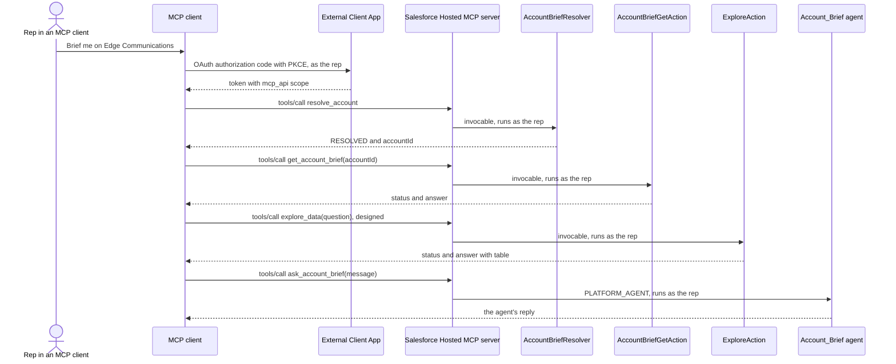

# 09. Outside door (MCP)

## The outcome

An AI client outside Salesforce, such as Claude, can ask for the same account brief and the same
data answers, signed in as the rep. It goes through the same Apex, with the same access rules and
the same fixed failure text. This pattern is designed and partly probed. It is not yet proven.

> [!WARNING]
> **Not yet proven:** a real MCP tool call. A probe created a custom server, added two Apex
> actions and the agent as tools, then deleted the server. No client has called a tool yet.

## The problem it removes

Teams that work in an outside AI client end up copying CRM data into it by hand, or building a
service account that sees everything. Salesforce Hosted MCP Servers let a client call chosen Apex
actions as the signed-in user over OAuth. No integration user is needed, and the rep's sharing and
field access apply.

## How it works

1. **Turn MCP on.** MCP servers are off by default. An admin turns them on in Setup under API
   Catalog, MCP Servers.
2. **One External Client App.** It has the `mcp_api` and `refresh_token` scopes. Sign-in is the
   OAuth authorization code flow with PKCE, per user. There is no machine-to-machine path.
3. **One custom server.** The probe added two `APEX_ACTION` tools, `resolve_account`
   (`AccountBriefResolver`) and `get_account_brief` (`AccountBriefGetAction`), and the registered
   agent as the `PLATFORM_AGENT` tool `ask_account_brief`. The design adds `ExploreAction` as a
   third Apex tool, `explore_data`, for org-wide questions.
4. **Annotate the tools.** The Apex tools only read CRM records, so they should carry
   `readOnlyHint`. An unannotated tool is treated as destructive. A brief does write one memory
   row, so `get_account_brief` is read-only for CRM data, not for the memory object.
5. **Same rules.** Each call runs as the signed-in rep, so `with sharing`, `USER_MODE` and the
   fixed status texts all apply as they do in the panel.
6. **Same order.** The client resolves first and briefs only a RESOLVED Id, as the agent does in
   [06](06-agent-routing-and-verbatim-relay.md).

## See it

This pattern has no screen yet. The diagram above is the design.

## Why you can trust it

- **The listing and add steps were probed live.** A custom server was created through the API.
  The org listed the action classes as `APEX_ACTION` sources, and the resolver and brief actions
  were added as tools. The Employee agent was listed as `PLATFORM_AGENT` and added. The server was
  never activated and was deleted at the end
  ([salesforce-mcp.md](../research/salesforce-mcp.md)).
- **The actions behind the door are tested.** They are the same classes the panel and agent use.
  See [01](01-route-gather-reduce.md), [02](02-ask-anything-explorer.md) and
  [07](07-trust-access-and-failure.md).
- **Access follows the rep.** Salesforce documents that every hosted MCP tool call carries the
  user's object, field and sharing access ([salesforce-mcp.md](../research/salesforce-mcp.md),
  facts table).

## Adopt it

There are no files to copy yet. The server, its tools and the External Client App are set up in
Setup or through the API Catalog, not in this repo.

1. Deploy the actions and assign `Account_Brief_Data_Access`, as in the
   [README](../../README.md#see-it-in-5-minutes).
2. In Setup, turn on MCP servers and create an External Client App with the `mcp_api` and
   `refresh_token` scopes.
3. Create a custom server, add the three Apex actions (and the agent, if you want it) as tools,
   name and describe each, set `readOnlyHint` where it holds, and activate it. Activation can take up to 2 minutes.
4. Add the server to your MCP client with your own OAuth client.
5. **Change the tools** by adding or removing Apex actions on the server. Tool names and
   descriptions are what the client model reads to choose a tool, so keep them task-specific.

## Limits and open items

- The three classes are `public`, not `global`. Salesforce documents `global` as required. The
  org listed and accepted them anyway, but whether a call then runs is untested. A thin `global`
  facade would remove the doubt.
- Hosted MCP is documented for Enterprise Edition and above, and for customers with Flex Credits.
  Calls may be billed.
- Whether a called action also needs class access through a permission set is not confirmed.
- The server's metadata is not in this repo, so it cannot be deployed with the rest yet.
