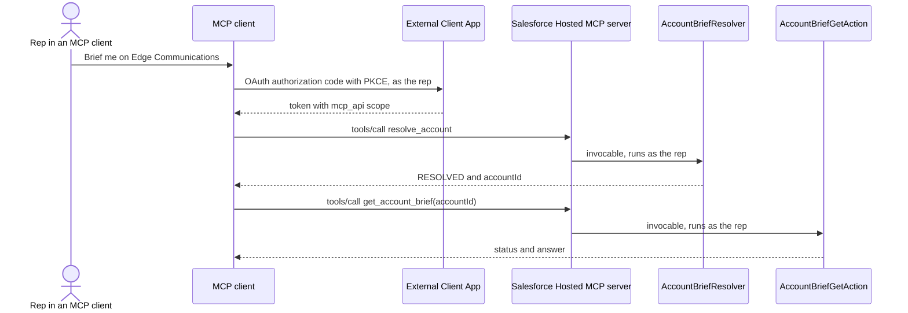

# 09. Outside door (MCP)

## The outcome

An AI client outside Salesforce, such as Claude, can ask for the same account brief, signed in
as the rep. It goes through the same Apex, with the same access rules and the same fixed failure
text. This pattern is designed and partly probed. It is not yet proven.

> [!WARNING]
> **Not yet proven:** a real MCP tool call. The server and its client app now exist and are
> active in agent-probe, but no client has called a tool yet. The first call waits on Ben's
> sign-in.

## Status in agent-probe

As of 2026-11-12, agent-probe has an active custom server `AccountBriefMcp` with three tools:
`resolve_account`, `get_account_brief` and `ask_account_brief` (the agent). Each tool has its own
client-facing description, so the agent-facing "Relay it verbatim" wording is not the tool text.
There is also a dedicated External Client App, `AccountBriefMcpClient`, with the `mcp_api` and
`refresh_token` scopes, PKCE, and access limited to holders of `Account_Brief_Data_Access`. A call
without a token gets HTTP 401. The first real tool call waits on Ben's OAuth sign-in. The
[runbook](../research/mcp-door-runbook.md) lists each step, what it changed, and what is proven.

## The problem it removes

Teams that work in an outside AI client end up copying CRM data into it by hand, or building a
service account that sees everything. Salesforce Hosted MCP Servers let a client call chosen Apex
actions as the signed-in user over OAuth. No integration user is needed, and the rep's sharing and
field access apply.

## How it works

1. **Turn MCP on.** MCP servers are off by default. An admin turns them on in Setup under API
   Catalog, MCP Servers.
2. **One External Client App.** It has the `mcp_api` and `refresh_token` scopes. Sign-in is the
   OAuth authorization code flow with PKCE, per user. There is no machine-to-machine path.
3. **Two deterministic tools, plus the agent.** One custom server holds two `APEX_ACTION` tools:
   `resolve_account` (`AccountBriefResolver`) and `get_account_brief` (`AccountBriefGetAction`).
   The brief needs a resolved Id, so the resolver comes with it. The agent itself is a third
   tool, `ask_account_brief` (`PLATFORM_AGENT`), for questions in plain language. `ExploreAction`
   is left out.
4. **Annotate the tools.** An unannotated tool is treated as destructive, so set the hints
   explicitly. A brief writes one memory row, so `readOnlyHint` is false; `destructiveHint`,
   `idempotentHint` and `openWorldHint` are false too.
5. **Same rules.** Each call runs as the signed-in rep, so `with sharing`, `USER_MODE` and the
   fixed status texts all apply as they do in the panel.
6. **Same order.** The client resolves first and briefs only a RESOLVED Id, as the agent does in
   [06](06-agent-routing-and-verbatim-relay.md).

## See it

This pattern has no screen yet. The diagram above is the design.

## Why you can trust it

- **The listing and add steps were probed live.** A custom server was created through the API.
  The org listed all three action classes as `APEX_ACTION` sources, and the resolver and brief
  actions were added as tools. The Employee agent was also listed as `PLATFORM_AGENT` and added,
  as `ask_account_brief`. The server was never activated and was deleted at the end
  ([salesforce-mcp.md](../research/salesforce-mcp.md)).
- **The actions behind the door are tested.** They are the same classes the panel and agent use.
  See [01](01-route-gather-reduce.md) and [07](07-trust-access-and-failure.md).
- **Access follows the rep.** Salesforce documents that every hosted MCP tool call carries the
  user's object, field and sharing access ([salesforce-mcp.md](../research/salesforce-mcp.md),
  facts table).

## Adopt it

The server definition and the External Client App are in `mcp-door/`, a package folder kept
apart from `force-app`, so the normal install does not deploy them. The
[runbook](../research/mcp-door-runbook.md) gives the one command that deploys them on purpose,
and the API steps that build the server where that deploy is not enough.

1. Deploy the actions and assign `Account_Brief_Data_Access`, as in the
   [README](../../README.md#see-it-in-5-minutes).
2. In Setup, turn on MCP servers and create an External Client App with the `mcp_api` and
   `refresh_token` scopes.
3. Create a custom server, add `AccountBriefResolver` and `AccountBriefGetAction` as tools, name
   and describe each, set the four hints, and activate it. Activation can take up to 2 minutes.
4. Add the server to your MCP client with your own OAuth client.
5. Test one call with a plain HTTP client first, to see the raw tool JSON, then in your MCP
   client. Check that a user without access to the account gets NOT_FOUND.
6. **Change the tools** by adding or removing Apex actions on the server. Tool names and
   descriptions are what the client model reads to choose a tool, so keep them task-specific.

## Limits and open items

- The action classes are `public`, not `global`. Salesforce documents `global` as required. The
  org listed and accepted them anyway, but whether a call then runs is untested. A thin `global`
  facade would remove the doubt.
- Hosted MCP is documented for Enterprise Edition and above, and for customers with Flex Credits.
  Calls may be billed.
- Whether a called action also needs class access through a permission set is not confirmed.
- The server's metadata is in `mcp-door/`. Whether deploying it creates the server in a fresh
  org is not yet tested, and activation is not in source.
- Org-wide questions (`ExploreAction`) and the agent as a tool are not part of the first step.
- All three re-reviews list a real MCP tool call as not yet made
  ([apex-review-2.md](../reviews/apex-review-2.md), [lwc-review-2.md](../reviews/lwc-review-2.md),
  [agent-review-2.md](../reviews/agent-review-2.md)).
