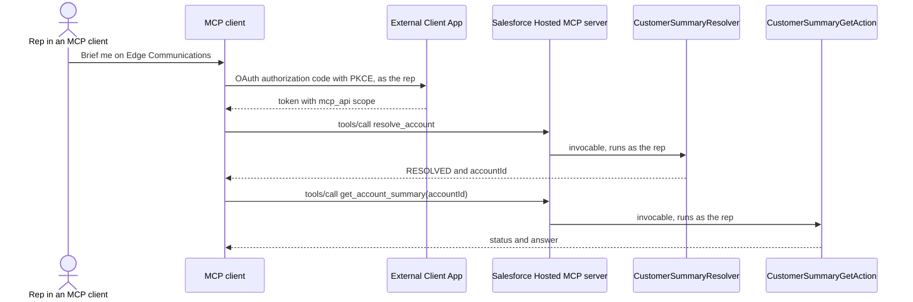

# 09. Outside door (MCP)

## The outcome

An AI client outside Salesforce, such as Claude, can ask for the same account summary, signed in
as the rep. It goes through the same Apex, with the same access rules and the same fixed failure
text. This pattern is built in agent-probe up to the sign-in. Whether a real MCP tool call is
proven is tracked in the README's [Status table](../../README.md#status).

## Status in agent-probe

As of 2026-11-13, agent-probe has an active custom server `CustomerSummaryMcp` with three tools,
all Apex actions: `resolve_account`, `get_account_summary` and `ask_anything` (the explorer). The
agent is not a tool. Each tool has its own client-facing description, so the agent-facing "Relay
it verbatim" wording is not the tool text. There is also a dedicated External Client App,
`CustomerSummaryMcpClient`, with PKCE and access limited to holders of
`Customer_Summary_Data_Access`. Its metadata and its description name its scopes `MCP` and
`RefreshToken`. These are taken to be the documented `mcp_api` and `refresh_token` scopes, but
that mapping is not yet proven. A call without a token gets HTTP 401, as does a call to a server
name that does not exist, so the 401 shows the token check, not the server. The first real tool
call waits on Ben's OAuth sign-in. The [runbook](../research/mcp-door-runbook.md) lists each step,
what it changed, and what is proven.

Old names: the first door from OPS-23, server and client app under the old product name
([`AccountBriefMcp` and `AccountBriefMcpClient`](../research/mcp-door-runbook.md#undo)), is still
active in agent-probe with its old tools. It stays until Ben approves its removal (`OPS-54`).

## The problem it removes

Teams that work in an outside AI client end up copying CRM data into it by hand, or building a
service account that sees everything. Salesforce Hosted MCP Servers let a client call chosen Apex
actions as the signed-in user over OAuth. No integration user is needed, and the rep's sharing and
field access apply.

## How it works

1. **Turn MCP on.** MCP servers are off by default. An admin turns them on in Setup under API
   Catalog, MCP Servers.
2. **One External Client App.** It has the `mcp_api` and `refresh_token` scopes. Sign-in is the
   OAuth authorization code flow with PKCE, per user. There is no machine-to-machine path.
3. **Three Apex-action tools, no agent.** One custom server holds three `APEX_ACTION` tools:
   `resolve_account` (`CustomerSummaryResolver`), `get_account_summary`
   (`CustomerSummaryGetAction`) and `ask_anything` (`ExploreAction`). The summary needs a resolved
   Id, so the resolver comes with it. `ask_anything` answers org-wide questions in plain language
   through the explorer. The optional agent is not a tool: the client model does the routing.
4. **Annotate the tools.** An unannotated tool is treated as destructive, so set the hints
   explicitly. A summary writes one memory row, so `readOnlyHint` is false; `destructiveHint`,
   `idempotentHint` and `openWorldHint` are false too. All three tools keep these defaults.
5. **Same rules.** Each call runs as the signed-in rep, so `with sharing`, `USER_MODE` and the
   fixed status texts all apply as they do in the panel.
6. **Same order.** The client resolves first and briefs only a RESOLVED Id, as the agent does in
   [06](06-agent-routing-and-verbatim-relay.md).

## See it

This pattern has no screen yet. The diagram above is the design.

## Why you can trust it

- **The setup ran live, up to the sign-in.** A first probe in the earlier org created a server,
  added the tools and deleted it ([salesforce-mcp.md](../research/salesforce-mcp.md)). In
  agent-probe the server and its client app were then built for real: the three Apex tools were
  added and described, the client app and the server definition deployed from source, the server
  was activated, and a call without a token was refused ([runbook](../research/mcp-door-runbook.md)).
- **The actions behind the door are tested.** They are the same classes the panel and agent use.
  See [01](01-route-gather-reduce.md) and [07](07-trust-access-and-failure.md).
- **Access follows the rep.** Salesforce documents that every hosted MCP tool call carries the
  user's object, field and sharing access ([salesforce-mcp.md](../research/salesforce-mcp.md),
  facts table).

## Adopt it

The server definition and the External Client App are in `mcp-door/`, a package folder kept
apart from `force-app`, so the normal install does not deploy them. The
[runbook](../research/mcp-door-runbook.md) gives the one command that deploys them on purpose,
and the API steps that build the server where that deploy is not enough.

1. Deploy the actions and assign `Customer_Summary_Data_Access`, as in the
   [README](../../README.md#see-it-in-5-minutes).
2. In Setup, turn on MCP servers and create an External Client App with the `mcp_api` and
   `refresh_token` scopes.
3. Create a custom server, add `CustomerSummaryResolver`, `CustomerSummaryGetAction` and
   `ExploreAction` as tools, name and describe each, set the four hints, and activate it.
   Activation can take up to 2 minutes.
4. Add the server to your MCP client with your own OAuth client.
5. Test one call with a plain HTTP client first, to see the raw tool JSON, then in your MCP
   client. Check that a user without access to the account gets NOT_FOUND.
6. **Change the tools** by adding or removing Apex actions on the server. Tool names and
   descriptions are what the client model reads to choose a tool, so keep them task-specific.

## Limits and open items

- The action classes are `public`, not `global`. Salesforce documents `global` as required. The
  org listed and accepted them anyway; whether a call then runs is part of the real tool call in
  the README's [Status table](../../README.md#status). A thin `global` facade would remove the doubt.
- Hosted MCP is documented for Enterprise Edition and above, and for customers with Flex Credits.
  Calls may be billed.
- Whether a called action also needs class access through a permission set is not confirmed.
- The client app's metadata accepts the scope name `MCP`, not `mcp_api`. That `MCP` is the
  documented `mcp_api` scope is inferred from the name and not yet proven. The app's description
  uses the metadata's names, `MCP` and `RefreshToken`.
- The server's metadata is in `mcp-door/`. Whether deploying it creates the server in a fresh
  org is not yet tested, and activation is not in source.
- `ask_anything` opens the explorer to outside clients. It runs read-only queries as the
  signed-in rep and calls a model on each turn.
- Write tools (create a task, log a call) are not on the server yet; they come later.
- For a real MCP tool call, see the README's [Status table](../../README.md#status) and the
  re-reviews ([apex-review-2.md](../reviews/apex-review-2.md),
  [lwc-review-2.md](../reviews/lwc-review-2.md), [agent-review-2.md](../reviews/agent-review-2.md)).
