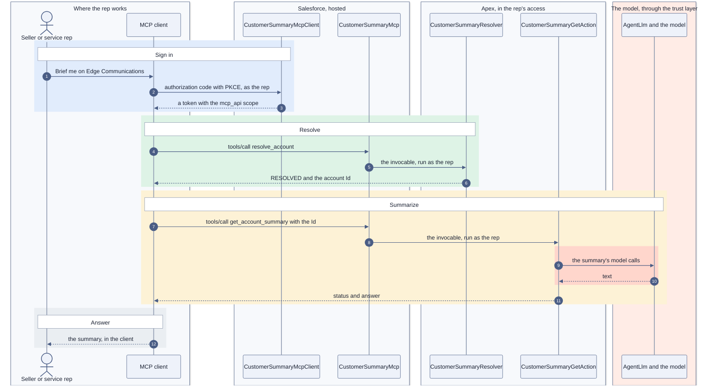
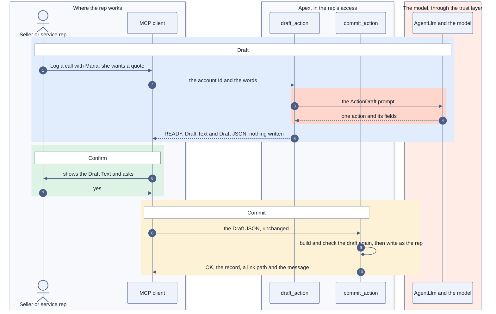

# Outside door (MCP)

A seller or service rep who works in an AI client outside Salesforce, such as Claude, asks for the same account
summary and the same answers, signed in as themselves, and can create a task or log a call once they say yes.

## The business problem

- **The problem.** Teams that work in an outside AI client end up copying CRM data into it by hand, or an admin builds
  a service account that sees everything. The first leaks data out of the CRM; the second ignores who is asking.
- **What changes for a seller or a service rep.** They stay in the client they already use and ask for a summary of an
  account, or a question about the data they can see, and get the same answer and the same fixed failure text as in
  the compact window. A follow-up such as "log a call with Maria, she wants a quote" comes back as a draft to say yes
  to; nothing is written before they do.
- **What changes for the admin.** Salesforce hosts the server. There is no integration user and no copy of the data:
  each call runs as the person who signed in, with their sharing and field access.
- **What changes for the builder.** The tools are the Apex actions the panel already uses. The door adds a server
  definition and a client app, not a second set of rules.

## The architecture in a few steps

1. **Sign in.** The rep adds the server to their client and signs in to Salesforce through one External Client App,
   with OAuth and PKCE. There is no machine-to-machine path.
2. **Pick a tool.** The client's own model reads five tool descriptions and picks one. Every tool is an Apex action;
   the optional agent ([06](06-agent-routing-and-verbatim-relay.md)) is not a tool, so the client does the routing.
3. **Resolve first.** `resolve_account` turns the rep's words into one account Id, or a fixed AMBIGUOUS or NOT_FOUND
   answer.
4. **Answer.** `get_account_summary` writes the summary for a resolved Id; `ask_anything` answers a question about
   the CRM data through the explorer ([02](02-ask-anything-explorer.md)).
5. **Write only after a yes.** `draft_action` returns a draft and writes nothing; `commit_action` writes it, as the
   rep, after the rep says yes. Only two actions pass this door: create a task and log a call.

**Which names the door runs under today.** In the test org the door runs under the Customer Summary names: the server
`CustomerSummaryMcp` and the client app `CustomerSummaryMcpClient` (OPS-31), with the write pair added by OPS-59. The
first door, under the old product name ([`AccountBriefMcp` and `AccountBriefMcpClient`](../research/mcp-door-runbook.md#undo)),
is still active beside it with its old tools; see [Limits and open items](#limits-and-open-items).

## How it works

The numbers in the diagram match the steps under it. The coral block is the model call. The theme is the shared one
in [_diagram-theme.md](_diagram-theme.md).



1. **Sign in (steps 1 to 3).** MCP servers are off by default; an admin turns them on in Setup under API Catalog, MCP
   Servers. The client signs the rep in through the External Client App `CustomerSummaryMcpClient`: authorization code
   with PKCE, per user, with the `mcp_api` and `refresh_token` scopes. Only holders of `Customer_Summary_Data_Access`,
   which the permission set group carries, may sign in.
2. **Resolve (steps 4 to 6).** The client calls `resolve_account`, which runs `CustomerSummaryResolver` as the rep and
   returns RESOLVED with one Id, or the same fixed AMBIGUOUS or NOT_FOUND text the panel shows
   ([01](01-route-gather-reduce.md#when-something-fails)). The client briefs only a RESOLVED Id, the order the agent
   follows in [06](06-agent-routing-and-verbatim-relay.md).
3. **Summarize (steps 7 to 11).** `get_account_summary` runs `CustomerSummaryGetAction`, the same engine as the panel.
   A summary makes 4 model calls (two pre-reduce calls, the synthesis and the sentiment score), shown here as one
   coral block, and writes one memory row and one outcome, as in [05](05-conversation-memory.md).
4. **Answer (step 12).** The client shows the status and the answer. `ask_anything` (`ExploreAction`) follows the same
   path from step 7 for a question such as "Which open deals close this quarter?": it runs read-only queries as the rep
   and calls a model on each turn.

**The five tools.** Each tool has its own client-facing description, so the agent-facing "Relay it verbatim" wording
in the Apex is not the tool text. An unannotated tool is treated as destructive, so the hints are set by hand.

| Tool | Apex action | Hints |
| --- | --- | --- |
| `resolve_account` | `CustomerSummaryResolver` | all false |
| `get_account_summary` | `CustomerSummaryGetAction` | all false: a summary writes a memory row, so it is not read-only |
| `ask_anything` | `ExploreAction` | all false |
| `draft_action` | `CustomerSummaryActionDraftAction` | `readOnlyHint` true: it writes nothing |
| `commit_action` | `CustomerSummaryActionCommitAction` | `destructiveHint` true: the service it calls can change records |

## Writing from an outside client

The door can write two things: **create a task** (`create_task`) and **log a call** (`log_call`, written as an Event,
as ledger F17 decides). It writes in two steps, with the person in between. The shared service and its rules are in
[13](13-write-actions.md).



1. **Draft (steps 1 to 5).** `draft_action` takes the account Id from `resolve_account` and either the request in plain
   words, which goes to the model as in [13](13-write-actions.md), or one of the two actions with its fields, which
   needs no model call. It returns the draft as text to show and as JSON to send back. It writes nothing.
2. **The person's yes (steps 6 and 7).** Both tool descriptions tell the client to show the draft and to call
   `commit_action` only after the person says yes. The client's own approval prompt for a destructive tool is a second
   check. The server cannot know that a person said yes, which is why step 9 checks again.
3. **Commit (steps 8 to 10).** `commit_action` takes the Draft JSON back unchanged, builds and checks the draft again
   in user mode, and writes it as the signed-in rep, so a changed draft writes nothing the rep could not write by hand.
4. **The refusal.** Any other action (an event, a case, a contact or opportunity update), asked for by name, drafted
   from words, or sent as a hand-made draft, gets one fixed text and writes nothing: "Only two actions are allowed
   here: create a task (create_task) and log a call (log_call). Nothing was drafted or saved." The allow-list is
   `CustomerSummaryActionDraftAction.DOOR_ACTIONS`. The panel does not go through these invocables and keeps all six
   actions.

## See it

This pattern has no screen of its own: the client draws the answer. This text block is the tool list as the server
holds it in the test org, from the runbook's record of the server's tools after OPS-59
([runbook, W4](../research/mcp-door-runbook.md#w4-name-describe-and-mark-the-two-tools-changes-the-org-yes)). It is a
record of the server's setup, not a tool call.

```text
server   CustomerSummaryMcp   active   type PLATFORM   5 tools, all APEX_ACTION
tool     resolve_account      CustomerSummaryResolver              hints: all false
tool     get_account_summary  CustomerSummaryGetAction             hints: all false
tool     ask_anything         ExploreAction                        hints: all false
tool     draft_action         CustomerSummaryActionDraftAction     hints: readOnly
tool     commit_action        CustomerSummaryActionCommitAction    hints: destructive
refused  Only two actions are allowed here: create a task (create_task) and log a call (log_call). Nothing was drafted or saved.
```

Whether a real tool call has run is kept in the README's [Status table](../../README.md#status).

## Why you can trust it

Runs as the signed-in user: every tool call runs as the rep who signed in through the client app, over OAuth with no
integration user, so the same `with sharing` classes, user-mode reads and writes and fixed status texts apply as in
the panel.

System context: the door adds none. The actions behind it use the product's own records named in
[07](07-trust-access-and-failure.md#the-exceptions): `AgentLlm` reads the prompt settings (the product's own
configuration, the same for every user), `get_account_summary` writes the rep's own session row (reps hold no write
access to the session object), and a summary or a commit records an outcome whose text is set in system context
(reps hold no field access to outcome text).

- **The setup ran in a test org, up to the sign-in.** The server and its client app were built under the new names,
  the client app and the server definition deployed from `mcp-door/`, the server activated, and a call without a token
  refused with HTTP 401 ([runbook](../research/mcp-door-runbook.md)). The 401 shows the token check only; the API
  Catalog listing shows the server is active.
- **The write pair was added and marked.** The two tools came back with their names, descriptions and hints, and the
  three read tools kept theirs ([runbook, Write tools](../research/mcp-door-runbook.md#write-tools-ops-59)).
- **The door's allow-list is tested.** `CustomerSummaryActionDoorTest` covers a refused action by name, by words and as
  a hand-made draft at commit, an allowed task and logged call, and the panel's six actions.
- **The source matches the plan.** [tests/test_mcp_door.py](../../tests/test_mcp_door.py) checks the five tools, the
  two markings, the confirm rule in both descriptions, that no tool is the agent, and that nothing under `mcp-door/`
  holds a consumer key or secret, a Salesforce Id, an email or a host name.
- **The actions behind the door are tested.** They are the classes the panel uses, tested as in
  [01](01-route-gather-reduce.md#why-you-can-trust-it), [02](02-ask-anything-explorer.md) and
  [13](13-write-actions.md#why-you-can-trust-it).
- **Access follows the rep.** Salesforce documents that every hosted MCP tool call carries the user's object, field
  and sharing access ([salesforce-mcp.md](../research/salesforce-mcp.md)).

## How it scales

- **Salesforce hosts the server.** There is nothing to run or patch; the API Catalog holds the server and its tools
  ([salesforce-mcp.md](../research/salesforce-mcp.md)).
- **A call costs what the same action costs in the panel.** Each tool call is one Apex transaction in the rep's own
  limits: a summary runs about 25 queries and 4 model calls, and a request past the cap gets a fixed line and no model
  call ([01](01-route-gather-reduce.md#how-it-scales)).
- **More tools are more Apex actions.** A tool is an invocable added to the server's tool set; the runbook's steps add
  two at once without touching the other three ([runbook, W3](../research/mcp-door-runbook.md#w3-deactivate-then-replace-the-tool-set-changes-the-org-yes)).

## Adopt it

The server definition and the External Client App are in `mcp-door/`, a package folder kept apart from `force-app`, so
the normal install does not deploy them. The [runbook](../research/mcp-door-runbook.md) gives the one command that
deploys them on purpose, and the API steps that build the server where that deploy is not enough.

1. Grant access: assign the permission set group `Customer_Summary_User`.
2. Deploy the actions from `force-app`, as in the README's [quick start](../../README.md#see-it-in-5-minutes).
3. In Setup, turn on MCP servers. Deploy `mcp-door/` for the External Client App with the `mcp_api` and
   `refresh_token` scopes, or create one by hand.
4. Create the custom server, add `CustomerSummaryResolver`, `CustomerSummaryGetAction` and `ExploreAction` as tools,
   name and describe each, set the hints, and activate it. Activation can take up to 2 minutes. To let clients write,
   also add `CustomerSummaryActionDraftAction` (read-only) and `CustomerSummaryActionCommitAction` (destructive), with
   descriptions that carry the confirm rule.
5. Add the server to your MCP client with your own OAuth client.
6. Test one call with a plain HTTP client first, to see the raw tool JSON, then in your MCP client. Check that a user
   without access to the account gets NOT_FOUND.
7. **Change the tools** by adding or removing Apex actions on the server. Tool names and descriptions are what the
   client model reads to choose a tool, so keep them task-specific. To take the writes away again, remove
   `draft_action` and `commit_action` from the tool set ([runbook, Undo](../research/mcp-door-runbook.md#undo)).

## Limits and open items

- **No tool has been called, read or write.** The first call waits on an admin's OAuth sign-in. That call also
  answers four questions the setup leaves open: whether `public` invocable methods run (Salesforce documents `global`),
  whether the client app's `MCP` scope is the documented `mcp_api`, whether the consent screen is skipped for holders of
  `Customer_Summary_Data_Access`, and whether the client sees only the tool descriptions and not the Apex field texts.
  OPS-53 records the result in the README's [Status table](../../README.md#status), and it is parked.
- **A first write over the door** also waits on its own approval, and whether a client really asks the person before
  `commit_action` is open until then. No card yet.
- **The old door is still active.** The first server and client app under the old product name stay until their
  removal is approved. OPS-54 has it, and it is parked.
- **A fresh-org install of `mcp-door/`** has not been tried: whether deploying it creates the server in an org that
  never had it is open, and activation is not in source. No card yet.
- **Class access for a called action through a permission set** is not confirmed. No card yet.
- **Edition and billing.** Hosted MCP is documented for Enterprise Edition and above, and for customers with Flex
  Credits; calls may be billed. Accepted, a platform limit.
- **`ask_anything` opens the explorer to outside clients.** It runs read-only queries as the signed-in rep and calls a
  model on each turn. Accepted.
- **The diagrams on this page have not been render-checked:** the render check in
  [_diagram-theme.md](_diagram-theme.md#render-check) was not run for this page. No card yet.

### Closed since the earlier version of this page

- **The door ran under the old product name, with the agent as a tool.** Closed by OPS-31: the door was rebuilt as
  `CustomerSummaryMcp`, with Apex-action tools only.
- **The explorer was not a tool.** Closed by OPS-31: `ask_anything` is the third read tool.
- **An outside client could not write.** Closed by OPS-59: `draft_action` and `commit_action`, for two actions only.

[Back to the pattern index](README.md) | [Back to the architecture page](../ARCHITECTURE.md) | [Back to the README](../../README.md)
