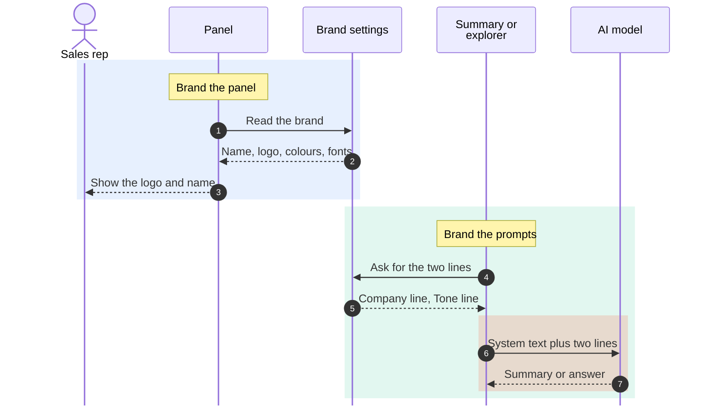
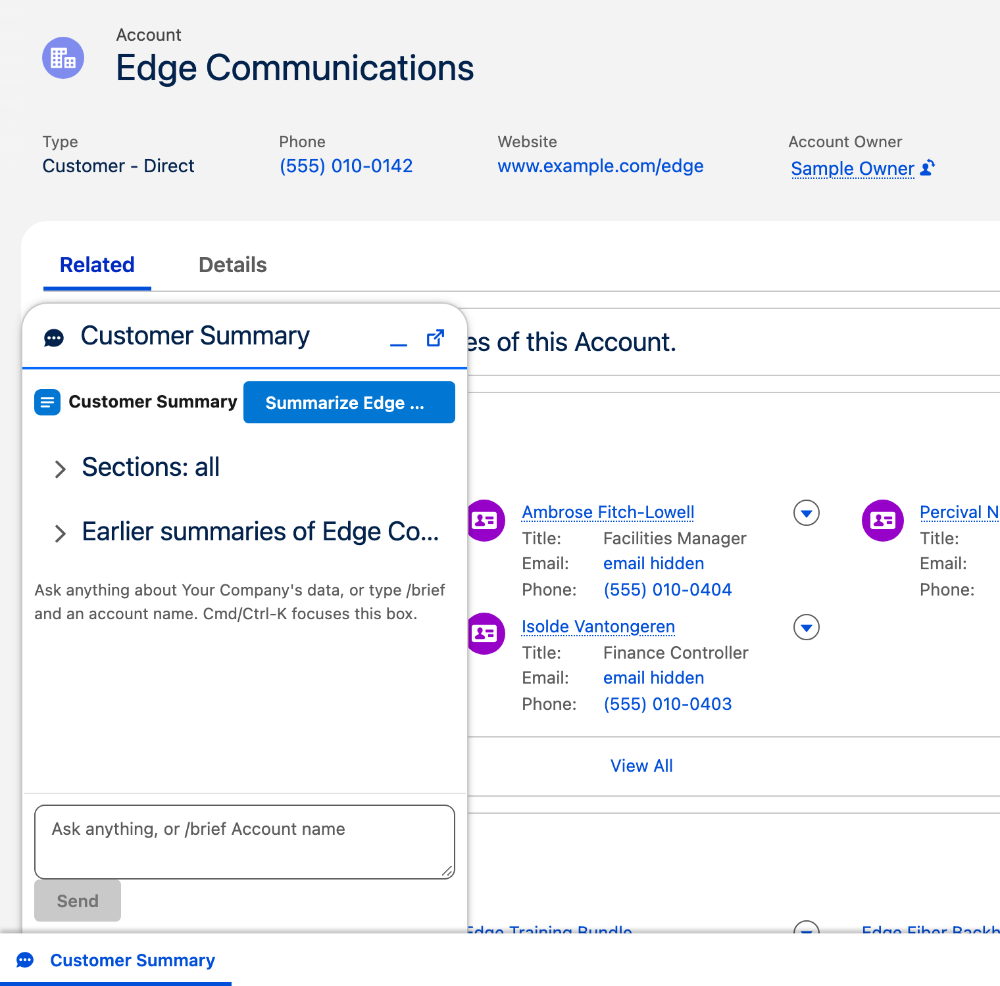

# Brand and theming

A seller puts a prospect's name, logo, colours and tone on the agent by changing one record, so a demo
looks like the prospect's own product.

## The business problem

A seller who demos a generic agent shows someone else's name and colours. Users respond better to an
agent that carries their own company's brand, and a seller has no time to edit code before each demo.
An implementation team has the same problem later: it needs to pull in a customer's styling without
hunting through components for hard-coded names, colours and fonts.

With this pattern, one record holds the agent name, the company name, the logo, four colours, two
fonts and a tone line. The panel and the model prompts read that record, so changing it and
redeploying re-brands the whole product. Nothing in the panel hard-codes a name, a colour or a font.

## The architecture in a few steps

1. One brand record, `Default`, holds every brand value.
2. When the panel opens, it asks Apex for the brand.
3. The panel shows the logo and the agent name in its header and the company name in its empty
   state, and sets its colours and fonts from the brand.
4. When the panel asks a model for a summary or an answer, Apex adds two lines to the end of the
   instructions: the company the user works at, and the tone to write in.

## How it works

The numbers in the diagram match the steps under it. The coral block is the model call. The theme is the shared one
in [_diagram-theme.md](_diagram-theme.md).



1. **Read the brand (steps 1 and 2).** The panel reads the brand through one cacheable Apex method,
   `BrandSettings.getSettings()`. It reads the `Default` record of the custom metadata type
   `Brand_Setting__mdt`. A blank field, a missing record or a value that is not safe to put in a
   style falls back to a neutral default (the defaults are the values in the shipped record).
2. **Brand the panel (step 3).** The panel sets seven CSS variables as inline custom properties on its host:
   `--cs-color-primary`, `--cs-color-accent`, `--cs-color-surface`, `--cs-color-ink`,
   `--cs-font-display`, `--cs-font-body` and `--cs-radius`. Its stylesheet reads only those, each
   with a neutral fallback, so the panel still looks right before the brand arrives or if the read
   fails. The header shows the logo and the agent name; the empty state names the company.
3. **Brand the prompts (steps 4 to 7).** The account summary's final step and the explorer each ask
   `BrandSettings.promptLines()` for two lines and add them after their prompt file's own system text, in the
   model call: `Company: the user works at <company>.` and `Tone: <tone>`. The prompt files themselves are not changed.

## Swap the brand: step by step

This is the part a seller follows before a demo, in five steps. It takes about ten minutes, most of it waiting for
the deploy.

### 1. Edit the Default record

Open `force-app/main/default/customMetadata/Brand_Setting.Default.md-meta.xml` and change the values
between the `<value>` tags. Each field:

| Field | What it changes | Example | If blank or not valid |
|---|---|---|---|
| `Agent_Name__c` | The name in the panel header | `Northwind Assist` | Customer Summary |
| `Company_Name__c` | The empty-state line, and the company named to the model | `Northwind Health` | Your Company |
| `Logo_Resource__c` | The logo in the header: the name of a static resource | `BrandLogo_Example` | `BrandLogo` |
| `Primary_Color__c` | Buttons and links, as hex | `#0b6e4f` | `#0176d3` |
| `Accent_Color__c` | Button hover and focus, as hex | `#08415c` | `#014486` |
| `Surface_Color__c` | The panel background, as hex | `#f7faf8` | `#ffffff` |
| `Ink_Color__c` | The text colour, as hex | `#1b2a24` | `#181818` |
| `Display_Font__c` | The agent name and the panel's headings, as a CSS font list | `Georgia, serif` | Salesforce's own font |
| `Body_Font__c` | Everything else, as a CSS font list | `Verdana, sans-serif` | Salesforce's own font |
| `Tone__c` | One line on how the model writes | `Friendly and brief; no jargon.` | Plain, warm and concise |

Colours are hex only (`#rgb`, `#rrggbb`, or with an alpha digit pair). A font list may hold letters,
digits, spaces, commas, hyphens and quotes. Anything else falls back, so a typo never breaks the
panel. A font has to be one the browser already has; the panel loads no web fonts. To leave a field
blank, write `<value xsi:nil="true"/>` in place of its value.

If you would rather click than edit a file, the same record is in Setup:
**Setup > Custom Metadata Types > Brand Setting > Manage Records > Default > Edit**. A change made
there is live at once, with no deploy, but it is not in the repo: the next deploy from the repo puts
the file's values back.

### 2. Swap the logo

1. Save the prospect's logo as an SVG (best) or a PNG, square, at least 40 by 40 pixels.
2. Add it as a static resource next to the default one: copy
   `force-app/main/default/staticresources/BrandLogo.resource` and its `.resource-meta.xml` to a new
   name such as `ProspectLogo.resource`, put the image in the new file, and set the meta file's
   `<contentType>` to `image/svg+xml` or `image/png`.
3. Put the new name in `Logo_Resource__c` (`ProspectLogo`, without the `.resource`).

`BrandLogo` is the neutral default, a plain mark with no company name. `BrandLogo_Example` is a
made-up company's monogram, used for the "after" picture below.

### 3. Change the utility item label

The label on the utility bar button (the item a user clicks at the bottom of the screen) is not read
from the brand record: Lightning sets it from the app's utility bar page, before the panel loads. To
change it, open `force-app/main/default/flexipages/Customer_Summary_UtilityBar.flexipage-meta.xml`,
find the `componentInstanceProperties` whose `<name>` is `label`, and change its `<value>` (shipped as
`Customer Summary`). Or in Setup: **Setup > App Manager > Customer Summary > Edit > Utility Items >
Customer Summary > Label**.

### 4. Put the history and the sentiment chart on the Account record page

The rail shows the account's history timeline and its sentiment chart ([12](12-right-rail.md)). A team that also wants
them on the Account record page places them there; the quick start does not.

1. Open an account, then **Setup (the gear) > Edit Page** to open the Lightning App Builder on the Account record page.
2. From the custom components, drag **Customer Summary History** (the timeline of the account's outcomes) and
   **Customer Summary Sentiment** (sentiment over time) onto the page.
3. **Save**, then **Activate** the page for the app, profiles or record types the team uses.

The two components ask Apex for nothing about the brand. Inside the rail they draw in the brand's colours, which the
panel sets on its host; on the record page they draw in their neutral fallback colours. A page saved in the App Builder
is live at once but is not in the repo, the same as a record edited in Setup.

### 5. Redeploy

From the repo folder, validate with the local tests, then deploy the validated job:

```bash
sf project deploy validate --source-dir force-app/main/default/customMetadata \
  --source-dir force-app/main/default/staticresources \
  --target-org <your org> --test-level RunLocalTests --wait 30
sf project deploy quick --job-id <the validate job id> --target-org <your org> --wait 10
```

Add `--source-dir force-app/main/default/flexipages` if you changed the utility item label. In a
sandbox or a developer org, `sf project deploy start` with the same folders works too. Reload the
page in the browser to see the new brand; the panel caches the brand for the session.

### What tone changes, and what it does not change yet

- **Changes:** the account summary's final write-up and every explorer answer get the tone line and
  the company name at the end of their instructions.
- **Does not change:** the two smaller summary steps that run before the final write-up (engagement
  and deal history) keep their prompts as shipped. Fixed sentences the product shows, such as error
  messages, are not written by the model and keep their wording.
- **Not yet:** the optional Agentforce agent's own instructions do not get the tone. That is parked
  as `BE-28`.

## See it

The panel with the shipped `Default` record, then the same panel after the record is swapped to a
made-up company, Northwind Health: agent name Northwind Assist, the `BrandLogo_Example` logo,
primary `#0b6e4f`, surface `#f7faf8`, the agent name in Georgia and the panel text in Verdana. Only
the record changed between the two pictures. The utility panel's title and the utility bar button
still read "Customer Summary" in both: that label comes from the app, not the record (step 3).




## Why you can trust it

Runs as the signed-in user: the brand record is read in user mode; the data-access permission set, in the group,
grants read on `Brand_Setting__mdt` and the `BrandSettings` class.

System context: none on the brand read. The prompts the brand lines join are sent through `AgentLlm`, which reads the
prompt settings in system context because they are the product's own configuration, the same for every user
([07](07-trust-access-and-failure.md#the-exceptions)).

- A value that is not safe to put in a style (a colour that is not hex, a font list with a
  semicolon, a logo name with a path in it) falls back to the default:
  `BrandSettingsTest.getSettings_ValuesThatAreNotSafe_GiveTheFallbacks`.
- Blank fields and a missing record give the defaults: `BrandSettingsTest`.
- The company and tone lines end the summary and explorer prompts, after the prompt file's own text:
  `CustomerSummaryTest.synthesisPromptEndsWithTheBrandCompanyAndToneLines` and
  `DataExplorerTest.everyTurnsSystemPromptEndsWithTheBrandCompanyAndToneLines`.
- The panel sets every theme variable, shows the name, logo and company, and stays accessible:
  the `brand` tests in `customerSummaryPanel.test.js`.
- The stylesheet reads only the theme variables, and the markup names no agent or company:
  [tests/test_brand_settings.py](../../tests/test_brand_settings.py).

## How it scales

- The brand is one custom metadata record. Apex reads it once per request and the panel caches it,
  so it adds no measurable load: [tests/test_brand_settings.py](../../tests/test_brand_settings.py)
  checks there is one record, and `BrandSettingsTest` reads it.
- A new surface (the rail, an embedded component) gets the same brand by calling the same method and
  setting the same seven variables.

## Adopt it

1. Copy `Brand_Setting__mdt` (the object folder), the `Default` record, `BrandSettings.cls` and its
   test, and the `BrandLogo` static resource.
2. Grant access: assign the permission set group `Customer_Summary_User`.
3. In your own component, call `BrandSettings.getSettings()`, set the seven `--cs-*` variables on
   the host, and read only those in the stylesheet, each with a fallback.
4. In your own prompts, pass `BrandSettings.promptLines()` as the last argument of
   `AgentLlm.complete` to add the company and tone lines.

## Limits and open items

- The optional agent's own instructions do not get the tone (parked as `BE-28`).
- The utility item label is set in the app's utility bar page, not from the brand record.
- The corner radius has no field yet; it is one fixed value in `BrandSettings`.
- Fonts must already be on the user's machine; the panel loads no web fonts.
- On a record page the history timeline and the sentiment chart draw in neutral colours, not the brand's: only the
  panel reads the brand and sets the variables. No card yet.
- One brand per org. Different brands for different users would need a second record and a way to
  choose it; no card yet.
- The diagram on this page has not been render-checked: the render check in
  [_diagram-theme.md](_diagram-theme.md#render-check) was not run for this page. OPS-61 has it, and it is parked.

[Back to the pattern index](README.md) | [Back to the architecture page](../ARCHITECTURE.md) | [Back to the README](../../README.md)
