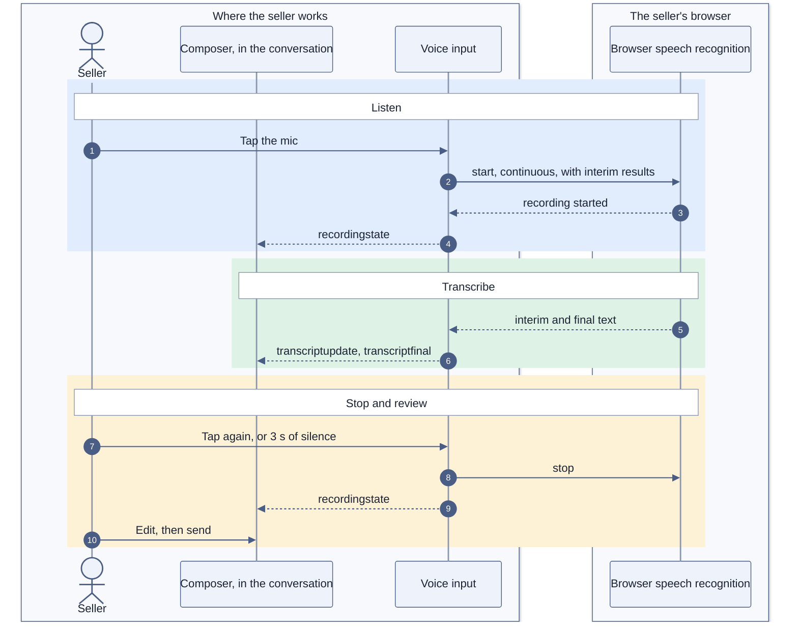

# Voice input

A seller talks to the agent instead of typing, and the words land in the composer for the seller to check and send.

## The business problem

Sellers are between calls, in a car park or walking to a meeting. Typing a question to the agent is slow on a phone-sized
window and easy to skip, so the agent goes unused at the moments it would help most.

With this pattern, the composer in every Customer Summary window, the compact window and the rail alike, carries a
mic button. The seller taps it, speaks, and watches the words
appear in the composer. Nothing is sent until the seller sends it, so a misheard word costs one edit, not a wrong answer.

## The architecture in a few steps

1. The seller taps the mic. The browser asks for the microphone once.
2. The browser's own speech recognition turns the voice into text as the seller speaks.
3. The component hands that text to its host as events, and the host puts it in the composer.
4. Recording stops when the seller taps again or after three seconds of silence.
5. The seller edits the text if needed and sends it.

## How it works

The numbers in the diagram match the steps under it. No model is involved: recognition is the browser's. The theme
is the shared one in [_diagram-theme.md](_diagram-theme.md).



Steps 1 to 4: the button calls `start()` on a new recognizer. The component asks for continuous recognition with interim
results, in the user's locale with `en-US` as the fallback, and fires `recordingstate` when listening begins. Steps 5 and
6: each result arrives as the full text so far. The component fires `transcriptupdate` with the whole transcript
(finished words plus the words still being heard), and `transcriptfinal` when a finished phrase is added. Steps 7 to 9: a
stop (the button, `stop()`, three seconds with no result, an error or the component leaving the page) ends recognition
and fires `recordingstate`. Step 10: the seller sends from the composer, never from here.

The component's public surface:

| Part | What it does |
|---|---|
| `agentName` (property) | Name used in the permission message. Default `Customer Summary`. |
| `start()` and `stop()` | Begin or end listening. `stop()` when idle does nothing. |
| `transcriptupdate` | `detail.transcript`: all text so far, finished and interim. |
| `transcriptfinal` | `detail.transcript`: all finished text, fired when it grows. |
| `recordingstate` | `detail.recording`: true when listening starts, false when it stops. |
| `voiceerror` | `detail.error`: the recognizer's error code. |

Event names are lowercase because LWC rejects hyphens. A polite live region says "Listening started." and "Listening
stopped.". The button is a toggle (`aria-label` Talk or Stop, `aria-pressed`) with a visible recording style that does not
animate for people who ask for reduced motion.

### Errors and support

- `not-allowed`: "Customer Summary needs microphone permission to listen." (the agent name comes from the property).
- Any other error: "Voice input had an issue. Try again or type instead." Silence (`no-speech`) and `aborted` show nothing.
- No speech API in the browser: the button is hidden and a note says voice is not available in this browser. Typing
  always works.

### Browser support

| Browser | Support |
|---|---|
| Chrome and Edge | Full |
| Safari | Patchy |
| Firefox | None |

### Privacy

Chrome sends the audio to Google's servers to transcribe it. Say so to anyone who asks, and to a customer whose security
team will.

### Why it never auto-sends

Speech recognition mishears names, numbers and product words. The words go into the editable composer so the seller can
fix them first. The component has no send path at all: it fires events and the host decides what to do with them.

### Test it by hand

Automated Chromium cannot speak to the API (see [the surfaces spike](../research/fr2-surfaces-spike.md)), so Jest uses a
mocked recognizer and the real check is by hand, once per release.

1. Open the surface that embeds the mic in Chrome, signed in as a seller.
2. Tap the mic and allow the microphone. The button turns to its recording style and reads "Stop".
3. Say a sentence. Words appear in the composer while you speak.
4. Stay quiet for three seconds. Recording stops by itself and nothing is sent.
5. Tap the mic, then block the microphone for the site in Chrome and tap again. The permission message shows.
6. Open the page in Firefox. The mic is hidden and the note shows.

### Embed it

The conversation component (`customerSummaryConversation`) already embeds it on the composer's row, so the compact
window and the rail both have the mic. Its handlers put the transcript after any text already typed and never send.
To embed it in another surface, place the component beside that surface's composer and listen for its events. The
component is not exposed on any page by itself.

```html
<c-customer-summary-voice-input
    agent-name={agentName}
    ontranscriptupdate={handleTranscript}
    onrecordingstate={handleRecordingState}
    onvoiceerror={handleVoiceError}
></c-customer-summary-voice-input>
```

Set the composer's text from `event.detail.transcript` in `handleTranscript`. Do not send from any of these handlers. Set
the `--cs-*` brand variables on the host, as in [brand and theming](10-brand-and-theming.md); the stylesheet reads only
those, each with a neutral fallback.

## See it

No capture yet. The mic sits on the composer's row in the compact window and the rail, but no still or GIF of it
has been taken; OPS-52 takes the captures from a written list. A capture cannot show the transcript itself, which is
checked by hand (see [Test it by hand](#test-it-by-hand)).

## Why you can trust it

Runs as the signed-in user: the component calls no Apex and reads no record; recognition runs in the user's own browser.

System context: none on this path.

- Start, interim and final text, silence stop, manual stop, permission and other errors, an unsupported browser, leaving
  the page, and zero accessibility violations are covered with a mocked recognizer:
  `customerSummaryVoiceInput.test.js`.
- The component never sends: no test or code path dispatches a send event, and the host owns the send button.
- It uses no blocked Lightning Web Security API and needs no CSP, trusted site or permission metadata.

## How it scales

- Each window runs its own recognizer in its own browser, so voice adds no server load: the audio goes from the browser
  to the browser vendor's speech service, not to Salesforce
  ([the surfaces spike](../research/fr2-surfaces-spike.md)).
- A new surface embeds the same component and listens for the same four events, as the conversation component does
  (`customerSummaryConversation.test.js` covers the mic filling its composer).

## Adopt it

1. Grant access: assign the permission set group `Customer_Summary_User`.
2. Copy the `customerSummaryVoiceInput` component bundle.
3. Embed it as shown above and fill your composer from `transcriptupdate`.

## Limits and open items

- The recognizer is the browser's, so accuracy, language list and the audio privacy line are the browser vendor's.
- Only the user's locale is tried, with `en-US` as the fallback; there is no language picker.
- The real transcript is checked by hand, not in automation.
- The by-hand check (a real microphone in Chrome) is not recorded in the README's [Status table](../../README.md#status)
  yet. OPS-53 records it, and it is parked.
- The diagram on this page has not been render-checked: the render check in
  [_diagram-theme.md](_diagram-theme.md#render-check) was not run for this page. No card yet.

### Closed since the earlier version of this page

- **The mic was on no page.** Closed by FE-12: the conversation component embeds it beside the composer, so the
  compact window and the rail both have it.

[Back to the pattern index](README.md) | [Back to the architecture page](../ARCHITECTURE.md) | [Back to the README](../../README.md)
