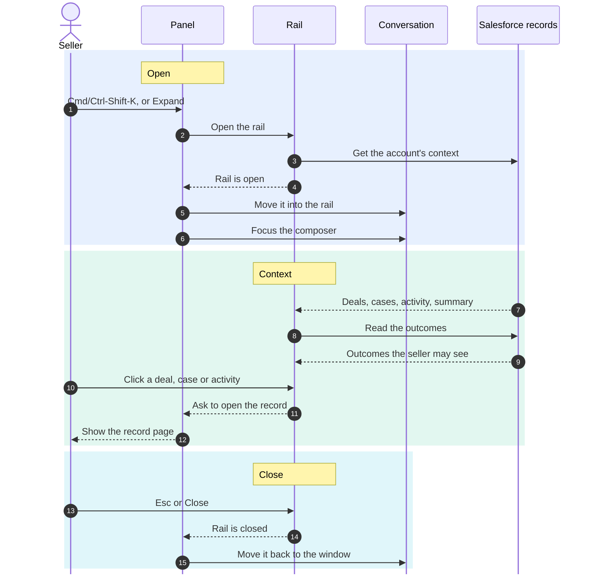
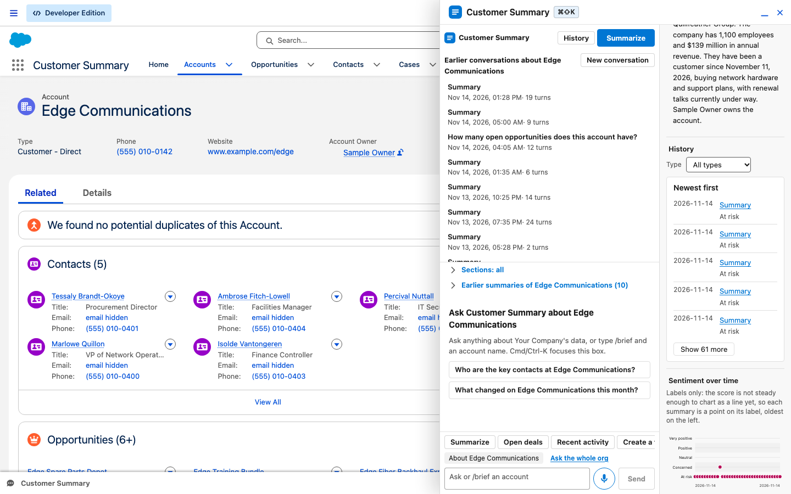
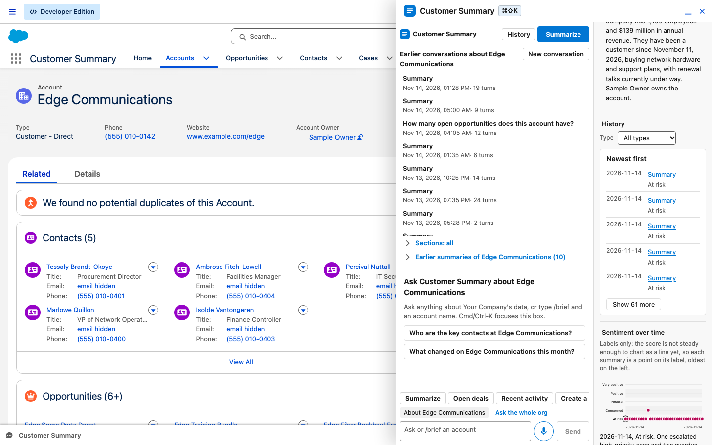

# Right rail

A full-height side panel on the right of the page: the same conversation as the compact window, with the account's
deals, activity, cases, last summary, history and sentiment beside it.

## The business problem

The compact window is for a quick question. A seller who is working an account for the next ten minutes needs more
room for the answer, and needs the account's own facts in view while they read it: which deals are open, what happened
last week, which cases are still open, what the last summary said, and how the account has gone over time. Without
that, the seller flips between the answer and the record's related lists and loses the thread.

The rail is for that seller. It opens on one key from anywhere on the page, or from the compact window when a quick
question turns into a longer one, and it keeps the conversation the seller already started. Why this is a surface of
the product's own, and not the standard Agentforce chat, is chapter [00](00-why-custom.md).

## The architecture in a few steps

1. The seller presses Cmd/Ctrl-Shift-K, clicks the expand button beside the launcher, or clicks Expand in the compact
   window.
2. The rail asks for the account's context at once, before it is drawn, and slides in over the right of the page.
3. The one conversation element moves out of the compact window into the rail, so the thread, the session and the
   composer's text are the same. The composer has focus.
4. The context column fills from one read-only Apex call: open deals, recent activity, open cases and the last summary.
   Under them, the account's history timeline and its sentiment chart each read the account's outcomes.
5. Esc or Close sends the conversation back to the window and focus back to where it was. Minimize leaves a slim tab on
   the right edge; resting the pointer on the tab peeks the rail back out.

## How it works

The numbers in the diagram match the steps under it. The rail makes no model call. The theme is the shared one in
[_diagram-theme.md](_diagram-theme.md).

1. **Open (steps 1 to 6).** The panel (`customerSummaryPanel`) owns the rail (`customerSummaryRail`) and opens it,
   and the rail fires `railopen` back. The key is caught by a document listener and by a capture listener on the
   panel's stage, because the composer stops most keys before they reach the document. The rail calls
   `CustomerSummaryContext.getContext` first and draws while the call is on its way; the panel then moves the one
   conversation element into the rail's slot and puts focus in the composer.
2. **The context arrives (step 7).** `CustomerSummaryContext` returns the context and the rail fills four sections.
3. **History and sentiment (steps 8 and 9).** Under them, the history timeline and the sentiment chart draw for the
   rail's account and read its outcomes through `CustomerOutcomes` (`listOutcomes(accountId)`; see
   [The history and the trend](#the-history-and-the-trend)).
4. **Open a record (steps 10 to 12).** A click on a row fires `railopenrecord`, which asks the panel to open the record:
   the rail lives on the stage the panel moved onto `document.body`, outside the page's navigation context, so the
   panel (which stays in the utility bar) does the navigation.
5. **Close (steps 13 to 15).** Esc or Close fires `railclose`, and the panel puts the conversation back in the compact
   window and focus back where the key was pressed.

### How it opens

| Way in | What happens |
|---|---|
| Cmd-Shift-K on a Mac, Ctrl-Shift-K elsewhere | Opens the rail from anywhere on the page, the composer included. Pressed again while the rail is out, it puts focus back in the composer. |
| The expand button beside the launcher | Opens the rail. Hovering or focusing the button starts the context call early. |
| Expand in the compact window | The window closes and the rail opens on the same session, thread intact. The `CustomerSummaryExpand` message still goes out with the session and record. |
| The edge tab, when minimized | A click opens the rail. Resting the pointer on it for 350 ms opens a peek; the peek slides back 400 ms after the pointer leaves, unless the seller clicked or tabbed into it. |
| Cmd/Ctrl-K while the rail is out | Brings the conversation back to the compact window. |

The header shows the brand logo, the agent name and the key hint (`⌘⇧K` or `Ctrl Shift K`, also in
`aria-keyshortcuts`). The rail is a non-modal `<dialog>` opened with `show()`: Tab can leave it, and the page stays usable.

### Push or overlay

The rail slides over the page; it does not push the page aside. The surfaces spike
([fr2-surfaces-spike.md](../research/fr2-surfaces-spike.md#rail)) showed that pushing works only by restyling
Salesforce's own `.viewport` element. No published API lets a component resize the Lightning workspace, and that markup
can change in any release, so the rail does not depend on it. The rail is 480 to 640 px wide
(`clamp(480px, 46vw, 640px)`, 640 px in a 1440 px window), full height, with a soft shadow and no backdrop, so the page to
its left can still be clicked.

### What it prefetches

One call, `CustomerSummaryContext.getContext(accountId)`, cacheable, at most 8 SOQL queries:

| Section | What it shows | Cap |
|---|---|---|
| Open deals | Name, amount, stage, close date | 5 |
| Recent activity | Calls, tasks, events, synced emails and case comments, newest first, each labelled with its kind | 10 |
| Open cases | Case number and subject, status, priority | 5 |
| Last summary | The date and first lines of the seller's own last stored summary | 3 lines |

The call goes out on the key press, before the rail is drawn, and on hover or focus of the launcher's expand button and of
the edge tab. The result is kept per account, so reopening the rail on the same account does not ask again. While it
loads, each section shows two skeleton rows and is marked `aria-busy`; a polite live region says "Loading account
details" and then "Account details loaded". A failed call shows one fixed sentence and Try again. A list the seller
cannot read says "Your access doesn't include this." and the others still load. On a page that is not an account the
column says it has no account to show; once an account has been seen, the rail keeps it while the seller opens one of
its deals or cases.

### The history and the trend

Under the four sections, while the rail is open, the context column shows two more panes from FE-19. A closed rail makes
neither call.

- **History.** `customerSummaryHistoryTimeline` lists the account's outcomes newest first (summaries, actions taken and
  saved answers, up to 100), as one `timeline` card drawn by the shared card renderer, with a filter by type and a
  detail under the card for each entry.
- **Sentiment over time.** `customerSummarySentimentChart` draws each of the account's last 50 summaries as a point on
  the band of its sentiment label, oldest on the left, with a text table for screen readers. It draws labels only: no
  line and no numeric axis, because the score behind a label is not steady enough to chart; an edit to one prompt rule
  moved a label by two steps ([fr2-sentiment.md](../research/fr2-sentiment.md)).

Both draw only what `CustomerOutcomes` returns: another rep's entry shows its type, date and label, and says its text
stays with its author. How outcomes are written and shared is chapter [05](05-conversation-memory.md). The same two
components can also go on an Account record page ([10](10-brand-and-theming.md#swap-the-brand-step-by-step), step 4).

### Speed budget

Measured by e2e spec Rail 6 (warm, three fresh pages per project, Playwright Chromium, 1440x900, `agent-probe`,
2026-11-14):

| Measure | Budget | `mac` | `windows` |
|---|---|---|---|
| Key press to the first frame with the rail open | under 300 ms | 18, 14, 13 ms (median 14) | 12, 18, 11 ms (median 12) |
| Key press to every section filled | under 1.5 s | 323, 286, 244 ms (median 286) | 387, 316, 459 ms (median 387) |

### History visibility (F32)

The rail shows the History list of the conversation component (FE-22's control) open in its main column. History is
own-only: a seller sees the conversations they own for the account, never another rep's, even one shared with them or
one their role would show. The last summary in the context column follows the same rule. Who else may see history is
question Q7 in [feature-revision-2.md](../plans/feature-revision-2.md) and is not answered; until it is, own-only stands.

### Motion and theme

The sheet slides in 280 ms with `cubic-bezier(0.32, 0.72, 0, 1)`; the edge tab, rows and chevrons move in 120 to 180 ms.
With reduced motion asked for, nothing slides or pulses. Every colour, font and radius reads a `--cs-*` variable from
the brand settings, as in [brand and theming](10-brand-and-theming.md). At 1040 px wide or less the context column folds
under the conversation and scrolls with it; there is no sticky header. The rail keeps its account while a deal is opened.

## See it

Retaken by OPS-52 on 2026-11-14 on the Edge Communications record page, each still the whole 1440 by 900 window
unless it says otherwise ([capture record](../research/fr2-captures.md)). The rail slides over the page and does not
push it (see Push or overlay): the left of each still is the record page, unmoved, under the rail.

## Why you can trust it

Runs as the signed-in user: `CustomerSummaryContext` is `with sharing` and every query runs `WITH USER_MODE`, so object,
field and record access all apply. It is read-only. The conversation in the rail is the same component, with the same
doors, as in the compact window.

System context: one use on this path. The history timeline and the sentiment chart read outcome text through
`CustomerOutcomes` in system context, only for the rows they show in full (the seller's own, or a type marked to
share), because reps hold no field access to outcome text ([07](07-trust-access-and-failure.md#the-exceptions)). The
conversation in the rail uses the same doors as the compact window, named on [01](01-route-gather-reduce.md) and
[05](05-conversation-memory.md).

- **Jest covers the rail.** [customerSummaryRail.test.js](../../force-app/main/default/lwc/customerSummaryRail/__tests__/customerSummaryRail.test.js)
  covers the key on and off a Mac, the expand message and `open()` with a session Id, focus in and back, overlay (no
  page style touched), minimize to the tab, the hover peek and its timings, every section with rows, empty,
  unavailable, loading and error, the rail keeping its account while a deal is opened, opening a record (by the rail or by its host), no record Id in the
  markup, and axe in each state. It also puts the timeline and the sentiment chart in the context column, on the rail's
  account, once the rail is open.
- **Jest covers the history and the trend.**
  [customerSummaryHistoryTimeline.test.js](../../force-app/main/default/lwc/customerSummaryHistoryTimeline/__tests__/customerSummaryHistoryTimeline.test.js)
  and [customerSummarySentimentChart.test.js](../../force-app/main/default/lwc/customerSummarySentimentChart/__tests__/customerSummarySentimentChart.test.js)
  cover another rep's entry showing type, date and label but never its text, no record Id in the markup, and a point
  per summary with no line.
- **Jest covers the panel's side.** [customerSummaryPanel.test.js](../../force-app/main/default/lwc/customerSummaryPanel/__tests__/customerSummaryPanel.test.js)
  covers the flag off, Expand keeping the same element, turns and session, the sessions list open with a reopen, the
  launcher expand and its prefetch, Cmd/Ctrl-Shift-K from the composer and the page, Esc bringing the thread home, Cmd-K
  bringing it back, a minimized rail, an Open prompt landing in the rail, the panel navigating for a row, and axe.
- **It runs in a real org.** `e2e/rail.spec.js` (six specs, in [e2e/README.md](../../e2e/README.md)): open by key,
  geometry and focus return; Expand with the thread intact; one question answered in the rail; every context section and
  a row opening its record; minimize, peek and tab; and the speed budget. `e2e/history.spec.js` opens the timeline and
  the sentiment chart in the rail.
- **Lightning Web Security.** No blocked API: document listeners, timers, `<dialog>` `show()` and `close()`,
  `appendChild` into the component's own `lwc:dom="manual"` containers, and `NavigationMixin`.

## How it scales

- The context is one cacheable call of at most 8 queries per account, kept in the rail per account, so a seller moving
  between the window and the rail on one account asks once
  ([CustomerSummaryContextTest](../../force-app/main/default/classes/CustomerSummaryContextTest.cls)).
- The timeline and the chart each make one read of the account's outcomes, capped at 100 and 50 rows, and only while
  the rail is open ([customerSummaryRail.test.js](../../force-app/main/default/lwc/customerSummaryRail/__tests__/customerSummaryRail.test.js)).
- The rail adds no model call. The only model calls are the questions the seller asks, as in the compact window.
- There is one conversation element for both frames, so a second surface costs no second session or second history
  load.

## Adopt it

1. Grant access: assign the permission set group `Customer_Summary_User`.
2. Deploy `customerSummaryPanel`, `customerSummaryRail` and `CustomerSummaryContext`.
3. Turn the rail on: set the utility item's `Right rail` property (`expandEnabled`) to true, as the shipped
   `Customer_Summary_UtilityBar` does.

## Limits and open items

- Push is not offered: the rail always slides over the page (see Push or overlay).
- Reopening a past conversation from the History list in the rail closes the list; that is the conversation
  component's own behaviour (FE-22).
- The context caps (5 deals, 10 activities, 5 cases) are fixed in `CustomerSummaryContext`, not settings.
- Who else may see a seller's history (F32, Q7) is not answered; history stays own-only.
- The speed numbers are from Playwright's Chromium on one machine, warm; a cold first open also loads the component.
- Rail 1 failed once on `mac` on the first open after a deploy (Esc did not close: focus was not yet in the rail), then
  passed three runs in a row; treat a single failure there as a cold-cache flake and rerun before chasing it.
- The sentiment chart draws labels only, because the score is not steady enough to chart. With up to 50 points in the
  narrow rail, the points crowd. No card yet.
- On a record page the two FE-19 components draw in neutral colours, not the brand's (see
  [10](10-brand-and-theming.md#limits-and-open-items)). No card yet.
- The diagram on this page has not been render-checked: the render check in
  [_diagram-theme.md](_diagram-theme.md#render-check) was not run for this page. OPS-61 has it, and it is parked.

[Back to the pattern index](README.md) | [Back to the architecture page](../ARCHITECTURE.md) | [Back to the README](../../README.md)
