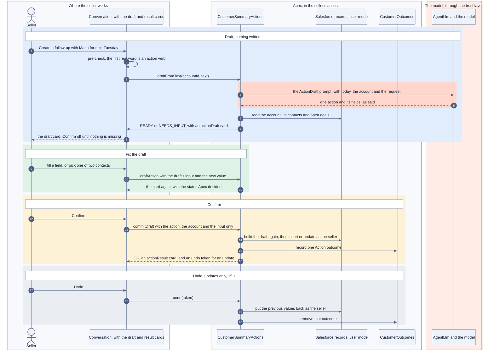
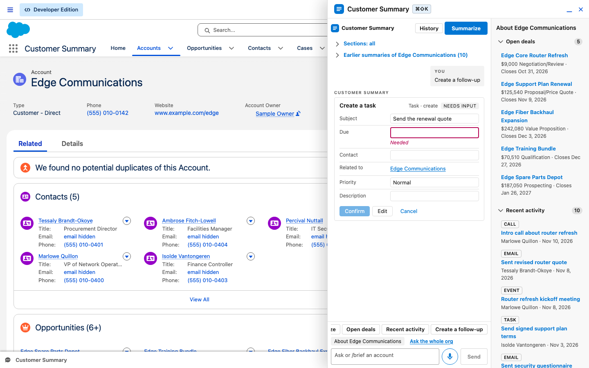

# Write actions

A seller asks for a follow-up or an update in their own words, sees exactly what will be written as a draft card, and
only a Confirm writes it, as them, with their access.

## The business problem

- **The problem.** Sellers finish a call knowing what comes next: a task for Friday, a meeting next week, a new title
  for the buyer, a pushed close date. Opening the right record, finding the right field and typing it in is where those
  follow-ups get lost.
- **What changes for a seller or a service rep.** They say it to Customer Summary, by voice or in the chat ("create a
  follow-up with Maria for next Tuesday"), or tap "Create a follow-up" or "Log a call". A draft card shows every field
  that will be written. They fill what is missing, pick a contact if two match, and confirm. A result card links to
  the saved record, and a changed field can be undone for fifteen seconds.
- **What changes for their manager.** Every write is recorded as an Action outcome on the account, so the account's
  history ([05](05-conversation-memory.md)) shows what was done, not only what was said.
- **The rule.** Draft, then confirm. Nothing is written before the seller presses Confirm, and the model only proposes:
  Apex decides every value.

## The architecture in a few steps

1. **Ask.** The seller says or types a request with an account open, or taps one of the two action chips.
2. **Draft.** A cheap check of the first real word decides if the text could be an action at all; a question never
   reaches the model. The model turns the sentence into one action and its fields, as said. Apex checks every field
   against the account and the seller's access and returns a draft. Nothing is written.
3. **Fix.** The draft card marks each missing field and offers a choice when two records match. Each change goes back to
   Apex, which drafts again and decides the status.
4. **Confirm.** Confirm is off until the draft is ready. On Confirm, Apex builds the draft again from the same input,
   writes it as the seller, records an Action outcome and returns a result card.
5. **Undo, for updates only.** An update's result card offers Undo for fifteen seconds. A created record is not undone.

## How it works

The numbers in the diagram match the steps under it. The coral block is the model call; everything else is
deterministic Apex and the conversation. The theme is the shared one in [_diagram-theme.md](_diagram-theme.md).

1. **Ask and pre-check (steps 1 to 3).** The conversation runs the same pre-check as Apex (`CustomerSummaryActionCatalog`,
   from the actions spike): it skips filler words ("so", "please", "can you") and tests the first word left against a
   verb list ("create", "add", "schedule", "log", "update", "push" and others). Matching a verb anywhere would be wrong:
   "Which of their open deals close this quarter?" contains "open". Text that does not start with a verb goes straight
   to the ask path with no extra request; `NOT_AN_ACTION` from the server also goes on to the ask path in the same turn,
   so the seller sees one turn. The chips "Create a follow-up" (`create_task`) and "Log a call" (`log_call`) skip the
   model and call `draftAction` with no input; they show on an account's record page only.
2. **The model proposes (steps 4 and 5).** The `ActionDraft` prompt (static resource `AgentPrompt_ActionDraft`, settings
   in `Agent_Prompt_Setting.ActionDraft`) gets today's date, the weekday, the account name and the request, and answers
   with one JSON object or `{"action":"none"}`. A person or deal the request never named is dropped from the reply, so
   the model cannot add one. A draft costs one model call at most.
3. **Apex decides (steps 6 to 8).** `draft` reads the account, matches contacts and open deals by name on that account
   only, parses the dates and values, and returns a `Draft` with BE-39's `actionDraft` card. The card is drawn by
   `c-customer-summary-card` with the same plain-text fallback as every other card. A missing field has an error
   border, the word "Needed" and `aria-invalid`, and Confirm stays off until no field is missing.
4. **Fix the draft (steps 9 to 11).** A changed value or a chosen record calls `draftAction` again with the draft's
   resolved input plus the new words. The client never builds a field or decides a status: the server is the only
   source of a draft.
5. **Confirm (steps 12 to 16).** Confirm calls `commitAction` once, with only the draft's action, account and input; the
   card is busy while it runs, so a second click does nothing. `commitDraft` builds the draft again from that input,
   writes only a `READY` draft, records the outcome and returns a `Result` with an `actionResult` card: the title ("Task
   created"), the record as a link, what was written, and Open. A refusal or a failure adds the error turn with a plain
   message and leaves the draft open. Cancel closes the card and says "Cancelled. Nothing was saved."
6. **Undo (steps 17 to 20).** An update's result card shows Undo next to Open for 15 seconds, by a client timer; the
   server's own 15-second check still decides. `undo` restores the values the token carries and removes the outcome.

### The six actions

| Action | Writes | Fields |
|---|---|---|
| `create_task` | a Task on the account | subject and due date (required), contact, priority, description |
| `create_event` | an Event on the account | subject and start (required), end or length (30 minutes by default), contact, description |
| `log_call` | a completed Task with subtype Call by default (see below) | contact (required), subject (`Call` by default), description |
| `update_contact` | a Contact on the account | contact and changes, from the allow-list: Title, Phone, MobilePhone, Email, Department |
| `create_case` | a Case on the account | subject (required), description, priority, contact |
| `update_opportunity` | an open Opportunity on the account | deal and changes: StageName, CloseDate, NextStep, Amount |

Dates take ISO days and words: "tomorrow", "next Tuesday", "end of next month", "end of quarter", "Nov 17". Times take
"2pm", "10:30am", "at 3" (read as 15:00) and "noon". Amounts take "$50k". A day the month does not have, such as
February 30, is not read as a nearby day; the field is marked as needed.

### Draft statuses

| Status | What the caller does |
|---|---|
| `READY` | Show the draft and ask the seller to confirm. |
| `NEEDS_INPUT` | Ask for the fields marked "(needed)", or for a choice when two contacts or deals match. |
| `NOT_AN_ACTION` | Treat the text as a question. |
| `REFUSED` | Show the message: an unknown action, an account the seller can't see, or no create or edit access. |
| `ERROR` | Show the fixed message: the model could not be reached. |

### Three ways in

- **The conversation, in the compact window and the rail.** Through `CustomerSummaryPanelController.draftAction`,
  `draftFromText`, `commitAction` and `undoAction`, each of which turns an unexpected exception into one fixed message.
  All six actions are open here. The reference surface is the conversation's `_startDraft`, `_redraft` and `_confirm`.
- **The outside door (MCP).** The invocables `CustomerSummaryActionDraftAction` (`draft_action`) and
  `CustomerSummaryActionCommitAction` (`commit_action`). Draft returns `Draft JSON`, which the client passes unchanged to
  Commit after the person says yes ([09](09-outside-door-mcp.md#writing-from-an-outside-client)). These two invocables
  allow two actions only, `create_task` and `log_call` (`CustomerSummaryActionDraftAction.DOOR_ACTIONS`), and refuse any
  other with one fixed text.
- **An agent.** An agent that later calls the same two invocables gets the same two actions. The optional agent in
  [06](06-agent-routing-and-verbatim-relay.md) does not call them today.

Every draft and result also comes back as an `actionDraft` or `actionResult` card (`AnswerCard`), so any surface that can
show cards shows the same thing. Record Ids appear only in the card's refs.

### Why a draft and a Confirm

The model reads a sentence, and sentences are loose: "Maria" can be two people, "next Friday" can mean two days, and a
misheard word in voice input ([11](11-voice-input.md)) becomes a wrong value. A write the seller has not seen is a write
nobody can vouch for. So the draft makes no DML at all, and every field it would write is on screen before the seller
confirms.

The confirm does not trust the draft it is sent. `commitDraft` builds the draft again from its input and writes only if
it is still `READY`, so a draft changed on the way, or one whose contact has since moved account, writes nothing.

### The log_call choice (F17)

`CustomerSummaryActions.LOG_CALL_AS` decides what a logged call is. It is `'Task'`, as the product owner chose on
2026-11-16: a completed Task with subtype Call, status Completed, dated today unless the person gave a date, with the
contact as the who and the account as the related record. That is what the standard Log a Call quick action writes, and
activity reports filter on the subtype. Set it to `'Event'` and a logged call becomes a 15-minute Event that ends now.
The actions spike measured both: each lands in the account's activity history. It is a one-line change, and the tests
cover both shapes.

### Add a seventh action

1. Add a `Spec` to `CustomerSummaryActionCatalog.all()`: its name, the draft and result labels, the object, `create` or
   `update`, and for an update the allow-list of fields.
2. In `CustomerSummaryActions.build`, add a `when` branch and a `buildX` method that adds each field with the helpers
   (`textField`, `dateField`, `picklist`, `contact`, `related`). An update reuses `buildUpdate`, which applies the
   allow-list and keeps the values before for undo.
3. Add the action and its fields to the `ActionDraft` prompt resource, with its required fields.
4. If people start the request with a verb that is not on `VERBS`, add it and pin the phrasing in
   `CustomerSummaryActionCatalogTest`.
5. Name the action in the `Action Type` description of `CustomerSummaryActionDraftAction`.
6. Add tests for its draft, its commit and a field that fails its check.

No permission set change is needed: the action writes with the seller's own object and field access.

## See it

Captured by OPS-52 on 2026-11-14 on the Edge Communications record page, each still the whole 1440 by 900 window
([capture record](../research/fr2-captures.md)). Each run cancels the draft after the still, so nothing is saved.

The result card has no capture: a result needs a saved record, and runs that create a record wait on their own
approval (see [Limits and open items](#limits-and-open-items)).

## Why you can trust it

Runs as the signed-in user: every read is `WITH USER_MODE` and every insert, update and undo is a `USER_MODE` DML, so a
seller can only write what their own object, field and sharing access allow.

System context: two uses on this path, each named in [07](07-trust-access-and-failure.md#the-exceptions). `AgentLlm`
reads the `ActionDraft` prompt settings, the product's own configuration, the same for every user. `CustomerOutcomes`
sets the Action outcome's text fields, and deletes the outcome on undo, because sellers hold no access to outcome text
and no delete on outcomes; the delete runs only after it checks the seller wrote the outcome.

- **Nothing is written before Confirm.** A draft makes no DML: BE-27's Apex tests assert `Limits.getDmlStatements()` is
  0 after a draft. No draft, edit or Cancel path in the conversation calls `commitAction`
  (`customerSummaryConversationActions.test.js`), and Confirm is off until the draft is `READY` and while the commit
  runs (`customerSummaryActionCards.test.js`).
- **The confirm path is tested.** `commitAction` is called once with the button disabled while it runs, then the result
  card and Open, the error turn for a refusal and a failure, and Undo with its 15 seconds
  (`customerSummaryConversationActions.test.js`), with axe on each card state
  ([fr2-action-cards.md](../research/fr2-action-cards.md#tests)).
- **What the end-to-end test proves, under its Approvals row.** `e2e/conversation-actions.spec.js` FR2 5 runs in a test
  org with 0 model calls and 0 records: the chip gives a task draft in the turn, Confirm stays off until Subject and Due
  are filled, each fill re-drafts, and Cancel closes the card with no `commitAction` request. It never clicks Confirm,
  because the approval for e2e and agent tests that create a record is still pending. Until it is approved, Confirm is
  covered by the Jest suites above and BE-27's Apex tests, not by a run in the org.
- **A contact must be on the account and a deal must be open on the account,** at draft and again at commit.
- **An update changes only allow-listed fields** and names any other field it left out.
- **Undo works only within fifteen seconds,** only for an update, and only for allow-listed fields on a record on the
  same account. A changed or made-up token changes nothing.
- **A seller without edit access is refused** at the draft and at the commit, in a test that runs as a minimum-access
  user.
- **A failed outcome write is logged and never undoes the action.** A value the platform rejects saves nothing and says
  why.
- **The model only proposes.** Apex decides every value, and a person or deal the request never named is dropped.
- **The shapes were measured first.** The actions spike ([fr2-actions-spike.md](../research/fr2-actions-spike.md)) ran
  the pre-check and both `log_call` shapes before BE-27 built the service.

Whether a run in a real org has passed is kept in one place, the README's [Status table](../../README.md#status).

## How it scales

- **A draft costs one model call at most,** and none for a chip or for text that does not start with an action verb
  (`CustomerSummaryActionCatalogTest` pins the pre-check).
- **Each draft or commit makes a few selective queries on one account,** and each commit one DML plus one outcome
  insert ([fr2-actions-spike.md](../research/fr2-actions-spike.md)).
- **Every surface calls the same service,** so the rules live in one place; the draft and result cards are BE-39's card
  contract, drawn by the one card component ([fr2-card-contract-apex.md](../research/fr2-card-contract-apex.md)).

## Adopt it

1. Grant access: assign the permission set group `Customer_Summary_User`.
2. Copy `CustomerSummaryActions`, `CustomerSummaryActionCatalog`, `CustomerSummaryActionResolver`, the two invocables, the
   `AgentPrompt_ActionDraft` resource and the `Agent_Prompt_Setting.ActionDraft` record, with the customer outcomes
   pattern they record into ([05](05-conversation-memory.md)).
3. Set `LOG_CALL_AS` to the shape your team logs calls in.
4. Call `draftFromText` or `draftAction` from your surface, show the draft, and call `commitAction` only on Confirm. Set
   `action-mode` on `c-customer-summary-card` to draw the draft and result cards; the conversation's `_startDraft`,
   `_redraft` and `_confirm` are the reference.
5. To turn the two chips off, set `ACTION_CHIPS_ENABLED` to false in the conversation.

## Limits and open items

- **Confirm is not run in the org by the e2e.** The approval for e2e and agent tests that create a record is pending,
  so the result card and Undo have no run in the org and no capture. No card yet.
- **The chips cover two of the six actions.** The other four are reached by typing or speaking.
- **The outside door and any agent get two actions, not six.** The shared invocables allow `create_task` and
  `log_call` only, by design (OPS-59); the conversation keeps all six.
- **The verb pre-check misses requests that start with another word,** such as "Follow up with Maria next week" or
  "File a case about the broken router". These come back as questions; `CustomerSummaryActionCatalogTest` pins the
  known misses. No card yet.
- **The undo token is not signed.** Changing it can only do what the seller could already do: allow-listed fields, on
  the account, with their own access. Accepted.
- **Undo is for updates only.** A created task, event or case is deleted from its record page. Accepted.
- **Undo is shown for 15 seconds by a client timer.** The server's own 15-second check still decides.
- **No email drafting, and no actions on other objects.** No card yet.
- **The diagram on this page has not been render-checked:** the render check in
  [_diagram-theme.md](_diagram-theme.md#render-check) was not run for this page. OPS-61 has it, and it is parked.

### Closed since the earlier version of this page

- **The cards were not drawn in the panel.** Closed by FE-14: the conversation draws the draft and result cards, with
  the two chips and the typed and spoken way in.

[Back to the pattern index](README.md) | [Back to the architecture page](../ARCHITECTURE.md) | [Back to the README](../../README.md)
