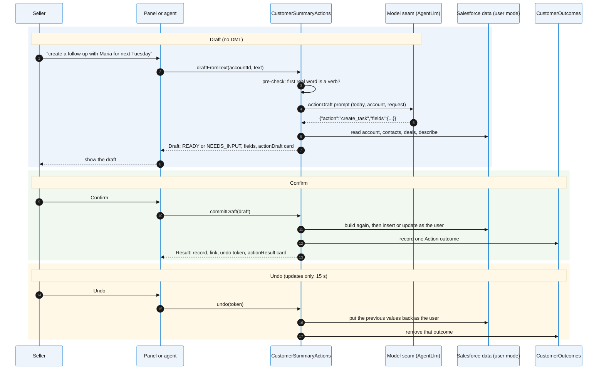

# Write actions

A seller asks for a follow-up or an update in their own words, sees exactly what will be written, and only a Confirm
writes it, as them, with their access.

## The business problem

Sellers finish a call knowing what comes next: a task for Friday, a meeting next week, a new title for the buyer, a
pushed close date. Opening the right record, finding the right field and typing it in is where those follow-ups get lost.

With this pattern the seller says it to Customer Summary, by voice or in the chat: "create a follow-up with Maria for
next Tuesday". The panel shows a draft with every field it will write. The seller fixes what is wrong, picks a contact if
two match, and confirms. The record is saved, the account remembers it as an outcome, and a changed field can be undone
for fifteen seconds.

## The architecture in a few steps

1. The seller says or types a request with an account open.
2. A cheap check of the first real word decides if the text could be an action at all. A question never reaches the
   model.
3. The model turns the sentence into one action and its fields, as said. It never looks anything up.
4. Apex checks every field against the account and the seller's access, finds the contact or the deal by name, works out
   dates such as "next Tuesday", and returns a draft. Nothing is written.
5. The seller confirms. Apex builds the draft again from the same input, and writes it only if it is still ready.
6. The write is recorded as an Action outcome on the account. An update returns an undo token that works for fifteen
   seconds.

## How it works

Steps 1 to 3: `draftFromText` skips filler words ("so", "please", "can you") and tests the first word left against a
verb list ("create", "add", "schedule", "log", "update", "push" and others). Matching a verb anywhere would be wrong: "Which
of their open deals close this quarter?" contains "open". A miss returns `NOT_AN_ACTION` with no model call, and the
caller treats the text as a question. Steps 4 and 5: the `ActionDraft` prompt (static resource
`AgentPrompt_ActionDraft`, settings in `Agent_Prompt_Setting.ActionDraft`) gets today's date, the weekday, the account name
and the request, and answers with one JSON object or `{"action":"none"}`. A person or deal the request never named is
dropped from the reply, so the model cannot add one. Steps 6 to 8: `draft` reads the account, matches contacts and open
deals by name on that account only, parses the dates and values, and returns a `Draft`. Steps 9 to 13: `commitDraft`
runs the same build from the draft's input, writes only a `READY` draft, records the outcome and returns a `Result`.
Steps 14 to 17: `undo` restores the values the token carries and removes the outcome.

### The six actions

| Action | Writes | Fields |
|---|---|---|
| `create_task` | a Task on the account | subject and due date (required), contact, priority, description |
| `create_event` | an Event on the account | subject and start (required), end or length (30 minutes by default), contact, description |
| `log_call` | an Event by default (see below) | contact (required), subject (`Call` by default), description |
| `update_contact` | a Contact on the account | contact and changes, from the allow-list: Title, Phone, MobilePhone, Email, Department |
| `create_case` | a Case on the account | subject (required), description, priority, contact |
| `update_opportunity` | an open Opportunity on the account | deal and changes: StageName, CloseDate, NextStep, Amount |

Dates take ISO days and words: "tomorrow", "next Tuesday", "end of next month", "end of quarter", "Nov 17". Times take
"2pm", "10:30am", "at 3" (read as 15:00) and "noon". Amounts take "$50k". A day the month does not have, such as
February 30, is not read as a nearby day; the field is marked as needed.

### Draft statuses

| Status | What the caller does |
|---|---|
| `READY` | Show the draft and ask the seller to confirm. |
| `NEEDS_INPUT` | Ask for the fields marked "(needed)", or for a choice when two contacts or deals match. |
| `NOT_AN_ACTION` | Treat the text as a question. |
| `REFUSED` | Show the message: an unknown action, an account the seller can't see, or no create or edit access. |
| `ERROR` | Show the fixed message: the model could not be reached. |

### Three ways in

- The panel: `CustomerSummaryPanelController.draftAction`, `draftFromText`, `commitAction` and `undoAction`. Each turns an
  unexpected exception into one fixed message.
- The agent: the invocables `Draft Action` (`CustomerSummaryActionDraftAction`) and `Commit Action`
  (`CustomerSummaryActionCommitAction`). Draft returns `Draft JSON`, which the agent passes unchanged to Commit after the
  seller confirms.
- Later, the outside door: the same service, with no logic of its own.

Every draft and result also comes back as an `actionDraft` or `actionResult` card (`AnswerCard`), so any surface that can
show cards shows the same thing. Record Ids appear only in the card's refs.

### Why a draft and a Confirm

The model reads a sentence, and sentences are loose: "Maria" can be two people, "next Friday" can mean two days, and a
misheard word in voice input becomes a wrong value. A write the seller has not seen is a write nobody can vouch for.
So the draft makes no DML at all, and every field it would write is on screen before the seller confirms.

The confirm does not trust the draft it is sent. `commitDraft` builds the draft again from its input and writes only if
it is still `READY`, so a draft changed on the way, or one whose contact has since moved account, writes nothing.

### The log_call choice (F17)

`CustomerSummaryActions.LOG_CALL_AS` decides what a logged call is. It is `'Event'`, as the product owner chose: a
15-minute Event that ends now. Set it to `'Task'` and a logged call becomes a completed Task with subtype Call, due today,
which is what the standard Log a Call quick action writes. The actions spike measured both: each lands in the account's
activity history. It is a one-line change, and the tests cover both shapes.

### Add a seventh action

1. Add a `Spec` to `CustomerSummaryActionCatalog.all()`: its name, the draft and result labels, the object, `create` or
   `update`, and for an update the allow-list of fields.
2. In `CustomerSummaryActions.build`, add a `when` branch and a `buildX` method that adds each field with the helpers
   (`textField`, `dateField`, `picklist`, `contact`, `related`). An update reuses `buildUpdate`, which applies the
   allow-list and keeps the values before for undo.
3. Add the action and its fields to the `ActionDraft` prompt resource, with its required fields.
4. If people start the request with a verb that is not on `VERBS`, add it and pin the phrasing in
   `CustomerSummaryActionCatalogTest`.
5. Name the action in the `Action Type` description of `CustomerSummaryActionDraftAction`.
6. Add tests for its draft, its commit and a field that fails its check.

No permission set change is needed: the action writes with the seller's own object and field access.

## See it

None yet. The panel's draft and result cards are drawn by a later card, so there is no capture to show.

## Why you can trust it

Runs as the signed-in user: every read is `WITH USER_MODE` and every insert, update and undo is a `USER_MODE` DML, so a
seller can only write what their own object, field and sharing access allow.

System context: none in the write actions. The Action outcome uses `CustomerOutcomes`, which writes the outcome's text
fields and deletes the outcome on undo in system context, because sellers hold no access to outcome text and no delete
on outcomes; the delete runs only after it checks the seller wrote the outcome.

- Draft makes no DML: the tests assert `Limits.getDmlStatements()` is 0 after a draft.
- A contact must be on the account and a deal must be open on the account, at draft and again at commit.
- An update changes only allow-listed fields and names any other field it left out.
- Undo works only within fifteen seconds, only for an update, and only for allow-listed fields on a record on the same
  account. A changed or made-up token changes nothing.
- A seller without edit access is refused at the draft and at the commit, in a test that runs as a minimum-access user.
- A failed outcome write is logged and never undoes the action. A value the platform rejects saves nothing and says why.
- The model only proposes. Apex decides every value, and a person or deal the request never named is dropped.

## How it scales

- A draft costs one model call at most, and none for text that does not start with an action verb.
- Each draft or commit makes a few selective queries on one account, and each commit one DML plus one outcome insert.
- Every surface calls the same service, so the rules live in one place.

## Adopt it

1. Grant access: assign the permission set group `Customer_Summary_User`.
2. Copy `CustomerSummaryActions`, `CustomerSummaryActionCatalog`, `CustomerSummaryActionResolver`, the two invocables, the
   `AgentPrompt_ActionDraft` resource and the `Agent_Prompt_Setting.ActionDraft` record, with the customer outcomes
   pattern they record into.
3. Set `LOG_CALL_AS` to the shape your team logs calls in.
4. Call `draftFromText` or `draft` from your surface, show the draft, and call `commitDraft` only on Confirm.

## Limits and open items

- The verb pre-check misses requests that start with another word, such as "Follow up with Maria next week" or "File a
  case about the broken router". These come back as questions; `CustomerSummaryActionCatalogTest` pins the known misses.
- The undo token is not signed. Changing it can only do what the seller could already do: allow-listed fields, on the
  account, with their own access.
- Undo is for updates only. A created task, event or case is deleted from its record page.
- No email drafting, and no actions on other objects.
- The cards are not drawn in the panel yet; no card yet for the panel view.

[Back to the architecture page](../ARCHITECTURE.md) | [Back to the README](../../README.md)
