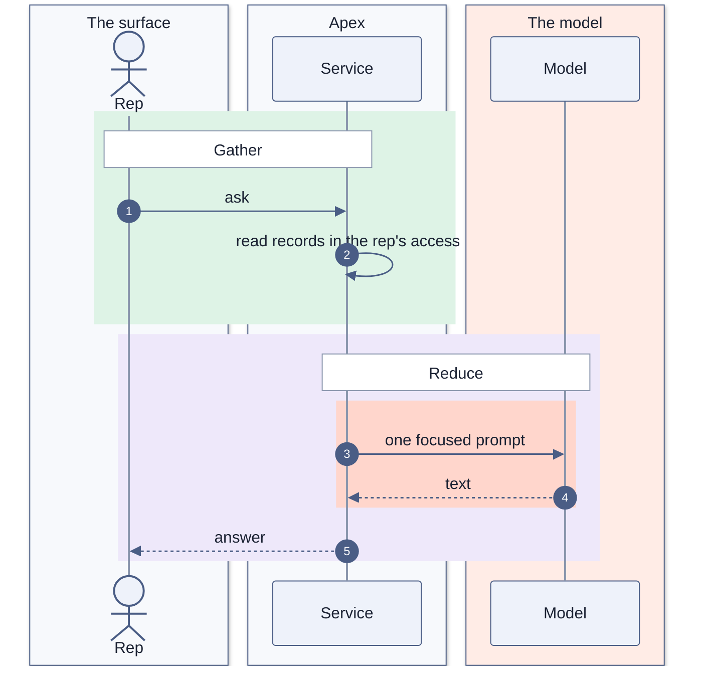

# Diagram theme

The one theme every Mermaid diagram on the pattern pages copies, so the chapters match. The rules it serves are in
[fr2-design.md](../plans/fr2-design.md#diagrams): numbered steps, colour that carries meaning, one theme, checked on
GitHub. `tests/pattern_shape.py` reads the `%%{init: ...}%%` line below and checks that every sequence diagram on a
chapter page carries it, word for word, and starts with `autonumber`.

## The snippet

Put this line first in every diagram, before `sequenceDiagram` or `flowchart`:

```text
%%{init: {"theme": "base", "themeVariables": {"fontFamily": "-apple-system, BlinkMacSystemFont, Segoe UI, Helvetica, Arial, sans-serif", "fontSize": "15px", "primaryColor": "#EEF2FA", "primaryBorderColor": "#4A5D85", "primaryTextColor": "#1B2233", "secondaryColor": "#F4F6F9", "tertiaryColor": "#FFFFFF", "lineColor": "#4A5D85", "textColor": "#1B2233", "actorBkg": "#EEF2FA", "actorBorder": "#4A5D85", "actorTextColor": "#1B2233", "actorLineColor": "#8A96AD", "signalColor": "#4A5D85", "signalTextColor": "#1B2233", "labelBoxBkgColor": "#FFFFFF", "labelBoxBorderColor": "#4A5D85", "labelTextColor": "#1B2233", "loopTextColor": "#1B2233", "noteBkgColor": "#FFFFFF", "noteBorderColor": "#8A96AD", "noteTextColor": "#1B2233", "sequenceNumberColor": "#FFFFFF", "activationBkgColor": "#DDE4F2", "activationBorderColor": "#4A5D85", "clusterBkg": "#F7F9FC", "clusterBorder": "#8A96AD", "edgeLabelBackground": "#FFFFFF"}}}%%
```

## The colours

Every fill is opaque and light, and all text is dark ink (`#1B2233`), so text sits on a light fill in GitHub's light
and dark themes alike, at well above WCAG AA contrast. Keep every message inside a phase `rect` and every participant
inside a `box`: a message left outside would draw dark text on GitHub's dark background.

| Use | Colour | Mermaid |
| --- | --- | --- |
| Phase: route | light blue | `rect rgb(225, 236, 252)` |
| Phase: gather | light green | `rect rgb(222, 243, 230)` |
| Phase: pre-reduce | light amber | `rect rgb(253, 242, 214)` |
| Phase: reduce | light lavender | `rect rgb(238, 232, 250)` |
| Phase: remember, or any closing phase | light grey | `rect rgb(234, 238, 242)` |
| **Model call (the one accent)** | coral | `rect rgb(255, 214, 204)`, nested inside the phase around each model call |
| Box: a surface or Apex layer | near white | `box rgb(247, 249, 252) <layer name>` |
| Box: the model layer | light coral | `box rgb(255, 236, 230) <layer name>` |

A later chapter with other phases (for example draft, confirm, commit) reuses these tints in order and keeps coral for
model calls only. Each phase opens with a `Note` that names it.

## Example



## Render check

The design rule asks for a check that a diagram renders on GitHub. In OPS-38 **no check could be made to fail, so the
diagrams on the chapter pages have not been render-checked.** What was tried:

1. **The GitHub markdown API** (`gh api markdown`) returns a mermaid block as its source, without parsing it. A broken
   diagram passes, so it is not a check.
2. **A local Mermaid parse with what the repo installs.** The repo installs no Mermaid package (`node_modules` has
   none), and this card may add no dependency to `package.json` and no global tool.
3. **Mermaid in the Playwright browser the repo already installs.** The script below loads one pinned Mermaid build
   into headless Chromium and calls `mermaid.parse` and `mermaid.render` on every block. In the OPS-38 session the
   permission policy refused to run it (a browser loading a script from a CDN), so it was never shown to fail.

What `tests/pattern_shape.py` does check is structure only: the theme line, `autonumber`, the H1 and the H2 parts. It
does not parse Mermaid.

**For the next card that tries (OPS-36 or a later chapter):** save the script as a file outside the repo, run it from
the repo root on the broken sample below, and trust it only if it prints `FAIL` for the broken block and `ok` for the
good one. Then run it on the chapter pages and record what it caught here, replacing this section's first paragraph.
If it cannot be run either, say so here again.

```js
// mermaid-check.cjs: parse and render every mermaid block in the Markdown files given.
// Run from the repo root: node /path/to/mermaid-check.cjs docs/patterns/01-route-gather-reduce.md
const fs = require('fs');
const path = require('path');
const { chromium } = require(path.join(process.cwd(), 'node_modules', 'playwright'));
const MERMAID = 'https://cdn.jsdelivr.net/npm/mermaid@11.4.1/dist/mermaid.min.js';
const FENCE = '`'.repeat(3);
(async () => {
  const blocks = [];
  for (const file of process.argv.slice(2)) {
    const re = new RegExp(FENCE + 'mermaid\\n([\\s\\S]*?)' + FENCE, 'g');
    let m, n = 0;
    while ((m = re.exec(fs.readFileSync(file, 'utf8')))) blocks.push({ where: file + ' #' + ++n, code: m[1] });
  }
  const browser = await chromium.launch();
  const page = await browser.newPage();
  await page.setContent('<div></div>');
  await page.addScriptTag({ url: MERMAID });
  let bad = 0;
  for (const [i, b] of blocks.entries()) {
    const err = await page.evaluate(async ({ code, i }) => {
      try {
        mermaid.initialize({ startOnLoad: false });
        await mermaid.parse(code);
        await mermaid.render('d' + i, code);
        return null;
      } catch (e) { return String((e && e.message) || e).split('\n').slice(0, 3).join(' | '); }
    }, { code: b.code, i });
    console.log((err ? 'FAIL ' : 'ok   ') + b.where + (err ? ': ' + err : ''));
    if (err) bad++;
  }
  await browser.close();
  console.log('checked ' + blocks.length + ' diagrams, ' + bad + ' failed');
  process.exit(bad ? 1 : 0);
})().catch((e) => { console.error('check could not run: ' + e.message); process.exit(2); });
```

The broken sample: a Markdown file outside the repo with these two diagrams, each in its own mermaid block. The first
is good; the second is broken (its message has no colon, and its `rect` is not closed).

```text
sequenceDiagram
    autonumber
    A->>B: hi

sequenceDiagram
    autonumber
    A->>B hi with no colon
    rect rgb(1,2
```

[Back to the architecture page](../ARCHITECTURE.md) | [Back to the README](../../README.md)
