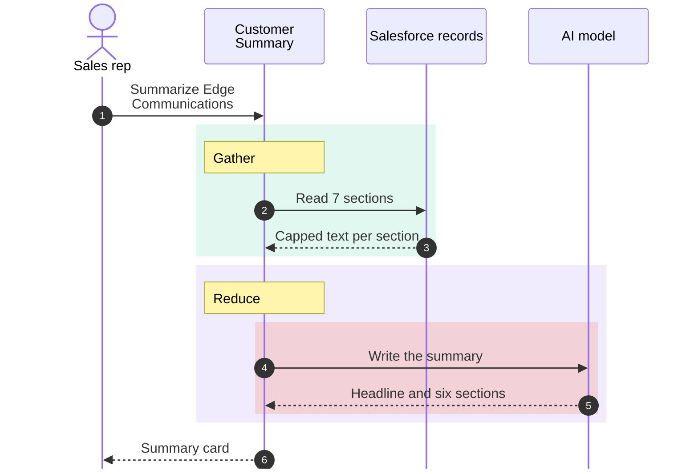

# Diagram theme

The one style every Mermaid diagram in the repo copies, so the pages match and every diagram reads in GitHub's light
and dark themes. The rules it serves are in [fr2-design.md](../plans/fr2-design.md#diagrams). `tests/pattern_shape.py`
reads the two snippets below and checks each diagram against them and against the rules in [The rules](#the-rules).

GitHub draws Mermaid 12 (checked with an `info` block on a pushed page in November 2026). These choices were picked
on a scratch branch by viewing each one on GitHub in both themes:

- **No `theme` is set.** GitHub then draws each diagram in its own light or dark palette, so lifelines, arrows, step
  badges and labels always contrast with the page. A fixed theme cannot do that: a light theme left dark text on
  GitHub's dark background, and the earlier opaque light fills made dark mode a patchwork of bright boxes.
- **Phase tints are translucent** (`rgba`, 12 to 22 percent), so the same tint reads on white and on near-black.
- **Phase names are slate chips with white text**, drawn by one `themeCSS` rule, at 10:1 contrast in both themes.
- **Settings go in a `config` frontmatter block**, which replaced the `%%{init}%%` line (deprecated since Mermaid
  10.5).

## The snippets

Put this block first in every sequence diagram, before `sequenceDiagram`:

```text
---
config:
  themeCSS: ".note { fill: #334155 !important; stroke: none !important; } .noteText, .noteText tspan { fill: #FFFFFF !important; font-weight: 600 !important; letter-spacing: 0.04em; }"
  sequence:
    mirrorActors: false
    actorMargin: 50
    width: 140
    messageMargin: 40
    boxMargin: 10
    noteAlign: left
    wrap: true
---
```

Put this block first in every flowchart, before `flowchart`, and copy only the `classDef` lines below that the
diagram uses:

```text
---
config:
  layout: dagre
  flowchart:
    curve: basis
    nodeSpacing: 40
    rankSpacing: 55
    wrappingWidth: 220
    padding: 14
---
```

```text
    classDef surface fill:#E8F1FD,stroke:#0B5CAB,color:#0B2A4A,stroke-width:1.5px
    classDef core fill:#0B5CAB,stroke:#0B5CAB,color:#FFFFFF,stroke-width:1.5px
    classDef apex fill:#E6F6EE,stroke:#2E844A,color:#0B2A1A,stroke-width:1.5px
    classDef model fill:#FDE9E3,stroke:#C2410C,color:#4A1A08,stroke-width:1.5px
    classDef later fill:#FFFFFF,stroke:#8A96AD,color:#3A4456,stroke-dasharray:4 3
    classDef zone fill:#8A96AD14,stroke:#8A96AD,stroke-width:1px,stroke-dasharray:5 4
```

## The rules

Sequence diagrams (the test checks every rule marked *checked*):

1. **The snippet, then `autonumber`** (*checked*). Every message gets a number, and the numbered list under the diagram
   names every number once, as "(step 4)", "(steps 4 and 5)" or "(steps 4 to 7)" (*checked*).
2. **At most five lifelines** (*checked*), named in plain business words: "Sales rep", "Customer Summary",
   "Salesforce records", "AI model", "Memory". Class, object and prompt names belong in the numbered steps under the
   diagram, not in the diagram. No `box` (*checked*): the lifeline names already say which layer is which.
3. **Short messages** (*checked*: at most 32 characters each). A message says what happens in a few words ("Read 7
   sections"); the detail goes in the steps. No message from a lifeline to itself (*checked*): say it in the steps, or
   send it to the lifeline that does the work.
4. **Every message sits in a phase.** Each phase is one `rect` in its tint below, opened by one
   `Note over <one lifeline>: <Phase name>` (*checked*: one lifeline, at most 24 characters), which draws as a slate
   chip. The opening ask and the closing answer may sit outside a phase.
5. **Model calls in coral.** Each model call and its reply sit in a coral `rect` nested inside their phase. Coral means
   a model is involved, and nothing else is coral.
6. **`alt`, `loop` and `opt` sparingly.** GitHub draws their frames in its own palette; one per diagram at most.

Flowcharts:

1. **The snippet**, then `flowchart TB` or `flowchart LR` (*checked*), and the `classDef` lines above for colour: `core`
   for Customer Summary itself, `surface` for where people work, `apex` for code and records in Salesforce, `model`
   for the AI model, `later` for something planned or optional, `zone` for every `subgraph`.
2. **Short node text**: a name and, at most, one short line under it.
3. **Keep the bottom-right corner clear.** GitHub lays its pan and zoom buttons over it; a node there is hidden.

## The colours

| Use | Mermaid |
| --- | --- |
| Phase: route, or the first phase | `rect rgba(59, 130, 246, 0.12)` |
| Phase: gather, or the second phase | `rect rgba(16, 185, 129, 0.12)` |
| Phase: pre-reduce, or the third phase | `rect rgba(245, 158, 11, 0.14)` |
| Phase: reduce, or the fourth phase | `rect rgba(139, 92, 246, 0.12)` |
| Phase: remember, or the closing phase | `rect rgba(100, 116, 139, 0.12)` |
| **Model call (the one accent)** | `rect rgba(244, 114, 82, 0.22)`, nested inside the phase |

A chapter with other phases (for example draft, confirm, commit) uses these tints in order and keeps coral for model
calls only.

## Example



1. **Ask (step 1).** The rep names an account.
2. **Gather (steps 2 and 3).** Code reads each section in the rep's own access.
3. **Reduce and answer (steps 4 to 6).** One model call writes the summary from those sections only.

## Render check

The design rule asks for a check that a diagram renders on GitHub. **In OPS-44 the script below ran locally:**
Mermaid 11.4.1 in the Chromium that the repo's Playwright installs printed `FAIL` for the broken sample's second block
and `ok` for its first, then `ok` for every diagram on pages 01 and 06. That is a local parse and render, not a GitHub
render. How the diagrams draw on GitHub is checked by viewing the pushed page in a browser in both themes. In OPS-38 no check could be
made to fail. What was tried there:

1. **The GitHub markdown API** (`gh api markdown`) returns a mermaid block as its source, without parsing it. A broken
   diagram passes, so it is not a check.
2. **A local Mermaid parse with what the repo installs.** The repo installs no Mermaid package (`node_modules` has
   none), and this card may add no dependency to `package.json` and no global tool.
3. **Mermaid in the Playwright browser the repo already installs.** The script below loads one pinned Mermaid build
   into headless Chromium and calls `mermaid.parse` and `mermaid.render` on every block. In the OPS-38 session the
   permission policy refused to run it (a browser loading a script from a CDN), so it was never shown to fail.

What `tests/pattern_shape.py` does check is structure only: the snippets, `autonumber`, the rules marked *checked*
above, the H1 and the H2 parts. It does not parse Mermaid.

**The Mermaid CDN render check is held until Ben answers (OPS-61).** Do not run it before then. Once he does,
save the script below as a file outside the repo, run it from the repo root on the broken sample, and trust it only
if it prints `FAIL` for the broken block and `ok` for the good one.

```js
// mermaid-check.cjs: parse and render every mermaid block in the Markdown files given.
// Run from the repo root: node /path/to/mermaid-check.cjs docs/patterns/01-route-gather-reduce.md
const fs = require('fs');
const path = require('path');
const { chromium } = require(path.join(process.cwd(), 'node_modules', 'playwright'));
const MERMAID = 'https://cdn.jsdelivr.net/npm/mermaid@11.4.1/dist/mermaid.min.js';
const FENCE = '`'.repeat(3);
(async () => {
  const blocks = [];
  for (const file of process.argv.slice(2)) {
    const re = new RegExp(FENCE + 'mermaid\\n([\\s\\S]*?)' + FENCE, 'g');
    let m, n = 0;
    while ((m = re.exec(fs.readFileSync(file, 'utf8')))) blocks.push({ where: file + ' #' + ++n, code: m[1] });
  }
  const browser = await chromium.launch();
  const page = await browser.newPage();
  await page.setContent('<div></div>');
  await page.addScriptTag({ url: MERMAID });
  let bad = 0;
  for (const [i, b] of blocks.entries()) {
    const err = await page.evaluate(async ({ code, i }) => {
      try {
        mermaid.initialize({ startOnLoad: false });
        await mermaid.parse(code);
        await mermaid.render('d' + i, code);
        return null;
      } catch (e) { return String((e && e.message) || e).split('\n').slice(0, 3).join(' | '); }
    }, { code: b.code, i });
    console.log((err ? 'FAIL ' : 'ok   ') + b.where + (err ? ': ' + err : ''));
    if (err) bad++;
  }
  await browser.close();
  console.log('checked ' + blocks.length + ' diagrams, ' + bad + ' failed');
  process.exit(bad ? 1 : 0);
})().catch((e) => { console.error('check could not run: ' + e.message); process.exit(2); });
```

The broken sample: a Markdown file outside the repo with these two diagrams, each in its own mermaid block. The first
is good; the second is broken (its message has no colon, and its `rect` is not closed).

```text
sequenceDiagram
    autonumber
    A->>B: hi

sequenceDiagram
    autonumber
    A->>B hi with no colon
    rect rgb(1,2
```

[Back to the architecture page](../ARCHITECTURE.md) | [Back to the README](../../README.md)
