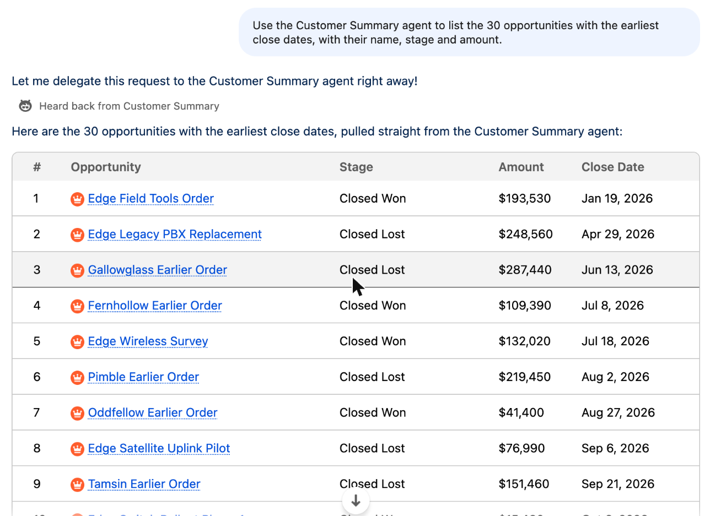
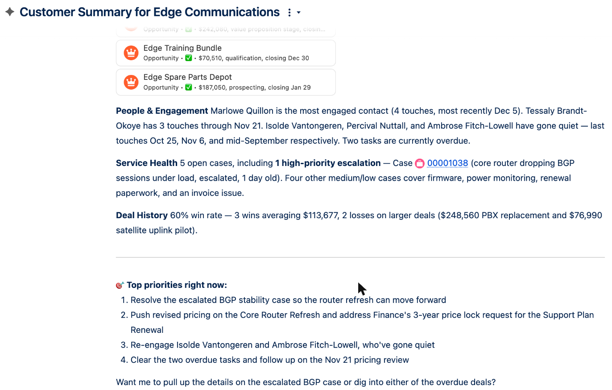

# Coworker calls our agent: naming it works, and how Coworker picks it (OPS-64)

Researched and measured 2026-11-15 in `connect-24h`. **Status: Coworker called `Customer_Summary` in 12 of 13
turns, with nothing changed in the org.** It delegated in every turn that named the agent (way a, 9 of 9), and in 3 of 3
plain turns of a question worded around what only our agent does. It did not delegate the plain summary question
"Summarize Edge Communications" (1 of 1 control turn, matching OPS-63's 0 of 9). Way (c) is not offered without
deactivating Coworker's own agent; way (d) has no setting to try; way (b) was not run (see [Ways tried](#ways-tried)).
The turns are in [delegation-2.jsonl](../../spikes/coworker/results/delegation-2.jsonl). The docs answers are from
Salesforce pages read in a Chrome tab on 2026-11-15. Ids, usernames and hostnames are left out. Read with
[fr2-coworker-spike.md](fr2-coworker-spike.md#delegation-measured), which holds OPS-63's 0 of 9 baseline.

## Plain answer

- **Name the agent and Coworker calls it.** "Use the Customer Summary agent to ..." delegated 9 of 9: three summary
  turns, three brief turns and three explore turns (two e2, one e4). Each showed "Let me delegate this to the Customer
  Summary agent", an Agent Delegation step, and "Heard back from Customer Summary" (the e4 turn said "Heard back from
  Agent", and its reply said the Customer Summary agent pulled the rows). That is the lever the docs give users [C1].
- **A question only our agent can do also delegates unnamed.** "Run the resolve-then-brief gate for Edge Communications
  and give me its account brief" delegated 3 of 3 with no agent named. "Summarize Edge Communications" did not: Coworker
  ran its own Case, Opportunity and Account searches and answered in 13.7 s. This fits the docs: Coworker delegates only
  what it cannot complete itself, and routes on agent and topic descriptions [C1]. A plain account summary is something
  its own search can do; "resolve-then-brief gate" matches only our agent's description.
- **To be callable, an agent needs the user's agent access and a description that matches.** No Coworker page names a
  Setup list of callable agents, a delegation switch, or a step to add an agent to Coworker [C1], [C4], [C5], [C6].
  Employee agent access is granted on the agent's Agent Access page or a permission set's Enabled Agent Access [C3]. The
  admin in `connect-24h` already held `Customer_Summary_Agent_Access` (OPS-63), and nothing was granted.
- **"Add our agent to Coworker as a connected agent" is not offered.** In Builder, Coworker's agent (`SearchAgent`) shows
  0 subagents and "To make changes, your agent must be deactivated"; the docs say changing it breaks Coworker [C1].
- **Cost: about three times slower, and the reply is Coworker's retelling.** A delegated summary finished in 41.4 to 46.9 s
  against 13.7 s for Coworker alone. Our six section labels came through as bold lead-ins to paragraphs (5 or 6 of 6),
  and at most 1 of 6 as a heading on its own line (0 of 6 in the nine named turns, 1 of 6 in the three plain Q2 turns). Explore tables came through whole: 30 of 30 rows and 47 of 47 rows.

## Org guard and read-only state

- **Guard.** `sf org display` for `connect-24h` and for `agent-probe`, compared before any org step: org Id
  **DIFFERENT**, username **DIFFERENT**. Nothing was run against `agent-probe` or `experimental`.
- **Agents (read-only SOQL on `BotDefinition` and `BotVersion`).** Seven agent definitions. `SearchAgent` (label
  "Coworker Agent", Employee agent type) has v1 active. `Customer_Summary` has v1 active, with the repo's agent
  description unchanged. `Customer_Summary_Coworker_Spike` (FE-28) has v1 active and was left alone. The other four are
  sample agents that came with the org.
- **Session rows are not readable by SOQL.** `AiAgentSession`, `AiAgentSessionParticipant`, `BotSession` and
  `AiAgentInteraction` each returned `INVALID_TYPE`. So whether a turn delegated was read from the thinking steps
  Coworker streams, as OPS-63 did, not from `Customer_Summary` session rows.
- **Browser.** On the first try the org's record page redirected to the login page, and the run stopped without typing
  anything. The coordinator then opened the org in Chrome; every turn ran in one Chrome tab of this run, from the Ask
  button on the Edge Communications record, each in a new chat.

## How Coworker chooses another agent

| Question | What the docs say | Source |
|---|---|---|
| When does it delegate? | Only "When your users make a request that Agentforce Coworker can't complete". The section page says the same: when it "can't complete a request on its own, it can hand the request off to another Agentforce agent" | [C1], [C2] |
| What does it read to choose? | The agent and topic descriptions of the agents those users can access. Topics are also called sub-agents. It compares the request with each agent's capabilities and delegates on a match. It uses only those descriptions, not topic instructions | [C1] |
| Which agents? | Any Agentforce agent the users have access to, custom agents included; up to 50 agents | [C1] |
| Timeout | It times out if it cannot direct the request to another agent within 90 seconds. The page's remedy: rephrase, ask Coworker to delegate to an accessible agent, or try later | [C1] |
| What the user sees | The delegated agent's thinking steps streamed live, a confirmation when a delegated topic asks for one, and the agent's response, with cards from custom Lightning types and HXL widgets | [C1] |
| How to write descriptions | Agent and topic descriptions "act as routing rules". Scope each agent to one job, avoid overlapping sub-agents, keep replies well inside 90 seconds, and say which questions the agent handles best | [C1] |
| Trailhead's wording | Coworker "Routes requests to the right AI agent based on what you need" and acts as a front door to specialised agents | [C10] |

## Must an agent be added or granted to be callable?

| Mechanism | Answer | Source |
|---|---|---|
| Agent access (permission sets) | **Yes, needed.** Coworker considers only agents the user can access [C1]. For an Employee agent, access is set on the agent's Agent Access page in Agentforce Builder, or on a permission set or profile's Enabled Agent Access in Setup; only Employee agents appear in that list [C3]. The admin already holds it (OPS-63), so it is not the gap | [C1], [C3] |
| Agent and topic descriptions | **Yes, they are the routing input.** Coworker routes on them alone [C1] | [C1] |
| A Setup list of callable agents | **Not documented.** The Coworker setup section lists Turn On, search data, user access and user mapping [C4]. The Turn On page's agent-related item is the Coworker admin permission set [C5]. The user access page says nothing about delegation [C6] | [C4], [C5], [C6] |
| Connected agents, agent-to-agent in Builder | **Documented for agents you own, not for Coworker.** In Multi-Agent Orchestration a connected subagent is "an entirely separate agent in your Salesforce org that your orchestrator agent can use like a subagent" [C8]. It is added from the orchestrator's Explorer panel (+, Connect Agent as Subagent), with the orchestrator in draft [C7]. Coworker's Search Agent "you can't modify", and changes break it [C1]. So adding `Customer_Summary` as a connected subagent of the Search Agent would mean modifying it, which the docs rule out. No page read says Coworker's delegation uses Multi-Agent Orchestration | [C1], [C7], [C8] |
| A newly activated version | **Needed for Multi-Agent Orchestration** for customers who were not in its pilot: create and activate a new version of an agent built in the new Builder [C7], [C9]. Not stated for Coworker's delegation | [C7], [C9] |
| Coworker Skills | **Not a callable-agent mechanism in the docs.** Trailhead says Skills are made "from successful conversations" and "combine instructions, context, agents, and tools into shareable workflows" [C10]. No page says a Skill makes an agent callable | [C10] |

## What the docs say is not supported

- Modifying the Search Agent: it is preconfigured and platform-managed, and changes break Coworker's search and
  reasoning [C1].
- Coworker's own answers as cards: they stay in markdown; only a delegated agent's custom Lightning type or HXL
  response is drawn as a card [C1].
- In Multi-Agent Orchestration (not stated for Coworker): orchestration across orgs, with non-Agentforce agents,
  file-based agents, more than one level of delegation, and Agentforce Voice; a connected subagent cannot be
  deactivated; timeouts are 120 seconds for the orchestrator and 30 for a connected subagent [C9].

## Ways tried

Two questions, each asked in a new chat on Edge Communications. Q1 is OPS-63's summary question. Q2 asks for something
only `Customer_Summary` does, its resolve-then-brief gate. A plain control turn ran first, with the agent not named.
"Delegated" is read from Coworker's thinking steps: "Let me delegate this to the Customer Summary agent", an Agent
Delegation step, then "Heard back from Customer Summary". Seconds run from pressing Enter to the feedback buttons
appearing under the answer. Labels are our six section labels (Account, Open deals, People & engagement, Service health,
Deal history, Watch next), counted twice: alone on their own line, and as the first words of a line.

| Way and question | Delegated | Seconds to finished answer | Labels on their own line | Labels leading a line | Table rows kept |
|---|---|---|---|---|---|
| Control, Q1 plain: "Summarize Edge Communications" | 0 of 1 (Coworker's own Case, Opportunity and Account searches) | 13.7 | 0 of 6 | 1 of 6 | not a table |
| Control, Q2 plain: "Run the resolve-then-brief gate for Edge Communications and give me its account brief" | 3 of 3 | 42.5 to 45.3 | 1 of 6 | 5, 5 and 6 of 6 | not a table |
| (a) Q1 named: "Use the Customer Summary agent to summarize Edge Communications" | 3 of 3 | 41.4 to 44.9 | 0 of 6 | 5, 6 and 6 of 6 | not a table |
| (a) Q2 named: "Use the Customer Summary agent to run the resolve-then-brief gate ..." | 3 of 3 | 43.9 to 46.9 | 0 of 6 | 6, 6 and 5 of 6 | not a table |
| (a) BE-32's e2 named: 30 earliest-closing opportunities with name, stage and amount | 2 of 2 | 27.4 and 27.6 | not a summary | not a summary | 30 of 30 both times |
| (a) BE-32's e4 named: all opportunities with five columns, by close date | 1 of 1 | 42.6 | not a summary | not a summary | 47 of 47, five columns |

Where 5 of 6 labels led a line, the missing one was Watch next in three turns and Deal history in one. In the delegated
summaries the labels open bold paragraphs and the open deals come as Opportunity record cards; Coworker adds its own
"Watch out" line and "Top priorities right now" list around them. There were no timeouts. With e2 run twice and e4 once,
the explore questions make the three extra turns the card asks for once a way delegates.

| Way | Result |
|---|---|
| (a) Name the agent in the question | **Works: 9 of 9 delegated.** Nothing in the org was changed |
| (b) Changed agent and topic descriptions on `Customer_Summary`, edited in Builder, republished and reactivated | **Not run, by choice.** Way (a) worked, and the plain Q2 control already showed that a request matching our description is delegated unnamed. So (b) would only test whether new descriptions move "Summarize Edge Communications", which Coworker can complete itself and so, per [C1], should not hand off. It would cost a publish and activation now and another to undo. The coordinator cleared it, so it can run on request |
| (c) `Customer_Summary` as a connected or callable agent of the Coworker Agent | **Not offered.** Setup's page for `SearchAgent` has tabs Details, System Messages, Language Settings, Connections and Agent Access (one permission set, Search Agent Access). Open in Builder shows a Subagents panel with 0 items, "To make changes, your agent must be deactivated", and Batch Test and Deactivate buttons; no add-agent control shows while it is active. Deactivating Coworker's agent is outside Ben's go, and the docs say changing it breaks Coworker [C1], so nothing was clicked |
| (d) A Setup setting the docs name | **None found.** The only Coworker toggle near agents is Agent Actions, which the docs tie to creating and updating records, not to delegation [C11] |

## Undo

Changed in `connect-24h`: no setting, description, version, grant, connection or user. The run left 13 Coworker chats
(one per turn) in the admin's Recents, named for their questions; they can be deleted from Recents or left. `SearchAgent`
was opened in Setup and in Builder and left active and unchanged. Read-only SOQL only (agent definitions, versions, one
account lookup, four session-object probes that failed as `INVALID_TYPE`). The run's Chrome tab was closed.

## For Ben

- **Which way works: (a), naming the agent.** 9 of 9. A request worded around what only our agent does also works
  without the name (3 of 3); a plain summary does not (OPS-63's 0 of 9, plus 1 control turn here). So in Coworker a rep
  must either name Customer Summary or ask for something Coworker's own search cannot do.
- **Latency.** A delegated summary took 41 to 47 s to finish, against about 14 s for Coworker alone (13.5 to 16.3 s in
  OPS-63). e2 took about 27 s and e4 about 43 s. All are inside the 90-second handoff timeout [C1], but a summary is
  roughly three times slower than Coworker answering itself.
- **Fidelity.** Coworker retells our answer. The six labels survive as bold lead-ins (5 or 6 of 6), with at most 1 of 6 as a heading on
  its own line, and with Coworker's own opening and closing lines around them. Tables are relayed whole (30 of 30, 47 of
  47) as Coworker tables with record links.
- **FE-28's re-cut.** A card in Coworker needs a delegation first, and now there is a reliable one: name the agent.
  FE-28's turns can name `Customer_Summary_Coworker_Spike` the same way once its renderer deploys.
- **F83.** Coworker can be a way in to our agent, but only through the agent, only when asked by name or for something
  Coworker cannot do, and at about three times Coworker's own latency. Whether that is an acceptable door is still
  Ben's call.
- **Choices this run made.** Q2's wording ("resolve-then-brief gate"), counting labels both on their own line and
  leading a line, and skipping way (b). Anything that deactivates `SearchAgent` needs Ben's go.

## Sources

All read in a Chrome tab on 2026-11-15. Salesforce Help pages are named by title and article id, since their links
carry a query string.

- [C1] Search Agent and Agent Delegation in Agentforce Coworker (Agentforce Coworker guide):
  https://developer.salesforce.com/docs/data/agentforce-coworker/guide/agentforce-coworker-customize-delegate-agent.html
- [C2] Use Agentforce Coworker (Agentforce Coworker guide, section page):
  https://developer.salesforce.com/docs/data/agentforce-coworker/guide/agentforce-coworker-a-manage-experience-home.html
- [C3] Manage Employee Agent Access (Salesforce Help, article `ai.agent_manage_aea_access.htm`).
- [C4] Set Up Agentforce Coworker (Agentforce Coworker guide, section page):
  https://developer.salesforce.com/docs/data/agentforce-coworker/guide/agentforce-coworker-a-setup-home.html
- [C5] Turn On Agentforce Coworker (Agentforce Coworker guide):
  https://developer.salesforce.com/docs/data/agentforce-coworker/guide/agentforce-coworker-turn-on-infrastructure.html
- [C6] Add or Remove User Access in Agentforce Coworker (Agentforce Coworker guide):
  https://developer.salesforce.com/docs/data/agentforce-coworker/guide/agentforce-coworker-manage-user-access.html
- [C7] Connect an Agent as a Subagent (Salesforce Help, article `ai.agent_multi_orch_connect.htm`).
- [C8] Multi-Agent Orchestration (Salesforce Help, article `ai.agent_multi_orch.htm`; the Salesforce Admins post
  below links it as "Multi-Agent Orchestration (Beta)").
- [C9] Considerations and Limitations in Multi-Agent Solutions (Salesforce Help, article
  `ai.agent_multi_orch_consider.htm`).
- [C10] Trailhead, Quick Start: Agentforce Coworker, unit "Enable and Use Agentforce Coworker in Your CRM":
  https://trailhead.salesforce.com/content/learn/modules/quick-start-agentforce-coworker/explore-agentforce-coworker
- [C11] Search, Ask, and Update Records with Agentforce Coworker (Agentforce Coworker guide):
  https://developer.salesforce.com/docs/data/agentforce-coworker/guide/agentforce-coworker-navigate-the-experience.html
- Also opened, not cited for a fact: How to Set Up a Super Agent with Connected Subagents (Salesforce Admins, 2026-08-20),
  https://admin.salesforce.com/blog/2026/how-to-set-up-a-super-agent-with-connected-subagents, used only to find [C8];
  Agentforce Coworker Limits and Guidelines, which names no delegation limit beyond the Search Agent's 100 requests a
  minute; and Give Users Access to Agentforce (Default) (Salesforce Help, `ai.copilot_setup_user_access.htm`), which
  is about the retired default agent.
