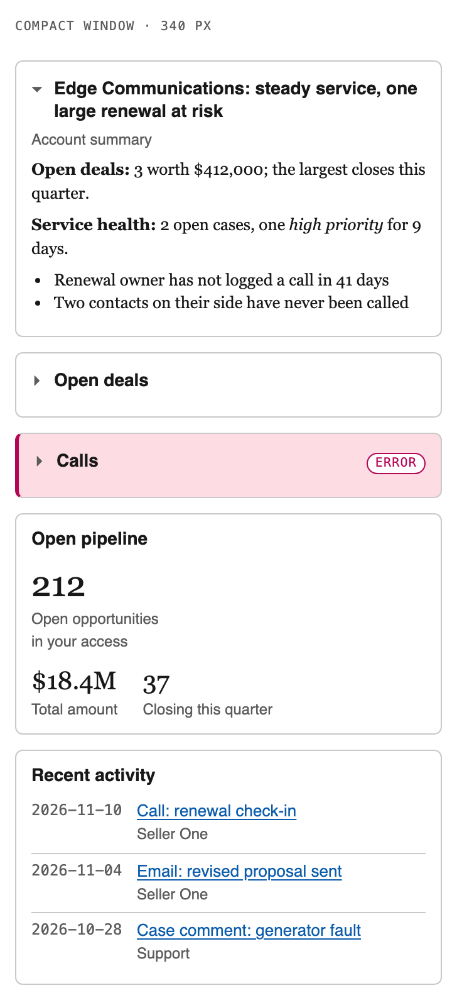
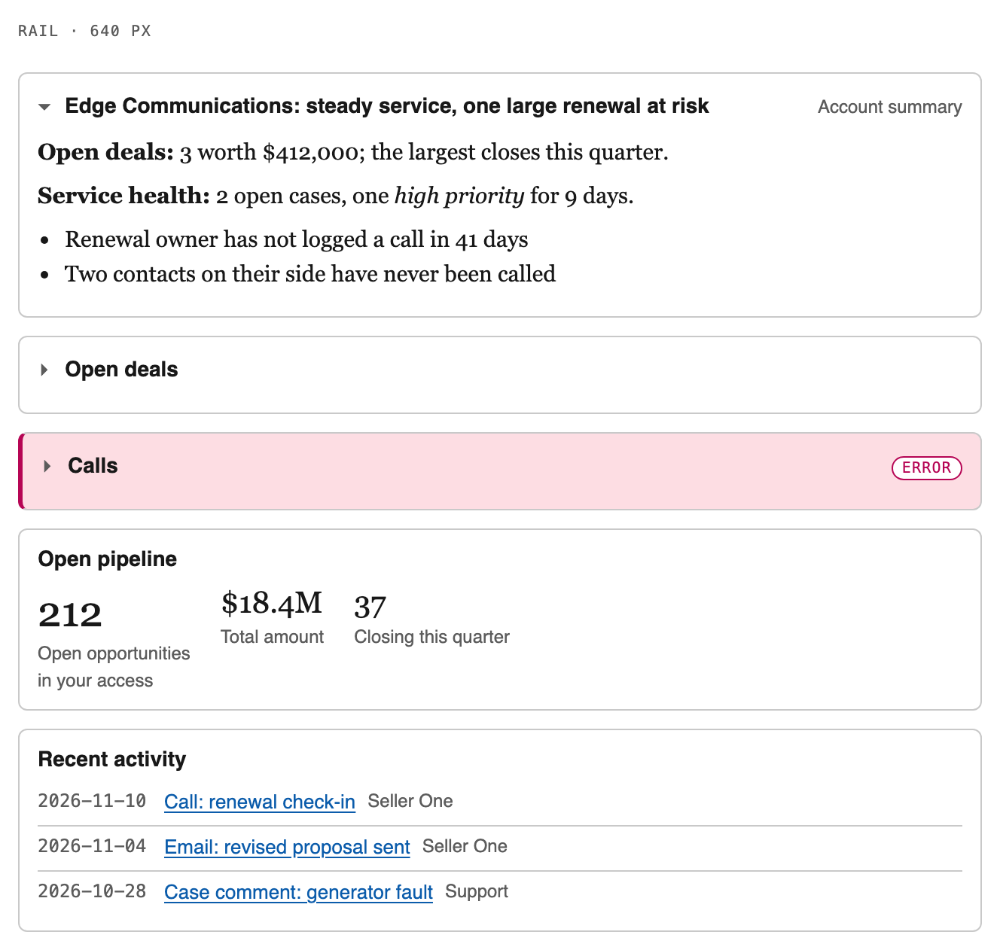
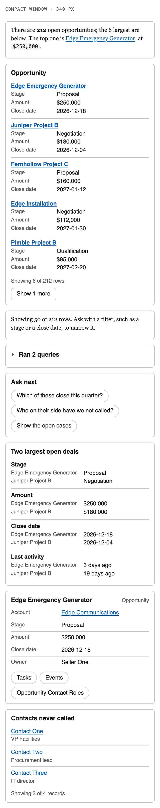
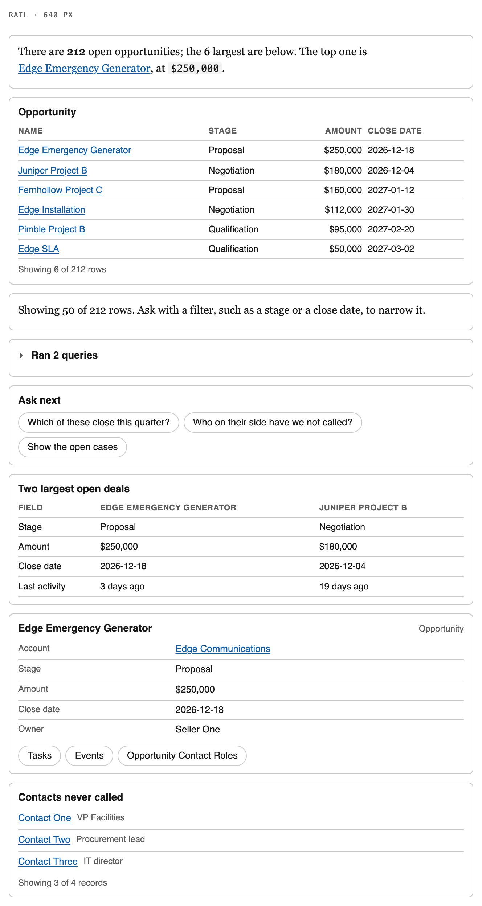
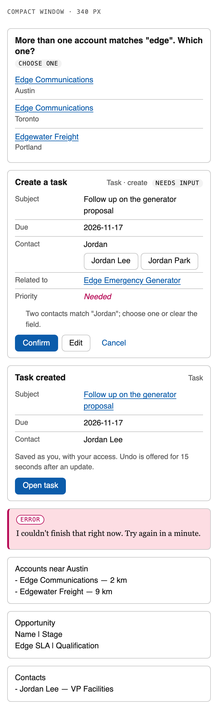
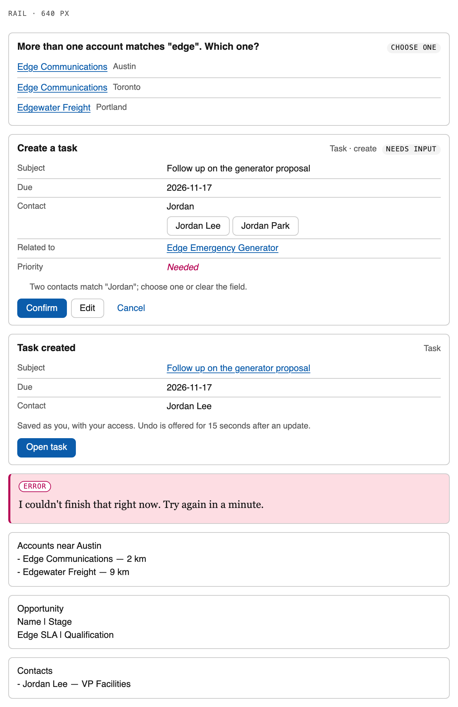

# FR2: the card architecture (FE-18 spike)

Feature revision 2 (FR2), operating principle 2: every answer is richly formatted and shown in cards from one typed contract that every surface reads (ledger F65). This spike fixes that contract. It catalogs every answer kind, gives the contract and one JSON example per card type, and proves a renderer for both widths in a prototype with Jest and axe. It also says what an MCP client sees. BE-39 builds the contract in Apex from this page, and FE-22 renders it in the conversation.

Read with: [fr2-design.md](../plans/fr2-design.md) ('Theming', 'Cards inline', 'Rich text'), [fr2-actions-spike.md](fr2-actions-spike.md) (BE-22: the draft and result shapes), [fr2-standard-limits.md](fr2-standard-limits.md) (BE-32: what the standard chat does to a card), [fr2-surfaces-spike.md](fr2-surfaces-spike.md) and the tasks [BE-39](../../agents/tasks/BE-39-fr2-card-contract-in-apex.md) and [FE-22](../../agents/tasks/FE-22-fr2-history-scope-chip-and-cards.md).

## What was found, in short

- **The answer kinds come down to 6 layouts.** There are 19 answer kinds and 16 card types, and every one of them renders with one of six layouts: prose, list, fields, grid, metric and chips. Adding a type means writing one view builder, one Apex builder and one plain-text rule. No surface changes.
- **One flat envelope works in Apex.** No member is a Map or an Object, every table cell is a string, and record Ids sit only in `refs`, which runs, rows, items and fields point at by key. Both of BE-22's findings (JSON.deserialize cannot fill an Object member, and an invocable variable cannot be a map) are met.
- **Rich text is data, not markup.** The subset is bold, italic, inline code, bullet and numbered lists, and links to records by `ref:` key. It is parsed into blocks of runs and bound as text. The prototype has no `lwc:inner-html`, no `innerHTML` and no `href` built from card data. A record link is a button that fires `cardopen`, and the host navigates by Id.
- **Every card carries its plain text.** `text` is filled by one rule per type. It is what an MCP client reads and what a screen shows when the card cannot be drawn, and it never holds a record Id.
- **The prototype proves both widths and all three fallbacks.** 87 Jest tests pass across 3 suites, and every card has zero axe violations at both densities (see 'The LWC prototype').
- **Recommendation: yes, build one shared card component** (`customerSummaryCard`) and give FE-22 an explicit go. The card picks its layout from a type→family registry, and the surface passes only a density.
- **MCP: keep today's text and add the cards as JSON text.** No tool on the door has ever been called, so nothing here is observed in a client. The transcript below is constructed from the spec and from the door's three tools; the explorer reaches a client only through the agent tool.

## The catalog

Source names where the data is made today: **summary** (CustomerSummary.Result and CustomerSummarySection), **explorer** (DataExplorer.Result and ExploreQuery.ResultSet), **resolver** (CustomerSummaryResolver.Response), **drill** (the panel controller's Drill), **BE-27** (BE-22's Draft and Result, built by BE-27) and **future** (no service makes it yet, but the contract holds it so a service can start without a surface change).

"340" is the compact window, which has about 340 px of content inside its 420 px frame. "640" is the rail at its widest. "Pinned" is what stays visible when the card is folded or cut short. "Folds" is what hides.

| Answer kind | Card type (family) | Source today | Parts | Pinned | Folds | At 340 | At 640 | Plain text |
|---|---|---|---|---|---|---|---|---|
| Summary headline and body | `summary` (prose) | summary: `answer` | title, meta, body runs | title, meta | the body; open by default | one column, body 13 px | body 15 px display face | title, then the body lines |
| A summary section | `section` (list) | summary: `CustomerSummarySection` key, title, status, body, total, shown | title, status badge, lines, count | title, the "(shown of total)" in text | the lines; closed by default | label and detail stacked | label and detail on one line | `Title (shown of total)`, then `- label — detail` per item; with no counts, the title alone |
| A failed section | `section` with status ERROR | summary: section status ERROR | title, Error badge, the fixed message | title, badge | the message | as above, error rule and wash | as above | `Title`, then the message |
| Explorer prose answer | `text` (prose) | explorer: `answer` | runs with record links | everything (short) | nothing | wraps | wraps | the runs' text, links as their label |
| Explorer result table | `table` (grid) | explorer: `ResultSet` columns, labels, rows, total, shown | columns with a kind, rows of string cells, row ref, count | the column heads, the count line | rows past 5 (340) or 10 (640) under "Show N more" | more than 3 columns: each row stacked as label and value | a table that scrolls inside the card, never the page; row heads | the title, an `A \| B` header, one `x \| y` line per row, then `(shown of total rows)` |
| "Showing 50 of N" note | `notice` (prose) | explorer: `ResultSet.total` greater than `shown` | one sentence and a hint | everything | nothing | wraps | wraps | the sentence |
| Query trail | `trail` (list) | explorer: `trail` | title "Ran N queries", one item per query with its row count | the title | the queries; closed by default | stacked | one line each | title, then `N. query — rows` lines |
| Follow-up chips | `followups` (chips) | explorer: `followups` | up to 3 questions | everything | nothing | chips wrap | chips in one row | the title (`Ask next`), then a `- ` line each |
| One record | `record` (fields) | drill: `Drill.result` (one row) and `Drill.related` | title, object as meta, fields, lookups as links, related objects as chips | title, meta | nothing (5 to 8 fields) | label column 80 px minimum | label column 34% | `Title · Object`, then `Label: value` lines |
| Drill record view | `record` (fields) | drill: as above, opened from a row | as above | as above | as above | as above | as above | as above |
| A list of records | `recordList` (list) | explorer: a narrow result set (a name and one detail), or a summary section's records | items with a ref and a detail, count | title, count line | items past 5 / 10 | stacked | one line | title, `- label — detail` lines, `(shown of total)` |
| A metric or count | `metric` (metric) | explorer: an aggregate result set (COUNT, SUM), or future | the first figure as the hero, up to 3 more | everything | nothing | hero on its own line, 28 px | hero beside the others | title, `Label: value — detail` lines |
| A timeline | `timeline` (list) | future (the summary's activity sections are its first user) | items with `at`, kind, label, detail, ref | title | items past 5 / 10 | date column 76 px, label under it | date, label and detail on one line | title, `at · label — detail` lines |
| A comparison | `comparison` (grid) | future (an explorer question across two records) | the first column is the field, then one column per record | the column heads | rows past 5 / 10 | stacked: one block per field, a line per record (two record columns leave each about 100 px) | a table | as a table |
| Ambiguous candidates | `choice` (list) | resolver: status AMBIGUOUS | the question, one item per candidate with a ref and a detail | title, the "Choose one" badge | nothing | stacked | one line | the question, then `N. label — detail` lines |
| Not found | `notice` with status NOT_FOUND | resolver: status NOT_FOUND, `message` | the message | everything | nothing | wraps | wraps | the message |
| Error | `error` (prose) | any service: status ERROR, `message` | the fixed message, never the exception | everything | nothing | coral left rule and wash | as at 340 | the message |
| Action draft | `actionDraft` (fields) | BE-27: Draft status, action, fields (api, label, value, required, missing, choices), warnings | title, meta, fields with a state (missing, choose), choice chips, notes, controls | title, status badge, controls | nothing | fields stack under 34% labels; chips wrap | as at 340 with more room | `Title · meta`, `Label: value` lines (a missing field reads `(needed)`, a choice `(choose one)`), `Note: …`, `Options: Confirm, Edit, Cancel` |
| Action result | `actionResult` (fields) | BE-27: Result status, recordId, label, message, undoToken | title, the saved fields, the record as a link, a line, the open control | title, controls | nothing | as the draft | as the draft | `Title · meta`, `Label: value` lines, the line |

The fold counts are 5 rows or items at 340 and 10 at 640. A card's count line ("Showing 6 of 212 rows") is pinned under the fold, so a reader always sees what was left out, whether the fold or the service did the cutting.

## The contract

One card is a flat object. A surface reads a list of them, in order. Every member is optional except `type`, `version` and `text`.

| Member | Type | Meaning |
|---|---|---|
| `type` | string | one of the 16 types above |
| `version` | integer | the version of that type's shape; 1 for all today |
| `key` | string | unique within the answer; events name the card by it |
| `title`, `meta` | string | the pinned head; `meta` is the small line beside the title |
| `status` | string | the service's word: OK, ERROR, EMPTY, NOT_FOUND, AMBIGUOUS, READY, NEEDS_INPUT, REFUSED, UNDONE. Only words other than OK show a badge |
| `text` | string | the plain-text form, by the rule for the type. Never an Id, never markup |
| `body` | Block[] | rich text as blocks of runs (below) |
| `fields` | Field[] | `key`, `label`, `value`, `ref`, `state` (`missing` or `choose`), `choices` (ref keys) |
| `columns` | Column[] | `key`, `label`, `kind` (text, number, currency, percent, date) |
| `rows` | Row[] | `ref`, `cells` (strings, one per column, already formatted) |
| `total`, `shown` | integer | how many rows the service found, and how many the card holds |
| `items` | Item[] | `label`, `value`, `detail`, `at`, `kind`, `status`, `ref` |
| `controls` | Control[] | `key`, `label`, `kind` (primary, neutral, link) |
| `refs` | Ref[] | `key`, `recordId`, `objectName`, `label`: the only place an Id appears |

As Apex (BE-39), each list is a list of a small inner class with `@AuraEnabled` members, so `JSON.deserialize` fills it and an invocable can return it as JSON text:

```text
AnswerCard { String type; Integer version; String key; String title; String meta; String status;
  String text; List<Block> body; List<Field> fields; List<Column> columns; List<Row> rows;
  Integer total; Integer shown; List<Item> items; List<Control> controls; List<Ref> refs; }
Block { String kind; List<Run> runs; }            // kind: p, li, ol
Run { String text; Boolean strong; Boolean em; Boolean code; String ref; }
Field { String key; String label; String value; String ref; String state; List<String> choices; }
Column { String key; String label; String kind; }
Row { String ref; List<String> cells; }
Item { String label; String value; String detail; String at; String kind; String status; String ref; }
Control { String key; String label; String kind; }
Ref { String key; String recordId; String objectName; String label; }
```

**Why record links go by key.** A rendered card never shows an Id or puts one in an attribute. The Id stays in `refs`, and the click event hands it to the host. One Jest test renders every fixture and finds no Id in the markup. It also means a model's text can name a record as `[label](ref:o1)` without ever writing an Id.

### Rich text

Grammar, inline: `**bold**`, `*italic*`, `` `code` ``, `[label](ref:key)`. Lines: a line starting `- ` or `• ` is a bullet, and `1. ` or `1) ` starts a numbered item. A blank line ends a paragraph. Everything else is literal text: HTML, other link forms, a lone `*` and unclosed markers. A `ref:` key missing from `refs` becomes plain text. Apex (BE-39) and the LWC parse the same grammar. Every row below is a Jest vector in `cardSpikeContract.test.js`, run with `o3` in `refs`, and Apex should keep the same rows.

| Source | Runs |
|---|---|
| `plain words` | one plain run |
| `**212** open, *high priority*` | strong "212", plain " open, ", em "high priority" |
| `5 * 3 = 15` | one plain run (a lone star is literal) |
| `2 * 3 * 4` | one plain run |
| ``costs `$250,000` `` | plain, code "$250,000" |
| `[Edge SLA](ref:o3)` with o3 in refs | a link run "Edge SLA", ref o3 |
| `[Edge SLA](ref:zz)` with no zz | plain "Edge SLA" |
| `[site](https://example.com)` | one plain run, literal |
| `<b>x</b>` | one plain run, literal |
| `**unclosed` | one plain run, literal |

### Plain text

Each type has one rule, and Jest checks that every fixture's `text` equals its rule's output. Prose types give their lines, with a `- ` bullet or an `N. ` number per list line. Lists give the title, then `- label — detail` (numbered for a choice and the trail, `at · label` for a timeline). Fields give `Title · meta`, then `Label: value`. Grids give `A | B` lines, the same shape `ExploreAction.compose()` sends to a model today. A list or a grid ends with its count, `(shown of total rows)`, when `shown` is less than `total`. A card's title is its first line, and an Id never appears.

### How a new card type is added

1. Add a row to the TYPES registry: its name, its family and its version (and whether it folds). If an existing family draws it, which covers most new types, no template changes.
2. Add its plain-text rule and one fixture, and run the contract test. It fails until the fixture's `text` matches the rule, `checkCard` passes, and the page quotes the fixture.
3. Add its builder to AnswerCard in Apex, with a test from the same fixture.

A surface that has not been updated still draws the new type correctly as soon as the registry has it. A surface running an older registry shows the card's `text`, because an unknown type falls back to it. A new family, needed only for a new layout, is the one change that touches the card component's template.

### Versions and fallbacks

`viewOf(card, density)` never throws. A card falls back to its `text`, drawn line by line, in four cases: there is no card, its type is unknown, its version is newer than the surface's registry, or a view builder throws. The gallery shows three of them (an unknown type, version 2 of a table and a broken list), and Jest checks each one. A breaking change to a type's shape bumps its version. An added optional member does not.

## The JSON examples

Each example is a fixture in `spikes/cards/main/default/lwc/cardSpikeFixtures/`. The contract test fails if this page and that file differ. Record Ids are written `record-id:<key>`, and the names are sample data.

### `summary` (sum)

<!-- card:summary:sum -->
```json
{
    "type": "summary",
    "version": 1,
    "key": "sum",
    "title": "Edge Communications: steady service, one large renewal at risk",
    "meta": "Account summary",
    "status": "OK",
    "text": "Edge Communications: steady service, one large renewal at risk\nOpen deals: 3 worth $412,000; the largest closes this quarter.\nService health: 2 open cases, one high priority for 9 days.\n- Renewal owner has not logged a call in 41 days\n- Two contacts on their side have never been called",
    "body": [
        {
            "kind": "p",
            "runs": [
                {
                    "text": "Open deals:",
                    "strong": true
                },
                {
                    "text": " 3 worth $412,000; the largest closes this quarter."
                }
            ]
        },
        {
            "kind": "p",
            "runs": [
                {
                    "text": "Service health:",
                    "strong": true
                },
                {
                    "text": " 2 open cases, one "
                },
                {
                    "text": "high priority",
                    "em": true
                },
                {
                    "text": " for 9 days."
                }
            ]
        },
        {
            "kind": "li",
            "runs": [
                {
                    "text": "Renewal owner has not logged a call in 41 days"
                }
            ]
        },
        {
            "kind": "li",
            "runs": [
                {
                    "text": "Two contacts on their side have never been called"
                }
            ]
        }
    ],
    "refs": []
}
```

### `section` (sec-deals)

<!-- card:section:sec-deals -->
```json
{
    "type": "section",
    "version": 1,
    "key": "sec-deals",
    "title": "Open deals",
    "status": "OK",
    "text": "Open deals (3 of 3)\n- Edge Emergency Generator — Proposal · $250,000 · closes 2026-12-18\n- Edge Installation — Negotiation · $112,000 · closes 2027-01-30\n- Edge SLA — Qualification · $50,000 · closes 2027-03-02",
    "body": [],
    "total": 3,
    "shown": 3,
    "items": [
        {
            "label": "Edge Emergency Generator",
            "detail": "Proposal · $250,000 · closes 2026-12-18",
            "ref": "o1"
        },
        {
            "label": "Edge Installation",
            "detail": "Negotiation · $112,000 · closes 2027-01-30",
            "ref": "o2"
        },
        {
            "label": "Edge SLA",
            "detail": "Qualification · $50,000 · closes 2027-03-02",
            "ref": "o3"
        }
    ],
    "refs": [
        {
            "key": "o1",
            "recordId": "record-id:o1",
            "objectName": "Opportunity",
            "label": "Edge Emergency Generator"
        },
        {
            "key": "o2",
            "recordId": "record-id:o2",
            "objectName": "Opportunity",
            "label": "Edge Installation"
        },
        {
            "key": "o3",
            "recordId": "record-id:o3",
            "objectName": "Opportunity",
            "label": "Edge SLA"
        }
    ]
}
```

### `section` (sec-calls)

<!-- card:section:sec-calls -->
```json
{
    "type": "section",
    "version": 1,
    "key": "sec-calls",
    "title": "Calls",
    "status": "ERROR",
    "text": "Calls\nCouldn't load Calls right now.",
    "body": [
        {
            "kind": "p",
            "runs": [
                {
                    "text": "Couldn't load Calls right now."
                }
            ]
        }
    ],
    "total": 0,
    "shown": 0,
    "items": [],
    "refs": []
}
```

### `text` (ans)

<!-- card:text:ans -->
```json
{
    "type": "text",
    "version": 1,
    "key": "ans",
    "title": "",
    "status": "OK",
    "text": "There are 212 open opportunities; the 6 largest are below. The top one is Edge Emergency Generator, at $250,000.",
    "body": [
        {
            "kind": "p",
            "runs": [
                {
                    "text": "There are "
                },
                {
                    "text": "212",
                    "strong": true
                },
                {
                    "text": " open opportunities; the 6 largest are below. The top one is "
                },
                {
                    "text": "Edge Emergency Generator",
                    "ref": "o1"
                },
                {
                    "text": ", at "
                },
                {
                    "text": "$250,000",
                    "code": true
                },
                {
                    "text": "."
                }
            ]
        }
    ],
    "refs": [
        {
            "key": "o1",
            "recordId": "record-id:o1",
            "objectName": "Opportunity",
            "label": "Edge Emergency Generator"
        }
    ]
}
```

### `table` (tbl)

<!-- card:table:tbl -->
```json
{
    "type": "table",
    "version": 1,
    "key": "tbl",
    "title": "Opportunity",
    "status": "OK",
    "text": "Opportunity\nName | Stage | Amount | Close date\nEdge Emergency Generator | Proposal | $250,000 | 2026-12-18\nJuniper Project B | Negotiation | $180,000 | 2026-12-04\nFernhollow Project C | Proposal | $160,000 | 2027-01-12\nEdge Installation | Negotiation | $112,000 | 2027-01-30\nPimble Project B | Qualification | $95,000 | 2027-02-20\nEdge SLA | Qualification | $50,000 | 2027-03-02\n(6 of 212 rows)",
    "body": [],
    "columns": [
        {
            "key": "Name",
            "label": "Name",
            "kind": "text"
        },
        {
            "key": "StageName",
            "label": "Stage",
            "kind": "text"
        },
        {
            "key": "Amount",
            "label": "Amount",
            "kind": "currency"
        },
        {
            "key": "CloseDate",
            "label": "Close date",
            "kind": "date"
        }
    ],
    "rows": [
        {
            "ref": "o1",
            "cells": [
                "Edge Emergency Generator",
                "Proposal",
                "$250,000",
                "2026-12-18"
            ]
        },
        {
            "ref": "o4",
            "cells": [
                "Juniper Project B",
                "Negotiation",
                "$180,000",
                "2026-12-04"
            ]
        },
        {
            "ref": "o5",
            "cells": [
                "Fernhollow Project C",
                "Proposal",
                "$160,000",
                "2027-01-12"
            ]
        },
        {
            "ref": "o2",
            "cells": [
                "Edge Installation",
                "Negotiation",
                "$112,000",
                "2027-01-30"
            ]
        },
        {
            "ref": "o6",
            "cells": [
                "Pimble Project B",
                "Qualification",
                "$95,000",
                "2027-02-20"
            ]
        },
        {
            "ref": "o3",
            "cells": [
                "Edge SLA",
                "Qualification",
                "$50,000",
                "2027-03-02"
            ]
        }
    ],
    "total": 212,
    "shown": 6,
    "refs": [
        {
            "key": "o1",
            "recordId": "record-id:o1",
            "objectName": "Opportunity",
            "label": "Edge Emergency Generator"
        },
        {
            "key": "o4",
            "recordId": "record-id:o4",
            "objectName": "Opportunity",
            "label": "Juniper Project B"
        },
        {
            "key": "o5",
            "recordId": "record-id:o5",
            "objectName": "Opportunity",
            "label": "Fernhollow Project C"
        },
        {
            "key": "o2",
            "recordId": "record-id:o2",
            "objectName": "Opportunity",
            "label": "Edge Installation"
        },
        {
            "key": "o6",
            "recordId": "record-id:o6",
            "objectName": "Opportunity",
            "label": "Pimble Project B"
        },
        {
            "key": "o3",
            "recordId": "record-id:o3",
            "objectName": "Opportunity",
            "label": "Edge SLA"
        }
    ]
}
```

### `metric` (met)

<!-- card:metric:met -->
```json
{
    "type": "metric",
    "version": 1,
    "key": "met",
    "title": "Open pipeline",
    "status": "OK",
    "text": "Open pipeline\nOpen opportunities: 212 — in your access\nTotal amount: $18.4M\nClosing this quarter: 37",
    "body": [],
    "items": [
        {
            "label": "Open opportunities",
            "value": "212",
            "detail": "in your access"
        },
        {
            "label": "Total amount",
            "value": "$18.4M"
        },
        {
            "label": "Closing this quarter",
            "value": "37"
        }
    ],
    "refs": []
}
```

### `record` (rec)

<!-- card:record:rec -->
```json
{
    "type": "record",
    "version": 1,
    "key": "rec",
    "title": "Edge Emergency Generator",
    "meta": "Opportunity",
    "status": "OK",
    "text": "Edge Emergency Generator · Opportunity\nAccount: Edge Communications\nStage: Proposal\nAmount: $250,000\nClose date: 2026-12-18\nOwner: Seller One",
    "body": [],
    "fields": [
        {
            "key": "AccountId",
            "label": "Account",
            "value": "Edge Communications",
            "ref": "a1"
        },
        {
            "key": "StageName",
            "label": "Stage",
            "value": "Proposal"
        },
        {
            "key": "Amount",
            "label": "Amount",
            "value": "$250,000"
        },
        {
            "key": "CloseDate",
            "label": "Close date",
            "value": "2026-12-18"
        },
        {
            "key": "OwnerId",
            "label": "Owner",
            "value": "Seller One"
        }
    ],
    "items": [
        {
            "label": "Tasks",
            "kind": "related"
        },
        {
            "label": "Events",
            "kind": "related"
        },
        {
            "label": "Opportunity Contact Roles",
            "kind": "related"
        }
    ],
    "refs": [
        {
            "key": "a1",
            "recordId": "record-id:a1",
            "objectName": "Account",
            "label": "Edge Communications"
        }
    ]
}
```

### `recordList` (lst)

<!-- card:recordList:lst -->
```json
{
    "type": "recordList",
    "version": 1,
    "key": "lst",
    "title": "Contacts never called",
    "status": "OK",
    "text": "Contacts never called\n- Contact One — VP Facilities\n- Contact Two — Procurement lead\n- Contact Three — IT director\n(3 of 4)",
    "body": [],
    "total": 4,
    "shown": 3,
    "items": [
        {
            "label": "Contact One",
            "detail": "VP Facilities",
            "ref": "c1"
        },
        {
            "label": "Contact Two",
            "detail": "Procurement lead",
            "ref": "c2"
        },
        {
            "label": "Contact Three",
            "detail": "IT director",
            "ref": "c3"
        }
    ],
    "refs": [
        {
            "key": "c1",
            "recordId": "record-id:c1",
            "objectName": "Contact",
            "label": "Contact One"
        },
        {
            "key": "c2",
            "recordId": "record-id:c2",
            "objectName": "Contact",
            "label": "Contact Two"
        },
        {
            "key": "c3",
            "recordId": "record-id:c3",
            "objectName": "Contact",
            "label": "Contact Three"
        }
    ]
}
```

### `timeline` (tml)

<!-- card:timeline:tml -->
```json
{
    "type": "timeline",
    "version": 1,
    "key": "tml",
    "title": "Recent activity",
    "status": "OK",
    "text": "Recent activity\n2026-11-10 · Call: renewal check-in — Seller One\n2026-11-04 · Email: revised proposal sent — Seller One\n2026-10-28 · Case comment: generator fault — Support",
    "body": [],
    "items": [
        {
            "at": "2026-11-10",
            "kind": "call",
            "label": "Call: renewal check-in",
            "detail": "Seller One",
            "ref": "t1"
        },
        {
            "at": "2026-11-04",
            "kind": "email",
            "label": "Email: revised proposal sent",
            "detail": "Seller One",
            "ref": "t2"
        },
        {
            "at": "2026-10-28",
            "kind": "case",
            "label": "Case comment: generator fault",
            "detail": "Support",
            "ref": "k1"
        }
    ],
    "refs": [
        {
            "key": "t1",
            "recordId": "record-id:t1",
            "objectName": "Task",
            "label": "Call: renewal check-in"
        },
        {
            "key": "t2",
            "recordId": "record-id:t2",
            "objectName": "Task",
            "label": "Email: revised proposal sent"
        },
        {
            "key": "k1",
            "recordId": "record-id:k1",
            "objectName": "Case",
            "label": "Generator fault"
        }
    ]
}
```

### `comparison` (cmp)

<!-- card:comparison:cmp -->
```json
{
    "type": "comparison",
    "version": 1,
    "key": "cmp",
    "title": "Two largest open deals",
    "status": "OK",
    "text": "Two largest open deals\nField | Edge Emergency Generator | Juniper Project B\nStage | Proposal | Negotiation\nAmount | $250,000 | $180,000\nClose date | 2026-12-18 | 2026-12-04\nLast activity | 3 days ago | 19 days ago",
    "body": [],
    "columns": [
        {
            "key": "field",
            "label": "Field",
            "kind": "text"
        },
        {
            "key": "o1",
            "label": "Edge Emergency Generator",
            "kind": "text"
        },
        {
            "key": "o4",
            "label": "Juniper Project B",
            "kind": "text"
        }
    ],
    "rows": [
        {
            "cells": [
                "Stage",
                "Proposal",
                "Negotiation"
            ]
        },
        {
            "cells": [
                "Amount",
                "$250,000",
                "$180,000"
            ]
        },
        {
            "cells": [
                "Close date",
                "2026-12-18",
                "2026-12-04"
            ]
        },
        {
            "cells": [
                "Last activity",
                "3 days ago",
                "19 days ago"
            ]
        }
    ],
    "refs": []
}
```

### `choice` (cho)

<!-- card:choice:cho -->
```json
{
    "type": "choice",
    "version": 1,
    "key": "cho",
    "title": "More than one account matches \"edge\". Which one?",
    "status": "AMBIGUOUS",
    "text": "More than one account matches \"edge\". Which one?\n1. Edge Communications — Austin\n2. Edge Communications — Toronto\n3. Edgewater Freight — Portland",
    "body": [],
    "items": [
        {
            "label": "Edge Communications",
            "detail": "Austin",
            "ref": "a1"
        },
        {
            "label": "Edge Communications",
            "detail": "Toronto",
            "ref": "a2"
        },
        {
            "label": "Edgewater Freight",
            "detail": "Portland",
            "ref": "a3"
        }
    ],
    "refs": [
        {
            "key": "a1",
            "recordId": "record-id:a1",
            "objectName": "Account",
            "label": "Edge Communications"
        },
        {
            "key": "a2",
            "recordId": "record-id:a2",
            "objectName": "Account",
            "label": "Edge Communications"
        },
        {
            "key": "a3",
            "recordId": "record-id:a3",
            "objectName": "Account",
            "label": "Edgewater Freight"
        }
    ]
}
```

### `followups` (fol)

<!-- card:followups:fol -->
```json
{
    "type": "followups",
    "version": 1,
    "key": "fol",
    "title": "Ask next",
    "text": "Ask next\n- Which of these close this quarter?\n- Who on their side have we not called?\n- Show the open cases",
    "body": [],
    "items": [
        {
            "label": "Which of these close this quarter?"
        },
        {
            "label": "Who on their side have we not called?"
        },
        {
            "label": "Show the open cases"
        }
    ],
    "refs": []
}
```

### `trail` (trl)

<!-- card:trail:trl -->
```json
{
    "type": "trail",
    "version": 1,
    "key": "trl",
    "title": "Ran 2 queries",
    "text": "Ran 2 queries\n1. Opportunity where IsClosed = false: COUNT() — 212 rows\n2. Opportunity where IsClosed = false, by Amount descending, first 6 — 6 of 212 rows",
    "body": [],
    "items": [
        {
            "label": "Opportunity where IsClosed = false: COUNT()",
            "detail": "212 rows"
        },
        {
            "label": "Opportunity where IsClosed = false, by Amount descending, first 6",
            "detail": "6 of 212 rows"
        }
    ],
    "refs": []
}
```

### `notice` (not)

<!-- card:notice:not -->
```json
{
    "type": "notice",
    "version": 1,
    "key": "not",
    "title": "",
    "status": "OK",
    "text": "Showing 50 of 212 rows. Ask with a filter, such as a stage or a close date, to narrow it.",
    "body": [
        {
            "kind": "p",
            "runs": [
                {
                    "text": "Showing 50 of 212 rows. Ask with a filter, such as a stage or a close date, to narrow it."
                }
            ]
        }
    ],
    "refs": []
}
```

### `error` (err)

<!-- card:error:err -->
```json
{
    "type": "error",
    "version": 1,
    "key": "err",
    "title": "",
    "status": "ERROR",
    "text": "I couldn't finish that right now. Try again in a minute.",
    "body": [
        {
            "kind": "p",
            "runs": [
                {
                    "text": "I couldn't finish that right now. Try again in a minute."
                }
            ]
        }
    ],
    "refs": []
}
```

### `actionDraft` (drf)

<!-- card:actionDraft:drf -->
```json
{
    "type": "actionDraft",
    "version": 1,
    "key": "drf",
    "title": "Create a task",
    "meta": "Task · create",
    "status": "NEEDS_INPUT",
    "text": "Create a task · Task · create\nSubject: Follow up on the generator proposal\nDue: 2026-11-17\nContact: Jordan (choose one)\nRelated to: Edge Emergency Generator\nPriority: (needed)\nNote: Two contacts match \"Jordan\"; choose one or clear the field.\nOptions: Confirm, Edit, Cancel",
    "body": [],
    "fields": [
        {
            "key": "Subject",
            "label": "Subject",
            "value": "Follow up on the generator proposal"
        },
        {
            "key": "ActivityDate",
            "label": "Due",
            "value": "2026-11-17"
        },
        {
            "key": "WhoId",
            "label": "Contact",
            "value": "Jordan",
            "state": "choose",
            "choices": [
                "c1",
                "c4"
            ]
        },
        {
            "key": "WhatId",
            "label": "Related to",
            "value": "Edge Emergency Generator",
            "ref": "o1"
        },
        {
            "key": "Priority",
            "label": "Priority",
            "value": "",
            "state": "missing"
        }
    ],
    "items": [
        {
            "label": "Two contacts match \"Jordan\"; choose one or clear the field."
        }
    ],
    "controls": [
        {
            "key": "confirm",
            "label": "Confirm",
            "kind": "primary"
        },
        {
            "key": "edit",
            "label": "Edit",
            "kind": "neutral"
        },
        {
            "key": "cancel",
            "label": "Cancel",
            "kind": "link"
        }
    ],
    "refs": [
        {
            "key": "c1",
            "recordId": "record-id:c1",
            "objectName": "Contact",
            "label": "Jordan Lee"
        },
        {
            "key": "c4",
            "recordId": "record-id:c4",
            "objectName": "Contact",
            "label": "Jordan Park"
        },
        {
            "key": "o1",
            "recordId": "record-id:o1",
            "objectName": "Opportunity",
            "label": "Edge Emergency Generator"
        }
    ]
}
```

### `actionResult` (res)

<!-- card:actionResult:res -->
```json
{
    "type": "actionResult",
    "version": 1,
    "key": "res",
    "title": "Task created",
    "meta": "Task",
    "status": "OK",
    "text": "Task created · Task\nSubject: Follow up on the generator proposal\nDue: 2026-11-17\nContact: Jordan Lee\nSaved as you, with your access. Undo is offered for 15 seconds after an update.",
    "body": [
        {
            "kind": "p",
            "runs": [
                {
                    "text": "Saved as you, with your access. Undo is offered for 15 seconds after an update."
                }
            ]
        }
    ],
    "fields": [
        {
            "key": "Subject",
            "label": "Subject",
            "value": "Follow up on the generator proposal",
            "ref": "t9"
        },
        {
            "key": "ActivityDate",
            "label": "Due",
            "value": "2026-11-17"
        },
        {
            "key": "WhoId",
            "label": "Contact",
            "value": "Jordan Lee"
        }
    ],
    "controls": [
        {
            "key": "open",
            "label": "Open task",
            "kind": "primary"
        }
    ],
    "refs": [
        {
            "key": "t9",
            "recordId": "record-id:t9",
            "objectName": "Task",
            "label": "Follow up on the generator proposal"
        }
    ]
}
```

## The surfaces

### The LWC prototype (spikes/cards/)

There are four bundles. `cardSpikeContract` holds the parser, the registry, the text rules and `viewOf`. `cardSpikeCard` is the one renderer. `cardSpikeFixtures` holds the cards above. `cardSpikeGallery` is a tab showing every card at 340 and at 640, in three groups.

- **Interface:** `@api card`, `@api density` (`compact` or `comfortable`), and the events `cardopen` {ref, recordId, objectName}, `cardchoose` {cardKey, fieldKey, ref, recordId}, `cardask` {text} and `cardaction` {cardKey, control}. All four events bubble and are composed. A candidate in a `choice` card fires `cardchoose`, never `cardopen`.
- **Brand:** the card reads only the variables in fr2-design.md 'Theming' (`--cs-color-primary`, `--cs-color-accent`, `--cs-color-surface`, `--cs-color-ink`, `--cs-font-display`, `--cs-font-body`, `--cs-radius`), each with an SLDS styling hook and then a neutral value as fallback. The surface sets them on its host. The gallery sets them inline the way the panel would.
- **Accessibility:** each card is an `article` named by its `h3`, or by its type when it has no title. A folding title is a button with `aria-expanded` and `aria-controls`. Tables have `th scope=col` and `scope=row`, and the scroll area is a focusable named region. A timeline item is a `time` element. A missing field says "Needed" in words as well as colour. Status shows as a word in a badge, never as colour alone.
- **Evidence:** `npx sfdx-lwc-jest -- --roots spikes/cards` gives `Tests: 87 passed, 87 total` across 3 suites. The suites cover the grammar vectors, every fixture against `checkCard` and the page, one render test per type, the three fallbacks, the four events, the folds at both densities, the Id-in-markup check, markup-as-text, and `toBeAccessible()` (axe through @sa11y/jest, which this repo already uses in place of jest-axe) for every fixture at both densities with the folds open.
- **Live:** the bundles were deployed to `agent-probe` (validate with RunLocalTests: 260 of 260 local Apex tests passed, 0 component errors, on each of the two deploys, then a quick deploy), and the captures below are the gallery tab in that org. The capture (spikes/cards/__tests__/cards.capture.js, which reuses the e2e sign-in and the capture kit's privacy guard unedited) also checks that no card at 340 is wider than its column: 0 of 20 cards overflow at 340, and 0 of 20 at 640. The check also fails if a table's own scroll area is wider than the area itself at 340. That case was first seen by eye: in the first capture, a 3-column comparison scrolled inside its card and broke words. A comparison now stacks at compact, and table cells wrap only between words.

The summary group: the summary, a section, a failed section, a metric and a timeline.




The explorer group: the answer, the table (stacked at 340, a table at 640), the note, the trail, the chips, the comparison, a record and a list.




The actions group: the candidates, the draft, the result, the error and the three fallbacks.




### Agentforce's own panel

Out of scope (F83). BE-32 found that the standard chat rewrites a formatted brief's layout but relays tables whole, and that its cards come from Lightning Types rather than from anything an action returns ([fr2-standard-limits.md](fr2-standard-limits.md)). That is why every card here carries its `text`. When an answer has to pass through the standard chat, the `text` is what to send.

### MCP clients

From the MCP specification (2025-06-18, 'Tools'): a tool result has `content`, a list of text, image, audio, resource link or embedded resource items, each with optional `annotations` (`audience`, `priority`). It may also have `structuredContent`, an object, which a tool declares through an optional `outputSchema`. The spec says "For backwards compatibility, a tool that returns structured content SHOULD also return the serialized JSON in a TextContent block". `isError: true` marks a failed tool run, and a client SHOULD ask a person to confirm a sensitive operation.

The door (mcp-door/, `CustomerSummaryMcp`) offers three tools:

- **`resolve_account`** runs the resolver's invocable (`CustomerSummaryResolver`). It takes `accountName` (the name, or an Id, as the user wrote it) and `knownAccountId`. It returns `status` (RESOLVED, AMBIGUOUS or NOT_FOUND), `accountId` and `accountName` (both blank unless RESOLVED), and `message`. An AMBIGUOUS `message` opens with `Several accounts match "<term>". Which one?` and lists each candidate on its own line as `Name — City — Id`.
- **`get_account_summary`** runs `CustomerSummaryGetAction`. It takes `accountId` (required), `userQuestion` and `include`, and it returns `status` and `answer` (labelled Status and Answer). `answer` is the brief, and its description says "relay it verbatim".
- **`ask_account_summary`** invokes the Customer Summary agent (operation `invoke`; the definition does not name its input fields) and returns the agent's prose.

The explorer has no tool of its own. It reaches a client only through `ask_account_summary`, where the agent calls `ExploreAction`, whose text is made by `compose()`: the answer, a blank line, a `|` table of the last result set with cells clipped to 40 characters, and `(shown of total rows)`, all under 5,900 characters. The agent may then reword that text before it reaches the client. None of the three tools has ever been called from a client (the runbook marks them unproven), and the platform's REST description gives no input or output schema. Exactly how an invocable's outputs are laid out in a tool result is therefore unknown, and what follows is constructed, not observed. With BE-39, `get_account_summary` gains one more output, the cards as JSON text, and so does `ExploreAction` behind the agent.

```text
Constructed, not observed: three tools/call results as a client would log them. Argument and output
names are the invocables' own; how a result lays them out is not known until a client is logged.

1. resolve_account { "accountName": "edge" }
content[0] (text)
  status: AMBIGUOUS
  accountId: (blank)
  accountName: (blank)
  message: Several accounts match "edge". Which one?
           Edge Communications — Austin — <Id>
           Edge Communications — Toronto — <Id>
           Edgewater Freight — Portland — <Id>
  (with the choice card proposed below, the candidates also come as a card, their Ids in refs)

2. resolve_account { "accountName": "Edge Communications", "knownAccountId": "<Id from step 1>" }
content[0] (text)
  status: RESOLVED
  accountId: <Id>
  accountName: Edge Communications
  message: Resolved: Edge Communications

3. get_account_summary { "accountId": "<Id from step 2>" }
content[0] (text)
  status: OK
  answer: Edge Communications: steady service, one large renewal at risk
          Open deals: 3 worth $412,000; the largest closes this quarter.
          ...
  cards: [{"type":"summary","version":1,"key":"sum",...},{"type":"section","version":1,"key":"sec-deals",...},...]
         <- new with BE-39: one more output, the cards as JSON text (its name is BE-39's to choose)

structuredContent (only if the hosted server passes it through; unproven)
  {"status":"OK","answer":"...","cards":[ ...the same list... ]}
```

Findings:

- **The text stays the contract with a model.** `answer` is unchanged, it holds no Id, and it reads well on its own. A client that knows nothing about cards loses nothing.
- **The cards travel as JSON text** next to it, because an invocable output is a string. A client that renders cards can parse them. A model can read them too, but it gains little from them over the text.
- **`resolve_account` already returns Ids.** It returns the account's Id when RESOLVED, because `get_account_summary` needs it, and today an AMBIGUOUS `message` puts each candidate's Id in its text. A choice card would move those Ids into `refs` and leave `message` free of them. Beyond the resolver, Ids reach an MCP client only inside `refs` in the cards JSON. The client is the signed-in user's own tool, and Ids are what it needs to open a record. Even so, nothing puts an Id in the text.
- **`structuredContent` with an `outputSchema`** is the right home for the cards once the hosted server is shown to pass it through. Until a client call is logged, that is unknown. The first card below proves it.
- **An action draft over MCP** is a card with controls a client cannot press. Its `text` says what would be written and asks for a yes. The commit is a separate tool call, which is where the spec's confirmation rule applies.

## Best in class

Three well-known assistants, described from their public developer documentation by their patterns only. No names or assets are used.

- **A workplace assistant in a team-chat suite** answers with declarative JSON cards that the host draws. Each card names a schema version and carries fallback text that the host shows when it cannot draw that version. Actions are declared on the card, not scripted. **Taken here:** `version`, `text` as the fallback, declared `controls`.
- **A general chat assistant that runs app tools** returns, for each tool call, text for the model and structured data for the app's own view, with an optional output schema. The view never reads the model's prose to find data. **Taken here:** the cards are built from the service's data, never parsed from the answer text, and the text and the cards travel side by side.
- **A CRM vendor's in-app assistant** shows record answers as compact field cards bound to record Ids, lists with a "view more" link, and any write as a preview you confirm before it saves. Sources are listed below the answer. **Taken here:** links by record (`refs`), the pinned count line and "Show N more", the draft with Confirm, Edit and Cancel, and the query trail.

What none of them does, and this design keeps: the model never writes markup, and the surface never trusts text as HTML.

## Recommendation

1. **Yes to one shared card component, `customerSummaryCard`**, for FE-22. It takes `card` and `density`, picks one of six layouts from the type's family, and fires the four events. The conversation, the compact window and the rail all use it and pass only a density. Port `cardSpikeCard` and `cardSpikeContract` as they are, and keep their tests.
2. **BE-39 builds the envelope as written here**, including the parser, so a service can put rich text in a card without the surface parsing anything. Its JSON examples should equal the fixtures above, Ids aside.
3. **Keep the current conversation core's runs** (FE-12's `toRuns`) until FE-22 lands, then retire them. The grammar here is a superset: it adds code, links by ref and lists.
4. **Over MCP, add the cards as JSON text to `get_account_summary` (and to `ExploreAction` behind the agent) and change nothing else.** Move to `structuredContent` once one client call shows it passes through.

## Risks

- **Two parsers.** Apex and JS each parse the grammar, so they can drift. Keep the vectors table as a shared test (proposed card 1). Better still, parse in Apex only and have the LWC read `body`. The LWC parser then serves only text a surface writes itself.
- **Size.** The 6-row table fixture is 1,797 characters as JSON against 394 as text, about 4.5 times. A model sees the cards JSON only on an MCP output, which keeps the 5,900-character cap on the text and needs its own cap. BE-39 should cap rows in the card at the same `shown` as the text.
- **Formatting is the service's job.** Cells arrive as formatted strings, so a surface cannot sort numbers or change a currency. That is deliberate for now. Sorting would need a typed value next to each cell, and that would be a new version.
- **Ids over MCP.** The refs list puts record Ids in a client transcript, as the resolver's AMBIGUOUS message already does today. That is the user's own client, but logs may keep it. The text never has one.
- **The standard chat** shows only `text`, since cards there need Lightning Types (out of scope).
- **The prototype is not the product.** It has no loading state and no animation, and it has not been tried against a real conversation turn. FE-22 owns those.

## Proposed build cards

These cover only what BE-39 and FE-22 do not.

1. **FR2: one set of rich-text vectors for Apex and the LWC.** Scope: a vectors JSON under data/, AnswerCardTest, the card component's test. Done when:
   - The grammar vectors on this page live in one file, and both tests read it.
   - A change to either parser that breaks a vector fails its test.
   - The page links the file.
2. **FR2: the resolver and the drill return cards.** Scope: CustomerSummaryResolver, the panel controller's drill and their tests, plus a page. Done when:
   - AMBIGUOUS gives a `choice` card, NOT_FOUND a `notice`, and a drill a `record` card, each built from data already held.
   - Every text member is unchanged.
   - The panel draws them with `customerSummaryCard`.
3. **FR2: one MCP call proves the text and the cards.** Scope: mcp-door/ docs and a research page; no code. Done when:
   - One call to each door tool from a real client is logged, with Ids and hosts removed.
   - The page records whether `structuredContent` passes through and how big the cards JSON is next to the text.
   - The constructed transcript above is replaced by the observed one.

## Undo

- In `agent-probe`: remove the permission set assignment of `FR2_Cards_Spike_Access` from the admin who ran the capture, then delete the permission set `FR2_Cards_Spike_Access`, the custom tab `FR2_Cards_Spike` and the LWC bundles `cardSpikeGallery`, `cardSpikeCard`, `cardSpikeFixtures` and `cardSpikeContract`, in that order (the tab uses the gallery, and the gallery uses the rest). This is a destructive deploy, which needs its own Approvals row.
- In the repo: delete `spikes/cards/`, this page and `docs/assets/fr2-cards-*.png`.
- Locally, not in git: `.delegation/FE-18/red-1.txt`, and the worktree's gitignored `.sf/config.json` target-org (`sf config unset target-org` in that worktree), which was set so the deploy gate would run.
