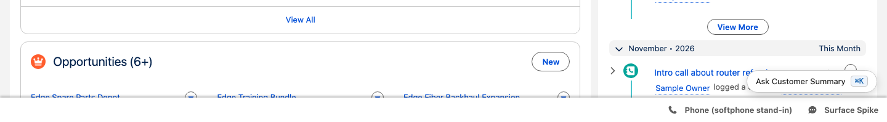
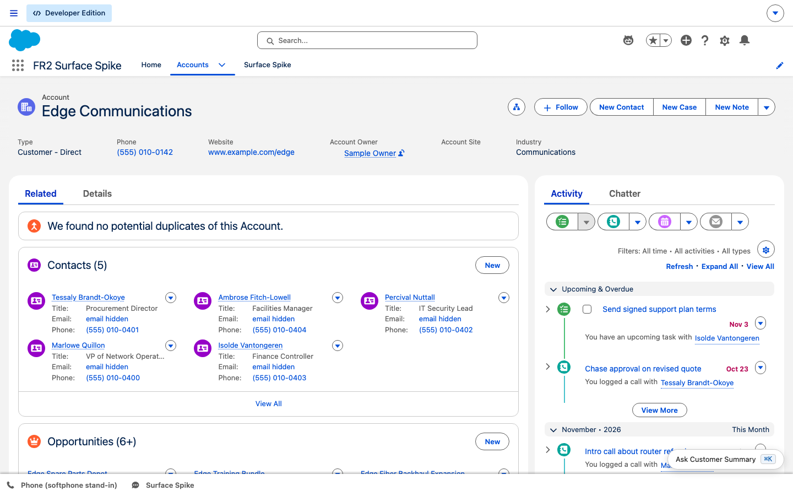
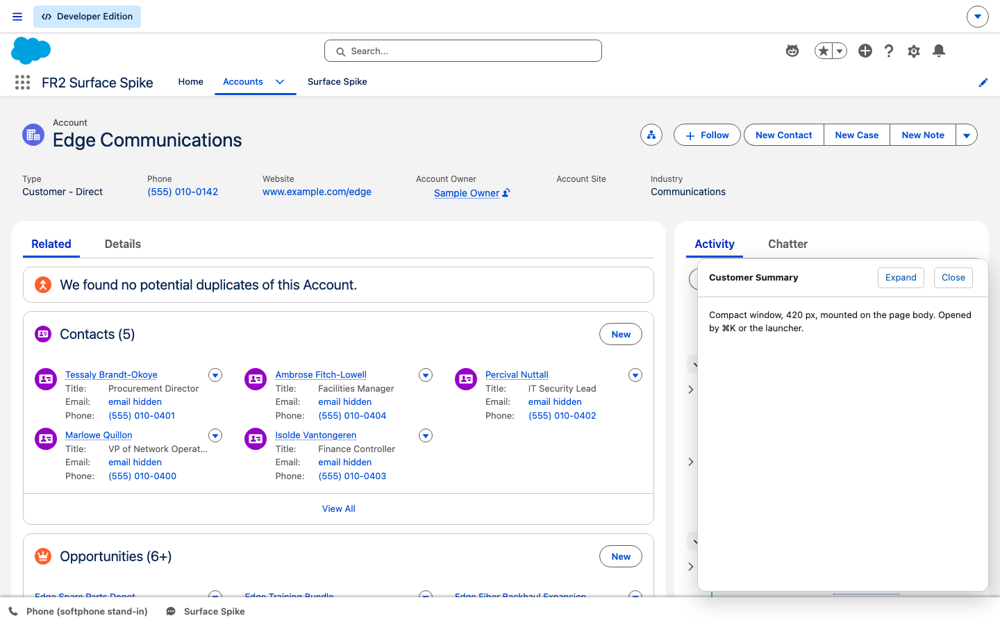
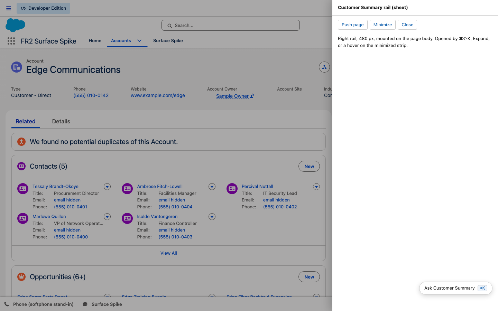
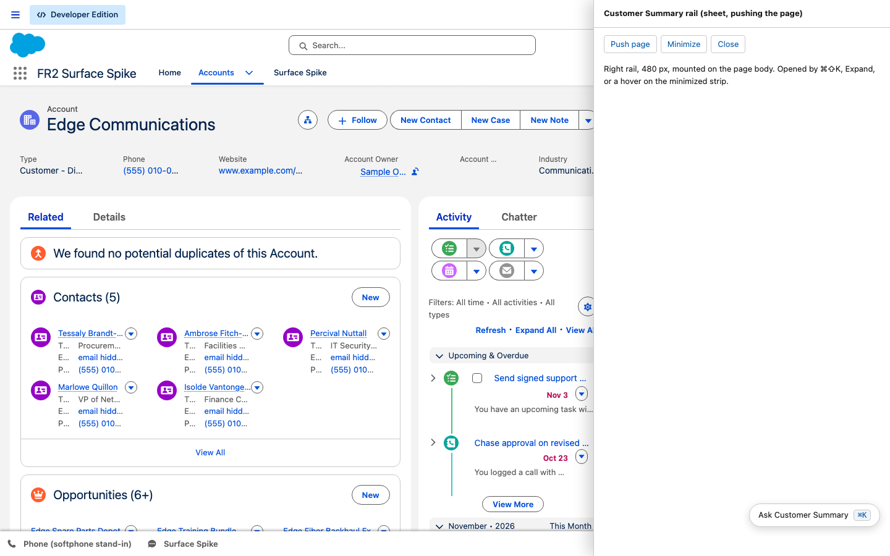
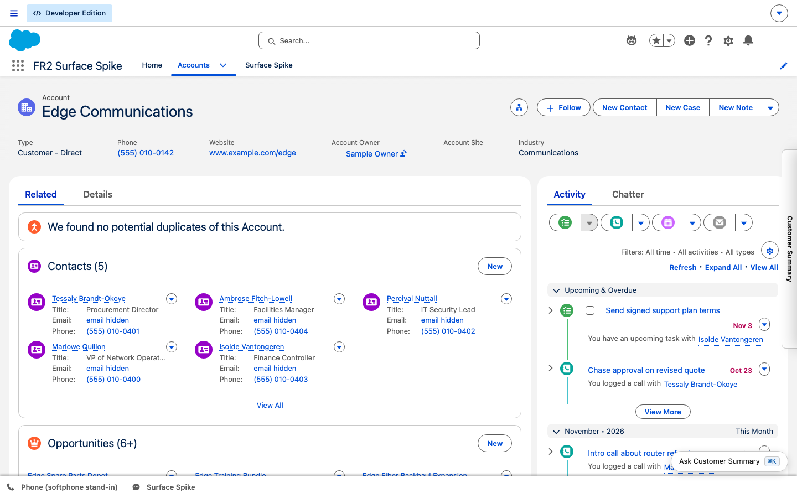
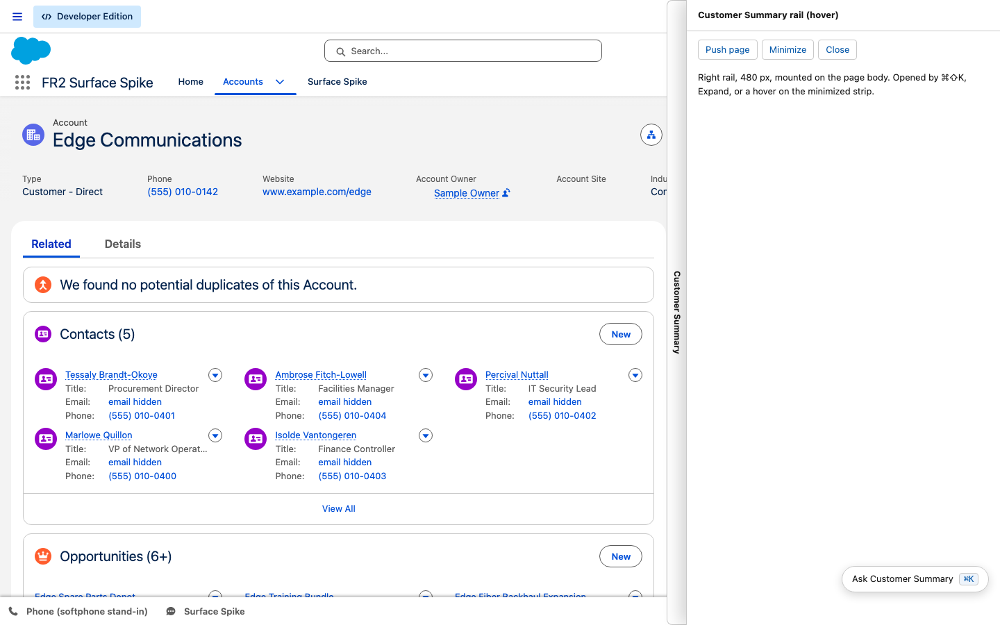
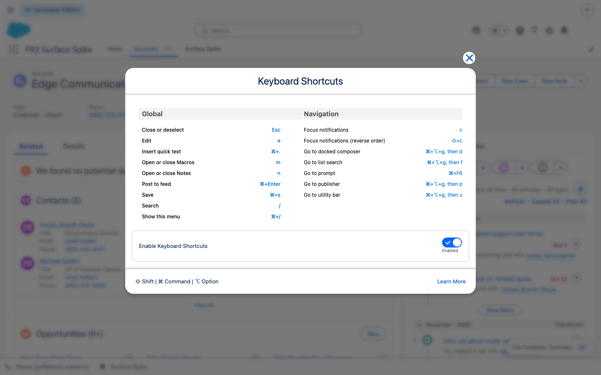
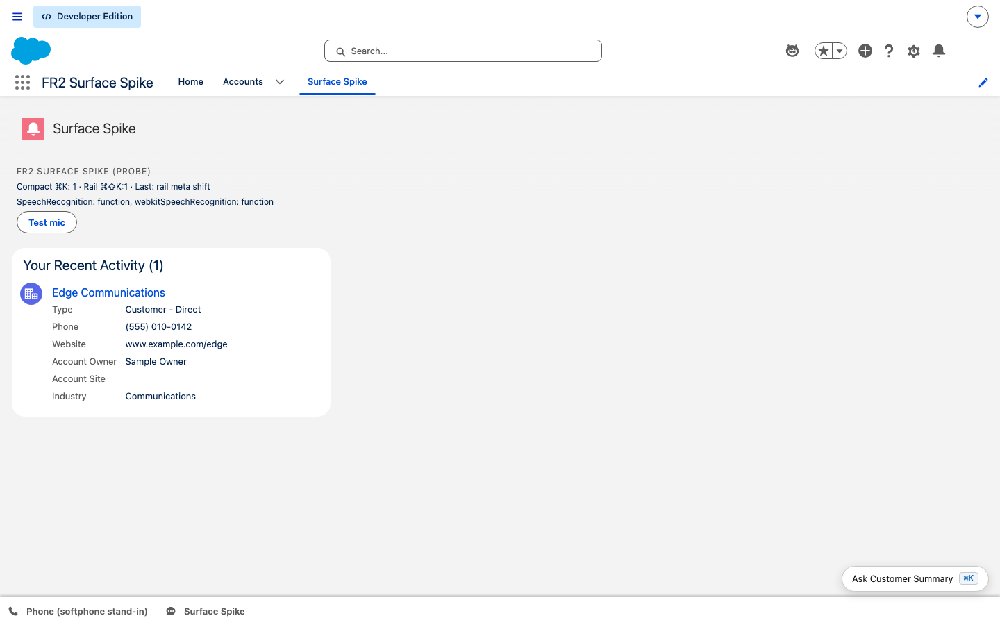

# FR2 surfaces spike: corner launcher, right rail, hotkeys and mic (OPS-29)

- Date: 2026-11-12 (US Central evening). Org `agent-probe` (API 68.0), signed in as the org's
  own admin. Playwright's bundled Chromium (headless, its default) on a Mac, viewport 1440x900.
- Code: [spikes/surface](../../spikes/surface/), a throwaway LWC `surfaceSpike` and its own app
  "FR2 Surface Spike" with its own utility bar. Nothing in `force-app` changed. The capture file is
  [07-surface-spike.capture.js](../../e2e/capture/07-surface-spike.capture.js).
- Status words: verified (seen in the org, in a capture or in a logged measurement), documented
  (a published page says so), unverified (inference).
- Evidence lines come from the capture's output (`SPIKE <name> <json>`), shortened and rounded
  where marked. Sizes are CSS pixels in a 1440x900 window.
- Read with [fr2-design.md](../plans/fr2-design.md) and
  [03-hotkey-panel.md](../patterns/03-hotkey-panel.md).

## Plain answer

- **Corner: put the launcher at the bottom right and leave the utility bar at its default, left
  alignment.** The softphone is an ordinary utility item, so it lives in the bar at the bottom
  left. A launcher mounted on the page body at bottom 48 px, right 16 px sits above the bar row on
  the far side (verified). It cannot cover the bar's items or a softphone panel opening from
  them: the items end at x=365 and the launcher starts at x=1212 (inferred from those measured
  boxes; the stand-in's panel was not opened and measured).
- **The bar can be moved to the right**, all of it, not one item: the app's utility bar setting
  "Utility Bar Alignment" (Default or Mirrored), which is `isLeftAligned=false` on the utility bar
  FlexiPage (verified). Mirroring would put the softphone under a bottom-right launcher, so it is
  not recommended.
- **Rail: build the slide-over sheet (with a backdrop), plus a minimized strip and a hover peek.**
  All three work (verified).
- **Pushing the page is not possible in a supported way.** It can be faked by restyling
  Salesforce's own `.viewport` element, and that worked in this org (the page's right edge moved
  from 1440 to 960). No published API lets a custom component do this, the markup belongs to
  Salesforce and can change in any release, so do not build on it.
- **Hotkeys: Cmd/Ctrl-K and Cmd/Ctrl-Shift-K are safe.** Cmd-K and Cmd-Shift-K reached a document
  listener on a record page, the home page and an app page on a Mac, with nothing preventing them
  first (verified). The Ctrl forms for Windows and Linux use the same listener code but were not
  pressed in this run (unverified).
  Lightning's own shortcut list has no K shortcut (verified in the org). Chrome on a Mac does not
  list either key; on Windows and Linux, Ctrl-K is Chrome's "search from anywhere", which a page
  may override (documented).
- **Mic: the API exists under LWS, but automated Chromium cannot produce a transcript.**
  `SpeechRecognition` and `webkitSpeechRecognition` are both functions inside the component.
  `start()` fires no event at all, with or without Chromium's fake media flags, and the page's
  main world behaves the same (verified). Test voice with Jest mocks plus one manual check in
  real Chrome.

## What was built

| Piece | What it does |
|---|---|
| `surfaceSpike` LWC, role `overlay`, mount `body` | Eager utility item. On load it appends one root element to `document.body` with the launcher ("Ask Customer Summary ⌘K"), the compact window (420x480), a backdrop and a 480 px right rail with a 28 px strip. A document `keydown` listener opens the compact window on Cmd/Ctrl-K and the rail on Cmd/Ctrl-Shift-K; Esc closes both. |
| `surfaceSpike` LWC, role `probe` | Only counts the hotkeys it sees and whether something else prevented them first. Used as the softphone stand-in in the bar and on the app page. Holds the mic test button. |
| `FR2_Surface_Spike_UtilityBar` | The app's own utility bar: the Open CTI Softphone item, the stand-in "Phone (softphone stand-in)", then "Surface Spike". |
| `FR2_Surface_Spike_Page`, tab `FR2_Surface_Spike` | An app page with the probe, to test the hotkeys off a record page. |
| `FR2_Surface_Spike` app, `FR2_Surface_Spike_Access` permission set | The app (standard navigation: Home, Accounts, Surface Spike) and its visibility. |

The Open CTI Softphone item deployed but draws nothing for a user without a call centre, so the
stand-in item takes its place in the bar (verified). Vendor setup guides place their softphone the
same way: one utility item, often about 200 to 340 px wide and 450 px high, loaded in the
background (documented: Genesys, Natterbox, Avaya, Fastcall setup guides).

## Corner

### What was tried

1. **A fixed launcher inside the utility item's own template.** Hidden whenever the utility panel
   is closed: Lightning sets the closed panel to `display: none`. With the panel open, the panel's
   `transform` makes it the containing block, so `position: fixed` measured as the panel's own box
   (480x299 at y=561), not the window (verified).
2. **An LWC in the utility bar's background region.** Refused at deploy: "The c:surfaceSpike
   component isn't allowed in the backgroundComponents region." (verified). The documented
   background utility item is an Aura component.
3. **Mount on the page body.** The eager utility item appends its overlay root to
   `document.body`. Lightning Web Security allowed `document.createElement`,
   `document.body.appendChild` and a `document` keydown listener (verified). The launcher showed on
   the record page, the home page and the app page, and stayed when the utility panel was closed.
   This mount is tolerated by LWS but not a documented pattern, so the build should keep it in one
   small module that is easy to replace.

### Bar alignment, measured

```
SPIKE mirrored.bar [{"label":"Phone (softphone stand-in)","left":1073,"right":1298},{"label":"Surface Spike","left":1300,"right":1438}]
SPIKE mirrored.launcher {"x":1212,"y":814.5,"width":212,"height":37.5}    (x and width rounded)
SPIKE final.bar [{"label":"Phone (softphone stand-in)","left":0,"right":225},{"label":"Surface Spike","left":227,"right":365}]
SPIKE final.portal [{"role":"overlay","portal":{"ok":true,"inBody":true,"launcher":{"left":1212,"right":1424,"top":815,"bottom":852}}}]
```

(Labels shortened: the raw text repeats each label two or three times. The `push` line in the
Rail section is trimmed to its two edge values.)

- Mirrored, the items keep their order and move to the right end of the bar, so the softphone's
  450 px panel would open under a bottom-right launcher.
- Default, the items sit at the left end; the launcher's box (1212 to 1424) is far from them.
- The bar spans the window's width either way, and only the order is set by the admin, so the
  softphone always sits with the other items (documented).





### Recommendation

Bottom right, with the bar left alone. The launcher sits 48 px above the window's bottom edge
(its bottom edge at y=852, clear of the bar) and 16 px from its right edge. For an org that mirrors its bar, the corner
should be a setting that flips the launcher to the bottom left (the spike's `corner` property);
unverified beyond the right-hand case.

## Compact window

Cmd/Ctrl-K opens a 420 px window anchored above the launcher; Esc or Close shuts it.



## Rail

Three options were built in the body-mounted rail (480 px wide, full height on the right).

| Option | Works | How | Evidence |
|---|---|---|---|
| (a) Push the page left | Only as a hack | Sets `style.right = 480px` on Salesforce's `.viewport`; header, tabs and record all reflow into 960 px | `SPIKE push {"viewportRightBefore":1440,"viewportRightAfter":960}`; minimizing restores it: `SPIKE push.afterMinimize 1440` |
| (b) Slide-over sheet with a backdrop | Yes | The rail slides in over the page; a translucent backdrop closes it on click | verified |
| (c) Minimized strip and hover peek | Yes | Minimize slides the rail out leaving a 28 px "Customer Summary" strip on the right edge; hovering the strip slides the rail back over the page without a backdrop, and leaving it slides it out again | verified |

- No published Salesforce API lets a custom LWC resize the Lightning workspace. Split view opens on
  the left, and the console's pinned regions and the "Header and Right Sidebar" template are fixed
  page regions chosen in the App Builder, not something a component can open at run time
  (documented). The utility bar's own API resizes only its own panel (`updatePanel`,
  `setPanelWidth`; documented).
- Pushing works today only because Lightning lays the page out in one absolutely positioned
  `.viewport`. That is Salesforce's private markup; any release can rename it.









**Build (b) and (c):** the sheet for Cmd/Ctrl-Shift-K and "Expand", minimize to the strip, hover to
peek. Do not build (a).

## Hotkeys

The listener matches `event.code === 'KeyK'` with no Alt; on a Mac it needs Cmd and not Ctrl,
elsewhere Ctrl and not Cmd; Shift picks the rail. `prevented` counts events that arrived with
`defaultPrevented` already set.

```
SPIKE record.keys [{"role":"overlay","compact":1,"rail":1,"prevented":0}]
SPIKE home.keys [{"role":"overlay","compact":1,"rail":1,"prevented":0}]
SPIKE apppage.keys [{"role":"probe","compact":1,"rail":1,"prevented":2},{"role":"overlay","compact":1,"rail":1,"prevented":0}]
```

- Record page, home page and app page: each key (pressed as `Meta+k` and `Meta+Shift+k` on a
  Mac) arrived exactly once at the overlay, and nothing prevented it first. On the app page the probe's two "prevented" events are the overlay's own
  `preventDefault`, since the probe's listener runs after it.
- Lightning's shortcuts (Cmd-/ on a Mac, standard navigation), read from its own dialog in the
  org: Esc, e, ⌘+., m, n, ⌘+Enter, ⌘+s, /, ⌘+/, c, ⇧+c, ⌘+F6, and ⌘+⌥+g then d, f, p or u. **No K
  shortcut.** Esc already means "close or deselect" in Lightning, which matches the panel's use.
- Chrome: the published shortcut list has no Cmd-K or Cmd-Shift-K on a Mac. On Windows and Linux,
  Ctrl-K (and Ctrl-E) is "search from anywhere on the page", a normal accelerator that a page can
  `preventDefault`; Ctrl-Shift-K is not listed. Chromium's keys that a page can never take are
  Ctrl/Cmd-N, T and W and their Shift forms (documented).
- Limit: Playwright delivers key presses to the page, past Chrome's own accelerators, so "not
  reserved" rests on the published lists. One manual press in real Chrome on each platform before
  release closes that gap.





(The app page's opportunity list card is hidden in this still because it shows an owner alias.)

## Launcher

"Ask Customer Summary" with a ⌘K key cap (Ctrl K elsewhere) at the bottom right, on every page of
the app (record, home, app page; verified). Hidden until pressed, read as the agent being hidden
until the seller presses the key or the button (F25 in
[feature-revision-2.md](../plans/feature-revision-2.md)): only the launcher shows at first; the
compact window appears on Cmd-K and is gone again after Esc, and the rail appears on Cmd-Shift-K
(verified: the capture asserts the compact window visible after Cmd-K and hidden after Esc,
and the rail's backdrop visible after Cmd-Shift-K; the stills are the launcher, compact and
rail-sheet ones above).

## Mic

```
SPIKE mic.plain {"standard":"function","webkit":"function","mediaDevices":"object","events":[{"name":"start-called"}]}
SPIKE mic.fake {"standard":"function","webkit":"function","mediaDevices":"object","events":[{"name":"start-called"}]}
SPIKE mic.mainworld.plain ["start-called"]
SPIKE mic.mainworld.fake ["start-called"]
```

- Under LWS, `window.SpeechRecognition` and `window.webkitSpeechRecognition` both exist and
  construct; `navigator.mediaDevices` exists.
- `start()` did not throw and fired nothing in 20 s: no `start`, `audiostart`, `error`, `result`
  or `end`. The same happened with `--use-fake-ui-for-media-stream`,
  `--use-fake-device-for-media-stream` and the microphone permission granted, and in the page's
  main world outside LWS. Chromium's recognizer needs Google's speech service, which the test
  browser does not have, so this is a browser limit, not LWS (unverified as to the exact cause).
- Plan: unit-test the voice states with a mocked recognizer in Jest; check the real transcript by
  hand in Chrome once per release.

## Deploys

The org classifies as production, so every deploy was a validate with `RunLocalTests`, then a
quick deploy of that validation.

| Step | Result |
|---|---|
| Validate, first version (LWC in the background region) | Failed: LWC not allowed in `backgroundComponents` |
| Validate and quick deploy, mirrored bar with the Open CTI item | Passed, 260 tests, 0 failures |
| Validate and quick deploy, body mount and the softphone stand-in, mirrored bar | Passed, 260 tests, 0 failures |
| Validate and quick deploy, final, default (left) bar alignment | Passed, 260 tests, 0 failures |

Commands: `sf project deploy validate --source-dir spikes/surface --test-level RunLocalTests -o
agent-probe`, then `CONFIRM_PROD=1 sf project deploy quick --job-id <validation id> -o
agent-probe`.

The admin needed the app's permission set to see it: `FR2_Surface_Spike_Access` was assigned to
the signed-in admin only. No other user was touched.

## Sources

- Salesforce Help, "Utility Bar Alignment" in the Lightning App Builder's app settings (Default
  or Mirrored); confirmed by
  [applicationperfection.com](https://applicationperfection.com/2024/04/19/choose-your-utility-bar-alignment/)
  and [Apex Hours](https://www.apexhours.com/customizing-the-utility-bar-for-admins-in-salesforce/).
- [FlexiPage metadata type](https://developer.salesforce.com/docs/atlas.en-us.api_meta.meta/api_meta/meta_flexipage.htm).
- [Lightning Console JavaScript API: utility bar](https://developer.salesforce.com/docs/atlas.en-us.api_console.meta/api_console/sforce_api_console_js_lex_intro.htm),
  [updatePanel](https://developer.salesforce.com/docs/atlas.en-us.api_console.meta/api_console/sforce_api_console_lwc_updatePanel.htm),
  [utility pop-out](https://developer.salesforce.com/docs/atlas.en-us.api_console.meta/api_console/sforce_api_console_lightning_utility_popout.htm).
- Lightning Aura Components Developer Guide, "Background utility items" (an Aura interface).
- [Open CTI setSoftphonePanelWidth](https://developer.salesforce.com/docs/service/api-cti/guide/sforce-api-cti-setsoftphonepanelwidth-lex.html);
  softphone setup:
  [Genesys](https://help.genesys.com/pureconnect/mergedprojects/wh_tr/mergedprojects/wh_tr_salesforce_int/desktop/enable_the_open_cti_softphone.htm),
  [Natterbox](https://docs.natterbox.com/docs/how-do-i-add-the-cti-to-a-lightning-app-in-the-utility-bar),
  [Fastcall](https://fastcall.com/training/setup-guide/setup/add-fastcall-to-the-utility-bar-in-salesforce/).
- [LWS distortion viewer](https://developer.salesforce.com/docs/platform/lwc/guide/security-lwsec-tools-distortion-viewer.html).
- [Chrome keyboard shortcuts](https://support.google.com/chrome/answer/157179);
  [Chromium browser keys](https://www.chromium.org/developers/design-documents/extensions/proposed-changes/apis-under-development/browser-keys/).
- [SpeechRecognition (MDN)](https://developer.mozilla.org/en-US/docs/Web/API/SpeechRecognition).

## Undo

The spike is left deployed in `agent-probe`. Removing it is Ben's call.

- Metadata to remove with a destructive deploy (validate first, as for any deploy):
  - CustomApplication `FR2_Surface_Spike`
  - FlexiPage `FR2_Surface_Spike_UtilityBar` and `FR2_Surface_Spike_Page`
  - CustomTab `FR2_Surface_Spike`
  - LightningComponentBundle `surfaceSpike`
  - PermissionSet `FR2_Surface_Spike_Access`
- Before that, remove the one assignment (to the signed-in admin). Either in Setup, on that user's
  Permission Set Assignments, or with the CLI: find it with
  `sf data query --query "SELECT Id FROM PermissionSetAssignment WHERE PermissionSet.Name = 'FR2_Surface_Spike_Access'" -o agent-probe`,
  then `sf data delete record --sobject PermissionSetAssignment --record-id <assignment id> -o agent-probe`.
- Local only: the OPS-29 worktree has `target-org` set to `agent-probe` in its own `.sf/config.json`
  (git-ignored), so the deploy gate would accept the validate commands. The main checkout is
  unchanged.
- Repo: delete `spikes/surface/`, `e2e/capture/07-surface-spike.capture.js`, the nine
  `docs/assets/fr2-spike-*.png` files and their rows in
  [MANIFEST.md](../assets/MANIFEST.md).
